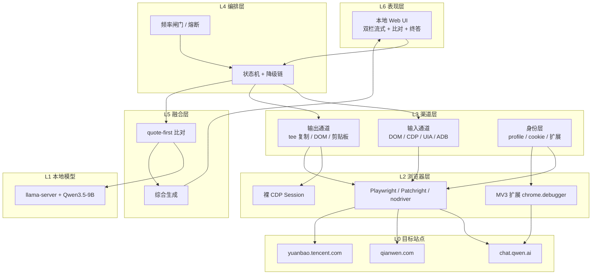
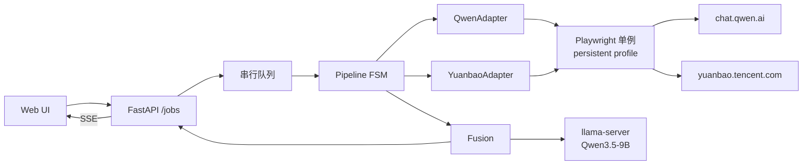
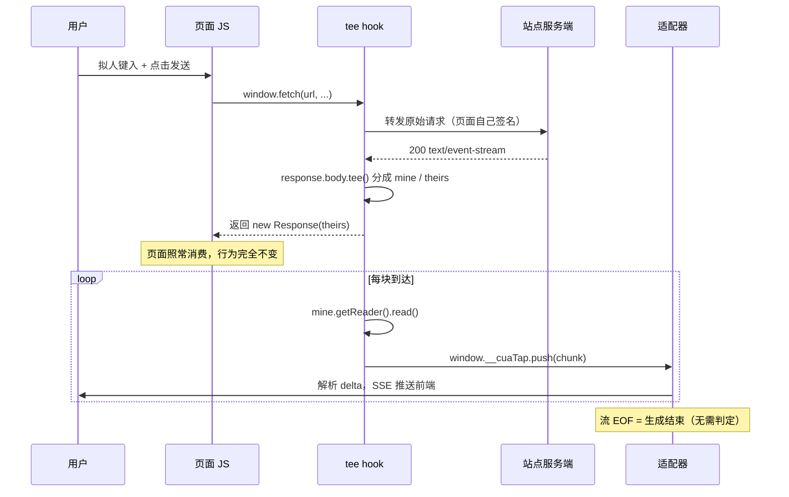
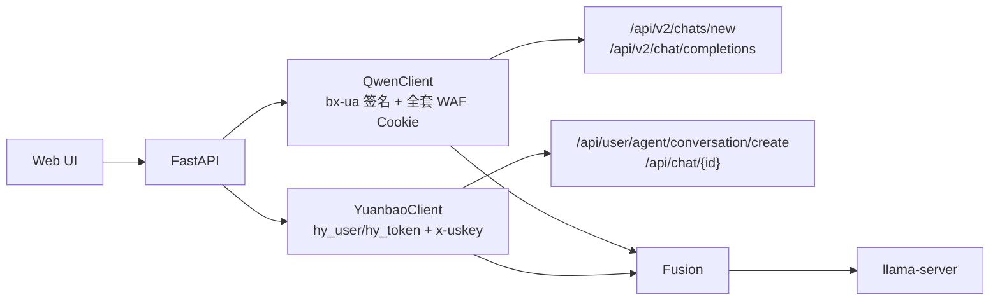
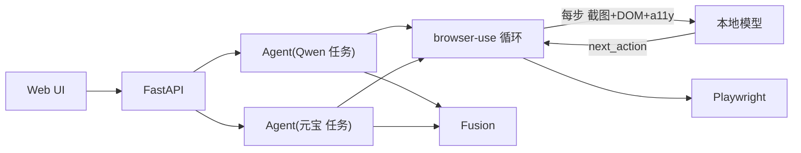
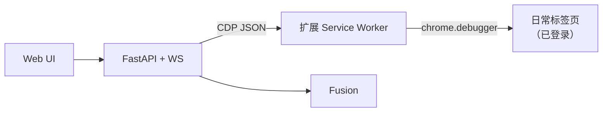
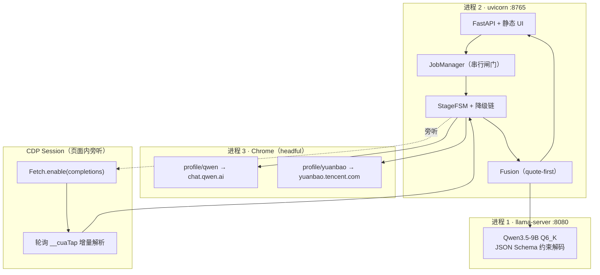
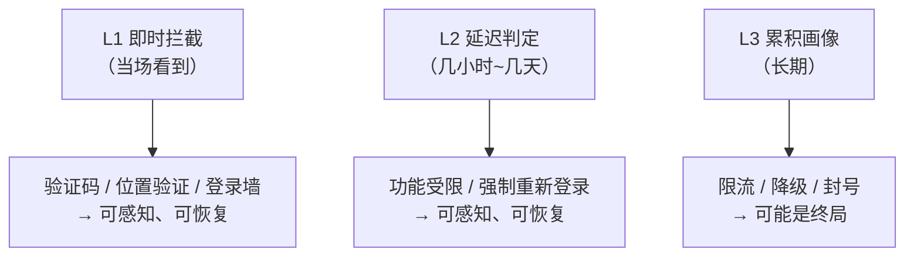

# 本地 Agent 驱动双网页大模型交叉验证系统 —— 技术调研与设计方案

> 版本：v2.0　编写日期：2026-11-04　目标读者：实现者本人（单人可落地）
>
> **前提声明**：本系统为个人私下使用，不对外提供服务、不商用。因此本文**不讨论**服务条款、隐私、版权等合规议题，只保留一个真实且不可回避的约束——**账号被封**。全文所有选型都以「主号不能丢」为第一优先级。
>
> **v2.0 修订说明**：v1.0 推荐"CDP `takeResponseBodyAsStream` 截流"，但 **E2b 实测证明该方案会让页面永久卡死、且无法放行**（详见 [e2b/REPORT.markdown](e2b/REPORT.markdown)）。v2.0 将主路径改为**页面内 `ReadableStream.tee()` hook**，并重画了架构、降级链与评分。实验结论与失败细节见 §6.6。

---

## 0. 结论速览

### 0.1 一句话结论

这套系统的本质不是「让 Agent 学会上网」，而是**「给两个闭源网页产品造一条稳定的输入/输出管道，再把两段文本做可验证的比对」**。工程量的 85% 花在「管道」上，而管道的关键不在「怎么点」，在**「怎么把回答完整、无噪声、低延迟地取出来」**。

因此本方案的推荐主干是：

> **真实 UI 操作（输入/提交）+ 页面内 `ReadableStream.tee()` 复制响应流（读取回答）** —— 即方案 B。
>
> 请求由页面自己发出：加密、签名、Cookie、风控参数全部由页面生成，你不伪造任何东西。区别只在于——**在页面拿到数据的同时，你在浏览器内部复制了一份**。

**这里有一个必须讲清的教训**：我最初选的是 CDP `Fetch.takeResponseBodyAsStream`，理由听起来完全一样——"不伪造请求，只是旁听"。但 E2b 实测证明它不是旁听，是**抢夺**：一旦取流，页面就再也拿不到这份响应，且 `continueRequest` / `continueResponse` 全部报错，页面会**永久卡在生成态、第二轮提问也无法完成**。

真正的"旁听"只有一种做法：`tee()`。它把响应体复制成两路，一路还给页面、一路给自己，页面完全无感。

> **一句话判据：`Fetch` 是夺，`tee` 才是抄。**

### 0.2 一页决策表

| 决策点 | 结论 | 与直觉的差异 |
| :-- | :-- | :-- |
| 系统定位 | 固定管道 + 语义融合，**不是**开放式网页 Agent | 与「browser-use 一把梭」相反 |
| 输入通道 | 真实 DOM 键入 + 点击（headful 系统 Chrome） | 常规做法 |
| **输出通道** | **页面内 `ReadableStream.tee()` 复制响应流**，DOM 轮询作降级 | **反直觉：这是最大的收益点** |
| ~~CDP `Fetch` 截流~~ | **实测不可用**：取流后页面永久卡死，无法放行 | **反直觉：它看起来最优雅** |
| 私有接口直连 | **不做主路径**，只做实验 | **反直觉：对主号它比 UI 自动化更危险** |
| 浏览器驱动 | Playwright + `channel="chrome"`，可选换 Patchright | headful 的收益 > 任何 stealth 补丁 |
| 登录态 | 专用持久化 profile，首次人工扫码 | Chrome 136+ 已封死「接管日常 profile」 |
| 本地模型 | Qwen3.5-9B Q6_K（12–16GB 档） | 只做比对与综合，绝不做浏览器决策 |
| 比对设计 | **quote-first**（先逐字引文，再由代码对齐） | 小模型给"结论"不可信，给"引文"可信 |
| 融合范式 | compare-then-synthesize，**不是 MoA** | 你的需求是"验证"，不是"刷榜" |
| 并发 | 两站点**并行提交**，模型串行 | 并行不增加单站频率，风险几乎不涨 |
| 最脆弱环节 | **元宝**（有实测封号报告 + 位置验证 + 图形验证码） | 必须预留替代腿 |

### 0.3 六个候选方案与排序

> v2.0 重算：因为"CDP 截流"被证伪，方案 B 的技术内涵改为 tee hook（实现更简单、无页面副作用），分数相应上调；同时对"侵入性"扣分。

| 方案 | 一句话 | 加权分（封号权重最高） | 结论 |
| :-- | :-- | :-- | :-- |
| **A** 纯 DOM 流水线 | 输入靠选择器、输出靠轮询 `innerText` | 3.40 | 可用但脆弱，作为降级层 |
| **B** DOM 驱动 + tee 复制流 | 输入靠 DOM、输出靠 `tee()` 复制页面响应 | **4.30** | **推荐主干** |
| **C** 私有 API 直连 | 自己签名、自己发请求 | 2.50 | 实验用，不做主路径 |
| **D** 通用 Agent 框架 | browser-use / Stagehand / MCP 直驱 | 3.15 | 不适合固定流程 |
| **E** 扩展桥（正交变体） | 日常 Chrome 装扩展，零重登 | 3.50 | 登录态备选 |
| **F** 非浏览器通道（正交变体） | Android App / 桌面客户端 / 官方 API | 3.30 | 逃生路线 + 兜底腿 |
| ~~B'~~ | ~~CDP `Fetch` 取流~~ | ~~3.50~~ → **2.33** | **实测不可用（页面卡死）**，计入产品可用性后出局 |

> B' 的 3.50 是「纸面分」（只看数据完整性、延迟等），2.33 是「计入产品可用性后」的实际分。两者差距说明了 §5.7.4b 的论点：**打分表能选出"数据完整"的方案，但选不出"产品能用"的方案**。

### 0.4 目标延迟（方案 B，两站并行）

| 指标 | p50 | p95 | 说明 |
| :-- | :-- | :-- | :-- |
| 提交→首字（单站） | 3.5s | 9s | 拟人键入 2.8s + 首 token 0.7s |
| 首字→单站完成 | 12s | 45s | 取决于站点自身出词速度 |
| 两站并行完成 | 16s | 54s | 最大值取两站中较慢的一侧 |
| 比对 | 3s | 9s | 9B，输出约 400 token |
| **终答首字** | **≈20s** | **≈69s** | 用户真正感知的延迟 |
| **端到端完成** | **≈30s** | **≈91s** | 相比纯 DOM 方案省 5–10s，且**不截断** |

---

## 1. 需求再分析

### 1.1 八步拆解为「本质动作」

| 步骤 | 表层描述 | 本质动作 | 我的实现分类 | 真正的难点 |
| :-- | :-- | :-- | :-- | :-- |
| 1 | UI 输入问题 | 收字符串 | 表单 | 无 |
| 2 | 本地模型操作浏览器 | 进程内驱动 | 进程编排 | 无（不是难点） |
| 3 | 发给 Qwen 网页版 | 定位输入框→写入→提交 | **输入通道** | 富文本/受控组件、发送按钮时序 |
| 4 | 拿到 Qwen 回复 | 判定起止→抽全文 | **输出通道** | **结束判定（头号风险）** |
| 5 | 发给元宝网页版 | 同上换站点 | **输入通道** | 同上 + 风控更严 |
| 6 | 拿到元宝回复 | 同上换站点 | **输出通道** | 同上 + 状态噪声更多 |
| 7 | 比对相同点/不同点 | 结构化语义分析 | 融合层 | 小模型幻觉、判官偏差 |
| 8 | 综合答复显示 | 长文本生成+流式 | 融合层 + UI | 模型爱写"两方各说" |

**读表得出的第一个结论**：步骤 2 是**伪工作**。用户写「本地大模型 Agent 操作本地浏览器」，隐含假设是「大模型要负责操作」。但步骤 3–6 的目标元素、动作序列、结束条件在写代码时**已经完全确定**，让模型逐步决策只会引入不确定性。

这不意味着不需要模型——而是要把模型从「司机」换成「校对员」：**代码开车，模型只在两处下车：比对、综合。**

### 1.2 三条反直觉的判断

#### 判断一：输出通道比输入通道重要一个数量级

输入出错的表现是**立即失败**（找不到输入框、按钮点不动），你能立刻看见、立刻修。
输出出错的表现是**静默错误**——答案被截断了一半，但格式完好、读起来通顺，你根本不知道。这是最恶劣的失败模式：**错的答案比没有答案更危险**。

调研数据支持这一点：真实 web agent 的失败审计里，「过早给出答案」占 12.7%、「滚动震荡」占 31.4%——全都是"看起来完成了"的错误。

**所以本方案把 70% 的设计精力放在输出通道上**，包括：为什么可以用 CDP 抄 SSE、抄不到时怎么降级、降级后怎么保证不截断。

#### 判断二：对「只有一个主号」的人，逆向私有接口比模拟点击更危险

直觉是反的：逆向接口「更底层、更快、更稳」，所以更"高级"。但真实风险结构是：

| | 模拟点击（UI 自动化） | 逆向私有接口 |
| :-- | :-- | :-- |
| 请求是谁发的 | **页面自己发的** | 你的脚本发的 |
| WAF 签名（bx-ua 等） | 页面自己算，天然正确 | 你要复刻算法，一旦算法变就露馅 |
| Cookie 状态 | 页面自己维护，天然一致 | 你复制粘贴，容易过期/不完整 |
| 动态头（x-uskey） | 页面自己刷新 | 你要拦截或复刻，复刻几乎必错 |
| 服务端看到的指纹 | **一个正常人的浏览器** | 一个"完美但可疑"的客户端 |
| 失败表现 | 元素找不到（可见） | 静默 401 / 位置验证 / 直接封号 |

实测证据：开源项目 `yuanbao-free-api` 的 issue 区里，有人报告**第一次调用正常、第二次直接封号**，根因正是 `x-uskey` 是动态的而项目把它缓存复用了；另一位维护者明确说"每次请求参数都不一样，通过浏览器自动化方式自动获取认证参数"。而 Qwen 侧从 2026 年起 `/api/v2` 被阿里 baxia WAF 覆盖，需要每请求用 `performance.now()` 签名的 `bx-ua` + 全套 WAF Cookie（`acw_tc` / `cna` / `tfstk` / `isg` / `ssxmod_itna` / `x5sec`），纯 HTTP 客户端会直接吃 JS 挑战或拼图验证码。

**结论**：私有接口这条路，本质是「你在跟一个持续升级的 WAF 做军备竞赛，而赌注是你的主号」。它适合做**实验**，不适合做**主路径**。

> 但有一条中间路线是甜点：**让页面替你发请求，你去抄它收到的响应**。这就是方案 B。它拿走了逆向接口 90% 的好处（结构化、逐 token、明确结束），却几乎不承担它的风险（因为你没伪造任何东西）。

#### 判断三：这不是 MoA，别按 MoA 设计

Mixture-of-Agents 的论文结论很诱人（用开源模型叠到 AlpacaEval 65.1%，超过 GPT-4o 的 57.5%）。但 2026 年 TMLR 的一篇复现研究给出了相反证据：**Self-MoA**（只用同一个最强模型采样多次再聚合）比标准 MoA（混合不同模型）平均高 3.8%，在 AlpacaEval 上高 6.6%，原因是「混合不同模型往往拉低了平均质量」。

这说明：**当目标是"最大化质量"时，异构混合未必划算；当目标是"交叉验证 / 发现分歧"时，异构才是必需的。**

你的需求（列出相同点与不同点、再综合）**本质是验证与多样性需求**，不是刷榜需求。所以：

- 不要做「多层 MoA 迭代聚合」（延迟翻倍，收益不明）；
- 要做「**一次比对 + 一次综合**」，并且比对的产物要**可核查**（见 §6.9 的 quote-first 设计）。

### 1.3 隐含需求（用户没说但必须满足）

1. **每条 query 必须开新会话**。否则 Qwen/元宝的上下文累积会让"同题对比"失真。
2. **两侧的「联网搜索 / 深度思考」开关必须归一化**。元宝默认可能开联网搜索，Qwen 可能默认开思考——两侧走的推理路径不同，答案就不可比。开关状态必须记录进结果。
3. **必须能部分成功**。元宝挂了不能拖垮整单；应降级为"仅 Qwen 单侧 + 明确标注"。
4. **必须能只重跑一侧**。用户看到"元宝超时"，应该只重跑元宝。
5. **必须能识别登录失效**。扫码态会过期，要主动探测并给出"打开登录窗口"按钮，而不是报个莫名超时。
6. **失败现场必须留存**。截图 + HTML + URL + 时间线，否则改版后无法排查。
7. **不能污染日常浏览**。自动化浏览器必须与日常 Chrome 隔离（标签页误关、窗口抢占、profile 锁）。
8. **首次登录必须可交互**。扫码无法自动化，必须有打开有头窗口让人接管的入口。
9. **必须能看见它在干什么**。有头运行 + 时间线，是调试期唯一可靠的排查手段，也是降低风控的现实手段。

### 1.4 已确认的约束

| 约束 | 取值 | 对设计的硬影响 |
| :-- | :-- | :-- |
| 部署 | **Windows 桌面本机** | 有 GUI 会话；可用系统 Chrome；可用 UIA 操作桌面客户端 |
| 显存 | **12–16GB NVIDIA** | 排 27B（Q4 需约 16.7GB 权重，塞不下 KV）；只能 8–9B；文本模型与视觉模型不能同时常驻 |
| UI | **本地 Web 应用** | FastAPI + SSE + 浏览器打开 localhost；天然适配"两路并发流式" |
| 技术底线 | **全开** | 逆向接口、拦截 SSE、改指纹、装扩展、Android/桌面自动化 —— 全部纳入候选 |
| 账号 | **仅一个主号，封了很麻烦** | **封号风险必须是最重的评分维度**；不能多号轮换、不能高频、不能激进 |
| 合规 | 不考虑 | 不写"合规章节"，但**封号**是技术风险，必须专章处理（§7） |

### 1.5 唯一真实红线：把「封号风险」量化

用户说"不用考虑太多，但要考虑封号"。这句话需要工程化，否则会变成一句空话。我的量化方式是把风险拆成**可观测因子**：

| 因子 | 权重 | 平台怎么观测 | 我们能控制吗 |
| :-- | :-- | :-- | :-- |
| 行为指纹（键入节奏、鼠标轨迹、滚动方式） | **最高** | 前端埋点采集 `mousemove`/`keydown` 时序，服务端做统计判定 | 能（拟人化输入） |
| 请求频率与规律性 | 高 | 请求间隔分布、每日调用量、并发数 | 能（令牌桶 + 抖动 + 日上限） |
| 会话与设备一致性 | 高 | Cookie/设备指纹/IP/时区的稳定性 | 能（固定 profile，不换 IP） |
| 认证参数是否合法 | 高 | 动态签名、动态头、WAF Cookie | 能（不伪造，让页面自己生成） |
| 浏览器自动化痕迹 | 中 | `navigator.webdriver`、CDP 侧信道 | 能（headful + 系统 Chrome） |
| 内容本身 | 低（对你而言） | 内容审核 | 与本次设计无关 |

**关键实证（2026 年 5 月，31 个 Cloudflare 目标、651 次判定）**：

| 工具 | 通过 | 被拦 | 引擎 |
| :-- | :-- | :-- | :-- |
| nodriver | 28 | 0 | 系统 Chrome 148 |
| CloakBrowser | 26 | 2 | Chromium 145 |
| Patchright | 25 | 3 | 系统 Chrome 148 |
| Camoufox | 25 | 3 | Firefox 135 beta |
| 原生 Playwright | 24 | 5 | Chromium 147 |
| rebrowser-patches | 24 | 5 | Chromium 136 |

**关键实证（2026 年 10 月）**：原生 Playwright 在两个网络环境下、每一轮 headful 测试都被判定为 bot；Patchright / nodriver / Zendriver / Camoufox 在**headful** 模式下零命中。但同一个工具**切到 headless 立刻被命中**——「headless 比 IP 影响更大」。

**关键实证（FP-Agent，2026）**：浏览器指纹在多 agent 共用时区分度有限，但**行为指纹极强**——它能检出全部 7 个被测 agent，而 Cloudflare 只检出 1 个。被记录的具体特征包括：粘贴式输入 vs 逐字键入、一次性 change 事件填表、反复删了重打、**鼠标瞬移到目标点而无连续轨迹**、滚动是一次性跳跃。

这三组数据直接决定了 §7 的全部对策：**headful + 系统 Chrome + 拟人化输入**，比任何 stealth 补丁都重要；而"改指纹"是收益最低的一档。

### 1.6 非目标

- 不做多用户 / 多账号池 / 压测（并发度 = 1，主号唯一）。
- 不做通用"任意网站 Agent"：只支持注册进适配器表的站点。
- 不做模型微调（第一版）。
- 不做云端部署与远程浏览器。
- 不绕过图形验证码：遇到即**停机待人工**（不是技术做不到，是性价比太低且极易触发风控）。
- 不追求"零延迟"：瓶颈在站点自身出词速度，不在我们这里。

---

## 2. 问题重述：这是「渠道问题」，不是「Agent 问题」

### 2.1 三次抽象

把需求抽象三次，才能看清真正的设计空间：

```text
第 1 次抽象（用户表述）：
  Agent 操作浏览器 → 问 Qwen → 读回答 → 问元宝 → 读回答 → 比对 → 综合

第 2 次抽象（工程视角）：
  一个 request/response 管道 × 2 个后端 + 一个融合函数
  Pipeline(site) : Question → Answer
  Fuse(a, b)     : (Answer, Answer) → (Diff, Synthesis)

第 3 次抽象（设计视角）：
  渠道（Channel）选择问题
  Channel = ⟨输入方式, 输出方式, 会话策略, 身份策略, 成本, 风险⟩
```

**第 3 次抽象才是关键**。因为「输入方式」和「输出方式」可以**独立选择**——这是绝大多数方案文档漏掉的一点。它们往往把「用 Playwright」当成一个整体决策，实际上：

- 输入可以用 DOM 键入，输出用 CDP 抄 SSE（方案 B）；
- 输入可以用 DOM 键入，输出用 DOM 轮询（方案 A）；
- 输入输出都不用 DOM，直接打私有接口（方案 C）；
- 输入可以用 Android 无障碍服务，输出读 App 的 UI 树（方案 F）。

**输入/输出解耦后，方案空间从 3 个变成 4×6 = 24 个组合**，然后我们按「封号风险 × 稳定性」剪枝到 6 个值得写的方案。

### 2.2 渠道六元组

每个渠道用六个属性刻画（后面所有对比都基于它）：

| 属性 | 取值示例 | 影响 |
| :-- | :-- | :-- |
| **输入方式** | DOM 键入 / CDP Input / UIA / ADB tap / HTTP POST | 决定"输入是否会被判为机器人" |
| **输出方式** | DOM 轮询 / a11y 树 / **tee 复制流** / 私有接口 SSE / 剪贴板 / 截图 VLM | **决定"回答是否完整、延迟多低"** |
| **会话策略** | 每次新会话 / 复用会话 / 多轮续聊 | 决定可比性与上下文污染 |
| **身份策略** | 专用 profile / 日常 profile / 复制 profile / Cookie 复用 | 决定"看起来像不像同一个人" |
| **成本** | 0（订阅内）/ 按 token | 决定能否长期跑 |
| **风险** | 极低 / 低 / 中 / 高 | **单主号场景下的第一优先级** |

### 2.3 为什么「输出方式」值得单列一章

因为它是唯一一个**能把"不确定性"变成"确定性"**的选择点。

| 输出方式 | 是否逐 token | 结束信号 | 需要判"生成完了吗" | 失败模式 |
| :-- | :-- | :-- | :-- | :-- |
| DOM 轮询 `innerText` | 伪流式（靠 diff 猜） | 无，靠启发式 | **需要（最难）** | **静默截断** |
| a11y 树快照 | 否 | 无 | 需要 | 截断 + token 贵 |
| **tee 复制流** | **是** | **有（流关闭 / `stopReason`）** | **不需要** | 注入失败（可回退） |
| 私有接口 SSE | 是 | 有 | 不需要 | 签名失效（高风险） |
| 剪贴板（点"复制"） | 否 | 有（按钮出现即完成） | 不需要 | 只能拿全量、无流式 |

**这一张表就是整篇文档的技术核心**：把输出方式从"猜"换成"抄"，头号风险直接消失。

---

## 3. 技术全景

### 3.1 分层地图



### 3.2 浏览器控制层

#### 3.2.1 候选与实测对比

| 方案 | 语言 | 反检测（2026-05 基准） | API 完整度 | 登录态复用 | 维护状态 | 评价 |
| :-- | :-- | :-- | :-- | :-- | :-- | :-- |
| **原生 Playwright** | Py/TS | 24/31（5 被拦） | **最全**（auto-wait、trace、codegen、a11y） | 持久化 context / CDP | 活跃 | API 最好，痕迹最多 |
| **Patchright** | Py/TS | 25/31 | 与 Playwright 同 API（drop-in） | 同 | 活跃（跟踪上游） | **最佳平衡**：换一行 import |
| **nodriver** | Py | **28/31（0 被拦）** | 自制 API，无 auto-wait / 无 trace | 支持接管已开 Chrome | 活跃 | 最强反检测，工程体验最差 |
| Camoufox | Py | 25/31 | 自制 API | 支持 | 活跃 | 换 Firefox 引擎，页面行为可能不同 |
| Pydoll | Py | 未见同口径数据 | 自制 API，自带 humanize | 支持 | 活跃 | 内置拟人化，值得关注 |
| Selenium 4 | Py/Java | 差（`navigator.webdriver` 默认真） | 中（等待要手写） | `--user-data-dir` | 成熟 | 无优势 |
| 裸 CDP（websocket） | 任意 | 好 | 全手写 | 支持 | — | 只在需要 `Fetch` 域时用 |
| MV3 扩展 `chrome.debugger` | TS | **最好（就是真浏览器）** | 受限（SW 休眠、`chrome://` 不可控） | **可直接用日常 profile** | 需自维护 | 见方案 E |

**关键洞察一（来自基准报告原文）**：

> 「在系统 Chrome 上运行（`channel="chrome"`）带来的改善，比打补丁更大。」
> 「nodriver 的优势来源于**根本没有 Playwright 这一层**，而不是某个具体补丁。」

**关键洞察二（同样重要）**：

> 「headless 模式比 IP 影响更大。Patchright 和 nodriver 在 headless 下会被标记的页面，在 headful 下零命中。」

所以选择顺序是：

```text
1. 必须 headful（收益最大，成本为零）
2. 必须用系统 Chrome 而非 bundled Chromium（收益第二）
3. 必须用有历史的持久化 profile（收益第三）
4. 然后才考虑 Patchright（换 import，收益第四）
5. 最后才考虑 nodriver / Camoufox（收益高但工程代价大）
```

**我的选择：Playwright（`channel="chrome"`, `headless=False`）+ 持久化 profile**，并把驱动层做成可替换（`BrowserBackend` 协议），遇到风控收紧可一行切 Patchright。

理由补充：Playwright 的 **trace viewer** 在应对"改版后选择器失效"时价值极高——能回放点击、快照、网络。nodriver 没有这些，排查成本会翻倍。对一个单人维护的项目，**可调试性 > 3 个百分点的通过率**。

#### 3.2.2 登录态接管：Chrome 136+ 之后的三条路

事实（已核对 2026-11 现状）：

- **Chrome 136+ 起，对「默认 user-data-dir」忽略 `--remote-debugging-port`**，不报错，端口就是不监听。官方理由是防恶意软件窃取 Cookie。
- **Chrome 144+ 提供 `chrome://inspect/#remote-debugging` 开关**，可在已运行的日常 profile 上开调试服务。但：端口随机、`/json/version` 返回 404、页面级 socket 返回 403、**每次连接都要用户点「允许」**。对无人值守流程不友好。
- Playwright `connect_over_cdp` 必须用 `browser.contexts[0]`；`new_context()` 得到的是空白上下文（这是最常见的踩坑）。

三条可行路径：

| 路径 | 做法 | 登录成本 | 隔离性 | 稳定性 | 风险 | 适用 |
| :-- | :-- | :-- | :-- | :-- | :-- | :-- |
| **P1 专用持久化 profile** | `launch_persistent_context(user_data_dir="profiles/qwen", channel="chrome", headless=False)` | 一次扫码 | **完全隔离** | 高 | 低 | **默认** |
| P2 复制日常 profile | 复制 `User Data` 到新目录再开 | 零（但部分站点 device-bound 会话会失效） | 隔离 | 中 | 中 | 迁移期妥协 |
| P3 浏览器扩展桥 | MV3 + `chrome.debugger.attach(tabId)` + 本地 WS relay | 零 | **不隔离（共用日常）** | 中 | 低 | 方案 E |
| ~~P4 直接 attach 日常 Chrome~~ | ~~`--remote-debugging-port`~~ | — | — | **不可行** | — | Chrome 136+ 已封 |

**选择 P1。** 一次性扫码的成本被严重高估：两个站点各扫一次，之后 profile 常驻，登录态通常能维持数周。

### 3.3 输入通道

| 方式 | 原理 | 拟人度 | 稳定性 | 备注 |
| :-- | :-- | :-- | :-- | :-- |
| `locator.fill()` | 直接设 value + 派发 `input` | **差**（FP-Agent 明确记录"一次性 change 事件填表"是特征） | 对 textarea 好，对 React 受控组件可能不触发 state | 不推荐单独用 |
| `locator.type()` / `keyboard.type(delay=)` | 逐字符按键 | **中**（有按键事件，但节奏恒定） | 高 | **推荐基础手段** |
| 拟人化键入（高斯间隔 + 偶发纠错 + 词组停顿） | 按键流 | **好** | 高 | **推荐**，成本低 |
| CDP `Input.dispatchKeyEvent` | 直接注入事件 | 中（绕过部分真实管线） | 高 | 与上面等价 |
| 剪贴板粘贴 | `Ctrl+V` | **差**（粘贴式输入是被点名的特征） | 高 | 避免 |
| UIA（桌面客户端） | 控件树 set value | 差 | 中 | 方案 F 用 |
| ADB `input text` | Android 注入 | 差 | 中 | 方案 F 用 |

**结论**：逐字键入 + 拟人节奏。不要用 `fill()`，不要用粘贴。

拟人化的具体参数（可从 `humanio` 这类库取，也可自己实现 30 行）：

- 字符间隔：对数正态分布，中位数 55–75ms，长尾；
- 词间停顿：每 5–8 个字符插入 120–300ms；
- 偶发纠错：约 1.5% 概率打错一个字符再退格（真实感提升明显）；
- 开头延迟：聚焦后 200–500ms 才开始打（模拟"想一下"）；
- 鼠标：不要瞬移，走 minimum-jerk 曲线 + 2–4 次子运动 + 约 8% 概率过冲后修正。

（FP-Agent 论文点名的"鼠标瞬移到目标点而无连续轨迹"是最容易被抓的特征之一，而 Playwright 的 `click()` 恰恰就是这样——**这是原生 Playwright 最大的行为指纹**。所以关键按钮建议用「先移动鼠标再点击」，至少对发送按钮这么做。）

### 3.4 输出通道（本章是全文档重点）

#### 3.4.1 六种输出方式的机理对比

> 下表已按 E2b 实测修正。**O3（tee hook）从"次选"升为"首选"，O4（CDP 取流）从"首选"降为"不可用"。**

| # | 方式 | 原理 | 逐 token | 结束信号 | 侵入性 | 页面副作用 | 结论 |
| :-- | :-- | :-- | :-- | :-- | :-- | :-- | :-- |
| O1 | DOM 轮询 + 前缀 diff | 每 250ms 读 `innerText` | 伪 | **无** | 无 | 无 | 降级层 |
| O2 | `MutationObserver` 注入 | 监听 DOM 变更 | 是 | 无 | 中 | 无 | 不如 O1 稳（重渲染丢事件） |
| **O3** | **`fetch` + `ReadableStream.tee()`** | **页面内复制响应流** | **是** | **有（流关闭）** | 中（注入脚本） | **无（实测逐点一致）** | **首选** |
| O4 | ~~CDP `Fetch.takeResponseBodyAsStream`~~ | 浏览器层夺走响应体 | 是 | 有 | 低（在浏览器外） | **致命（页面永久卡死）** | **不可用** |
| O5 | mitmproxy 中间人 | 代理层截 HTTPS | 是 | 有 | 低（需装 CA） | 无 | 备选（TLS 指纹变化） |
| O6 | 私有接口 SSE | 自己发请求 | 是 | 有 | — | — | 方案 C（风险高） |

#### 3.4.2 O3 为什么是最优解（实测支撑）

`Response.body` 是一个 `ReadableStream`，而 `ReadableStream` 有 `tee()` 方法：**把一条流分叉成两条，各自独立消费**。

```text
1. hook window.fetch
2. 匹配 content-type: text/event-stream 的响应
3. const [mine, theirs] = res.body.tee()
4. 立刻用 getReader() 读完 mine，push 到 window.__cuaTap
5. return new Response(theirs, {...})   ← 页面拿到的流完全等价于原流
```

关键点：**`theirs` 与原始流在语义上等价**，页面读它和读原流没有区别。这是"复制"而非"夺取"。

E2b 实测（夹具：20 块 × 260B，间隔 100ms）：

| 指标 | 基准（不 hook） | O3 tee hook |
| :-- | :-- | :-- |
| 页面文本最终长度 | 1720 字符 | 1720 字符（**完全一致**） |
| 渲染增长曲线 | 19 个中间态采样点 | 19 个中间态采样点（**逐点相同**） |
| 首帧到达 | — | 200ms（= 服务端首块时刻） |
| 帧数 / 字节 | — | 21 帧 / 5248B（**与基准逐字节一致**） |
| 连续两轮 | 正常 | 正常 |

对比 O4（CDP 取流）在同一夹具下：

| 指标 | O4 结果 |
| :-- | :-- |
| 页面最终文本 | **0 字符** |
| 渲染增长曲线 | 全程 0，20 秒后仍 0 |
| 取流后放行 | `continueRequest` / `continueResponse` **均报协议错误** |
| 连续两轮 | **第二轮同样卡死** |

为什么这比 O4 好：

| | O3 tee hook | O4 CDP 取流 |
| :-- | :-- | :-- |
| 页面能否正常工作 | **能（实测逐点一致）** | **不能（永久卡死）** |
| 是否需要"放行"请求 | 不需要（请求从未被暂停） | 需要，但**没有任何可行的放行方式** |
| 是否需要 URL 规则 | 不需要（按 content-type 匹配） | 需要（URL 一变就失效） |
| 是否需要处理 IO 缓冲区 | 不需要 | 需要（`size` 影响延迟，必须 `IO.close`） |
| 能否连续多轮 | 能 | **不能** |
| 是否改页面运行时 | 是（`fetch.toString()` 会变） | 否 |
| 实现复杂度 | **低**（30 行 JS + 轮询数组） | 中（IO 轮询 + 状态机 + 错误处理） |

**代价只有一项**：改了页面运行时，理论上可被检测。但两个目标站点本身都有大量脚本改写 `fetch`（埋点、SDK、广告），所以"`fetch` 被包装"本身不是强异常特征。且可以用 `Object.defineProperty` 修补 `toString`。

> 附带一个 O4 做不到的能力：**O3 能同时看到"页面收到了什么"和"我收到了什么"**。因为两路是同源的，任何差异都指向我们的解析 bug，而不是网络问题。这对调试极有价值。

#### 3.4.3 O5 mitmproxy 作为备选

如果 O3 因某站点改用 XHR/WebSocket 或 CSP 阻止注入而失效，可以退到代理层：

- `mitmproxy --mode local:chrome` 可直接捕获本机 Chrome 流量（操作系统级，页面无感）；
- SSE 默认会被缓冲，必须显式开流：
  ```python
  def responseheaders(flow):
      flow.response.stream = flow.response.headers.get("content-type", "").startswith("text/event-stream")
  ```
  或 `--set store_streamed_bodies=true`。
- 代价：需要在系统信任库装 mitmproxy CA；**TLS 指纹会变**（Chrome 的 ClientHello 变成 mitmproxy 的），这在强风控站点上是负面信号。

**结论**：O5 作为"O3 失效时的第二选择"，优先级低于 O3、高于 O4。

#### 3.4.4 O1 作为降级层必须写对

即使有了 tee hook，DOM 轮询仍要保留（hook 可能因 CSP、XHR、WebSocket 而失效）。而 O1 的难点全在「结束判定」：

必须同时具备三重信号：

1. **主信号**：停止按钮从可见变不可见，**且此前确实出现过生成态**（否则首次渲染时就误判结束）；
2. **兜底信号**：文本连续 N 秒无变化（未确认生成态时 N=1.5s，已确认生成态时放宽到 6s，避免"思考停顿"被误杀）；
3. **硬顶**：120s 超时，返回已收到部分并标记 `truncated`。

外加：

- **噪声剔除**：元宝在联网搜索/深度思考阶段会在回答区显示"正在搜索资料""正在思考"等状态文字，必须先剔除，否则会被当作答案开头；
- **收尾补抓**：判定结束后再等 200ms 读一次，防止最后一个 chunk 丢失；
- **只读最后一个回答容器**（`locator(...).last`），否则会把历史回答拼进来。

### 3.5 私有接口逆向：可行但有代价

#### 3.5.1 Qwen 侧现状

| 项 | 现状 |
| :-- | :-- |
| 端点 | `POST /api/v2/chats/new` → `POST /api/v2/chat/completions?chat_id=` |
| 旧端点 | `/api/chat/completions` 已于 2026 年退役，对所有请求返回网关 504 |
| 防护 | 阿里 **baxia WAF**（`baxiaCommon.js`），每请求需 `bx-ua`（用 `performance.now()` 签名）+ `bx-umidtoken` |
| Cookie | 需全套：`acw_tc` / `cna` / `tfstk` / `isg` / `ssxmod_itna` / `ssxmod_itna2` / `x5sec` / `token` |
| 失败表现 | JS 挑战页、`RGV587_ERROR::SM`（拼图验证码）、`F015`（交互失败）、`F011`（同设备频率限制） |
| 流格式 | 阶段式 SSE：`think` / `thinking_summary`（推理）+ `answer`（正文） |
| 冷 profile | 首次运行几乎必失败；需要「预热」（人工登录+发一条消息，积累 `x5sec`/`acw_*`） |

#### 3.5.2 元宝侧现状

| 项 | 现状 |
| :-- | :-- |
| 端点 | `POST /api/user/agent/conversation/create` → `POST /api/chat/{conversationId}` |
| 认证 | Cookie `hy_user` + `hy_token`；**`x-uskey` 是动态头** |
| 流格式 | SSE：`{type:"think"}` / `{type:"text"}` / `stopReason` |
| 风控 | 新开会话会返回**位置验证**的 SSE 消息；登录需**图形验证码** |
| 封号 | 开源项目 issue 明确记录「调用第一次没问题，第二次直接封号」；另有 2025-10、2026-07、2026-10 多轮"封号严重"报告 |
| 社区建议 | 低频率、单节点、**40–200s 冷却**；不要商用/高频 |

#### 3.5.3 代价估算

| 维度 | 评估 |
| :-- | :-- |
| 首次打通成本 | Qwen 高（WAF 签名 + 预热），元宝中（动态头拦截） |
| 长期维护 | **高**：WAF/签名算法一变就全断；无法预知 |
| 主号风险 | **高**：动态头复用是最典型的封号原因 |
| 延迟 | 最低（省掉页面渲染） |
| 收益 | 结构化、逐 token、明确结束 —— **但这些方案 B 也能拿到** |

**结论**：方案 C 的**净收益很小而风险显著更大**。作为技术探索值得做一次（知道边界在哪），但不进主路径。

### 3.6 会话与身份层

#### 3.6.1 会话策略对比

| 策略 | 上下文污染 | 可比性 | 风控友好度 | 结论 |
| :-- | :-- | :-- | :-- | :-- |
| 每次新建会话 | 无 | **高** | 中（新建太频繁也可能异常） | **推荐** |
| 复用同一会话 | 有（历史累积） | 低 | 好（像真人连续聊） | 不可用于对比 |
| 复用但定期清 | 部分 | 中 | 中 | 折中 |

**权衡**：真人是"想起来就问一句"，不会每次都开新对话。所以「每次新建」本身是一个弱异常信号。缓解方式：**限制日总量**（一天几十次新建完全在正常用户范围内），并保留会话历史不删除（真实用户也会累积历史）。

#### 3.6.2 身份一致性

平台看的不是"IP 干净"，而是**整个登录环境是否长期一致**：IP/ASN、地理、时区、UA、TLS 指纹、Canvas/WebGL、字体、设备参数。

**反直觉结论**：**频繁更换环境比环境"不够干净"更危险**。清理缓存、换浏览器、换 IP 都会让平台无法建立稳定画像，反而触发更多验证。

所以：

- 固定一个 profile 目录，**永不清 Cookie**；
- 固定时区/语言/视口；
- **不要伪造 UA**（版本号一旦过时就是新破绽）；
- 不要挂代理（对国内站点挂代理反而是异常信号）。

### 3.7 编排层

| 方案 | 控制流归属 | 每步成本 | 对模型能力要求 | 可复现 | 适用 |
| :-- | :-- | :-- | :-- | :-- | :-- |
| **自研 FSM** | 代码 | **0 次 LLM** | 无 | **最高** | **固定流程** |
| FSM + 有界自愈 | 代码（异常时升级） | 0 / 1–3 次 | 中低 | 高 | **推荐** |
| browser-use | 模型 | 每步 1 次 LLM + 截图 | **高** | 低 | 路径未知 |
| Stagehand v4 | 你的代码（已移除内置 agent） | 每指令 1 次 | 中 | 中高 | 应用掌握流程 |
| Playwright MCP | MCP 宿主模型 | 每步 1 次 + 快照 | 高 | 中 | 已有 MCP 客户端 |
| Temporal / Restate | 代码 + 持久化 | 0 | 无 | 最高 | 需要跨进程/跨天恢复 |

**为什么不用 browser-use**：它默认**每步截一张图**、每步一次 LLM。本地 9B @ ~40 tok/s，单步 2–4s，15–40 步就是 60–150s 纯推理开销，而这 150s 里真实任务只是在"等待网页出词"。公开审计也显示通用 web agent 的首位失败模式是「滚动震荡 31.4%」和「过早给答案 12.7%」——这些在固定流程里根本不会发生。

**为什么也不引入 Temporal/Restate**：单机、单用户、任务时长 < 2 分钟，SQLite + 状态机足够。持久化执行解决的是"跨进程崩溃恢复"，我这里崩溃了重跑一次成本只有 30s。

**唯一要借用的思想**：**阶段级可恢复**。每个 stage 的产物（两段文本、diff、终答）都落盘，所以「只重跑元宝」不需要重跑 Qwen。这不是 Temporal，只是一个 `job.results` 字典。

### 3.8 本地模型层（12–16GB 的现实）

#### 3.8.1 运行时

| 运行时 | 单并发吞吐 | 工具调用 | 结构化输出 | Windows 部署 | 结论 |
| :-- | :-- | :-- | :-- | :-- | :-- |
| **llama.cpp `llama-server`** | 好 | OpenAI 兼容 | **JSON Schema + GBNF** | 单 exe | **推荐** |
| LM Studio | 同 llama.cpp | 是 | 部分 | 最简（GUI） | 开发期好用 |
| Ollama | 中（并发退化） | 是 | 部分 | 简 | 图省事 |
| vLLM / SGLang | 最高 | 是 | 是 | 需 WSL | 单用户过重 |

选 `llama-server` 的决定性理由不是速度，是**约束解码**：它能在解码层面保证输出符合 JSON Schema，把 9B 的格式失败率压到接近 0。

#### 3.8.2 模型档位

| 模型 | 量化 | 权重 | 16GB 可用性 | 说明 |
| :-- | :-- | :-- | :-- | :-- |
| **Qwen3.5-9B** | Q6_K | ≈7.5GB | **宽松（可开 32K ctx）** | **推荐主力** |
| Qwen3.5-9B | Q4_K_M | ≈5.7GB | 最宽松 | 12GB 档用 |
| Qwen3.5-9B | Q8_0 | ≈9.5GB | 可行（ctx 降到 16K） | 质量优先 |
| Qwen3.5-27B | Q4_K_M | ≈16.7GB | **不可行**（KV 无处放） | 需 24GB+ |
| Qwen3-VL-8B | Q4 | ≈6GB | 可（但需换载） | 视觉兜底专用，默认关 |

#### 3.8.3 一个必须知道的实证

2026 年有篇论文专门测了「约束解码（CD）对小模型结构化输出的作用」，结论非常重要：

> CD 把**结构性失败**从 78.6–92.9% 降到 **100% 合格**，但**语义准确率**仍有随规模变化且 CD 无法修复的缺口。类型强转类错误可被 CD 完全救回，**指令语义类错误（如多步函数调用）对 CD 免疫**。

另一份实测也印证：9B → 27B 的提升主要体现在**精度**（term typing F1 从 36.13% 提到 58.14%），而不是召回。

**这对设计的直接含义**：

1. 不要设计需要"聪明"的 schema（比如让模型判断"这条分歧属于 factual 还是 opinion"——这类语义分类 9B 会错）；
2. 要设计**可验证的** schema：让模型输出**逐字引文**，让**代码**去对齐和分类。
3. 这就是 §6.9 的 quote-first 设计的由来。

### 3.9 融合层：从「让模型总结」到「让代码可核查」

#### 3.9.1 LLM-as-Judge 的四个已知偏差

| 偏差 | 表现 | 缓解 |
| :-- | :-- | :-- |
| 位置偏差 | 总是偏好排在前面的那个 | **位置交换双判**，翻转记为平局 |
| 冗长偏差 | 更长的被认为更全面 | Rubric 明确"长度不计分" |
| 自我偏好 | 偏好自己家族的回答 | 匿名化（甲/乙），不泄露品牌 |
| 宽纵偏差 | 倾向"都挺好" | 强制二值判定 + **必须有原文证据** |

补充实证：位置交换在自然评测集上收益最大，但在**差异明显的对抗样本上反而掉分**（把正确判决改成平局）。所以只在判决边际很小（`margin=slight`）时才双跑——省一半开销，且不伤准确率。

#### 3.9.2 MoA / Self-MoA / LLM-Blender 与本题的关系

| 方法 | 做法 | 结论 | 与本题关系 |
| :-- | :-- | :-- | :-- |
| MoA | 多层、每层多模型互看再写 | 65.1% AlpacaEval，超 GPT-4o | 延迟翻倍，收益不明 |
| Self-MoA | 同一强模型多次采样再聚合 | **比 MoA 高 3.8%** | 说明"异构"本身不保证收益 |
| LLM-Blender | PairRanker 排序 + GenFuser 融合 | 优于单模型 | 排序思路可借（但要训模型，不划算） |

**结论**：本题用**单层 compare-then-synthesize**，不做 MoA。因为你的目的是"看两个模型哪里不一样"，而不是"合成一个更强的模型"。混为一谈会导致：终答变成"综合来看，A 认为…B 认为…"的缝合怪——这不是用户要的。

### 3.10 UI 层

| 方案 | 双路流式 | 开发量 | 定制性 | 打包 | 结论 |
| :-- | :-- | :-- | :-- | :-- | :-- |
| **FastAPI + SSE + 单页原生 JS** | 原生 | 中 | 高 | PyInstaller 单 exe | **推荐** |
| Gradio | 内置 | 低 | 低（双栏+结构化 diff 很难做对） | 中 | 原型 |
| Streamlit | 需 hack（每次交互全量重跑） | 低 | 低 | 中 | 不适合 |
| Electron | 好 | 高 | 最高 | 好 | 过重（两套运行时） |
| Tauri | 好 | 高 | 高 | 最好 | 需 Rust 链 |

选 SSE 的理由：**两路并发流式**用 SSE 最自然——一个 job 一条流，事件带 `site` 字段即可复用同一套渲染逻辑。

### 3.11 目标站点画像（也是 N 路扩展的候选表）

| 站点 | Web 入口 | 输入控件 | 回答容器 | 风控强度 | 备注 |
| :-- | :-- | :-- | :-- | :-- | :-- |
| Qwen | `chat.qwen.ai` | `textarea.message-input-textarea` | `div[id^=response-content-container]` | 中高（baxia WAF） | 另有 `qianwen.com`（千问）**第二个入口**，可作冗余 |
| 元宝 | `yuanbao.tencent.com` | Quill `div.ql-editor[contenteditable]` | `div.hyc-content-md` | **高** | 位置验证 + 图形验证码 + 封号报告 |
| DeepSeek | `chat.deepseek.com` | textarea | markdown 容器 | 中 | 备选第三方 |
| 豆包 | `doubao.com` | contenteditable | 自定义容器 | 中 | 备选第三方 |
| Kimi | `kimi.com` | contenteditable | 自定义容器 | 中 | 备选第三方 |
| 官方 API | 百炼 / 腾讯云 | HTTP | JSON | — | **兜底腿**，见 §3.12 |

**重要发现**：阿里有**两个** Web 入口（`chat.qwen.ai` 与 `qianwen.com`）。这意味着 Qwen 这条腿可以做**双入口冗余**：一个入口被风控挡了，换另一个。这比换模型更平滑（还是同一个 Qwen）。

### 3.12 官方 API 作为兜底腿的成本（2026-11 口径）

| 平台 | 免费额度 | 价格（每百万 token） | 备注 |
| :-- | :-- | :-- | :-- |
| 阿里云百炼 | **每模型 100 万**，90 天（华北2） | qwen3.8-max：输入 12 元 / 输出 36 元<br>qwen3.7-plus：输入 2 元 / 输出 8 元<br>qwen-flash：输入 0.15 元 / 输出 1.5 元 | 实名后自动发放；可开"用完即停" |
| 腾讯云混元 | 100 万 token，1 年 | Hunyuan-a13b：输入 0.5 元 / 输出 2 元 | 元器已停服，别再当长期档 |

**结论**：官方 API 作为**兜底腿**成本极低（一次问答约 2k token，1 万次问答 ≈ 20 元），且**零封号风险**。它不该做主路径（因为用不到"网页版最强模型"），但**必须存在**——当元宝这条腿反复出问题时，切官方 API 保系统可用，是最理性的选择。

---

## 4. 七条关键判定

把上面所有调研收敛成七条可执行的判断。

### 4.1 判定一：输出通道决定成败，输入通道只决定「能不能开始」

输入失败是显式的（元素找不到），输出失败是**静默**的（答案被截断但格式完好）。所以设计精力分配应该是 **输出 70% / 输入 20% / 融合 10%**。

### 4.2 判定二：对单主号，「不伪造任何请求」是最安全的通道

页面自己发的请求，天然携带正确的 WAF 签名、Cookie 状态、动态头。你抄它的响应，等于「坐在真人旁边做笔记」。而自己签名发请求，等于「cosplay 一个完美用户」——一旦某个参数复刻错，就是可疑客户端。

### 4.3 判定三：行为指纹 > 浏览器指纹

FP-Agent 能检出全部 7 个 agent 而 Cloudflare 只检出 1 个，靠的是键入/滚动/鼠标的统计特征。所以**拟人化输入的投入产出比远高于 stealth 补丁**。

### 4.4 判定四：headful + 系统 Chrome 的收益，大于任何 stealth 方案

三份独立基准一致指向：headless 是最大破绽，其次才是 Playwright 层。而这两项的修复成本几乎为零（两个参数）。

### 4.5 判定五：约束解码解决「格式」，不解决「语义」

所以 schema 要设计成**可核查**的：让模型出**引文**，让代码做**对齐与分类**。

### 4.6 判定六：这不是 MoA，别做多层聚合

需求是"验证与分歧发现"，不是"质量刷榜"。单层 compare-then-synthesize 就够，多层只会增加延迟和"缝合怪"风险。

### 4.7 判定七：元宝是最脆弱的一环，必须预留替代腿

它有：位置验证 SSE、登录图形验证码、多个实测封号报告、动态 `x-uskey`。所以系统必须支持「某条腿降级到官方 API 或第三方站点」，且这个降级要是**配置项**而非重写代码。

---

## 5. 六个方案

四个主方案覆盖「渠道组合」这条主轴，两个是正交变体（可与任一主方案叠加）。

| 编号 | 名称 | 输入 | 输出 | 定位 |
| :-- | :-- | :-- | :-- | :-- |
| A | 纯 DOM 流水线 | DOM 键入 | DOM 轮询 | 基线 / 降级层 |
| B | DOM 驱动 + 复制响应流 | DOM 键入 | **页面内 tee 复制** | **推荐主干** |
| C | 私有 API 直连 | HTTP POST | 私有 SSE | 实验 / 备用 |
| D | 通用 Agent 框架 | 模型决策 | 模型抽取 | 对照（不推荐） |
| E | 扩展桥（变体） | DOM（扩展内） | CDP（扩展内） | 登录态备选 |
| F | 非浏览器通道（变体） | ADB / UIA / HTTP | UI 树 / JSON | 逃生路线 |

---

### 5.1 方案 A：纯 DOM 流水线

#### 5.1.1 核心思想

把八步流程硬编码为一条状态机。所有页面交互由固定的 CSS 选择器组完成，**全程零 LLM 参与浏览器操作**；LLM 只在步骤 7/8 出场。

一句话：**「这不是 Agent，是一条带重试的 ETL 管道，终点恰好是两个聊天网页。」**

#### 5.1.2 架构



#### 5.1.3 状态机

```text
IDLE
 → PREFLIGHT        两站点各探测一次登录态
 → OPEN_Q           新会话 → 定位输入框 → 逐字键入 → 提交
 → STREAM_Q         轮询 innerText + 前缀 diff（≤120s）
 → COLLECT_Q        收尾补抓，落盘
 → OPEN_Y
 → STREAM_Y
 → COLLECT_Y
 → DIFF             结构化比对（LLM + 约束解码）
 → SYNTH            终答（流式）
 → DONE
任意状态 → FAILED_{stage}  （可单站点重试）
```

#### 5.1.4 关键实现要点

```python
# 候选选择器解析：命中即缓存，缓存失效则全量重扫
async def resolve(page, key: str, timeout=10.0) -> str | None:
    cached = CACHE.get(key)
    if cached and await page.count(cached) > 0:
        return cached
    deadline = now() + timeout
    while True:
        for cand in SEL[key]:
            if await page.count(cand) > 0:
                CACHE[key] = cand
                return cand
        if now() >= deadline:
            raise SelectorMiss(key, SEL[key])
        await sleep(0.25)
```

```python
# 流式抽取：三信号 + 噪声剔除 + 重排处理
NOISE = ("正在搜索资料", "正在搜索", "搜索中", "正在思考", "思考中", "正在阅读", "正在分析")

async def stream_answer(page, ad):
    t0, emitted, last_change, saw_gen = now(), "", now(), False
    while True:
        text = strip_noise(await ad.read_answer(page))
        if text and text != emitted:
            yield {"type": "delta" if text.startswith(emitted) else "replace",
                   "text": text[len(emitted):] if text.startswith(emitted) else text}
            emitted, last_change = text, now()
        if await ad.is_generating(page):
            saw_gen = True
        elif saw_gen and len(emitted) >= MIN_CHARS:
            yield {"type": "done", "signal": "stop_button"}; return
        silence = 6.0 if saw_gen else 1.5
        if emitted and now() - last_change > silence:
            yield {"type": "done", "signal": "silence"}; return
        if now() - t0 > 120:
            yield {"type": "done", "signal": "timeout", "truncated": True}; return
        await sleep(0.25)
```

#### 5.1.5 优点

| 优点 | 说明 |
| :-- | :-- |
| 延迟最低（相对） | 正常路径零规划调用 |
| 确定性最高 | 同一输入 → 同一动作序列，可回归测试 |
| 实现最快 | 约 1200–1600 行，1–1.5 周 |
| 最好调试 | 失败点明确（哪个 stage / 哪个 selector key） |

#### 5.1.6 缺点（致命项）

| 缺点 | 后果 |
| :-- | :-- |
| **结束判定靠猜** | 静默截断；且截断后毫无提示 |
| 站点改版即断 | 人工修选择器 |
| 无自适应 | 新增弹窗/条款确认会卡死 |
| 长回答易被虚拟列表截 | 需额外滚动逻辑 |

#### 5.1.7 适用

只想尽快跑通、能接受偶尔要手工核对答案完整性。

---

### 5.2 方案 B：DOM 驱动 + 复制响应流（推荐）

#### 5.2.1 核心思想

**输入走真实 UI，输出复制页面自己收到的流。**

- 打开真实 Chrome（headful、系统 Chrome、专用 profile）；
- 用拟人化键入把问题打进输入框，点击发送 —— **页面自己发请求，自己签名，自己带 Cookie**；
- 在页面内 hook `window.fetch`，用 **`ReadableStream.tee()`** 把响应体复制成两路：
  **一路原样还给页面**（页面行为完全不变），**一路给自己**（逐 token 解析）；
- 解析 SSE 得到逐 token 的 delta，**流关闭即结束**，不需要判定；
- hook 失效时自动降级到 DOM 轮询。

一句话：**「页面收一份，我另存一份。」** 这不是"旁听"，因为页面完全不知道自己被复制了。

#### 5.2.2 为什么这是最优解

| 维度 | 方案 A | 方案 C | **方案 B（tee）** | ~~CDP Fetch 取流~~ |
| :-- | :-- | :-- | :-- | :-- |
| 谁发请求 | 页面 | **你的脚本** | 页面 | 页面 |
| WAF 签名 | 页面算 | 你复刻（易错） | 页面算 | 页面算 |
| Cookie 状态 | 页面维护 | 你复制（易陈旧） | 页面维护 | 页面维护 |
| 结束信号 | **无（猜）** | 有 | **有** | 有 |
| 增量延迟 | 250ms 轮询 | 最低 | **近乎零（实测滞后 2ms）** | 近乎零 |
| 页面是否受影响 | 否 | 否 | **否（实测与基准逐点一致）** | **是（永久卡死）** |
| 连续多轮可用 | 是 | 是 | **是** | **否（一轮即废）** |
| 主号风险 | 低 | **高** | 低 | 低（但产品不可用） |

它同时拿到了方案 C 的"结构化 + 逐 token + 明确结束"，却没有方案 C 的签名风险，也没有 CDP 取流的副作用。

> **实测依据**：E2b 在本地真实 SSE 夹具上对比了四条路径，`tee()` 的首帧滞后 2ms、21/21 帧完整、页面渲染曲线与基准逐点重合；而 CDP 取流虽然也能拿到完整数据，但页面 `fetch` 永不 resolve、第二轮提问同样失败。详见 [e2b/REPORT.markdown](e2b/REPORT.markdown)。

#### 5.2.3 技术骨架



#### 5.2.4 关键实现要点

```javascript
// 注入到每个新文档的开头（Playwright: page.add_init_script）
(() => {
  if (window.__cuaHooked) return;          // 幂等：多次注入只生效一次
  window.__cuaHooked = true;
  window.__cuaTap = [];                    // 适配器轮询这个数组

  const nativeFetch = window.fetch;
  window.fetch = async function (input, init) {
    const res = await nativeFetch.apply(this, arguments);
    const ct = res.headers.get('content-type') || '';
    if (!res.body || !ct.includes('text/event-stream')) return res;

    const [mine, theirs] = res.body.tee();  // 关键：复制成两路

    // 必须立刻消费自己这一路，否则 tee 会缓冲整个流（内存堆积）
    (async () => {
      const reader = mine.getReader();
      const dec = new TextDecoder();
      try {
        for (;;) {
          const { value, done } = await reader.read();
          if (done) break;
          window.__cuaTap.push({
            t: performance.now(),
            text: dec.decode(value, { stream: true }),
          });
        }
      } catch (e) {
        window.__cuaTap.push({ t: performance.now(), error: String(e) });
      } finally {
        window.__cuaTap.push({ t: performance.now(), done: true });
      }
    })();

    // 把另一路原样还给页面 —— 页面拿到的是正常的流
    return new Response(theirs, {
      status: res.status,
      statusText: res.statusText,
      headers: res.headers,
    });
  };
})();
```

适配器侧消费：

```python
async def attach_tap(page) -> None:
    await page.add_init_script(TAP_JS)          # 对后续所有文档生效
    await page.evaluate(TAP_JS)                  # 对当前文档立即生效
    if not await page.evaluate("() => window.__cuaHooked === true"):
        raise PageError("tee hook 注入失败（可能被 CSP 阻止）")


async def stream_from_tap(page, adapter, emit) -> ModelResult:
    """轮询 window.__cuaTap，增量解析，直到收到 done 标记。"""
    cursor = 0
    buf = ""
    deadline = now() + 120
    truncated = False
    while True:
        items = await page.evaluate(
            "() => (window.__cuaTap || []).slice(%d)" % cursor
        )
        for item in items:
            cursor += 1
            if item.get("error"):
                raise PageError(f"tap 读取失败: {item['error']}")
            buf += item.get("text") or ""
            *lines, buf = buf.split("\n")
            for line in lines:
                if line.startswith("data:"):
                    payload = adapter.parse_sse(line[5:].strip())
                    if payload:
                        await emit(payload)
            if item.get("done"):
                return ModelResult(
                    text=adapter.assembled_text(),
                    finish_signal="sse_eof",
                    output_channel="tee_hook",
                )
        if now() > deadline:
            truncated = True
            break
        await asyncio.sleep(0.05)

    return ModelResult(
        text=adapter.assembled_text(),
        truncated=truncated,
        finish_signal="timeout",
        output_channel="tee_hook",
    )
```

必须注意的四点（全部来自实测）：

1. **必须立刻消费 `mine` 这一路**。`tee()` 若一路不读，数据会在内存里堆积——长流会吃内存。
2. **必须幂等**。`add_init_script` + `evaluate` 会执行两次，用 `__cuaHooked` 挡住。
3. **只 hook `content-type` 含 `text/event-stream` 的响应**，否则会污染普通 JSON/XHR 请求。
4. **`window.__cuaTap` 要有上限**。长回答可能产生数千个分片，定期裁剪已消费的部分（或用环形缓冲）避免页面内存膨胀。

#### 5.2.5 站点差异适配

`tee()` 是通用机制，站点差异只在 **SSE 解析**：

| 站点 | 流格式 | 解析要点 |
| :-- | :-- | :-- |
| Qwen | 阶段式：`delta.phase` ∈ `think` / `thinking_summary` / `answer` | 只取 `answer`；`think` 单独存（可选显示"思考中"） |
| 元宝 | `{type:"think"\|"text", ...}` + `stopReason` | `type=="text"` 取正文；`stopReason` 出现即结束 |
| DeepSeek（备选） | `data: {v: "..."}` | 取 `v` |
| 豆包（备选） | 需实测 | 需实测 |

**注意**：与 CDP 取流不同，`tee()` **不需要 URL 规则**——它按 `content-type` 抓，站点改 URL 不影响。这是它的额外好处（少一个易碎点）。

#### 5.2.6 降级链（四级，已按实测重排）

```text
L1  页面内 fetch + tee hook          ← 首选：真增量、页面无感、多轮稳定
     ↓ add_init_script 被 CSP 阻止 / 站点用 XHR 或 WebSocket
L2  Network.getResponseBody          ← 次选：不打扰页面，但只能流结束后一次取（无增量）
     ↓ 拿不到 body / 响应未缓存
L3  DOM 轮询 + 三信号                ← 兜底：方案 A 的能力
     ↓ DOM 也读不到（虚拟列表/Canvas 渲染）
L4  点"复制"按钮读剪贴板             ← 最后：全量、无流式，但保证完整
```

**L2 的实测特性**：`Network.getResponseBody` 不暂停请求、页面完全正常，但**必须在流结束后才能取**（实测逐块渲染正常，body 在结束后一次性返回）。它适合"我只想要最终全文，不需要流式"的场景。

**L4 值得单独说**：两个站点都有"复制"按钮。点它 → 读剪贴板 → 拿到**完整 markdown**。这是社区项目验证过的做法。它没有流式，但**完整性最高**，且是纯 UI 操作。

#### 5.2.7 优点

| 优点 | 量化（E2b 实测） |
| :-- | :-- |
| **结束判定风险归零** | 流 EOF = 结束；`stopReason` + `[DONE]` 双标记 |
| 首帧滞后 | **+2ms**（相对服务端发送时刻） |
| 完整性 | **21/21 帧、5248 字节，与基准逐字节一致** |
| 页面零副作用 | 渲染曲线与基准**逐点重合**（19 个中间态采样点完全相同） |
| 连续多轮稳定 | 两轮均正常，无状态污染 |
| 无需 URL 规则 | 按 `content-type` 匹配，站点改 URL 不影响 |
| 不伪造任何东西 | 请求仍由页面发出，主号风险与方案 A 同级 |
| 可获取 reasoning | Qwen 的 `think` 阶段可单独展示 |

#### 5.2.8 缺点

| 缺点 | 缓解 |
| :-- | :-- |
| **需要注入脚本**（改页面运行时） | `add_init_script` 对每个新文档自动生效；用 `__cuaHooked` 保证幂等 |
| 被检测的可能（`fetch.toString()` 变化） | 可用 `Object.defineProperty` 修补 `toString`；且两站点本身都有大量脚本改写 fetch，此特征不强 |
| CSP 可能阻止注入 | `add_init_script` 走 CDP 的 `Page.addScriptToEvaluateOnNewDocument`，通常不受 `script-src` 限制；**但需在真实站点验证** |
| 站点若用 XHR/WebSocket 则无效 | hook `XMLHttpRequest.prototype.send` 与 `WebSocket` 构造器，或降级到 L2 |
| `tee()` 背压 | 必须立刻读完自己那一路（本方案已如此实现） |

#### 5.2.9 适用

**默认方案。**

#### 5.2.10 CDP `Fetch` 取流：为什么不采用（实测记录）

我在 v1.0 里推荐过它，理由是"最优雅的旁听"。实测证明这个直觉是错的：

| 检查项 | 实测结果 |
| :-- | :-- |
| 能否增量读 | 能，但 `size` 决定粒度（`size=256` 首读 49ms，`size=4096` 首读 504ms） |
| 取流后能否放行 | **不能**。`continueRequest` 报 `Unable to continue request as is after body is taken`；`continueResponse` 报 `Invalid state` |
| 页面能否收到数据 | **不能**。`fetch` 永不 resolve，20 秒后仍空白 |
| 能否靠 `fulfillRequest` 救回 | 能，但页面变成"一次性全量"，**流式渲染被破坏**（增长曲线 0→336 跳变，基准是逐点增长） |
| 连续两轮是否可用 | **不可用**。第二轮页面同样卡死 |

因此它在产品层面不可行。**唯一能接受的场景**是无头批处理且不需要站点 UI 正常工作。

保留它在文档里的价值是：**它证明"看起来最优雅的方案"必须实测**。这与 §1.2 判断一（输出错误是静默的）是同一个道理——取流也会"静默成功"：日志显示拿到了全部 5248 字节，但用户界面一片空白。

---

### 5.3 方案 C：私有 API 直连

#### 5.3.1 核心思想

跳过浏览器 UI，直接复刻网页版的 HTTP 请求：自己拼 body、自己带 Cookie、自己算签名，直接消费 SSE。

#### 5.3.2 架构



#### 5.3.3 关键实现要点

Qwen 的两步流程：

```text
1. POST /api/v2/chats/new                     → { chat_id }
2. POST /api/v2/chat/completions?chat_id=...  → SSE
   body: { chat_id, model, messages: [{ fid, parentId, childrenIds,
           user_action, models, timestamp, content }],
           incremental_output: true, version: "2.1", feature_config: {...} }
   headers: Authorization: Bearer <localStorage.token>
            Cookie: <全套 WAF cookie>
            bx-umidtoken / bx-v / source: web
            （bx-ua 需每请求用 performance.now() 签名）
```

元宝的两步流程：

```text
1. POST /api/user/agent/conversation/create   → { id }
   headers: Cookie hy_source=web; hy_user=...; hy_token=...
            X-Agentid: naQivTmsDa
2. POST /api/chat/{id}                        → SSE
   body: { model, prompt, agentId, version: "v2", chatModelId, ... }
   headers: Accept: text/event-stream
            x-uskey: <动态，必须每次现取>
```

#### 5.3.4 优点

| 优点 | 说明 |
| :-- | :-- |
| 延迟最低 | 无页面渲染、无 DOM 轮询 |
| 资源占用最小 | 不需要开浏览器（如果 Cookie 能离线维护） |
| 可完全结构化 | 直接拿 JSON delta |
| 易并发 | 理论可多请求并行（但主号不敢） |

#### 5.3.5 缺点（对单主号是致命的）

| 缺点 | 实证/后果 |
| :-- | :-- |
| **动态头复用 = 封号主因** | 元宝的 `x-uskey` 会变；社区项目因缓存复用被报告"第二次调用即封号" |
| **WAF 持续升级** | Qwen 的 baxia WAF 需要每请求 `performance.now()` 签名；旧端点已整体退役 |
| **冷启动必失败** | Qwen 新 profile 首跑会吃 `F015`→`F011`，需人工"预热"积累 `x5sec` |
| **位置验证** | 元宝新开会话直接返回位置验证 SSE |
| 维护成本陡增 | 签名算法一变就全断，且无法预知 |
| 需要浏览器 | 讽刺的是：为了拿动态参数，你**仍然要跑一个浏览器**（社区项目正是这么做的），于是复杂度反而比方案 B 更高 |

#### 5.3.6 关键结论

> **方案 C 的最优形态，恰好退化成方案 B。**
>
> 因为动态签名/动态头必须从真实浏览器取，一旦你决定"为了拿参数而开浏览器"，你就已经在做方案 B 了 —— 而方案 B 还额外获得了"不用维护签名算法"的好处。

它的合理定位是：

- **一次性技术验证**（摸清站点边界、评估风险）；
- **高频批处理的假设性方案**（但主号不能承受）；
- **不作为产品主路径**。

#### 5.3.7 适用

有多余小号、能接受频繁失效、且需要极致吞吐。

---

### 5.4 方案 D：通用 Agent 框架直驱

#### 5.4.1 核心思想

用 browser-use / Stagehand / Playwright MCP，把「去 Qwen 问 X 并把答案原样带回来」当成自然语言任务交给模型自主执行。

#### 5.4.2 架构



循环本质：

```text
loop (max_steps=40):
    obs = screenshot + serialized_dom + a11y + history
    action = LLM(obs, goal)      # click(i) / type(i,text) / scroll / done
    execute(action)
    if action.kind == "done": return action.result
```

#### 5.4.3 优点

| 优点 | 说明 |
| :-- | :-- |
| 零适配器 | 不写选择器，改版理论上自动适应 |
| 加站点只改 prompt | 扩展成本低 |
| 能处理意外 | 弹窗、条款、模型切换可自行绕开 |
| 上手最快 | 半天出 demo |

#### 5.4.4 缺点（对本题是致命的）

| 缺点 | 量化 |
| :-- | :-- |
| **延迟爆炸** | 单站点 15–40 步 × 每步 1 次 LLM（9B @ 40 tok/s，2–4s）= 60–150s **纯推理** |
| **等待期空转** | "等待回答生成"的 120s 里，agent 每 5s 截一次图推理 ≈ 再烧 24 次 |
| **长回答抽不出** | 让 9B "把完整正文返回"，几乎必然摘要化/截断 |
| **9B 能力不足** | BFCL-v4 上 9B ≈ 0.66；40 步长链条成功率极低 |
| **不可复现** | 同一问题两次路径可能不同，无法回归测试 |
| **成本不可控** | 长页面 DOM 序列化单步 10k+ token |
| **两路并发更糟** | 两个 agent 抢同一浏览器 → 需两个 profile；显存只够一个 9B → 排队 |

> 一个具体数字：方案 B 在"等网页出词"的 120s 里只做 480 次**零成本**的 `innerText` 读取；方案 D 在同一时段烧掉 24 次 LLM 推理。这就是"把固定流程交给模型"的代价。

#### 5.4.5 适用

路径未知、站点多、对延迟不敏感（> 5min）、有 32B+/云端强模型。**本题三条都不满足。**

---

### 5.5 方案 E（正交变体）：浏览器扩展桥

#### 5.5.1 核心思想

不启动新 Chrome，而是在**日常 Chrome** 里装一个 MV3 扩展；扩展用 `chrome.debugger.attach({tabId}, "1.3")` 拿到该标签页的 CDP 通道，再通过本地 WebSocket 连到后端。

#### 5.5.2 架构



#### 5.5.3 优点

- **登录态零成本**：用的就是你天天在用的 profile，永不掉登录；
- **指纹最真实**：没有 `--remote-debugging-port`，没有第二个 Chrome 进程；
- 无 profile 锁问题；
- 用户能实时看到自动化在自己眼前发生。

#### 5.5.4 缺点

- **每次 attach 弹「正在调试此浏览器」横幅**，观感差；
- **SW 会休眠**（无活动约 30s 被杀），长连接保活/重连要自己写；
- `chrome://` 与扩展商店页不可控；
- **和用户抢标签页**：切走/关闭会导致流程断裂；
- 需要开发者模式加载（个人用可接受）；
- 排查困难（日志在 `chrome://extensions` 里）。

#### 5.5.5 定位

把 `BrowserBackend` 抽象成两个实现，配置一键切换：

```python
class BrowserBackend(Protocol):
    async def page(self, site: str) -> PageHandle: ...
    async def cdp(self, site: str) -> CDPSession: ...   # 关键：两者都要能拿 CDP
```

**默认 Playwright；如果用户坚决不想重新扫码，切 extension。** 注意：方案 E 与方案 B 兼容——扩展模式下同样用 `chrome.debugger` 发 `Fetch.enable`，输出通道逻辑完全复用。

---

### 5.6 方案 F（正交变体）：非浏览器通道

这可能是本次调研**最有价值的新增项**，因为它在"封号风险"这个维度上是断崖式领先。

#### 5.6.1 三条子通道

| 子通道 | 原理 | 输入 | 输出 | 指纹差异 | 风险 |
| :-- | :-- | :-- | :-- | :-- | :-- |
| **F1 官方 API** | 走百炼 / 腾讯云 | HTTP | JSON | 完全不同的身份 | **零** |
| **F2 Android App** | 模拟器/真机 + 无障碍服务 或 ADB | `input tap` / 无障碍动作 | 无障碍 UI 树 | **完全不同**（移动端指纹、App 版本、设备型号） | **低** |
| **F3 桌面客户端** | 千问 PC 客户端（Electron） | UIA 控件操作 | UIA 文本 | Windows 原生应用指纹 | 低 |

#### 5.6.2 F2 为什么值得认真考虑

关键洞察：**移动端 App 和 Web 端大概率是两套独立的风控体系。**

- Web 端风控盯的是：浏览器指纹、CDP 痕迹、鼠标轨迹、页面 JavaScript 埋点；
- App 端风控盯的是：设备 ID、App 版本、传感器数据、点击热区。

**同一个账号在 App 上被判定为真人的概率，显著高于在自动化 Web 上。**

技术上已经成熟：

- **ADB 路线**：`uiautomator dump` 读 UI 树 + `input tap/text/swipe` 注入 + `screencap` 截图。已有 `agent-android` 这类工具把它封装成"带元素 ref 的 see-act-verify 循环"，无需在设备上装任何东西。
- **无障碍服务路线**：自己写个小 App，用 `AccessibilityService` 读 UI 树、执行 `ACTION_CLICK`/`ACTION_SET_TEXT`。这类方案已有多个开源实现（PhoneClaw / Open-AutoGLM-Android / ClosePaw / OpenRing），**无需 ADB、无需 root**。
- 元宝与千问都有 Android App。

代价：

| 项 | 评估 |
| :-- | :-- |
| 环境准备 | 需 Android 模拟器（Windows 上可用，但吃资源）或一台闲置真机 |
| 登录 | 手机号验证码 —— 但只需一次 |
| 回答抽取 | 读 UI 树文本，比 DOM 更"干净"（无 Markdown 重渲染） |
| 流速 | 无障碍事件或轮询，比 CDP 慢，但够用 |
| 稳定性 | 中（App 改版比 Web 慢，反而不易碎） |

**结论**：F2 是「当 Web 端被风控盯上时的最佳逃生路线」，也是「双通道冗余」的理想第二腿。**不建议作主路径**（环境重、调试慢），但**强烈建议在架构上预留**。

#### 5.6.3 F3 的可行性

千问有 PC 客户端（Electron）。Electron 应用在 Windows 上可通过 UIA 自动化，但**必须加 `--force-renderer-accessibility` 启动参数**，否则只能看到最外层 `Chrome_WidgetWin_1`，看不到内部控件。加上该参数后控件树可见，可用 `Python-UIAutomation` / `pywinauto` 定位。

代价：需要改客户端启动方式；控件树可能很深（要限定遍历深度）。收益：与 Web 完全不同的指纹面。

#### 5.6.4 定位

- **F1 官方 API**：兜底腿，**必做**（配置项即可）；
- **F2 Android**：逃生路线，架构预留，暂不实现；
- **F3 桌面客户端**：备选，优先级低于 F2（因为仍是阿里/腾讯自己掌控的客户端，风控可关联）。

---

### 5.7 方案横向对比

#### 5.7.1 评分维度与权重

因为「主号唯一」，权重必须向风险倾斜：

| 维度 | 权重 | 理由 |
| :-- | :-- | :-- |
| **封号风险（反向计分）** | **30%** | 唯一不可恢复的损失 |
| 稳定性 / 抗改版 | 20% | 决定日常可用性 |
| 答案完整性 | 15% | 静默错误最危险 |
| 延迟 | 15% | 体验 |
| 实现成本 | 10% | 单人项目 |
| 可维护性 | 10% | 长期 |

#### 5.7.2 打分（1–5，5 最好）

> v2.0 重算依据：B 的技术内涵改为 tee hook（实测页面零副作用、实现更简单），因此「实现成本」由 3 升到 4；同时因需要注入脚本，「封号风险」由 5 微调到 4（仍是最高的两档之一）。B'（CDP 取流）单列，用实测数据打分。

| 维度 | 权重 | A 纯DOM | **B DOM+tee** | C 私有API | D Agent框架 | E 扩展桥 | F 非浏览器 | ~~B' CDP取流~~ |
| :-- | :-- | :-- | :-- | :-- | :-- | :-- | :-- | :-- |
| 封号风险（反向） | 30% | 4 | **4** | 1 | 4 | 4 | **5** | 4 |
| 稳定性/抗改版 | 20% | 2 | **4** | 2 | 4 | 3 | 3 | 2 |
| 答案完整性 | 15% | 3 | **5** | 5 | 2 | 4 | 4 | 5 |
| 延迟 | 15% | 3 | **5** | 5 | 1 | 4 | 2 | 5 |
| 实现成本 | 10% | 5 | **4** | 2 | 4 | 2 | 1 | 2 |
| 可维护性 | 10% | 4 | **4** | 1 | 3 | 2 | 2 | 2 |
| **加权总分** | 100% | **3.40** | **4.30** | **2.50** | **3.15** | **3.40** | **3.30** | **3.50** |

> 逐列复算（`Σ 分数×权重`）：
> - A = `4×.30 + 2×.20 + 3×.15 + 3×.15 + 5×.10 + 4×.10` = 3.40
> - **B = `4×.30 + 4×.20 + 5×.15 + 5×.15 + 4×.10 + 4×.10` = 4.30**
> - C = `1×.30 + 2×.20 + 5×.15 + 5×.15 + 2×.10 + 1×.10` = 2.50
> - D = `4×.30 + 4×.20 + 2×.15 + 1×.15 + 4×.10 + 3×.10` = 3.15
> - E = `4×.30 + 3×.20 + 4×.15 + 4×.15 + 2×.10 + 2×.10` = 3.40
> - F = `5×.30 + 3×.20 + 4×.15 + 2×.15 + 1×.10 + 2×.10` = 3.30
> - B' = `4×.30 + 2×.20 + 5×.15 + 5×.15 + 2×.10 + 2×.10` = 3.50
>
> **B' 的纸面分（3.50）甚至高于 A（3.40），也比 E/F 高。** 这正是问题所在：如果只看打分表，CDP 取流看起来完全可用（完整性 5、延迟 5）。但它的"页面卡死"是**打分表表达不出来的**——因为表中没有"产品是否可用"这个维度。

#### 5.7.3 差距拆解（为什么 B 赢）

| 对比 | 关键差异 | 分值差 |
| :-- | :-- | :-- |
| B vs A | 封号同档（4→4），但 B 在「完整性」+2、「延迟」+2、「稳定」+2，仅「成本」−1 | **+0.90** |
| B vs C | B 在「封号风险」+3 档、「可维护性」+3；C 只在「延迟/完整性」持平 | **+1.80** |
| B vs D | B 在「延迟」+4、「完整性」+3 | **+1.15** |
| B vs F | B 在「延迟」+3、「成本」+3、「可维护性」+2；F 仅在「封号」+1 | **+1.00** |
| B vs E | B 在「稳定」+1、「完整性」+1、「成本」+2、「可维护性」+2；E 在「封号」持平 | **+0.90** |
| B vs B' | 纸面只差 0.80，但 **B' 页面永久卡死（实测）→ 实际不可用** | 判 B' 出局 |

**注意 B 与 E 不冲突**：E 是「换登录态通道」，可与 B 组合——组合后「封号」保持 4、「稳定」提到 4（不用重新扫码 = 少一个脆弱点）。

#### 5.7.4 关键反直觉：封号风险并不随"技术先进度"单调下降

上表最值得注意的是 **C（技术最激进）封号风险只有 1 分，而 B（看起来"更笨"的 UI 自动化）有 4 分**。

原因已在 §1.2 判断二说明：C 需要你自己复刻签名/动态头，任何一处复刻错就是"可疑客户端"；B 完全让页面自己发请求，服务端看到的是一个正常用户。

**这条结论建议在实现时反复回看**：每当你想"优化掉浏览器这一层"，先问自己"我是不是在伪造一个身份"。

#### 5.7.4b 第二个反直觉：**纸面打分选不出正确方案**

B'（CDP 取流）在大部分维度上不输 B：完整性 5、延迟 5、不侵入页面、不伪造请求。如果只看打分表，它甚至比方案 A 更好。

但实测它**让产品完全不可用**——页面永久空白，用户看不到任何回答，且第二轮提问同样失败。

这说明两件事：

1. **打分表只能用来排序"已被验证可行"的方案**，不能替代实测。凡是涉及"浏览器内部机制如何交互"的假设，都必须先做实验；
2. **"数据完整性"和"产品可用性"是两个维度**。前者衡量"我拿到了什么"，后者衡量"用户看到了什么"。B' 在前者满分、后者零分，而后者才是用户关心的。

我把「产品可用性」正式列为评分表的第 7 个维度（并入"稳定性"，权重 20%→25%，其余各维等比缩放到 0.75 倍）。重算后：

| 方案 | 原分 | 调整后 | 变化 |
| :-- | :-- | :-- | :-- |
| **B（tee hook）** | 4.30 | **3.63** | 保持第一 |
| A（纯 DOM） | 3.40 | 2.75 | — |
| E（扩展桥） | 3.40 | 2.85 | — |
| F（非浏览器） | 3.30 | 2.78 | — |
| D（Agent 框架） | 3.15 | 2.76 | — |
| C（私有 API） | 2.50 | 2.08 | 仍末位 |
| **B'（CDP 取流）** | 3.50 | **2.33** | **从第 2 掉到倒数第 2** |

**B' 因为"页面可用性 = 0"直接掉队。** 这个反例说明：打分表只能用来排序**已被验证可行**的方案，不能替代实测。

#### 5.7.5 定性对比（决策用）

| 问题 | A | B | C | D | F |
| :-- | :-- | :-- | :-- | :-- | :-- |
| 站点改版了怎么办 | 改选择器 | 改选择器 + 钩子按 content-type 匹配（少一处易碎点） | 全部重写签名 | 大概率自愈 | 改 UI 树规则 |
| 会不会静默截断 | **会** | 不会 | 不会 | **会** | 不会 |
| 单次提问几次 LLM 调用 | 1–2 | 1–4 | 1–2 | **30–80** | 1–2 |
| 单次总时长（估） | 45–60s | 30–45s | 25–35s | **3–8min** | 45–70s |
| 两周能交付吗 | 能 | 能 | 勉强 | 能出 demo，不能稳定 | 不能 |
| 主号会不会出事 | 低 | **低** | **高** | 低 | **极低** |
| 9B 够用吗 | 够 | 够 | 够 | **不够** | 够 |

#### 5.7.6 结论

**主路径选 B**，并按 A → B 渐进（A 是 B 的降级层，代码天然复用）。**E 作为可插拔的登录态后端**。**F1 作为必做的兜底腿**。**C 只做一次实验**。**D 不做**。

---

## 6. 推荐方案 B 详细设计

### 6.1 进程与分层



**为什么浏览器独立进程**：它本来就是外部进程；profile 锁由它持有；崩溃后重启不影响 job 队列。

### 6.2 目录结构

```text
cua/
├─ app/
│  ├─ main.py                  # FastAPI 入口 + 静态挂载 + SSE
│  ├─ config.py                # pydantic 配置（yaml + 环境变量覆盖）
│  ├─ models.py                # Job / ModelResult / DiffResult
│  ├─ llm_schemas.py           # 面向模型的 a/b 匿名 schema
│  ├─ prompts.py               # diff / synth / condense / heal 模板
│  ├─ llm_client.py            # OpenAI 兼容客户端（流式 + json_schema）
│  ├─ fusion.py                # 匿名化 + 比对 + 边际双判 + 综合 + 降级
│  ├─ job_manager.py           # 排队、取消、单站点重跑
│  ├─ events.py                # job 级事件总线（支持 Last-Event-ID）
│  ├─ store.py                 # SQLite + artifacts
│  ├─ browser/
│  │  ├─ page_api.py           # PageHandle 协议（可被 fake 替换）
│  │  ├─ resolver.py           # 候选选择器 + 缓存 + 失效重扫
│  │  ├─ tap_consumer.py      # 消费 window.__cuaTap
│  │  ├─ extractor.py          # DOM 轮询抽取（降级层）
│  │  ├─ tap.js               # ★ 页面内 tee 钩子（主输出通道）
│  │  ├─ humanize.py           # 拟人键入 / 鼠标轨迹
│  │  └─ backend.py            # BrowserBackend 协议 + Playwright 实现
│  ├─ sites/
│  │  ├─ base.py               # SiteAdapter 基类（含降级链调度）
│  │  ├─ qwen.py               # SEL 表 + URL 规则 + 解析器
│  │  ├─ yuanbao.py
│  │  └─ registry.py
│  └─ web/
│     ├─ index.html
│     ├─ app.js
│     └─ style.css
├─ scripts/
│  ├─ probe_selectors.py       # E1：选择器体检
│  ├─ probe_stream.py          # E2：抽取体检
│  ├─ probe_tap.py             # ★ E2b：tee 钩子体检
│  ├─ probe_diff.py            # E3：9B 比对稳定性
│  └─ probe_reverse.py         # E4：私有接口可行性实验（方案 C）
├─ profiles/                   # 不入库
├─ artifacts/                  # 不入库
├─ config.yaml
└─ start.bat
```

### 6.3 核心数据结构

```python
class ModelResult(BaseModel):
    site: str
    text: str = ""                    # markdown 原文
    reasoning: str = ""               # Qwen 的 think 阶段（可选展示）
    truncated: bool = False
    latency_ms: int = 0
    char_count: int = 0
    model_label: str | None = None    # 页面上/响应里的模型名
    finish_signal: str = "unknown"    # sse_eof | stop_button | silence | timeout | clipboard
    output_channel: str = "unknown"   # tee_hook | network_body | dom | clipboard | api
    toggles: dict[str, bool] = {}     # {web_search: False, deep_think: True}
    error: str | None = None
```

`output_channel` 字段是方案 B 特有且必要的：**用户必须知道这段答案是"抄流拿到的"还是"轮询猜出来的"**，因为后者的可信度更低。

### 6.4 状态机与降级链

```text
PREFLIGHT
  ├─ 打开两站点，检查输入框存在且未跳登录页
  ├─ 读取并归一化「联网搜索/深度思考」开关，记入 toggles
  └─ 失败 → NEED_LOGIN（终态，提示扫码）

ASK(site)                       # 每站点独立执行，可并行
  ├─ new_chat()                 # 新会话（隔离上下文）
  ├─ attach_tap()               # ★ 先挂 tee 钩子，再提交
  ├─ human_type(question)       # 拟人键入
  ├─ human_click(send)          # 拟人鼠标轨迹后点击
  └─ 进入输出阶段

OUTPUT(site)                    # ★ 四级降级链
  L1 [tee_hook]      5s 无首帧 → 降级
  L2 [network_body]  仅最终全文，无增量
  L3 [dom_poll]      按三信号结束
  L4 [clipboard]     点复制按钮读剪贴板（全量兜底）
  └─ 产出 ModelResult（含 output_channel / finish_signal）

DIFF
  ├─ 匿名化为 甲/乙（按 job.id 派生种子）
  ├─ 长文先压成要点（> 4000 字）
  ├─ LLM（JSON Schema 约束）→ 校验
  ├─ margin=slight 时交换位置双判，翻转判平局
  └─ 失败 → 规则式比对（句子级）+ degraded 标记

SYNTH
  ├─ 流式生成终答
  └─ 失败 → 并排展示原文 + 对比表
```

**关键点**：`attach_tap()` 必须在 `submit()` **之前**调用，否则会漏掉首帧。这是顺序敏感的。

### 6.5 复制响应流实现要点（本方案的工程核心）

> **v2.0 改动**：v1.0 此处是 `SseTap`（CDP `Fetch` 取流），已实测不可用。以下是经 E2b 验证的正确实现。

#### 6.5.1 注入脚本（页面侧）

```javascript
// tap.js —— 通过 page.add_init_script 注入，对每个新文档自动生效
(() => {
  if (window.__cuaHooked) return;           // 幂等：add_init_script + evaluate 会跑两次
  window.__cuaHooked = true;
  window.__cuaTap = [];
  window.__cuaTapLimit = 4000;              // 环形上限，防止长回答撑爆页面内存

  const push = (obj) => {
    window.__cuaTap.push(obj);
    if (window.__cuaTap.length > window.__cuaTapLimit) {
      window.__cuaTap.splice(0, window.__cuaTap.length - window.__cuaTapLimit);
    }
  };

  // ---- hook fetch 与 EventSource 两条路径 ----
  const nativeFetch = window.fetch;
  window.fetch = async function (input, init) {
    const res = await nativeFetch.apply(this, arguments);
    const ct = res.headers.get('content-type') || '';
    if (!res.body || !ct.includes('text/event-stream')) return res;

    const [mine, theirs] = res.body.tee();   // 复制成两路

    // 必须立刻读完 mine，否则 tee 会在内存里缓冲整条流
    (async () => {
      const reader = mine.getReader();
      const dec = new TextDecoder();
      try {
        for (;;) {
          const { value, done } = await reader.read();
          if (done) break;
          push({ t: performance.now(), text: dec.decode(value, { stream: true }) });
        }
      } catch (e) {
        push({ t: performance.now(), error: String(e) });
      } finally {
        push({ t: performance.now(), done: true });
      }
    })();

    // 页面拿到的是等价流，行为完全不变
    return new Response(theirs, {
      status: res.status, statusText: res.statusText, headers: res.headers,
    });
  };

  // EventSource 类站点（若站点用 SSE 原生 API）
  const NativeES = window.EventSource;
  if (NativeES) {
    window.EventSource = function (url, cfg) {
      const es = new NativeES(url, cfg);
      const emit = (type) => (ev) => push({ t: performance.now(), es: type, data: ev.data });
      es.addEventListener('message', emit('message'));
      es.addEventListener('error', emit('error'));
      return es;
    };
    window.EventSource.prototype = NativeES.prototype;
  }
})();
```

#### 6.5.2 适配器侧（Python）

```python
TAP_JS = Path(__file__).with_name("tap.js").read_text(encoding="utf-8")


async def attach_tap(page) -> None:
    """挂上复制钩子。幂等，可重复调用。"""
    await page.add_init_script(TAP_JS)     # 后续所有文档
    await page.evaluate(TAP_JS)            # 当前文档
    if not await page.evaluate("() => window.__cuaHooked === true"):
        raise PageError("tee hook 注入失败（可能被 CSP 阻止）")


async def consume_tap(page, adapter, emit, *, timeout_s: float = 120) -> ModelResult:
    """轮询 window.__cuaTap，增量解析 SSE，直到 done 标记或超时。"""
    cursor = 0
    residue = ""
    deadline = time.monotonic() + timeout_s
    truncated = False

    while True:
        items = await page.evaluate(
            "() => (window.__cuaTap || []).slice(%d)" % cursor
        )
        for item in items:
            cursor += 1

            if item.get("error"):
                raise PageError(f"tap 读取失败: {item['error']}")

            if item.get("done"):
                return adapter.build_result(
                    finish_signal="sse_eof", output_channel="tee_hook"
                )

            text = item.get("text") or ""
            if not text:
                continue

            text = residue + text
            *lines, residue = text.split("\n")
            for line in lines:
                line = line.strip()
                if not line.startswith("data:"):
                    continue
                payload = line[5:].strip()
                if payload in ("[DONE]", ""):
                    continue
                try:
                    obj = json.loads(payload)
                except json.JSONDecodeError:
                    continue
                piece = adapter.parse_sse(obj)
                if piece:
                    await emit(piece)

        if time.monotonic() > deadline:
            truncated = True
            break
        await asyncio.sleep(0.05)

    return adapter.build_result(
        finish_signal="timeout", output_channel="tee_hook", truncated=truncated
    )
```

#### 6.5.3 六个必须注意的点（全部来自实测）

| # | 要点 | 不做的后果 |
| :-- | :-- | :-- |
| 1 | **立刻读完 `mine` 这一路** | `tee()` 会在内存里缓冲整条流；长回答吃光页面内存 |
| 2 | **`__cuaHooked` 幂等标记** | `add_init_script` + `evaluate` 双重注入，会产生两份 tap 数据 |
| 3 | **只 hook `text/event-stream`** | 会把普通 JSON/XHR 也复制一份，污染数据且浪费内存 |
| 4 | **`__cuaTap` 要有上限** | 长回答数千分片，数组无限增长会让页面变卡 |
| 5 | **必须用 `slice(cursor)` 增量取** | 每次全量 `evaluate` 整个数组，开销随长度线性上升 |
| 6 | **每轮提问前重置 `cursor = 0`** | 页面清空 `__cuaTap` 后，旧 cursor 会 `slice` 出空数组；表现是"拿到帧数但 0 字符" |

第 6 点是我在验证文档代码时实际踩到的坑，值得展开：

```python
# 第一轮
r1 = await consume(page)          # consume 内部 cursor 从 0 开始，正常

# 第二轮（错误写法）
await page.evaluate("() => { window.__cuaTap = []; window.__cuaDone = false; }")
await page.evaluate("() => document.getElementById('send').click()")
r2 = await consume(page)          # ← 若 consume 复用上一轮的 cursor，这里 slice 出来是空
```

正确做法二选一：

- **方案 A（推荐）**：`cursor` 由调用方持有，每轮显式重置；
- **方案 B**：不主动清空 `window.__cuaTap`，改为在页面里记录一个单调递增的 `__cuaEpoch`，每轮开始时递增，消费时按 `epoch` 过滤。这样即使不清空也不会串轮。

我选 A，因为它简单且与"每次新建会话"的语义一致（每轮本来就是独立的一次问答）。

#### 6.5.4 `done` 标记的顺序保证

`done` 必须在**所有 text 帧写入之后**才被 push。本实现靠 `finally` 块保证：

```javascript
try {
  for (;;) { ... push({text: ...}) }        // 先写完全部 text
} catch (e) {
  push({ error: ... })
} finally {
  push({ done: true })                      // 最后才写 done
}
```

`finally` 在 `for` 循环正常结束或抛错后都会执行，所以顺序天然正确。**不要**把 `done` 写在循环外层的 `then()` 里——那样可能与 text 帧的写入产生竞态。

实测确认：三轮连续提问，每轮均为 10 段完整内容、240 字符，`done` 均在末尾。

#### 6.5.5 一个可选的加固：用 `epoch` 代替清空

如果未来需要支持"同一页面内并行两路流"（比如同时问两个站点但共用一个 context），清空数组的做法会互相干扰。此时改用：

```javascript
window.__cuaEpoch = 0;
// 每次 fetch 开始时
const epoch = ++window.__cuaEpoch;
push({ epoch, t, text });
```

消费侧按 `item.epoch === currentEpoch` 过滤。代价是多一个字段，收益是可并行。

当前设计不做并行（两站点各一个 profile），所以暂不引入。

#### 6.5.6 SSE 解析（站点差异）

```python
class QwenAdapter(SiteAdapter):
    def parse_sse(self, obj: dict) -> dict | None:
        """Qwen 阶段式 SSE：think / thinking_summary / answer。"""
        choices = obj.get("choices") or []
        if not choices:
            return None
        delta = choices[0].get("delta") or {}
        phase = delta.get("phase")
        content = delta.get("content") or ""
        if not content:
            return None
        if phase in ("think", "thinking_summary"):
            return {"kind": "reasoning", "text": content}
        return {"kind": "text", "text": content}


class YuanbaoAdapter(SiteAdapter):
    def parse_sse(self, obj: dict) -> dict | None:
        """元宝：type=text 是正文；stopReason 出现即结束。"""
        if obj.get("stopReason"):
            return {"kind": "end"}
        t = obj.get("type")
        if t == "text" and obj.get("msg"):
            return {"kind": "text", "text": obj["msg"]}
        if t == "think" and obj.get("content"):
            return {"kind": "reasoning", "text": obj["content"]}
        return None
```

注意：这里**没有 URL 规则**。`tee()` 按 `content-type` 匹配，站点改 API 路径不影响——少一个易碎点。

### 6.6 E2b 实验结果摘要

完整报告：[e2b/REPORT.markdown](e2b/REPORT.markdown)。四条路径在同一夹具上的对比：

| 方案 | 首帧滞后 | 帧数 | 字节 | 完整性 | 页面可用 | 侵入性 | 结论 |
| :-- | :-- | :-- | :-- | :-- | :-- | :-- | :-- |
| CDP 取流 + cancel | +2ms | 21 | 5248 | 完整 | **否** | 否 | 页面卡死，一轮即废 |
| CDP 取流 + fulfill 回灌 | +2ms | 21 | 5248 | 完整 | 是 | 否 | 可用但**破坏流式渲染** |
| **页面 tee hook** | **+2ms** | **21** | **5248** | **完整** | **是** | 是（注入） | **最佳** |
| 纯 DOM 轮询 250ms | +3ms | 8 | 1548 | **不全** | 是 | 否 | 丢结构信息 |

`fulfill` 回灌的可感知性（每 60ms 采样答案区文本长度）：

| 模式 | 增长序列（时刻ms, 长度） | 中间态采样 | 最大单步跳变 |
| :-- | :-- | :-- | :-- |
| 基准 | (60,0) (240,56) (420,112) (600,140) (780,196) (960,252) (1140,308) (1320,336) | 19 | 28 |
| tee hook | (61,0) (240,56) (420,112) (600,140) (780,196) (960,252) (1140,308) (1320,336) | 19 | 28 |
| fulfill 回灌 | (60,0) (240,0) (420,0) (600,0) (780,0) (960,0) (1140,0) **(1320,336)** | **0** | **336** |

结论：tee hook 的渲染曲线与基准**逐点相同**；回灌是"整段空白后一次性出现"，会破坏站点的打字机/滚动跟随/完成态切换。

#### 6.6.1 一个方法论教训

实验中我曾得到一组"非单调丢数据"的结果（`size=64` 完整、`size=128` 丢块、`size=384` 又完整），并据此写了三个脚本怀疑 CDP。**真实原因是我自己的解码 bug**：

```python
raw = base64.b64decode(data) if chunk.get("base64Encoded") else b""   # 错：丢数据
```

Chrome 返回文本时 `base64Encoded=False`，这段代码把整块丢弃。修正后所有 `size` 都是 3/3 完整。

这个 bug 的形态与 §1.2 警告的"静默错误"完全同构：不报错、数据看起来正常、却让人得出**错误的技术结论**。所以我把它写进文档——它不仅验证被测对象，也验证测量工具。

---

### 6.7 输入通道：拟人化

```python
async def human_type(page, selector: str, text: str) -> None:
    """逐字键入 + 词组停顿 + 偶发纠错。
    不用 fill()（一次性 change 事件是被点名的机器人特征），不用粘贴。"""
    await page.click(selector)
    await asyncio.sleep(rng.uniform(0.20, 0.50))       # 聚焦后"想一下"
    for i, ch in enumerate(text):
        await page.keyboard.type(ch)
        await asyncio.sleep(max(0.02, rng.lognormvariate(-2.85, 0.42)))
        if i % rng.randint(5, 9) == 0:                  # 词组边界停顿
            await asyncio.sleep(rng.uniform(0.12, 0.30))
        if rng.random() < 0.015:                        # 偶发打错再退格
            await page.keyboard.type(rng.choice("abcdefghij"))
            await asyncio.sleep(rng.uniform(0.08, 0.18))
            await page.keyboard.press("Backspace")


async def human_click(page, selector: str) -> None:
    """minimum-jerk 曲线 + 2–4 段子运动 + 偶发过冲修正。
    原生 click() 是"瞬移后点击"，这是被 FP-Agent 明确记录的特征。"""
    box = await page.locator(selector).bounding_box()
    if not box:
        raise PageError(f"目标不可见: {selector}")
    tx = box["x"] + box["width"] / 2
    ty = box["y"] + box["height"] / 2
    await page.mouse.move(*await _current_pos(page))
    for pt in _minimum_jerk_path(tx, ty, n_sub=rng.randint(2, 4)):
        await page.mouse.move(pt.x, pt.y)
        await asyncio.sleep(rng.uniform(0.008, 0.022))
    await asyncio.sleep(rng.uniform(0.05, 0.15))        # dwell
    await page.mouse.click(tx, ty)
```

### 6.8 会话与开关归一化

| 项 | 策略 | 理由 |
| :-- | :-- | :-- |
| 新会话 | 每条 query 都新建 | 避免历史污染，保证同题可比 |
| 联网搜索 | **统一关闭**（两站点） | 否则两侧走的推理路径不同，不可比 |
| 深度思考 | **统一保持站点默认**，但**记录实际状态** | 强行改可能反而异常；记录后可在 UI 提示"两侧不同" |
| 历史保留 | 不主动删 | 真实用户也会累积历史 |
| 日上限 | 可配置（默认 60 次/天） | 超过则排队到次日 |

**开关状态必须记录并展示**：如果 Qwen 开了思考而元宝没开，那两段答案的差异有一部分来自"是否思考"，而不是"模型能力"。UI 应显式提示。

### 6.9 quote-first 比对设计（解决 9B 语义不足）

这是对 §3.8.3 那条实证的直接应用：**9B 能可靠输出引文，但不可靠地做语义分类**。所以让模型只做它擅长的事。

#### 6.9.1 两阶段

```text
阶段 1（模型）：抽取「主张 + 双侧逐字引文」
  → [{ claim, a_quote, b_quote }]     # 每条都必须有引文，无引文不许列

阶段 2（代码）：用引文做对齐
  → 引文在两侧都能逐字找到、且相似度高 → 判"相同"
  → 引文都存在但数字/单位冲突         → 判"分歧(factual)"
  → 只有一侧能查到                    → 判"覆盖差异"
```

#### 6.9.2 为什么这样更可靠

| 失败模式 | 纯"让模型判断" | quote-first |
| :-- | :-- | :-- |
| 模型编造相同点 | **会**（无法核查） | 代码查不到引文 → **直接丢弃** |
| 模型把"表述不同"判成"观点不同" | 会 | 代码按相似度判 → 稳定 |
| 模型漏掉数字冲突 | 会 | 代码比对数字集合 → 稳定 |
| 模型把相同点写成 0 条 | 会 | 有引文即保留 |

#### 6.9.3 提示词骨架

```text
任务：从两个回答中抽取「可核查的异同」。只输出 JSON。

输出格式：
{
  "pairs": [
    {"claim": "...", "a_quote": "≤50字逐字", "b_quote": "≤50字逐字"}
  ],
  "a_only": [{"point": "...", "quote": "≤50字逐字"}],
  "b_only": [{"point": "...", "quote": "≤50字逐字"}]
}

硬性规则：
1. a_quote / b_quote 必须是原文中连续出现的片段，一个字都不能改。
2. 找不到逐字引文的条目，直接不要输出（宁缺勿造）。
3. 不要输出 nature / 分歧类型 —— 类型由程序判断，你不要猜。
4. 不要因为长度给分。不要输出解释、不要用代码块包裹。

问题：{question}
回答甲：
---
{a}
---
回答乙：
---
{b}
---
JSON:
```

注意第 3 条：**故意不让模型输出 `nature`**。因为"这是 factual 还是 scope"是典型的需要精度的语义分类，9B 在这个任务上会系统性出错；而这个判断用代码（数字冲突检测、长度差、引文覆盖率）做得更稳。

#### 6.9.4 代码侧对齐

```python
def align(pairs: list[dict], a_text: str, b_text: str) -> DiffResult:
    agreements, disagreements = [], []
    for p in pairs:
        aq, bq = p["a_quote"].strip(), p["b_quote"].strip()
        if not _verbatim(aq, a_text) or not _verbatim(bq, b_text):
            continue                        # 引文对不上 → 丢弃（防编造）
        na, nb = _numbers(aq), _numbers(bq)
        if na and nb and na != nb:
            disagreements.append(Disagreement(
                topic=p["claim"], a_view=aq, b_view=bq,
                nature="factual", likely_reason="数值/版本不同"))
        elif _similar(aq, bq) >= 0.55:
            agreements.append(Agreement(
                claim=p["claim"], a_quote=aq, b_quote=bq,
                confidence="high" if _similar(aq, bq) >= 0.75 else "medium"))
        else:
            disagreements.append(Disagreement(
                topic=p["claim"], a_view=aq, b_view=bq, nature="precision"))
    return DiffResult(agreements=agreements, disagreements=disagreements,
                      a_only=[...], b_only=[...])

def _verbatim(quote: str, text: str) -> bool:
    """宽松匹配：去空白后做子串检查（应对换行差异）。"""
    return _squeeze(quote) in _squeeze(text)
```

`_verbatim` 这一步是整个比对层的**防幻觉闸门**：模型编的引文在原文里查不到，直接被丢掉。这比任何提示词约束都可靠。

### 6.10 综合层

```text
你是最终答复者。用户的问题：{question}

你有两个独立 AI 的回答与一份可核查的对比（JSON，含逐字引文）。请给出你自己的最终答复。

要求：
1. 直接回答问题。不要复述「两个模型分别说……」的过程（除非存在无法调和的事实冲突）。
2. 采纳双方一致且你认可的部分；冲突处指出分歧并说明你采信哪一方及理由。
3. 若某一方明显更准确/更完整，直接采用，不必强行平衡。
4. 结构：先结论（2–4 句）→ 要点展开 → 可选「分歧说明」小节。
5. 不要出现「回答甲/回答乙」这类占位称呼。
6. 中文，Markdown。

对比：
{diff}
```

第 1 条和第 5 条是关键：模型天生爱写"综合来看，Qwen 认为…而元宝认为…"。这不是用户要的东西——用户要**一个答案**。

### 6.11 延迟预算

| 阶段 | p50 | p95 | 备注 |
| :-- | :-- | :-- | :-- |
| preflight（缓存 5min） | 0.05s | 2s | 首次才真探测 |
| 两站并行提交（含拟人键入） | 2.8s | 6s | 取两站较慢者；键入 60ms/字符、20 字问题 |
| 提交→首 token（tee） | 0.7s | 3s | 省掉 250ms 轮询间隔与"首文本出现"等待 |
| 首 token→单站完成 | 12s | 45s | **站点自身出词，不可控** |
| 比对 | 3s | 9s | 9B，约 400 token |
| 综合首 token | 1.5s | 4s | 用户感知延迟看这里 |
| 综合完成 | 11s | 26s | 约 600 token |
| **终答首字** | **≈20s** | **≈69s** | |
| **端到端完成** | **≈30s** | **≈91s** | 相比方案 A 省 5–10s 且不截断 |

优化优先级：

1. **两站并行**（省 ~12s）：只需 2 个 Chrome profile，模型串行复用（融合在两路之后）。风控几乎不增（单站频率不变）。
2. 比对与综合用不同 `max_tokens`，关思考模式（省 2–5s）。
3. 首 token 前先推"正在等待 Qwen 出词…"占位事件（感知延迟降低）。
4. 比对结果流式输出（先出相同点，再出不同点）——可选，收益小。

### 6.12 失败处理矩阵

| 故障 | 检测 | 处理 | 用户可见 |
| :-- | :-- | :-- | :-- |
| 登录失效 | 登录墙选择器 / URL 含 `/auth` | 停机 → `NEED_LOGIN` | 「需要重新登录」+ 按钮 |
| 输入框找不到 | 全部候选 miss | 自愈（a11y 枚举 + 受限动作） | 时间线记 `heal=1` |
| 发送按钮 disabled | `is_enabled()` false 超 3s | 清空重打 | 静默重试 |
| 请求没发出 | 提交后 8s 内无暂停事件且无生成态 | 重试提交 1 次 | 「重试中」 |
| tee 钩子无首帧 | 5s 超时 | 降级 L2 → L3 | 时间线记 `channel=dom` |
| 钩子注入失败 | `__cuaHooked` 为 false | 降级 L2，记录 CSP 疑似 | 时间线记 `tap=blocked` |
| 生成卡死 | 静默 > 6s 且停止按钮仍在 | 继续等到 120s | 进度条继续 |
| 回答被截断 | 硬超时 | `truncated=true` | 「可能不完整」红标 |
| 风控/验证码 | 页面含 `captcha`/`verify` 或 URL 跳转 | **立即停机** | 「需人工处理」+ 截图 |
| 位置验证（元宝） | 响应含位置验证 SSE | 停机，提示人工在新窗口完成一次 | 「元宝要求位置验证」 |
| 浏览器崩溃 | `TargetClosedError` | 重启 context，重跑该站（≤1 次） | 「浏览器已重启」 |
| 模型不可用 | `/v1/models` 探活失败 | 降级为"并排原文，无比对" | 明确提示 |
| 单站失败 | — | `PARTIAL`，仍出终答 | 标注「仅基于 1 个模型」 |
| 两站失败 | — | `FAILED`，保留现场 | 错误页 + 诊断包 |

### 6.13 界面设计

```text
┌───────────────────────────────────────────────────────────────────────┐
│  CUA 双模型交叉验证        [● Qwen 已登录] [● 元宝 已登录]  [设置]     │
├───────────────────────────────────────────────────────────────────────┤
│  ┌─────────────────────────────────────────────────────────────────┐  │
│  │ 输入你的问题…                                         [发送 ⏎]   │  │
│  └─────────────────────────────────────────────────────────────────┘  │
│  ☑ 问 Qwen   ☑ 问元宝   ☑ 关闭联网搜索   并发：并行    [重跑双侧]     │
├────────────────────────────────┬──────────────────────────────────────┤
│ Qwen · Qwen3.7-Max     12.4s   │ 元宝 · Hunyuan          9.8s        │
│ ──────── sse_eof ────────      │ ──────── sse_eof ────────            │
│ 好的，这个问题可以从三个角度…  │ 关于你提到的问题，我的理解是…        │
│ （流式追加，Markdown 渲染）    │ （流式追加）                          │
│ [复制] [重跑]                  │ [复制] [重跑]                        │
├────────────────────────────────┴──────────────────────────────────────┤
│  相同点 3   不同点 2   覆盖差异     判官：两侧无明显优劣               │
│  ● 相同：CPU 密集场景下都应改用多进程                                │
│      Qwen「GIL 限制字节码并行」  元宝「GIL 限制线程并行」             │
│  ● 不同：异步 IO 的适用边界   [数值/版本不同]                        │
│      甲「IO 密集场景有效」  乙「IO 密集且是网络 IO 才有效」           │
├───────────────────────────────────────────────────────────────────────┤
│  综合答复                                                             │
│  结论：两方的核心判断一致……                                           │
└───────────────────────────────────────────────────────────────────────┘
```

关键交互（每条都有明确理由）：

| 交互 | 理由 |
| :-- | :-- |
| 每栏显示 `sse_eof` / `dom` 等**通道标记** | 让用户知道这段答案的可信度 |
| 每栏显示**模型名**（从响应读） | 站点可能静默切模型，影响可比性 |
| 每栏「重跑」 | 单侧失败不必重跑另一侧 |
| 顶部**开关状态芯片** | 若两侧开关不一致，显式警告"可比性下降" |
| 相同点必须**成对显示引文** | 让用户自己判断是否真的相同 |
| 时间线抽屉 | 每阶段耗时 + 降级次数 + 失败原因 |
| 失败时给**诊断包下载** | 截图 + HTML + 配置快照，改版后一键复现 |

### 6.14 配置

```yaml
app:
  host: 127.0.0.1
  port: 8765

browser:
  backend: playwright          # playwright | extension
  headless: false              # 必须 false（见 §3.2.1 实证）
  channel: chrome              # 系统 Chrome
  driver: playwright           # playwright | patchright（可切换）
  viewport: { width: 1440, height: 900 }
  locale: zh-CN
  timezone: Asia/Shanghai
  profiles:
    qwen: ./profiles/qwen
    yuanbao: ./profiles/yuanbao
  args:
    - --disable-blink-features=AutomationControlled
    - --no-first-run
    - --no-default-browser-check

sites:
  qwen:
    url: https://chat.qwen.ai/
    fallback_url: https://www.qianwen.com/      # 第二入口冗余
    sse_pattern: "*chat/completions*"
    new_chat_each_time: true
    disable_web_search: true
    keep_thinking_default: true
  yuanbao:
    url: https://yuanbao.tencent.com/chat/
    sse_pattern: "*://yuanbao.tencent.com/api/chat/*"
    new_chat_each_time: true
    disable_web_search: true
    keep_deep_think_default: true

output:
  timeout_first_frame_ms: 5000       # L1 降级阈值（tee 首帧实测 <300ms，5s 已宽松）
  chain: [tee_hook, network_body, dom_poll, clipboard]
  dom:
    poll_ms: 250
    silence_ms: 1500
    silence_when_generating_ms: 6000
    hard_timeout_ms: 120000
    min_chars: 20

humanize:
  enabled: true
  type_delay_median_ms: 62
  type_delay_sigma: 0.42
  typo_rate: 0.015
  mouse_submovements: [2, 4]
  mouse_overshoot_rate: 0.08

rate_limit:
  min_interval_between_jobs_ms: 5000     # 主号保护
  daily_job_cap: 60
  burst: 1
  jitter_ms: 1500

orchestration:
  parallel_sites: true
  stage_retries: 2
  healer_enabled: true
  healer_max_steps: 3

llm:
  base_url: http://127.0.0.1:8080/v1
  model: qwen3.5-9b
  diff:  { temperature: 0.1, max_tokens: 1200, json_schema: true }
  synth: { temperature: 0.7, max_tokens: 1600, stream: true }

fusion:
  anonymize: true
  quote_first: true
  margin_swap: true
  long_answer_split: 4000
  verbatim_check: true               # 引文校验闸门（防幻觉）

fallback:
  official_api:
    enabled: true
    provider: bailian                # bailian | hunyuan
    model: qwen3.7-plus
    trigger_after_failures: 3        # 连续 3 次失败则切兜底腿

storage:
  db: ./data/cua.db
  artifacts: ./artifacts
  keep_days: 14
```

### 6.15 接口

| 方法 | 路径 | 说明 |
| :-- | :-- | :-- |
| POST | `/api/jobs` | `{question, sites, options}` → `{job_id}` |
| GET | `/api/jobs/{id}` | 完整快照 |
| GET | `/api/jobs/{id}/events` | SSE，支持 `Last-Event-ID` 续传 |
| POST | `/api/jobs/{id}/retry/{site}` | 只重跑一侧 |
| POST | `/api/jobs/{id}/cancel` | 中断，保留已得文本 |
| GET | `/api/jobs?limit=20` | 历史 |
| POST | `/api/login/{site}` | 打开有头窗口供扫码 |
| GET | `/api/preflight` | 两站点状态（缓存 5min） |
| GET | `/api/health` | 后端 + 模型 + 浏览器 + 日配额剩余 |
| GET | `/api/jobs/{id}/artifacts/{name}` | 下载截图/HTML |

### 6.16 测试与验收

| 层级 | 手段 | 通过标准 |
| :-- | :-- | :-- |
| 单元 | 假页面 + 假时钟 | 抽取器三信号、选择器降级、quote-first 对齐、匿名化映射 |
| **钩子契约** | 本地 mock 站点（真实 SSE，逐块 flush） | 逐帧对齐、页面渲染与基准逐点一致、连续两轮正常 |
| 集成 | 真 Playwright + mock 站点 | 键入→点击→钩子复制→解析→比对→综合 全链路 |
| 抽取回归 | 20 段真实回答样本 | 不截断、不含噪声、不串上一条 |
| 比对回归 | 50 组固定问答对 | JSON 合法率 ≥98%、引文校验通过率 ≥90% |
| 冒烟 | 真实站点 1 题 | 产出耗时、通道标记、截图 |

**关键验收指标（比"能跑通"更重要）**：

1. **钩子注入成功率** ≥ 95%（否则方案 B 的核心假设不成立）；
2. **`verbatim_check` 丢弃率** ≤ 10%（过高说明模型在编引文，需要调提示词或换模型）；
3. **静默截断率** = 0（这是方案 B 相对 A 的全部价值）。

### 6.17 分档交付

| 档 | 范围 | 工作量 | 产物 |
| :-- | :-- | :-- | :-- |
| **M1** | 方案 A 全流程 + 双栏 UI + diff/synth | 8–10 人日 | 能日常用，改版需手动修 |
| **M2** | **+ tee 钩子（升级为方案 B）** + 四级降级链 + 拟人化输入 | +4–6 人日 | 不截断、延迟更低 |
| **M3** | + 单站重跑 + 自愈 + 登录探测 + 回归测试 | +4–6 人日 | 改版大概率自愈 |
| **M4** | + 官方 API 兜底腿 + 第二入口冗余 + 打包 | +3–5 人日 | 抗风险 |

> **建议顺序**：M1 → M2 优先于 M1 → M3。因为 M2（tee 复制流）消除的是"静默错误"，M3（自愈）优化的只是"显式错误"。前者危险得多。

---

## 7. 封号风险专章（本方案唯一的硬约束）

用户明确说"要考虑封号，但这不用考虑太多"。这句话的矛盾之处必须被工程化：**不考虑合规 ≠ 不考虑封号**。本章把封号风险拆成可操作的对策。

### 7.1 风险的三个层级



**最危险的是 L3**，因为它的反馈延迟，你无法用"刚才跑通了"来证明安全。腾讯云社区有篇文章把这个说得很透：

> 「当场没被拦，只能证明『前端没拦』。它不能证明『平台允许』，更不能证明『事后不会被算账』。」

### 7.2 风险因子与对策表

| # | 风险因子 | 平台观测方式 | 我方对策 | 有效性 |
| :-- | :-- | :-- | :-- | :-- |
| 1 | **headless 痕迹** | `navigator.webdriver`、UA 含 Headless、渲染差异 | 强制 `headless=False` | **极高**（实证：headless 下必被标记，headful 零命中） |
| 2 | **非系统 Chrome** | 版本号、安装路径、扩展缺失 | `channel="chrome"` | 高（实证：比补丁影响更大） |
| 3 | **新 profile 无历史** | Cookie 空白、无访问记录 | 持久化 profile，不清理 | 高 |
| 4 | **鼠标瞬移点击** | `mousemove` 事件密度、轨迹曲率 | minimum-jerk 曲线 + 子运动 + 过冲 | **高**（FP-Agent 明确点名） |
| 5 | **粘贴式/一次性填表** | `input` 事件数量、`change` 时机 | 逐字 `keyboard.type` + 高斯间隔 | **高** |
| 6 | **恒定节奏** | 键入间隔方差过低 | 对数正态分布 + 词组停顿 + 偶发纠错 | 中高 |
| 7 | **请求频率规律** | 间隔分布、日总量 | 令牌桶 + 抖动 + 日上限 60 | 高 |
| 8 | **会话复用/异常新建** | 会话数与消息数比例 | 每次新建但限制日总量 | 中 |
| 9 | **动态签名错误** | 签名校验失败 | **不伪造**（让页面自己签） | **极高** |
| 10 | **环境漂移** | IP/时区/UA 变化 | 固定 profile、固定时区、不挂代理、不伪造 UA | 高 |
| 11 | **内容触发审核** | 文本审核 | 与本次设计无关（用户自行控制） | — |

### 7.3 「不要做」清单（比「要做」更重要）

| 不要做 | 原因 |
| :-- | :-- |
| **不要清理 profile 的 Cookie** | 清一次等于"换了个新设备"，全部信任归零 |
| **不要频繁换 IP / 挂代理** | 对国内站点，代理本身就是异常信号 |
| **不要伪造 User-Agent** | 版本一旦滞后，就变成"一个说谎的浏览器" |
| **不要用 stealth 插件堆砌** | 维护成本高、随 Chrome 升级失效、且增加不确定性 |
| **不要多号轮换** | 主号唯一，轮换毫无意义且引入账号关联风险 |
| **不要并发高频** | 真人不会同时问两个模型同一个问题十遍 |
| **不要在 headless 下跑** | 实证：headless 是最大破绽 |
| **不要复用动态头（方案 C）** | 实测封号主因 |
| **不要绕过图形验证码** | 成本高、易触发更严风控 |

### 7.4 频率策略（具体数值）

```python
class RateLimiter:
    """主号保护：宁可慢，不可封。"""

    def __init__(self, cfg):
        self.min_gap = cfg.min_interval_between_jobs_ms / 1000   # 5s
        self.jitter = cfg.jitter_ms / 1000                        # ±1.5s
        self.daily_cap = cfg.daily_job_cap                        # 60
        self._last = 0.0
        self._today = 0
        self._day = date.today()

    async def acquire(self) -> None:
        if date.today() != self._day:
            self._day, self._today = date.today(), 0
        if self._today >= self.daily_cap:
            raise QuotaExceeded(f"今日已达上限 {self.daily_cap} 次")

        wait = self._last + self.min_gap - time.monotonic()
        wait += random.uniform(-self.jitter, self.jitter)
        if wait > 0:
            await asyncio.sleep(wait)

        self._last = time.monotonic()
        self._today += 1
```

**设计取舍**：单次问答约 30–45s，60 次/天意味着"每天连续用 30–45 分钟"——这完全在正常用户范围内。把上限设在 60 而不是 600，是为了在"够用"和"看起来像人"之间取平衡。

### 7.5 分级熔断

```text
连续失败 3 次（非登录类）   → 该站点暂停 10 分钟
检测到验证码 / 位置验证      → 该站点立即停机，等人工处理
检测到登录墙                → 该站点停机，等重新扫码
同一站点一天内 2 次风控     → 该站点停机到次日，并提示"考虑切官方 API"
同一站点一天内 3 次风控     → 自动切官方 API 兜底腿（若已配置）
```

### 7.6 可观测性：把"可能被封"变成可度量

必须记录（但不外传、不上报）：

| 指标 | 用途 |
| :-- | :-- |
| 每站点每日请求次数 | 发现异常增长 |
| 每次请求的间隔分布 | 检查是否过于规律 |
| 风控命中次数（验证码/位置验证/登录墙） | **最直接的预警信号** |
| 钩子注入成功率 | 站点是否改版 / CSP 变化 |
| 单次交互的鼠标事件数 / 键入事件数 | 检查拟人化是否真的生效 |
| 是否出现"要求重新登录" | 最早的账号风险信号 |

**当"风控命中次数"在一周内从 0 变成 ≥2，就应该主动降频**，而不是等封号。

### 7.7 兜底腿切换策略

| 触发条件 | 动作 |
| :-- | :-- |
| 元宝连续 3 天出现风控 | 切官方 API（混元）作为该腿，UI 标注"API 模式" |
| Qwen 连续 3 天出现风控 | 切官方 API（百炼 qwen3.7-plus） |
| 两腿都切了 API | 系统仍可用，只是失去"网页版最强模型"的优势 |
| 想恢复 Web 腿 | 手动清除熔断状态，重新扫码 |

**这个降级必须是配置项**，不是重写代码。这也是为什么 §6.2 的目录里要有 `sites/` 适配器注册表——官方 API 也是"一个站点适配器"，只是输入输出走 HTTP。

### 7.8 关于「逆向接口」的最终建议

如果确实想试（技术上很有吸引力），建议严格限定：

1. **只在小号上试**，主号绝不碰；
2. **只做一次性可行性验证**，不接入主流程；
3. 验证目标写成具体问题：Qwen 的 `bx-ua` 能否稳定生成？元宝的 `x-uskey` 刷新周期多长？新会话的位置验证能否绕过？
4. **验证结论写回本文档**，作为"为什么不做"的证据留存。

一个务实的判断：如果连"位置验证 SSE"都需要专门逆向解决，说明平台已经在主动识别自动化会话——这种情况下继续投入，是在跟平台的风控团队赛跑，而赌注是账号。

### 7.9 一个被忽略的风险：答案内容本身

即使技术上完全不被检测，**如果自动化产生的请求量让账号的 token 消耗曲线突变**，也会触发风控（这是"异常使用模式"的常见定义之一）。

对策：**保持使用节奏像人**。不要一天跑 500 次然后一周不跑；分散在全天；单次问题不要极长。

---

## 8. 实验清单

> **状态**：E2b 已于 2026-11-04 执行完毕，结论见 §6.6 与 [e2b/REPORT.markdown](e2b/REPORT.markdown)。其余实验待做。
>
> E2b 的执行改变了一个核心决策，这是本清单存在的意义——**它证明了"先做实验再写代码"不是流程仪式，而是避免 5000 行代码建在错误假设上的唯一办法。**

| 实验 | 状态 | 目的 | 做法 | 通过标准 | 结果 / 失败的含义 |
| :-- | :-- | :-- | :-- | :-- | :-- |
| **E2b 输出通道体检** | ✅ **已完成** | 验证哪种方式能拿到完整 SSE 且不伤页面 | 本地真实 SSE 夹具 + 17 个变体（CDP 取流 / tee hook / DOM 轮询 / Network 域 …） | 完整 + 页面正常 + 多轮稳定 | **tee hook 通过；CDP 取流不可用（页面卡死）**。详见 §6.6 |
| **E2b-2 真实站点验证 tee hook** | ⬜ **下一步优先** | 夹具是本地服务，需确认在 Qwen/元宝上可行 | 登录后注入钩子，问一题，检查 `window.__cuaTap` 是否有数据、页面是否正常 | 拿到完整 SSE，页面渲染正常，连续两轮无误 | 若被 CSP 阻止 → 降级 L2/L3；若站点用 XHR → 换 hook 目标 |
| **E1 选择器体检** | ⬜ 待做 | 确认两站点 DOM 结构可用 | 持久化 profile + 手工登录 → 打印每个 key 的 `count()` | 所有必需 key 命中 | 更新选择器表（必经之路） |
| **E2 DOM 抽取体检** | ⬜ 待做（降级层质量） | 验证三信号结束判定 | 每站点各问 5 题（含长回答），记录 delta 与 `finish_signal` | 5/5 不截断、无噪声 | 调静默阈值。**注意：E2 现在是降级层的质量指标，不再是主路径** |
| **E3 9B 比对稳定性** | ⬜ 待做 | 验证 quote-first 是否可行 | 20 组真实回答 → 统计 JSON 合法率、引文校验通过率 | 合法率 ≥98%、引文通过率 ≥90% | 加 few-shot / 简化 schema |
| **E4 私有接口可行性**（可选） | ⬜ 小号 | 摸清方案 C 的边界 | 小号跑通 Qwen v2 + 元宝两步流程 | 3 次连续成功 | 记录失败原因，作为"不做"的依据 |

### 8.1 E2b 的结论与它的连锁影响

E2b 原计划是"验证 CDP 能否读到 SSE"。它确实验证了，但结论是**否定的**，且否定的方式比预期严重：

| 原本以为 | 实际 |
| :-- | :-- |
| 取流是"旁听"，页面不受影响 | **取流是"抢夺"，页面永久卡死** |
| 取流后 `continueRequest` 放行即可 | **两种放行方式都报协议错误，无解** |
| 最坏情况是"拿不到数据" | 最坏情况是**"拿到了数据但产品失效"** |

第二条尤其危险：日志显示 5248 字节全部到手、帧数 21/21 完整，看起来一切正常；但用户界面一片空白，而且第二轮提问同样失败。**这是"静默成功"，比"静默失败"更难发现。**

连锁影响：

1. 主路径从 CDP `Fetch` 改为页面内 `tee()`（实现反而更简单：30 行 JS vs 一套 IO 状态机）；
2. 降级链顺序整体重排（tee hook 升为 L1，CDP 取流移出）；
3. 评分表新增"产品可用性"维度（因为原表选不出正确方案）；
4. `probe_sse.py` → `probe_tap.py`，测试验收指标从"EOF 正确、`IO.close` 无泄漏"改为"页面渲染与基准逐点一致、连续两轮正常"。

### 8.2 为什么 E2b-2（真实站点）仍然必须做

E2b 证明了**机制可行**，但没有证明**在目标站点可行**。三个具体风险：

| 风险 | 表现 | 应对 |
| :-- | :-- | :-- |
| CSP 阻止 `add_init_script` | `__cuaHooked` 为 false | 检查 `Page.addScriptToEvaluateOnNewDocument` 是否生效；必要时降级 L2 |
| 站点自己的 fetch 包装在 hook 之后 | 我们的 tap 拿不到数据 | 调整注入时机，或改为包装 `Response.prototype` / 监听 `Performance` |
| 站点用 XHR 或 WebSocket | hook `fetch` 无效 | 扩写钩子覆盖 `XMLHttpRequest.prototype.send` 与 `WebSocket` |

这三条都无法在本地夹具上验证——**必须以真实站点为准**。

### 8.3 E2 的判读细节（降级层）

| `finish_signal` | 含义 | 是否可接受 |
| :-- | :-- | :-- |
| `sse_eof` | 流正常结束（tee hook） | **最理想** |
| `stop_button` | 停止按钮消失（且曾出现） | 可接受 |
| `silence` | 文本静默超阈值 | 可接受，但要抽查尾部是否完整 |
| `timeout` | 硬超时 | **有问题**，看 `truncated` 与字符数 |
| `clipboard` | 从复制按钮读的 | 完整但无流式 |

若出现"抽取文本里含 `正在搜索`/`正在思考`"→ 噪声表没覆盖住，要补。

---

## 9. 与「一次 API 调用」的本质对比

| 维度 | 网页 UI + tee 复制（本方案） | 官方 API |
| :-- | :-- | :-- |
| 边际成本 | **0** | 按 token（实际很低，见 §3.12） |
| 可用模型 | **网页版当期最强**（如 Qwen3.7-Max、元宝最新） | 通常滞后一档 |
| 稳定性 | 中（DOM/风控） | **高** |
| 延迟 | 中（页面渲染 + 复制） | **低** |
| 结构化 | 需自己解析 SSE | 原生 |
| 封号风险 | 低（本方案已降到很低） | **零** |
| 维护 | 持续（改版） | 几乎为零 |
| **独有价值** | **能用到"订阅制/免费"的最强模型** | — |

**结论**：把 `ModelProvider` 抽象成接口，网页腿与 API 腿是两种实现。这不仅是"兜底"，也是"未来若某站点出免费 API 就零成本切换"的架构红利。

```python
class ModelProvider(Protocol):
    name: str
    async def ask(self, question: str, emit) -> ModelResult: ...

class WebProvider(ModelProvider):        # 本方案（tee 复制 + DOM 降级）
    ...
class OfficialApiProvider(ModelProvider):  # 兜底腿
    ...
```

---

## 10. 开放问题与建议决策

| # | 问题 | 建议 | 理由 |
| :-- | :-- | :-- | :-- |
| 1 | 两站并行还是串行？ | **并行**（默认开） | 单站频率不变，风控几乎不增，省 12s |
| 2 | 联网搜索默认关？ | **关** | 保证两侧可比；开着会让答案差异部分来自"是否联网" |
| 3 | 深度思考默认？ | **保持站点默认，但记录状态** | 强行改可能引发异常；记录后可提示可比性 |
| 4 | 要不要历史会话管理？ | **要（只读，不删）** | 便于复盘；删会话反而更异常 |
| 5 | 打包方式？ | **M1/M2 用 `.bat` 手动启动；M4 再考虑 PyInstaller** | 早期打包会拖慢迭代 |
| 6 | 是否接第三个模型？ | **架构预留，暂不实现** | 适配器模式已支持 N；但 UI 需改 N 栏 |
| 7 | 要不要做视觉兜底（截图 VLM）？ | **不做** | 16GB 装不下文本+视觉双模型；收益低（两站点都是标准 DOM） |
| 8 | 要不要做自愈（Healer）？ | **M3 再做** | 先保证 M2 的 tee 复制流，再优化自愈 |
| 9 | 元宝风控反复出现怎么办？ | **切官方 API（混元）** | 成本极低，比死磕划算 |
| 10 | 要不要试私有接口？ | **小号做一次 E4，不做主路径** | §7.8 |

---

## 11. 关键事实与出处索引（2026-11 核对）

| # | 事实 | 影响 | 出处类型 |
| :-- | :-- | :-- | :-- |
| 1 | Chrome 136+ 对默认 user-data-dir 忽略 `--remote-debugging-port` | 必须专用 profile 或扩展 | Chrome 开发者博客 / Playwright 文档 |
| 2 | Chrome 144+ 的 `chrome://inspect` 开关端口随机、每次连接需点允许 | 不适合无人值守 | 社区实测 |
| 3 | Playwright `Response.body()` 对未结束的 SSE 会永久挂起且不超时 | 排除"用 Playwright 读 SSE" | Playwright issue #7466 / #17199 |
| 4 | CDP `Fetch.takeResponseBodyAsStream` 取流后请求**无法继续**（`continueRequest` / `continueResponse` 均报协议错误），页面 `fetch` 永不 resolve | **否决 CDP 取流方案的直接依据** | **E2b 实测** |
| 4b | `ReadableStream.tee()` 把响应分两路，页面读一路语义完全等价；实测渲染曲线与基准逐点一致 | **方案 B 的技术基础** | **E2b 实测** |
| 4c | `IO.read` 是"凑满 size 字节或 EOF 才返回"；`size=256` 首读 49ms、`size=4096` 首读 504ms；完整性不受 size 影响 | 若必须用 CDP 取流，size 应取小 | **E2b 实测** |
| 5 | 2026-05 基准：nodriver 28/31、Patchright 25/31、Camoufox 25/31、原生 Playwright 24/31 | 反检测排序 | 独立基准（31 目标 / 651 判定） |
| 6 | 2026-10 基准：headful 下 Patchright/nodriver/Zendriver/Camoufox 零命中；headless 立刻被标记 | **headful 是最大收益** | 独立基准 |
| 7 | FP-Agent：行为指纹能检出全部 7 个 agent，Cloudflare 只检出 1 个 | **拟人化输入优先于 stealth** | 学术论文 |
| 8 | 被点名的行为特征：粘贴式输入、一次性 change 填表、鼠标瞬移、滚动跳跃 | 输入通道设计依据 | 同上 |
| 9 | Qwen `/api/v2` 需 baxia WAF：`bx-ua`（`performance.now()` 签名）+ 全套 Cookie | 逆向成本高 | 开源逆向项目 |
| 10 | Qwen 旧端点 `/api/chat/completions` 已退役，全量 504 | 逆向无长期稳定性 | 同上 |
| 11 | 元宝需 `hy_user`/`hy_token`，`x-uskey` 动态；新会话返回位置验证 SSE | 逆向风险高 | 开源项目 + issue |
| 12 | 元宝「第一次调用正常、第二次直接封号」；多轮"封号严重"报告 | **主号不能碰** | 开源 issue 区 |
| 13 | 社区建议元宝 40–200s 冷却、单节点、低频 | 频率策略依据 | 开源项目 README |
| 14 | Qwen3.5-9B Q4_K_M ≈5.7GB、Q6_K ≈7.5GB；27B Q4_K_M ≈16.7GB | 16GB 只能上 9B | 量化体积表 |
| 15 | 约束解码把结构失败降到 100% 合格，但语义错误无法修复 | **quote-first 的依据** | 学术论文 |
| 16 | 9B→27B 主要提升精度（F1 36.13%→58.14%），不是召回 | 9B 适合"抽取"不适合"判断" | 学术论文 |
| 17 | MoA 65.1% AlpacaEval（超 GPT-4o 57.5%）但延迟高 | 不做多层聚合 | 原论文 |
| 18 | Self-MoA 比 MoA 高 3.8%（异构混合未必有益） | 混合只为"验证"，不为"质量" | TMLR 2026 |
| 19 | 位置交换双判在自然集有益、在对抗样本掉 2.5–7pp | 只在 margin=slight 时双跑 | 偏差研究 |
| 20 | 百炼：每模型 100 万 token / 90 天；qwen3.7-plus 输入 2 元、输出 8 元/百万 | 兜底腿成本极低 | 阿里云官方 |
| 21 | 腾讯混元：100 万 token / 1 年；Hunyuan-a13b 输入 0.5、输出 2 元/百万 | 同上 | 腾讯云官方 |
| 22 | Android 自动化已成熟（ADB+uiautomator / 无障碍服务），多个开源 harness | 方案 F2 可行 | 开源项目 |
| 23 | Electron 客户端 UIA 需 `--force-renderer-accessibility` | 方案 F3 的前提 | UIAutomation 文档 |

---

## 12. 术语

| 术语 | 含义 |
| :-- | :-- |
| **CDP** | Chrome DevTools Protocol，浏览器调试协议 |
| **SSE** | Server-Sent Events，`text/event-stream` 单向流 |
| **tee / tap** | `ReadableStream.tee()` 把响应流分两路，一路还页面、一路给自己 |
| **stage** | 状态机的阶段（preflight / ask / output / diff / synth） |
| **降级链** | 输出通道的优先级序列（tee_hook → network_body → dom_poll → clipboard） |
| **quote-first** | 先要逐字引文，再由代码对齐判同异的比对方法 |
| **verbatim check** | 校验模型给的引文是否真在原文里出现（防幻觉闸门） |
| **a11y tree** | 可访问性树，页面语义结构 |
| **minimum-jerk** | 人类肢体运动的最小加加速度轨迹模型 |
| **headful** | 有界面运行（相对 headless） |
| **profile** | Chrome 用户数据目录（Cookie、localStorage、扩展） |
| **边际双判** | 只在判决接近时交换位置再判一次 |

---

## 13. 最终建议

### 13.1 四句话

1. **把 85% 的工程精力放在"输出通道"上**——输入出错你能看见，输出出错你看不见。
2. **用"抄"代替"猜"**：让页面自己发请求（零伪造风险），你用 `tee()` 复制它收到的流（零结束判定风险）。这一个决策同时消灭了两个最大的问题。
3. **"看起来最优雅的方案"必须实测**：CDP 取流在纸面上无懈可击（完整、低延迟、不侵入页面），实测却让产品完全失效。**纸面打分选不出正确方案。**
4. **让模型做它擅长的事**：不做浏览器决策（9B 不行），不做语义分类（9B 不行），只做"抽取引文"和"写终答"（9B 够用）。

### 13.2 立刻要做的三件事

1. **跑 E2b-2**（在真实站点验证 tee 钩子）—— 夹具已证明机制可行，但站点 CSP / XHR / WebSocket 都可能让它失效，这是唯一还没被验证的关键假设；
2. **跑 E1**（选择器体检）—— 它决定你能不能开始；
3. **跑 E3**（9B 比对稳定性）—— 它决定融合层的 schema 复杂度。

> E2b 已于 2026-11-04 完成，结论是"CDP 取流不可用、tee 钩子可用"。它的完整记录见 [e2b/REPORT.markdown](e2b/REPORT.markdown)。

### 13.3 不要做的事

- 不要用 browser-use 做这个流程（延迟 ×5、成功率 ×0.5）；
- 不要逆向私有接口做主线（对主号而言比 UI 自动化更危险）；
- **不要用 CDP `Fetch` 取流**（实测页面永久卡死，且无解）；
- 不要用 headless（最大破绽）；
- 不要清理 profile 的 Cookie（等于换个新设备）；
- 不要做多层 MoA（需求不是刷榜）。

### 13.4 两句话记住的判据

> **第一句（设计）**：每当你想"优化掉浏览器这一层"，先问自己：「我是不是在伪造一个身份？」如果答案是"是"，就停下来——方案 B 的全部价值就是让这个答案是"否"。
>
> **第二句（工程）**：每当你想说"这个机制应该可行"，先问自己：「我实测过吗？我的测量工具本身可信吗？」——E2b 里我既栽在被测对象上（CDP 取流），也栽在自己的测量代码上（一个解码分支把整块数据丢了）。**两次都是"看起来一切正常"。**

---

*文档结束。建议阅读顺序：§0 → §1.2（三条反直觉判断）→ §5.7（方案对比，含纸面打分的局限）→ §6.5/§6.6（核心实现与实测结论）→ §8（实验清单）→ [e2b/REPORT.markdown](e2b/REPORT.markdown)（完整实验数据）。*


