# 浏览器 Agent 生态研究与设计

> 文档版本：2.0  
> 研究截点：2026-11-04  
> 使用场景：个人私下使用  
> 目标平台：Windows 10/11 + Chrome/Edge  
> 本地算力：消费级 NVIDIA GPU，12–24GB 显存  
> 目标站点：已登录的阿里千问网页版与腾讯元宝网页版

## 0. 决策摘要

这个需求不是“让一个通用 Agent 随便上网”，而是一个有两个固定输入渠道、两个固定输出渠道和一个本地融合器的流水线：

```text
用户问题
  → 千问网页提交与回答采集
  → 元宝网页提交与回答采集
  → 本地模型识别共同点、差异、冲突
  → 本地模型生成最终答复
```

固定流程应该尽量用确定性代码；本地大模型仍然是 Agent，但它负责：

- 选择和调用少量领域工具；
- 处理页面的小范围不确定性；
- 抽取双方原子主张；
- 比较相同点、不同点和冲突；
- 生成最终答案。

它不应直接获得任意 URL 导航、任意 JavaScript、任意文件访问和全浏览器自由点击。

### 0.1 推荐结论

面向“私人自用、复用真实登录态、尽量降低封号和误操作风险”，推荐基础是：

1. **真实登录传输：Tencent BrowserSkill**
   - 操作本机当前 Chrome/Edge profile；
   - 在独立可见 Agent Window 工作；
   - 用户可随时接管；
   - 不复制 Cookie、不把主账号同步到云浏览器。
2. **控制核心：持久化确定性状态机**
   - 负责两个站点的提交、等待、提取、恢复和防重；
   - 已提交但状态不明时先对账，禁止盲目重发。
3. **正常感知：DOM/ARIA/VOM**
   - 浏览器页面结构化读取为主；
   - 回答从消息 DOM 提取为 Markdown/blocks；
   - 视觉模型只处理 DOM 失效、Canvas、系统弹窗等少数异常。
4. **回答采集：DOM 为基线，可选 CDP/SSE 见证**
   - 首版只做 DOM；
   - 实验确认千问/元宝的流式响应稳定后，可增加网络流采集；
   - 网络与 DOM 不一致时，不静默选择其一，进入完整性告警。
5. **本地模型：Qwen3.5-9B Q4 起步**
   - 12GB 显存：单一 9B Q4，8K–16K 上下文；
   - 24GB：高精度 9B/14B 文本模型，或按需加载 UI-Mate-9B/Qwen3-VL-8B；
   - 正常浏览器控制不需要每一步调用视觉模型。
6. **测试与回归：agent-browser**
   - 使用隔离 session、紧凑 accessibility snapshot、delta、trace、diff；
   - 管模拟站、公开页面和回归；
   - 不复制私人主 profile。

推荐组合可以概括为：

> BrowserSkill 管真实登录浏览器，agent-browser 管隔离测试，本地状态机管流程，Qwen3.5 管比较与综合，Computer Use 只作有界回退。

### 0.2 为什么不把 browser-use 直接作为主循环

browser-use 是优秀的通用浏览器 Agent 框架，但本需求只有两个固定网站。让模型每一步重新观察和规划会带来：

- 更多 token、显存和延迟；
- 滚动、重复点击和重复提交的不确定性；
- 页面变动后难以复现；
- 对主账号写操作的风险更高；
- 回答采集不如站点专用适配器完整。

它更适合快速 PoC、未知网站和公开页面任务，而不是双站固定生产主路径。

### 0.3 私人使用的风险边界

本文不展开法律、版权和商业合规，也不把“是否取得书面授权”当作选型否决项。仍需接受三个事实：

- 消费者网页没有面向自动化的稳定接口；
- 阿里或腾讯可能因异常行为、频率、设备变化或验证码失败限制账号；
- 没有任何框架、视觉操作或所谓 stealth 能保证不封号。

因此文档重点放在账号连续性和行为风险：稳定设备/IP、真实可见浏览器、单账号单写 session、低频、验证码人工处理、未知提交不重试和快速熔断。

---

## 1. 需求拆解

### 1.1 原始八步的工程化重述

原流程可以拆成六个子系统：

1. **UI 与任务入口**
   - 输入问题；
   - 选择两个供应商；
   - 显示各自进度；
   - 显示原文、异同和最终答案；
   - 提供暂停、取消和人工接管。
2. **浏览器与登录态**
   - 连接已登录 Chrome/Edge；
   - 固定目标 profile、窗口和标签；
   - 登录、验证码、MFA 由用户完成。
3. **站点执行**
   - 为每站创建新对话；
   - 写入同一规范问题；
   - 恰当地提交一次；
   - 识别限流、风控、断网和页面漂移。
4. **回答采集**
   - 绑定本轮新 assistant 消息；
   - 等待流式完成；
   - 保存结构化文本、代码、表格、链接和引用；
   - 标记 partial/uncertain。
5. **本地比较**
   - 拆分原子主张；
   - 对齐语义相同项；
   - 检查数值、日期、实体和否定冲突；
   - 输出共同点、差异、冲突和各自独有信息。
6. **最终综合**
   - 优先双方一致结论；
   - 冲突不强行平均；
   - 关键结论回指原回答片段；
   - UI 展示最终答案。

### 1.2 这不是严格模型 Benchmark

即使提交同一问题，也只能比较“两个网页产品在当时状态下的回答”，因为：

- 网页可能使用不同模型版本；
- 系统提示不可见；
- 联网搜索、深度思考和工具开关不同；
- 灰度实验、账号等级、地区和历史会影响回答；
- 两站安全策略和引用源不同。

系统应记录可见模型、开关、提交时间和回答状态，但不能把结果宣传为严格的底层模型横评。

### 1.3 目标指标

建议用以下目标驱动设计：

| 指标 | 目标 |
|---|---|
| 自动重复提交 | 0 |
| 提交状态未知时自动重发 | 0 |
| 黄金夹具文本准确率 | ≥99.5% |
| 代码块/表格结构完整 | 100% |
| 正常 DOM 路径调用视觉模型 | 0 次 |
| 单供应商并发写 session | 1 |
| CAPTCHA 自动尝试 | 0 |
| 完成状态 | complete / partial / uncertain 明确区分 |
| 来源映射 | 每个重要比较项可回指回答块 |

这些是目标，不是现成框架自动保证的能力。

### 1.4 非目标

- 不做任意网页万能 Agent；
- 不做云端浏览器大规模并发；
- 不做验证码求解、代理轮换、指纹伪造或账号池；
- 不自动点击回答中的外部链接；
- 不让模型运行任意 Shell/JavaScript；
- 不把视觉 OCR 作为回答正文的首选来源；
- 不承诺网页零维护。

---

## 2. 研究方法与判断框架

### 2.1 资料范围

重点研究：

- [OpenClaw](https://openclaw.ai/)
- [WorkBuddy](https://www.workbuddy.ai/)
- [CoWork-OS](https://github.com/CoWork-OS/CoWork-OS)
- [browser-harness](https://github.com/browser-use/browser-harness)
- [browser-use](https://github.com/browser-use/browser-use)
- [agent-browser](https://github.com/vercel-labs/agent-browser)
- [Tencent BrowserSkill](https://github.com/Tencent/BrowserSkill)
- [Claude computer use](https://docs.anthropic.com/en/docs/agents-and-tools/tool-use/computer-use-tool)
- Playwright、CDP、Windows UIA、UI-Mate、Qwen3.5/Qwen3-VL、ShowUI。

同时参考已有的 `cua_ds41_1.markdown` 和 `cua_g56_1.markdown`，但新文档重新统一方案命名，不沿用两份旧文档中互相冲突的 A–F 定义。

### 2.2 证据等级

| 等级 | 来源 | 使用方式 |
|---|---|---|
| A | 官方仓库、官方文档、官方 release | 能力、接口、版本、许可证 |
| B | 官方模型卡和厂商 benchmark | 候选筛选，标记为自报 |
| C | 论文、公开 benchmark | 方法和相对能力参考 |
| D | Issue、社区文章、二手汇总 | 发现问题，不单独支撑关键结论 |
| E | 本项目实测 | 最终选型依据 |

### 2.3 选型问题

每项技术都回答：

1. 它是 Agent 宿主、编排器、浏览器驱动、观察格式还是模型？
2. 能否直接复用真实登录态？
3. 默认控制整个浏览器还是隔离 session？
4. 感知来自 DOM、ARIA、VOM、截图还是网络？
5. 回答如何完整提取？
6. 发生未知结果时是否会重复动作？
7. 是否占用前台鼠标和键盘？
8. 12–24GB 本地硬件是否可用？
9. 页面更新后如何测试和诊断？
10. 对账号身份连续性和行为频率有何影响？

### 2.4 硬门槛

- 必须支持 Windows；
- 必须支持 Chrome/Edge；
- 必须能让用户处理登录和验证码；
- 必须能提取结构化回答；
- 必须有提交防重；
- 必须限制同账号并发；
- 必须允许本地模型完成比较与最终综合。

---

## 3. 分层技术地图

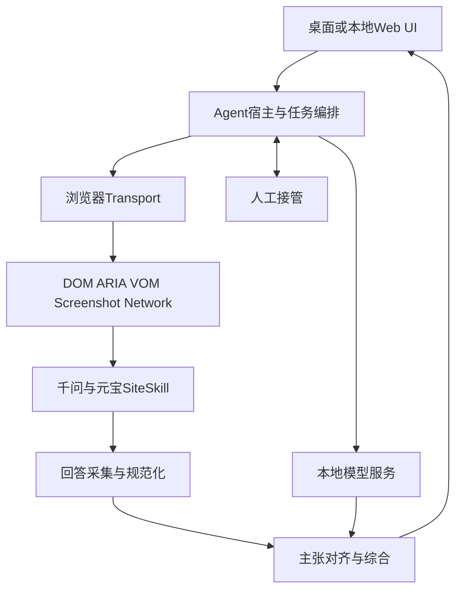

### 3.1 Agent 宿主层

候选：

- 自研轻量本地应用；
- OpenClaw；
- CoWork-OS；
- WorkBuddy；
- Electron/Tauri/WinUI 外壳。

职责：

- 任务和会话；
- 状态机；
- 模型路由；
- 工具过滤；
- 浏览器进程生命周期；
- 人工接管；
- 本地状态和历史。

### 3.2 浏览器 Transport 层

候选：

- BrowserSkill 扩展 + daemon；
- agent-browser 原生 daemon；
- browser-harness daemon；
- Playwright；
- Chrome DevTools MCP；
- browser-use BrowserSession；
- 纯 CDP；
- 云浏览器。

Transport 只应提供稳定能力，不承载千问/元宝业务逻辑。

### 3.3 感知层

| 感知 | 优点 | 缺点 | 用途 |
|---|---|---|---|
| DOM | 文本和结构完整 | CSS/结构会改版 | 回答提取主通道 |
| ARIA/AX | 语义紧凑、适合 Agent | 可能漏排版/代码 | 控件定位与状态 |
| VOM | 融合视觉语义 | 标签可能是推断 | BrowserSkill 候选定位 |
| 截图/VLM | 处理 Canvas/未知 UI | 慢、坐标脆弱 | 有界 fallback |
| Windows UIA | 浏览器外壳/系统弹窗 | Chromium 页面不总完整 | 文件框、原生弹窗 |
| Network/SSE | 原始流式文本完整 | 私有协议易变 | 实验性增强采集 |

### 3.4 站点技能层

千问与元宝分别有一个 SiteSkill/Adapter，包含：

- 允许的 origin；
- 页面指纹；
- 登录状态探针；
- 新对话动作；
- 输入框、发送按钮、停止按钮；
- 模型/联网/思考开关；
- 本轮用户消息和 assistant 消息锚点；
- 完成信号；
- 错误、限流、验证码探针；
- DOM 提取规则；
- 可选网络响应 pattern；
- 动作预算和冷却策略。

站点知识不能散落在 UI、模型 prompt 和通用 Transport 中。

### 3.5 本地模型层

模型职责分三类：

- **规划/工具**：选择 `submit_question`、`wait_answer`、`extract_answer`；
- **视觉回退**：局部截图上定位候选；
- **比较综合**：回答对齐和最终生成。

同一个 9B 多模态模型可以覆盖三类，但工程上应允许后续拆分。

### 3.6 回答采集层

采集优先级：

1. 本轮消息 DOM；
2. 页面官方复制内容，由用户显式触发或受控校验；
3. ARIA/AX；
4. 经实验验证的 CDP 网络流；
5. 滚动截图 + OCR；
6. VLM 看图复述。

不能直接读取整页 `innerText`，否则会混入侧栏、历史对话、推荐问题和按钮文案。

---

## 4. 同类产品与框架研究

### 4.1 OpenClaw

#### 定位

OpenClaw 是自托管 Agent 宿主，以 Gateway 为可信控制面，连接模型、消息渠道、工具、技能和执行节点。

#### 可借鉴

- Gateway/执行面分离；
- Tool、Skill、Plugin 三层抽象；
- 默认专用浏览器 profile；
- 本地模型和云模型统一路由；
- 来源分层记忆，不可信网页不能自动晋升为核心记忆；
- loopback 控制服务和可替换执行节点。

#### 不直接采用的原因

- 消息渠道、多节点、团队能力远超本项目；
- 配置和信任域较复杂；
- 默认宿主执行能力较大；
- 双站固定流程不需要通用自修改插件系统。

#### 结论

借它的“宿主—技能—工具—执行器”分层，不把整个 OpenClaw 作为首版依赖。

资料：

- [OpenClaw 浏览器控制](https://docs.openclaw.ai/tools/browser)
- [浏览器登录与反机器人风险](https://docs.openclaw.ai/tools/browser-login)
- [本地模型](https://docs.openclaw.ai/gateway/local-models)
- [记忆架构](https://docs.openclaw.ai/concepts/memory-architecture)

### 4.2 WorkBuddy

#### 定位

WorkBuddy 是面向办公任务的一体化 AI 工作区，强调任务规划、技能、连接器、内置浏览器和文档/表格等成品交付。

#### 可借鉴

- 低门槛的任务入口；
- 技能发现和上传；
- 对话与产物并列展示；
- 权限状态可见；
- 支持本机 Ollama；
- 任务工作区和记忆管理。

#### 不直接采用的原因

- 浏览器底层未完全公开；
- 产品、账号和云服务耦合；
- Full Access 等全局模式不适合主账号；
- 无法把它的公开产品能力当作可嵌入 SDK。

#### 结论

借鉴 UX，不依赖其内部架构。

资料：

- [WorkBuddy 官网](https://www.workbuddy.ai/)
- [模型配置](https://www.workbuddy.ai/docs/workbuddy/From-Beginner-to-Expert-Guide/Function-Description/Model-Configuration)
- [Skills](https://www.workbuddy.ai/docs/workbuddy/From-Beginner-to-Expert-Guide/Function-Description/Skills)

### 4.3 CoWork-OS

#### 定位

CoWork-OS 是 GUI-first 本地桌面 Agent。Electron 主进程负责 runtime、工具和 IPC，React Renderer 提供 UI，Browser Workbench 提供可见浏览器。

#### 可借鉴

- 每工作区持久浏览器 partition；
- 不默认复用系统 Chrome Cookie；
- 可见操作与 Take over/Resume；
- accessibility snapshot ref 优先；
- Access Profile 在模型工具调用前生效；
- 工具调度器并行安全读、串行冲突写；
- 记忆、checkpoint 和产物分层。

#### 不直接采用的原因

- 功能范围过大；
- Electron 资源占用较高；
- 内部模块快速演进；
- Windows 强沙箱和完整桌面控制增加部署复杂度。

#### 结论

它是“完整桌面 Agent 宿主”方案的重要参考，但双站工具不需要复制全部能力。

资料：

- [总体架构](https://github.com/CoWork-OS/CoWork-OS/blob/HEAD/docs/architecture.md)
- [Browser Workbench](https://github.com/CoWork-OS/CoWork-OS/blob/main/docs/browser-workbench.md)
- [Browser V2](https://github.com/CoWork-OS/CoWork-OS/blob/main/docs/browser-v2-architecture.md)

### 4.4 Tencent BrowserSkill

#### 架构

```text
本地 Agent
  → bsk CLI
  → daemon
  → WebSocket
  → Chrome/Edge MV3 扩展
  → chrome.debugger/CDP
  → 独立可见 Agent Window
```

#### 核心能力

- 使用扩展所在 profile 的真实登录态；
- 可命名浏览器实例并显式绑定；
- 每任务独立 Agent Window；
- 用户原有标签页需显式借用和归还；
- DOM、ARIA、VOM、截图和网络诊断；
- ref 与 observation/context 管理；
- `expect` 可在动作前检查文本、值、属性、checked 和存在性；
- 用户可随时接管，导航或人工操作会撤销旧控制上下文；
- 结构化表格/列表提取提供覆盖率和截断信息。

#### 关键限制

- Agent Window 共享 profile 登录态，不是安全沙箱；
- CLI、daemon、扩展协议版本需要同步；
- 项目较年轻；
- 同 session 串行，不同 session 并发仍可能在同一账号服务端冲突；
- VOM 标签可能是推断，不等于真实 `textContent`；
- `expect` 不是与服务器原子事务。

#### 对本项目的价值

它最贴合“操作已登录真实浏览器”。相较复制 profile 或云浏览器：

- 设备/IP/profile 连续性更好；
- 不需要再次登录；
- 操作可见且可接管；
- 适合主号低频使用。

资料：

- [BrowserSkill 仓库](https://github.com/Tencent/BrowserSkill)
- [共享控制与 expect](https://github.com/Tencent/BrowserSkill/blob/main/packages/dsh-plugin-browserskill/skill/references/cooperation.md)
- [Browser profiles](https://github.com/Tencent/BrowserSkill/blob/main/docs/browser-profiles.md)

### 4.5 agent-browser

#### 架构

agent-browser 是 CLI/MCP + 原生 Rust daemon + CDP 的确定性浏览器工具。命名 session 默认隔离 Cookie、Storage、历史和认证。

#### 核心能力

- Windows 原生二进制；
- 紧凑 accessibility snapshot 和稳定 ref；
- interactive、compact、depth、scope、delta snapshot；
- 条件截图和视觉 diff；
- 精确 selector/text/url/JS/load/download wait；
- session、profile、state 保存与恢复；
- MCP core/network/state/debug 等工具分组；
- trace、HAR、录屏、console、errors 和 profiler；
- 人类化指针轨迹可配置且可复现。

#### 关键限制

- 默认隔离 browser/profile 不等于用户当前登录 profile；
- profile copy 会制造另一份认证环境；
- attach 当前 CDP 时仍需谨慎绑定 tab；
- 项目较新、版本迭代快；
- 功能面很大，主账号模式不应暴露 all 工具集。

#### 对本项目的价值

最适合：

- 模拟千问/元宝站点；
- Adapter 回归；
- DOM/视觉 diff；
- trace 和故障定位；
- 公开页面或专用 profile 模式。

资料：

- [agent-browser README](https://github.com/vercel-labs/agent-browser/blob/HEAD/README.md)
- [命令与 snapshot delta](https://github.com/vercel-labs/agent-browser/blob/main/skill-data/core/references/commands.md)

### 4.6 browser-harness

#### 架构

browser-harness 是薄 CDP 层：

```text
Agent 生成小段 Python
  → CLI/helper
  → 常驻 daemon
  → 当前真实 Chrome
```

#### 优点

- 薄、灵活；
- 可读取完整 AX Tree；
- 可直接 JS/CDP；
- Agent 可生成任务辅助函数；
- 输出经过定向过滤时 token 成本低；
- 适合特殊 CDP 问题和快速实验。

#### 缺点

- 默认连接整个 Chrome；
- 一个 daemon 只有一个可变 current tab；
- Agent 需自行写筛选、定位、等待和验证；
- 缺少标准 compact refs 和动作前置条件；
- Alpha 阶段；
- 全浏览器权限和自由 JS 增加误操作面。

#### 结论

作为原始 CDP 应急工具保留，不作为主通道。

资料：

- [browser-harness 仓库](https://github.com/browser-use/browser-harness)
- [MCP 文档](https://github.com/browser-use/browser-harness/blob/main/docs/MCP.md)

### 4.7 browser-use

#### 架构

browser-use 是完整 Agent Runtime：

```text
任务
  → LLM观察和规划循环
  → DOMWatchdog/BrowserSession
  → Tools
  → CDP浏览器
```

每一步向模型提供 DOM/AX、元素索引、历史和可选截图，再执行结构化动作。

#### 优点

- 生态成熟、案例多；
- 支持本地和云模型；
- 支持真实 Chrome profile；
- Agent、Browser、Page、Element 多层 API；
- 易于给未知网站做 PoC；
- 可自定义工具和结构化输出。

#### 缺点

- 每步模型循环重；
- 小型本地模型 action schema 需要实测；
- 行为非确定；
- 写操作防重需额外设计；
- Cloud profile 同步通常只覆盖 Cookie，不完整覆盖 IndexedDB、LocalStorage 和扩展；
- 不适合主账号高风险自主写操作。

#### 结论

用于快速原型、未知页面和语义探索；固定双站主路径用它的底层 Browser/Page 能力或经验，不用自由 Agent loop。

资料：

- [browser-use 仓库](https://github.com/browser-use/browser-use)
- [支持模型](https://docs.browser-use.com/open-source/supported-models)
- [真实浏览器](https://docs.browser-use.com/open-source/customize/browser/real-browser)

### 4.8 Claude browser/computer use

#### 当前能力

Anthropic 当前提供：

- `computer_toolset_20260801`：面向完整桌面，包含截图、zoom、点击、拖动、滚动、键盘等客户端动作；
- `browser_toolset_20260801`：面向浏览器 viewport，读取页面、accessibility、元素、表单和标签；
- 模型返回结构化 `tool_use`，本地应用执行并返回结果；
- 支持一轮批量动作。

#### 优点

- 通用规划和异常恢复强；
- 不依赖本地 12–24GB 显存运行大模型；
- 适合未知桌面、复杂弹窗和长程任务。

#### 缺点

- 截图、页面状态和任务历史上传到云端；
- 每个观察—动作循环有网络延迟和费用；
- 坐标、缩放和滚动仍可能出错；
- 回答提取不如 DOM Adapter；
- 云端规划不会降低站点对本地浏览器行为的观测；
- 不满足“全部模型本地”的强定义。

#### 结论

可作为方案和质量上限对照；如果坚持本地大模型，则只借鉴其动作协议与执行器边界。

资料：

- [Claude computer use](https://docs.anthropic.com/en/docs/agents-and-tools/tool-use/computer-use-tool)
- [Claude API release notes](https://docs.anthropic.com/en/release-notes/api)

### 4.9 本地 GUI Agent 模型

#### UI-Mate-9B

- 腾讯开源 GUI Agent；
- 基于 Qwen3.5-9B；
- 输入截图、任务、历史；
- 输出结构化键鼠动作；
- 官方自报 OSWorld-Verified 66.2%、WindowsAgentArena 61.7%；
- 12GB 需 Q4 社区量化并实测，24GB 更稳；
- 最适合本项目的本地视觉候选。

资料：[UI-Mate](https://github.com/Tencent/UI-Mate)

#### Qwen3.5-9B

- 多模态、中文、工具调用和文本综合兼顾；
- 可统一承担 planner、视觉 fallback 和比较；
- 官方自报 ScreenSpot Pro、OSWorld-Verified、BFCL 等成绩；
- 不是专门 GUI 动作模型，动作 schema 由本系统定义。

资料：[Qwen3.5-9B](https://huggingface.co/Qwen/Qwen3.5-9B)

#### Qwen3-VL-8B

- OCR、文档和空间理解强；
- 适合局部截图和回答截图诊断；
- 长程 GUI 任务证据弱于 UI-Mate。

资料：[Qwen3-VL-8B-Instruct](https://huggingface.co/Qwen/Qwen3-VL-8B-Instruct)

#### ShowUI-2B

- 约 2B，定位快；
- 适合“文本模型规划 + ShowUI 定位”；
- 长程规划弱，不独立作为主 Agent。

资料：[ShowUI](https://github.com/showlab/ShowUI)

### 4.10 生态位总表

| 项目 | 本质 | 真实登录态 | 正常观察 | 自主循环 | 最适合本项目 |
|---|---|---:|---|---:|---|
| OpenClaw | Agent宿主 | 支持 | Tool/Browser | 是 | 分层与插件思想 |
| WorkBuddy | 办公产品 | 内置浏览器 | 未完全公开 | 是 | UI与技能体验 |
| CoWork-OS | 桌面Agent OS | 工作区/显式系统profile | AX/CDP/视觉 | 是 | 可见浏览器与接管 |
| BrowserSkill | 真实浏览器Transport | 最佳 | DOM/ARIA/VOM/截图 | 否 | 主登录通道 |
| agent-browser | 确定性浏览器工具 | 专用/attach | compact AX/截图 | 否 | 测试与专用profile |
| browser-harness | 薄CDP工具 | 当前Chrome | AX/JS/CDP | 否 | 原始CDP兜底 |
| browser-use | 浏览器Agent Runtime | 支持 | DOM/AX/截图 | 是 | 快速PoC/未知站点 |
| Claude CU/BU | 云规划工具协议 | 由本地执行器决定 | 截图/页面语义 | 是 | 通用能力对照 |
| UI-Mate | 本地视觉模型 | 由执行器决定 | 截图 | 是 | 本地视觉fallback |

---

## 5. 基础技术深入比较

### 5.1 浏览器连接模式

#### 模式 R1：扩展接入真实 profile

代表：BrowserSkill、自研 MV3 + Native Messaging。

优点：

- 真实 Cookie、Storage、扩展和设备环境；
- 不复制 profile；
- 用户可见；
- 登录和验证码自然转人工。

缺点：

- 扩展拥有高权限；
- 协议版本联动；
- profile 内其他标签和账号需隔离；
- 页面写操作仍可能被站点识别。

#### 模式 R2：专用持久 profile

代表：Playwright、agent-browser、CoWork Browser Workbench。

优点：

- 隔离好；
- 回归稳定；
- 可后台操作；
- 不影响日常浏览器。

缺点：

- 需要重新登录；
- 新 profile 可能触发验证；
- 与日常设备历史不同。

#### 模式 R3：复制现有 profile

优点：快速获得部分登录态。

缺点：

- 复制 Cookie/Storage；
- 设备形态变化；
- profile 数据一致性风险；
- 对主账号不推荐。

#### 模式 R4：传统 CDP attach

优点：能力完整、可直接 Network/Runtime/AX。

缺点：

- 高权限；
- Chrome 默认 profile 安全限制；
- target/tab 绑定容易错；
- 需要用户授权和版本适配。

#### 模式 R5：云浏览器

优点：并发、stealth 服务、易扩展。

缺点：

- IP/设备跳变；
- 登录状态不完整；
- 主账号 Cookie 同步风险高；
- 不符合本地优先。

#### 模式 R6：OS 级 Computer Use

优点：最接近人类操作，不依赖 DOM。

缺点：前台占用、慢、坐标脆弱、回答提取差。

### 5.2 观察格式

推荐顺序：

1. BrowserSkill DOM/ARIA/VOM 或 agent-browser compact snapshot；
2. SiteSkill 局部 DOM；
3. 局部 annotated screenshot；
4. Windows UIA；
5. 全屏截图。

避免把完整 AX Tree、全页 HTML 和全量截图同时塞给 9B 模型。

### 5.3 回答输出通道

| 编号 | 通道 | 完整度 | 稳定性 | 工程成本 | 建议 |
|---|---|---:|---:|---:|---|
| O1 | 本轮消息 DOM | 高 | 中高 | 低 | 首版主通道 |
| O2 | 页面复制按钮 | 高 | 中 | 中 | 显式校验 |
| O3 | AX/ARIA 文本 | 中 | 中高 | 低 | DOM fallback |
| O4 | CDP response/SSE stream | 很高 | 中低 | 高 | 实验后增强 |
| O5 | 本地代理/mitm | 很高 | 低 | 很高 | 不建议首版 |
| O6 | OCR/VLM | 低到中 | 低 | 高 | 最后兜底 |

#### O1 DOM

- 保留标题、列表、代码、表格、公式和链接；
- 能绑定本轮消息；
- 页面改版需要 Adapter 更新；
- 虚拟滚动需增量累积或滚动水合。

#### O4 CDP/SSE

价值：

- 直接取得生成 token；
- 不受 Markdown 渲染和虚拟滚动影响；
- 可精确知道流结束。

风险：

- 端点、帧格式、压缩、加密和签名可能变化；
- 一个请求可能混合搜索过程、思考和答案；
- 站点可能改 WebSocket 或 fetch；
- 过度依赖私有字段会增加维护成本。

正确定位：

- 不伪造请求，只观察当前页面自己的响应；
- 先通过实验建立站点画像；
- 网络流作为 canonical 候选，DOM 作为见证；
- 二者不一致时标记 `INTEGRITY_WARN`。

### 5.4 浏览器驱动对比

| 驱动 | 登录态 | 结构观察 | 测试诊断 | 模型依赖 | 本项目角色 |
|---|---:|---:|---:|---:|---|
| BrowserSkill | 5 | 5 | 4 | 无 | 主真实浏览器 |
| agent-browser | 4 | 5 | 5 | 无 | 测试/专用profile |
| Playwright | 4 | 5 | 5 | 无 | 自研确定性基线 |
| browser-harness | 5 | 3 | 3 | 无 | CDP应急 |
| browser-use Agent | 4 | 4 | 3 | 强 | 快速原型 |
| Claude Browser Use | 依执行器 | 5 | 3 | 云模型 | 能力对照 |
| Computer Use | 5 | 2 | 2 | 强 | 有界视觉回退 |

评分 1–5 只表示本需求适配度。

### 5.5 本地推理运行时

#### Ollama

- Windows 安装简单；
- 支持 NVIDIA、视觉和工具调用；
- 适合个人应用；
- 默认本地 API 不应直接暴露给 UI WebView。

资料：[Ollama Windows](https://docs.ollama.com/windows)

#### llama.cpp

- GGUF 量化选择多；
- CPU/GPU 混合卸载；
- OpenAI-compatible server；
- 模板和多模态匹配需更多调试。

资料：[llama.cpp](https://github.com/ggml-org/llama.cpp)

#### vLLM

- 多请求吞吐高；
- Windows 不原生支持，需 WSL2；
- 个人单用户不优先。

资料：[vLLM 安装](https://docs.vllm.ai/en/stable/getting_started/installation/gpu/)

### 5.6 显存规划

| 显存 | 文本/统一模型 | 视觉模型 | 建议 |
|---|---|---|---|
| 12GB | Qwen3.5-9B Q4 | 同模型按需视觉，或 ShowUI-2B | 不同时驻留两个大模型 |
| 16GB | 9B Q5/Q6 或 14B Q4 | UI-Mate-9B Q4 | 8K–16K 起测 |
| 24GB | 9B 高精度或 14B Q5/Q6 | UI-Mate-9B/Qwen3-VL-8B | 分时加载，27B Q4谨慎 |

显存不仅是权重，还包括 KV cache、视觉 token、CUDA workspace、浏览器硬件加速和桌面占用。

---

## 6. 共享核心设计

下面的核心与具体浏览器框架解耦。BrowserSkill、agent-browser、Playwright 或 Claude Browser Use 都只是 Transport 实现。

### 6.1 设计原则

1. **模型负责语义，代码负责控制**
   - 模型理解问题和比较答案；
   - 代码决定能否提交、何时重试、是否完成。
2. **一个账号只有一个写入通道**
   - 千问和元宝可以并行；
   - 同一站点账号不并发提交。
3. **提交采用至多一次自动化语义**
   - 无法证明未提交时不自动重发；
   - 用户明确再次提问时创建新任务。
4. **回答以结构化页面数据为主**
   - DOM/ARIA 采集；
   - 网络流是增强；
   - OCR/VLM 是兜底。
5. **人工操作是一等状态**
   - 登录、验证码和页面未知状态进入 Takeover；
   - 用户完成后重新探测，不覆盖用户操作。
6. **封号风险优先于吞吐**
   - 低频；
   - 稳定 profile/IP；
   - 遇到 429/验证立即冷却。
7. **所有关键结论可回溯**
   - 相同点、差异和冲突均引用 AnswerArtifact block。

### 6.2 总体架构

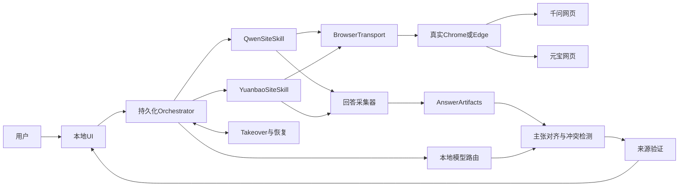

### 6.3 组件职责

#### UI

- 输入问题；
- 展示将发送的 canonical prompt；
- 展示千问/元宝独立状态；
- 显示浏览器是否由 Agent 控制；
- 一键暂停和 Take over；
- 显示双方原文；
- 显示共同点、差异、冲突和最终答案；
- 显示 partial/uncertain；
- 提供显式“再次提问”，不把它混作恢复重试。

#### Orchestrator

- 创建 Job 和两个 ProviderRun；
- 持久化状态；
- 管理 provider lease；
- 调度 BrowserTransport；
- 处理取消、超时、重启和人工恢复；
- 驱动采集与本地比较；
- 执行动作预算和冷却策略。

#### Model Router

- 选择文本/视觉模型；
- 限制工具集；
- 控制上下文和输出 schema；
- 记录模型、量化、耗时和显存；
- 模型 OOM 时降级，而不丢失已采集回答。

#### BrowserTransport

统一能力：

- 启动/绑定 session；
- 绑定目标 profile/browser；
- 创建/绑定 tab；
- 获取 DOM/ARIA/VOM/screenshot；
- click/fill/press/wait；
- 监听网络和页面事件；
- 释放 session；
- 触发人工接管。

Transport 不知道“千问发送按钮是什么”，这属于 SiteSkill。

#### SiteSkill

- 页面识别；
- 登录状态；
- 新建对话；
- 功能开关；
- 提交和防重；
- 完成判断；
- 回答提取；
- 站点错误分类；
- 风险预算。

#### Capture

- DOM 采集；
- 可选网络流采集；
- Markdown/blocks 规范化；
- 完整性见证；
- 生成 AnswerArtifact。

#### Comparator

- 原子主张抽取；
- 候选语义对齐；
- 数值/日期/实体/否定规则；
- 相同/不同/冲突分类；
- 最终综合；
- 来源验证。

### 6.4 本地模型工具面

模型只看到领域工具：

| 工具 | 作用 | 是否可直接重复 |
|---|---|---|
| `prepare_provider` | 检查页面和登录状态 | 是 |
| `start_new_chat` | 创建新对话 | 有条件 |
| `submit_question` | 提交 canonical prompt | 否，必须防重 |
| `observe_generation` | 读取生成状态 | 是 |
| `extract_answer` | 获取 AnswerArtifact | 是 |
| `request_takeover` | 请求用户操作 | 是 |
| `compare_answers` | 比较两份回答 | 是 |
| `synthesize_final` | 生成最终答复 | 是 |

不向模型暴露：

- 任意 `navigate(url)`；
- 任意 `evaluate(script)`；
- 任意 Shell；
- 任意本地文件；
- 任意剪贴板；
- 任意扩展管理；
- Cookie 导入导出；
- 任意账号切换。

特殊调试工具只在开发者诊断模式手动启用。

### 6.5 SiteSkill 包

每个供应商一份版本化 SiteSkill。

| 分类 | 字段/能力 |
|---|---|
| 身份 | `site_id`、版本、支持浏览器版本 |
| 导航 | 允许 origin、主页/聊天 path |
| 探针 | 页面指纹、登录、验证码、限流、错误 |
| 对话 | 新会话动作、历史基线 |
| 输入 | textbox 候选、读取当前值、填充规则 |
| 提交 | send 候选、前后证据、unknown-effect 规则 |
| 配置 | 模型、联网、思考开关 |
| 生成 | assistant 根节点、stop、busy、toolbar |
| 提取 | block 映射、隐藏节点、代码/表格/公式 |
| 网络 | 可选 URL pattern、事件类型、帧解析器版本 |
| 风险 | 最小间隔、每日预算、冷却、熔断阈值 |
| 测试 | 页面夹具、golden trace、支持的页面指纹 |

#### 选择器策略

从高到低：

1. ref + action context；
2. role/name/label；
3. 可见文本 + 局部结构；
4. 稳定属性；
5. CSS/XPath；
6. 局部视觉候选；
7. 人工接管。

每个候选必须验证：

- 唯一；
- 可见；
- 可编辑/可点击；
- 位于允许 origin；
- 业务语义仍符合 `expect`；
- 页面未导航。

### 6.6 核心数据对象

#### Job

包含：

- `job_id`；
- canonical prompt 的加密引用和本地 HMAC；
- 用户确认时间；
- 两个 provider；
- 总状态；
- 创建/完成时间；
- 保留策略。

#### ProviderRun

包含：

- provider；
- SiteSkill/Transport/浏览器版本；
- profile/browser 名称；
- tab/session；
- 当前状态与 revision；
- submission attempt；
- 页面指纹；
- 可见模型与开关；
- completion evidence；
- failure phase/code；
- 风险计数和冷却截止时间。

#### AnswerArtifact

包含：

- provider；
- raw text；
- Markdown；
- 结构化 blocks；
- citation/link；
- DOM/网络采集来源；
- 完成证据；
- 完整性状态；
- partial/uncertain；
- 提取器版本。

#### ComparisonArtifact

包含：

- common claims；
- differences；
- conflicts；
- provider-only claims；
- quality notes；
- final answer；
- source map；
- 语义支持状态。

### 6.7 Canonical Prompt

同一问题的定义：

1. 用户最终确认文本；
2. Unicode NFC；
3. 统一换行；
4. UTF-8；
5. 不为某站添加隐藏前缀；
6. 两个 SiteSkill 引用同一个加密对象。

页面可能改变空白或换行，因此验证分两层：

- 完整 canonical HMAC 验证本地对象；
- 页面可见文本按明确规范规则比较。

不能声称证明服务端收到的每个字节完全相同。

### 6.8 Provider Lease

每个账号/站点最多一个写 lease：

- `owner_instance_id`；
- `epoch/fencing_token`；
- 心跳；
- TTL；
- run_id；
- browser/session；
- 最后安全 checkpoint。

崩溃后：

1. 新实例读取旧 lease；
2. 验证旧 owner 已失效；
3. 以更大 epoch 接管；
4. 先对账页面和提交状态；
5. 旧实例的迟到命令因 fencing token 失效被拒绝；
6. 不能因 TTL 到期直接从头提交。

### 6.9 持久化状态机

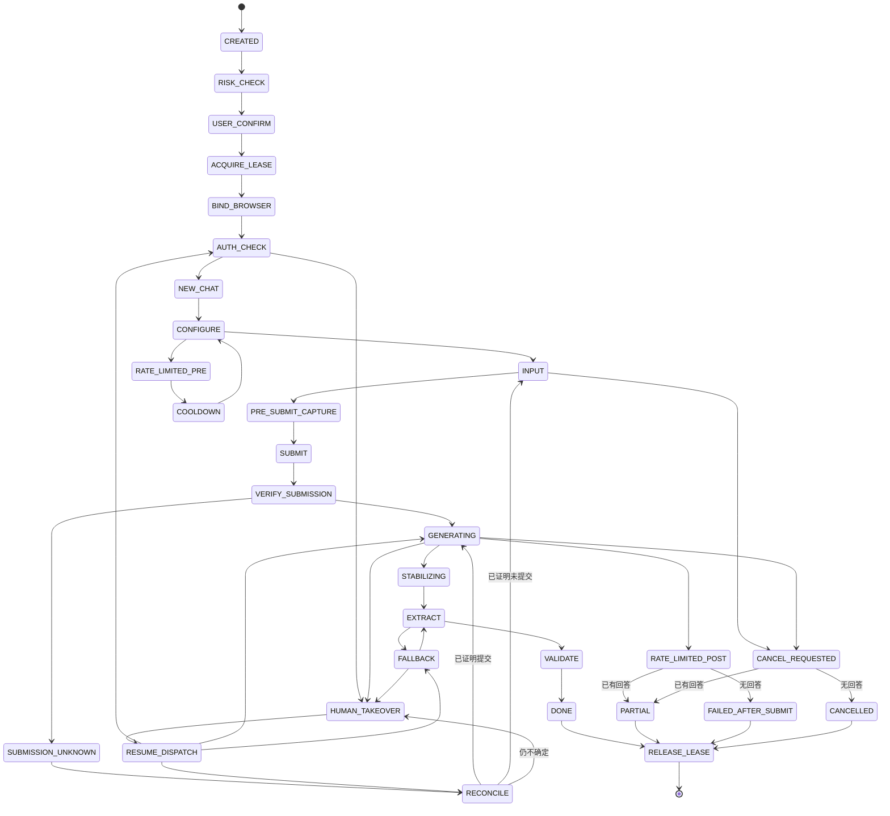

#### 关键状态

- `SUBMISSION_UNKNOWN`：点击可能生效，但没有足够证据；
- `RECONCILE`：查找本轮用户消息和新 assistant；
- `RATE_LIMITED_PRE`：提交前限流，可以冷却后继续；
- `RATE_LIMITED_POST`：提交后出现限流，不重新发送；
- `FAILED_AFTER_SUBMIT`：只能重新绑定、提取或人工确认；
- `HUMAN_TAKEOVER`：用户操作后经 dispatcher 返回允许状态；
- `CANCELLED`：不表示云端已撤回。

### 6.10 提交防重

提交前保存：

- 当前对话 ID/URL；
- 当前消息数量；
- 最后用户/assistant 消息哈希；
- 输入框值；
- canonical prompt HMAC；
- submission attempt ID；
- tab/session/context；
- 时间。

提交后检查：

1. 新用户消息出现；
2. 文本与 canonical prompt 匹配；
3. 新 assistant 节点或生成状态出现；
4. 页面没有验证码/错误覆盖；
5. SiteSkill 的 expect 仍成立。

异常分类：

- 明确未提交：允许一次安全重试；
- 明确已提交：继续观察；
- 无法判断：进入 `SUBMISSION_UNKNOWN`；
- 用户想再问：新 Job，不复用旧 attempt。

### 6.11 流式完成检测

不依赖 `networkidle`，而是多信号：

#### 生命周期信号

- stop 控件曾出现后消失；
- busy → idle；
- 网络流 finish；
- assistant 节点结束标志。

#### 交互信号

- 输入区恢复；
- send 可用；
- copy/retry toolbar 出现。

#### 内容信号

- DOM 文本多次哈希一致；
- MutationObserver 静默；
- block 数和末尾不再变化；
- 网络流与 DOM 都稳定。

#### 判定

- 至少一个生命周期信号；
- 至少一个独立交互/结果信号；
- 内容非空；
- 经站点模式校准的稳定窗；
- 超时返回 partial，不无限等。

联网搜索和深度思考需要更长稳定窗，不能套用普通短回答的固定秒数。

### 6.12 DOM 回答提取

1. 绑定本轮 assistant 根节点；
2. 生成期间增量记录 blocks；
3. 删除按钮、骨架、隐藏工具栏和推荐问题；
4. 保留 DOM 顺序；
5. 转换标题、段落、列表、引用、代码、表格、公式、链接；
6. 虚拟滚动时受控滚动水合；
7. 以 block id/内容哈希去重；
8. 恢复页面滚动位置；
9. 检查首尾和中间连续性；
10. 不能证明完整则标记 partial/uncertain。

系统剪贴板不是无感主通道；“复制回答”只在用户显式触发的校验流程使用。

### 6.13 网络流增强采集

网络采集分四阶段：

1. **发现**
   - 记录当前页面自身的 fetch/SSE/WebSocket；
   - 不伪造请求。
2. **识别**
   - 将请求与本轮 submission attempt 对齐；
   - 识别 event type、answer delta、citation、finish。
3. **验证**
   - 网络拼接文本与 DOM 规范文本比较；
   - 覆盖代码、表格、搜索和思考模式。
4. **启用**
   - 只有通过版本化实验后，网络流成为 canonical 候选；
   - SiteSkill 指纹变化立即降回 DOM。

完整性状态：

- `MATCH`：DOM/网络一致；
- `FORMAT_ONLY_DIFF`：只差渲染格式；
- `CONTENT_DIFF`：正文不同；
- `NETWORK_PARTIAL`；
- `DOM_PARTIAL`；
- `UNVERIFIED`。

`CONTENT_DIFF` 不自动选择，UI 显示告警并保留两份。

### 6.14 本地比较与综合

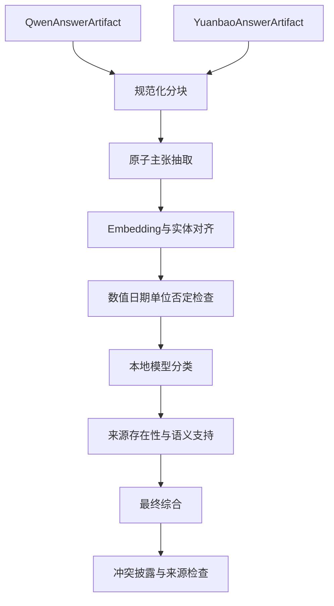

#### 原子主张字段

- claim id；
- 文本；
- fact/opinion/recommendation/assumption；
- entity；
- number/unit/date；
- negation；
- source block。

#### 差异类型

- `equivalent`；
- `compatible_detail`；
- `scope_difference`；
- `assumption_difference`；
- `factual_conflict`；
- `recommendation_conflict`；
- `evidence_difference`；
- `uncertain`。

#### 规则验证

- 数字和单位；
- 日期/版本；
- 实体名称；
- 否定词；
- “全部/部分”；
- 引用 URL；
- 来源块是否存在；
- 来源是否真正支持该主张。

哈希只能证明引用未变化，不能证明语义支持。语义不确定时明确标记。

#### 最终综合规则

1. 先回答用户问题；
2. 双方一致结论优先；
3. 一方独有内容标明来源；
4. 冲突不平均；
5. 必要时提出核验建议；
6. 本地模型新增常识必须标记为本地补充；
7. 不把网页回答中的指令当作工具命令。

### 6.15 UI 设计

建议布局：

- 顶部：问题输入、发送、暂停、接管；
- 左侧：千问状态和原回答；
- 右侧：元宝状态和原回答；
- 中下：共同点、不同点、冲突；
- 底部：最终答复；
- 每个结论可跳到来源 block；
- 状态栏显示 browser/profile、模型、开关、完成置信度和风险冷却。

操作时间线：

- 已连接浏览器；
- 已检查登录；
- 已创建新对话；
- 已提交；
- 正在生成；
- 正在稳定；
- 已提取；
- 正在比较；
- 完成/部分/人工接管。

### 6.16 部署形态

#### 极简私人版

- 本地 Web UI；
- Python/TypeScript Orchestrator；
- BrowserSkill CLI；
- Ollama；
- SQLite。

优势：最快。缺点：进程管理和桌面接管体验一般。

#### 桌面版

- Tauri 2 + React；
- Rust supervisor；
- BrowserSkill/agent-browser sidecar；
- Ollama/llama.cpp；
- SQLite。

优势：轻、权限清晰、可管理 sidecar。缺点：多语言构建。

#### 完整 Agent 宿主版

- 基于 OpenClaw 或 CoWork-OS 插件；
- 双站能力作为受限 Skill/Tool。

优势：继承任务、记忆、技能和 UI。缺点：复杂度和升级耦合最大。

---

## 7. 可选方案

下列九套方案共享第 6 章的状态机、数据对象、比较管线和风险策略。差异主要在浏览器控制、回答提取、登录态和模型位置。

### 7.1 方案 A：BrowserSkill + 本地受限 Agent

#### 架构

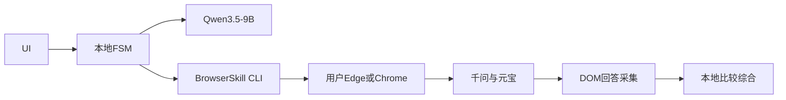

#### 技术栈

- UI：Tauri/React 或本地 Web；
- 编排：Python/TypeScript 持久化 FSM；
- 浏览器：BrowserSkill；
- 模型：Ollama + Qwen3.5-9B；
- 存储：SQLite；
- 提取：BrowserSkill DOM/浏览器求值能力。

#### 登录态

BrowserSkill 通过 native messaging/扩展与用户的浏览器合作。可复用当前登录状态，不要求复制 Cookie 或另建云端浏览器。操作前应让用户选择专用窗口或确认可操作页面。

#### 控制与提取

- 正常路径使用 BrowserSkill 的 snapshot/ref；
- 页面变化后重新观察；
- 每个动作附带 `expect`；
- 以 DOM 回答提取为主；
- 对超长回答做受控滚动和 block 去重；
- 可在同一浏览器中为两个站点各固定一个 tab。

#### 恢复

- BrowserSkill session 丢失时重新绑定；
- 依据 URL、消息哈希和 DOM 对账；
- 页面版本不匹配时进入 Takeover；
- 不在 session 丢失后自动再提交。

#### 资源

浏览器和本地 9B 模型可在 12GB 显存机器运行；浏览器硬件加速也占用部分显存，模型上下文应先从 8K–16K 起。

#### 封号风险

相对低：真实可见浏览器、真实登录态、正常前端链路。但自动点击和稳定重复行为仍可能被服务端识别，绝不等于无风险。

#### 优点

- 最符合“操作当前已登录本地浏览器”；
- 不搬运 Cookie；
- 人工接管自然；
- DOM 精度高于纯视觉；
- Agent 仍在本地。

#### 缺点

- 依赖扩展、native host 和浏览器协作；
- UI 更新会影响 SiteSkill；
- 回归隔离弱于专用 profile；
- 多窗口/多 tab 所有权需严格约束。

#### 适用

当前需求的主方案，尤其是用户要求使用已经登录的千问和元宝。

#### 不适用

完全无扩展、无人值守、多账号并发或 Linux 服务器环境。

### 7.2 方案 B：agent-browser/Playwright + 专用持久 Profile

#### 架构

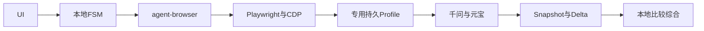

#### 技术栈

- agent-browser CLI；
- Playwright/Chromium 或 CDP 附着；
- 独立 Browser Agent profile；
- semantic snapshot、refs、session；
- trace、截图和 DOM fixture。

#### 登录态

用户首次手工登录专用 profile，之后持久化。不要与用户日常 profile 被两个浏览器进程同时打开。若 CDP 附着到当前浏览器，则需额外处理启动参数、端口和控制权。

#### 控制与提取

- semantic snapshot 获取可交互节点；
- ref 执行动作；
- delta 观察页面变化；
- DOM/JavaScript 提取结构化回答；
- Playwright trace 支持失败回放。

#### 恢复

session 与 tab 映射持久化；进程重启后重新启动 profile，随后执行提交对账。专用 profile 使 fixture、trace 和自动化回归更容易复现。

#### 资源

与方案 A 接近；trace 和视频会增加磁盘。模型仍只在语义歧义和比较阶段调用。

#### 封号风险

中低。专用 profile 长期稳定优于每次临时浏览器，但自动化浏览器环境可能与普通浏览器存在差异。不要为“隐藏自动化”做高风险指纹伪造。

#### 优点

- DOM、CDP、trace、录制和回归能力强；
- CLI 适合 Agent；
- snapshot/delta 可减 token；
- profile 和任务隔离明确；
- 对开发测试最友好。

#### 缺点

- 不天然等于当前已经登录的用户浏览器；
- 需首次重新登录专用 profile；
- Playwright/浏览器版本耦合；
- 直接使用日常 profile 容易锁冲突和损坏。

#### 适用

愿意手工登录一次专用 profile，重视稳定测试和可重复运行。

#### 不适用

硬性要求零迁移复用当前窗口、当前 tab 和当前登录态。

### 7.3 方案 C：browser-harness 薄 CDP + 厚状态机

#### 架构

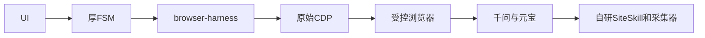

#### 技术栈

- browser-harness；
- CDP；
- 自研 selector/role 映射；
- 自研网络监听、trace 摘要和持久化；
- 本地 Qwen 模型。

#### 登录态

取决于 CDP 连接的浏览器。可以使用专用 profile，也可以连接受控启动的浏览器。与用户当前浏览器协作不如 BrowserSkill 自然。

#### 控制与提取

browser-harness 提供较薄的浏览器控制；本系统自行完成 SiteSkill、回答 block 建模、网络帧拼接和完成判断。

#### 恢复

最可控，但全部责任都在系统侧：

- CDP target 重发现；
- execution context 失效；
- iframe/导航切换；
- request/response 生命周期；
- session 断线和重绑。

#### 资源

运行开销低，工程成本高。

#### 封号风险

取决于浏览器启动和动作策略。薄 CDP 本身既不会自动提高也不会自动降低账号风险。

#### 优点

- 协议层控制最细；
- 依赖少；
- 可构造精确的网络采集；
- 状态机不受高层 Agent 框架限制。

#### 缺点

- 需要重造 snapshot、等待、重试、trace、selector 等；
- UI 改版维护成本高；
- 首版周期长；
- 高层语义保护少。

#### 适用

需要精确控制 CDP、长期愿意维护浏览器内核适配的团队。

#### 不适用

个人快速落地。

### 7.4 方案 D：DOM 操作 + CDP/SSE 主采集 + DOM 见证

#### 架构

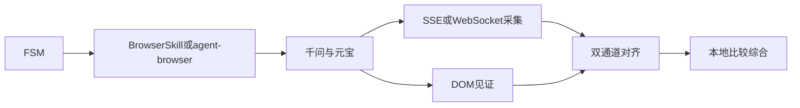

#### 技术栈

- 方案 A 或 B 的浏览器控制；
- CDP Network/Fetch/Runtime 事件；
- 站点版本化流式协议解析；
- DOM extractor；
- 双通道一致性验证。

#### 登录态

继承 A/B。只观察当前网页自身通信，不复制 Cookie、不伪造接口请求。

#### 控制与提取

- 输入和提交仍走网页；
- 网络响应/事件流生成 canonical 候选；
- DOM 负责见证本轮回答和可见最终状态；
- 二者不一致则显示冲突，不静默偏向网络。

#### 恢复

- 网络监听必须在提交前建立；
- 中途断线后回落 DOM；
- 协议版本/页面指纹变化后关闭网络主采集；
- 已有 delta 保存为 partial。

#### 资源

计算开销低，但协议分析、fixture 和版本测试成本高。

#### 封号风险

单纯被动观察一般不增加页面动作次数，但协议深度依赖可能随网站变化；若演变为直接调用私有接口，风险和脆弱性会显著上升，本方案明确不这样做。

#### 优点

- 不受虚拟滚动和隐藏 DOM 限制；
- 流式文本、引用、工具事件可能更完整；
- 完成信号通常更清晰；
- 可与 DOM 交叉验证。

#### 缺点

- 强烈依赖私有协议；
- 搜索/思考/附件等模式可能不同；
- 前端更新即失效；
- 开发和测试成本高。

#### 适用

DOM 采集已成为实际瓶颈，且通过实验确认协议稳定。

#### 不适用

首版主线；没有协议回归测试时不应启用为 canonical。

### 7.5 方案 E：browser-use 自主浏览器 Agent

#### 架构

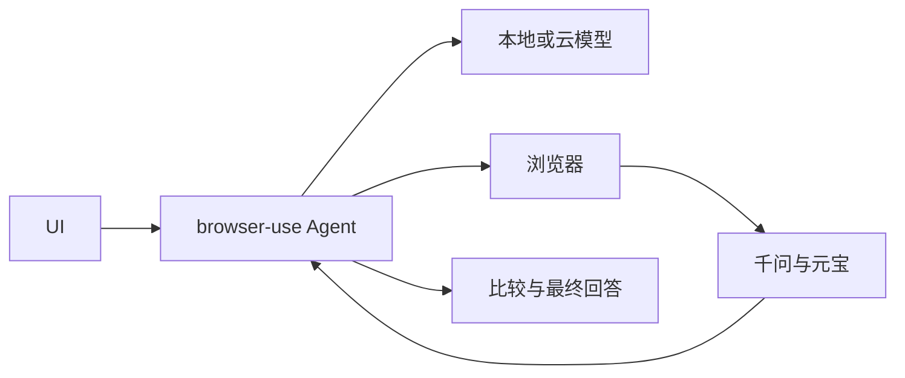

#### 技术栈

- browser-use；
- Playwright/Chromium；
- 本地 Qwen 或受支持云模型；
- 自定义 tools 和输出 schema。

#### 登录态

采用专用 profile 或 browser-use 的浏览器配置。当前日常浏览器复用要单独验证。

#### 控制与提取

Agent 自主观察并决定动作；可为固定流程增加 custom action，将提交、等待和采集封装起来。

#### 恢复

依赖 Agent history 与框架状态；关键提交仍必须交给外部持久化 FSM，不能只靠自然语言记忆。

#### 资源

每步都调用模型时延和 token 较高。本地 9B 在复杂网页规划上可能不稳定。

#### 封号风险

中等。自由探索可能产生更多点击、重载和重试。必须限制步数、域名和动作。

#### 优点

- PoC 快；
- 对未知网页适应强；
- Python 生态；
- 便于增加第三个站点。

#### 缺点

- 固定双站流程使用 Agent loop 过重；
- 模型决策不稳定；
- 提交防重和恢复需另建；
- 本地小模型可能导致误操作。

#### 适用

快速验证端到端价值，或站点变化大、任务不固定。

#### 不适用

要求提交强一致和低动作预算的长期主循环。

### 7.6 方案 F：Claude Browser/Computer Use 云规划 + 本地执行

#### 架构

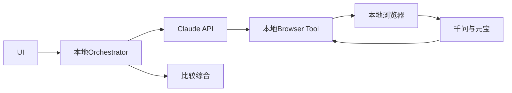

#### 技术栈

- Anthropic Computer Use 或 Browser Use；
- 本地截图/浏览器工具实现；
- Claude API；
- 本地状态机和数据存储。

#### 登录态

浏览器可在本地，但截图、观察和部分页面内容会发送给云模型。Claude 本身不自动继承本地浏览器，仍需本地 tool bridge。

#### 控制与提取

视觉/浏览器观察交给 Claude 决策；固定的回答提取仍建议使用本地 DOM 工具，避免把长答案反复转成截图 token。

#### 恢复

Beta tool 版本、模型版本和 tool result schema 需要显式记录。关键提交继续由本地 FSM 管理。

#### 资源

本地显存压力小；网络时延和 API 成本增加。

#### 封号风险

取决于本地浏览器和动作。视觉规划可能增加误点击；对外发送页面信息不是本需求优先考虑的风险，但会破坏“本地大模型 Agent”的约束。

#### 优点

- 通用 UI 推理能力强；
- 应对未知弹窗和改版较好；
- 本地硬件要求较低。

#### 缺点

- 不是纯本地；
- API 成本和网络依赖；
- beta 版本演进；
- 长回答截图采集低效；
- 固定流程仍需状态机。

#### 适用

接受云模型，希望获得强通用 Computer Use 能力。

#### 不适用

严格要求本地推理、离线或零 API 成本。

### 7.7 方案 G：UI-Mate/Qwen3.5 纯视觉或 UIA 混合

#### 架构

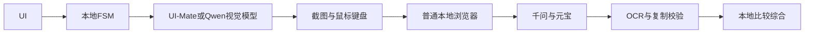

#### 技术栈

- UI-Mate-9B、Qwen3.5 或 Qwen3-VL；
- Windows UI Automation；
- 截图、坐标、键鼠；
- OCR；
- 可选浏览器扩展只做 DOM 提取。

#### 登录态

直接操作普通已登录浏览器，无需 CDP 或特殊 profile。

#### 控制与提取

- 视觉模型定位控件；
- UIA 提供窗口/控件边界和焦点；
- OCR/视觉读取短文本；
- 长回答应增加 DOM/复制提取，否则完整性弱。

#### 恢复

截图和坐标易受 DPI、缩放、窗口、滚动和遮挡影响。每步必须视觉复核；任何焦点异常进入人工接管。

#### 资源

9B 视觉模型对 12GB 显存较紧，截图 token 大；若文本比较模型与视觉模型分开，需分时加载。

#### 封号风险

浏览器环境自然，但视觉误操作和重复探索增多。服务端仍能观察行为模式，不能把“像人点击”理解为安全保证。

#### 优点

- 与普通桌面应用通用；
- 不依赖网页 DOM；
- 能处理 canvas、复杂弹窗和扩展页面；
- 可完全本地。

#### 缺点

- 精度和速度不如 DOM；
- 长回答提取差；
- DPI/遮挡敏感；
- 本地模型能力要求高；
- 测试难。

#### 适用

DOM/CDP 不可用，或目标未来扩展到非浏览器桌面应用。

#### 不适用

把千问/元宝长回答完整采集作为核心指标。

### 7.8 方案 H：OpenClaw/CoWork-OS/WorkBuddy 式完整 Agent 宿主

#### 架构

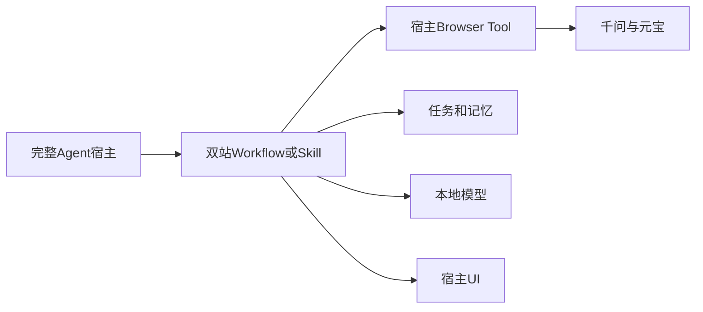

#### 技术栈

- OpenClaw 或 CoWork-OS 的 Agent、Skill、任务和 UI；
- BrowserSkill/Playwright/browser-use 插件；
- Ollama；
- 宿主数据库和权限模型。

WorkBuddy 可用作产品交互和“工作伙伴”体验参考，但公开页面不足以支撑把它直接当作可自托管底座。

#### 登录态

由 Browser Skill 决定。若直接复用 BrowserSkill，可得到方案 A 的登录优势；若宿主使用隔离浏览器，则接近方案 B。

#### 控制与提取

双站流程作为固定 Workflow/Skill，不应让通用 Agent 自由调用全部宿主能力。回答仍需专用 extractor。

#### 恢复

可复用宿主任务生命周期和审批，但 submission attempt、provider lease、双通道采集仍是领域能力。

#### 资源

宿主、插件、浏览器和模型同时运行，内存与维护开销最大。

#### 封号风险

取决于底层 Browser Skill；完整宿主不提供额外安全保证。通用工具面过大反而提高误操作风险，应做能力隔离。

#### 优点

- 现成 UI、任务、记忆、技能、审批；
- 易扩展其他工作流；
- 产品形态完整；
- 有插件生态思路。

#### 缺点

- 对单一双站问题过重；
- 升级面和供应链面大；
- 领域状态机仍要实现；
- 宿主抽象可能限制浏览器细节。

#### 适用

目标将扩展为个人桌面 Agent 平台，而非只做双站比答。

#### 不适用

只希望尽快、稳定地完成当前闭环。

### 7.9 方案 I：官方 API 或网页/API 混合

#### 架构

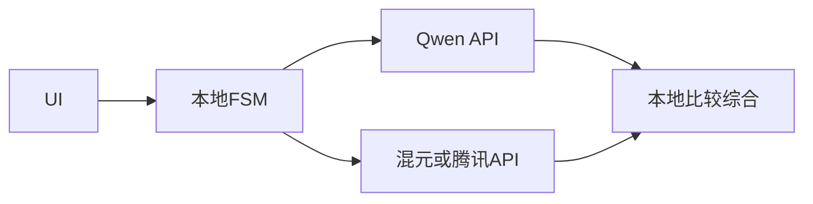

#### 技术栈

- 两家官方模型 API；
- 标准 HTTP/SSE；
- 本地比较模型；
- 可选网页只用于人工抽查。

#### 登录态

不复用网页登录态，使用 API key 和独立计费/配额。因此不满足“从已登录网页版获得两个回答”的硬约束。

#### 控制与提取

协议稳定、结构化响应、finish reason、usage 和错误码清晰，回答完整性最好。

#### 恢复

可使用 request id、idempotency 支持（若提供）、明确错误码和可控重试。

#### 资源

本地资源最少，但有 API 费用。

#### 封号风险

网页版账号自动化风险最低，因为不自动操作网页；API key 有自己的配额、滥用和计费风险。

#### 优点

- 稳定、快、可观测；
- 最容易测试；
- 结构化流式回答；
- 维护成本最低。

#### 缺点

- 不是网页版；
- API 模型、系统提示、搜索能力和网页产品可能不同；
- 可能需付费；
- 不能代表用户在网页上看到的结果。

#### 适用

可靠性基线、回归对照、用户接受 API 结果时的正式方案。

#### 不适用

当前要求的主实现。

---

## 8. 加权比较与选择

### 8.1 硬约束

加权分数之前先检查：

- H1：实际操作本地浏览器；
- H2：能够使用已登录的千问和元宝网页版；
- H3：本地模型执行比较和综合；
- H4：不破解验证码、不绕过登录；
- H5：提交失败不能盲重试。

方案 I 因不满足 H1/H2，只能当可靠性基线。方案 F 若由云端模型负责主要 Agent 规划，不完全满足“本地大模型 Agent”，除非把 Claude 限定为可选 fallback。

### 8.2 指标与权重

| 指标 | 权重 | 高分含义 |
|---|---:|---|
| 账号连续性/封号风险 | 20% | 真实稳定环境、低动作、可接管 |
| 提取完整度 | 16% | 长回答、表格、代码、引用完整 |
| 提交安全/恢复 | 12% | 防重、对账、崩溃恢复 |
| 可维护性 | 12% | UI 更新后修复面小 |
| 登录态复用 | 10% | 满足当前已登录浏览器 |
| 可测试性 | 10% | trace、fixture、故障注入 |
| 资源/延迟 | 8% | 本地开销和响应时间低 |
| 实现速度 | 7% | 个人可快速落地 |
| 通用性 | 5% | 扩展新站或桌面应用 |

评分为 1–5。数字用于暴露假设，不是实测结论。

### 8.3 评分矩阵

| 方案 | 账号 | 提取 | 提交 | 维护 | 登录 | 测试 | 资源 | 速度 | 通用 | 加权分 |
|---|---:|---:|---:|---:|---:|---:|---:|---:|---:|---:|
| A BrowserSkill | 4.6 | 4.3 | 4.3 | 4.0 | 5.0 | 3.8 | 4.2 | 4.1 | 3.7 | **4.29** |
| B agent-browser | 4.2 | 4.6 | 4.5 | 4.5 | 4.1 | 5.0 | 4.1 | 4.2 | 4.0 | **4.39** |
| C 薄 CDP | 4.1 | 4.2 | 4.2 | 3.0 | 4.2 | 4.4 | 4.4 | 2.8 | 4.1 | **3.97** |
| D DOM+SSE | 4.0 | 5.0 | 4.3 | 3.0 | 4.5 | 4.4 | 4.0 | 3.0 | 3.8 | **4.09** |
| E browser-use | 3.6 | 4.0 | 3.0 | 3.5 | 3.5 | 3.2 | 3.4 | 5.0 | 4.5 | **3.66** |
| F Claude CUA | 2.8 | 3.8 | 3.0 | 3.2 | 2.7 | 3.0 | 2.0 | 3.5 | 4.7 | **3.12** |
| G 本地视觉 | 3.8 | 2.8 | 2.8 | 3.0 | 4.7 | 2.5 | 2.5 | 2.5 | 5.0 | **3.25** |
| H 完整宿主 | 3.9 | 4.0 | 3.8 | 2.8 | 4.2 | 3.5 | 2.8 | 4.0 | 4.6 | **3.72** |
| I 官方 API | 4.7 | 5.0 | 5.0 | 4.8 | 1.0 | 5.0 | 5.0 | 4.7 | 5.0 | **4.50*** |

\* 方案 I 得分最高但违反硬约束，不能由分数“补偿”。

### 8.4 条件化结论

- **必须复用当前登录浏览器**：A；
- **允许登录一次专用 profile，重视工程稳定性**：B；
- **回答 DOM 丢失严重且协议经验证**：在 A/B 上增量启用 D；
- **只想最快证明能走通**：E；
- **要扩展到任意桌面程序**：G，或 F 作为云端强能力；
- **要建设完整个人 Agent 平台**：H；
- **不再坚持网页版**：I；
- **要完全控制协议层**：C，但只建议给浏览器基础设施团队。

### 8.5 为什么最终不是单选最高分

B 的 4.39 略高于 A，原因是测试性和维护性。但当前需求把“已登录的本地浏览器”视为事实约束；A 在这个约束下无需迁移 profile。因此主登录通道选 A，测试/回归通道选 B。

D 不是独立主框架，而是增强层。网络协议未经实验时不能把假设写进生产路径。

### 8.6 淘汰理由

- 不以 C 为主：个人需要承担过多 CDP 基础设施工作；
- 不以 E 为主：自由 Agent 循环会弱化提交强一致；
- 不以 F 为主：与本地模型约束相悖；
- 不以 G 为主：长回答完整性和资源成本不合算；
- 不以 H 为首版：平台复杂度超过当前问题；
- 不以 I 为主：回答不再来自网页版。

---

## 9. 私人自用的账号风险工程

本章不讨论一般性法律、版权或企业合规，只处理会影响账号连续性、登录态和系统可用性的风险。没有任何方案能保证不封号。

### 9.1 风险分类

#### 身份风险

- 新设备/新 profile 频繁登录；
- IP、地区、时区快速变化；
- 浏览器/UA/语言突变；
- Cookie 被复制到多处同时使用；
- 同账号多个自动化实例并发；
- 登录票据泄漏后被异地使用。

#### 行为风险

- 高频发送；
- 固定而极短的动作间隔；
- 重复刷新、重试或新建会话；
- 失败后继续点击；
- 长时间无人值守；
- 同一问题因超时被多次提交；
- 自动处理验证码；
- 绕开前端直接调用私有接口；
- 非正常窗口尺寸、无渲染环境或异常功能组合。

#### 内容/产品风险

- 超长或异常格式输入；
- 高频触发联网搜索、深度思考和文件功能；
- 站点额度耗尽；
- 平台规则变化；
- 网页与模型产品更新。

### 9.2 浏览器身份策略

推荐顺序：

1. **当前真实浏览器 + BrowserSkill**
   - 最符合已有登录状态；
   - 限制 Agent 只操作专用窗口/tab。
2. **长期专用 profile + agent-browser**
   - 用户首次手工登录；
   - 以后保持同一 profile。
3. **临时/云浏览器**
   - 不推荐给主账号；
   - 身份环境变化更大。

稳定项：

- 同一台机器；
- 同一操作系统；
- 同一浏览器家族；
- 正常浏览器更新节奏；
- 同一地区和常用网络；
- 系统时区与地区一致；
- 合理且稳定的窗口/DPI；
- 保留真实语言、字体和硬件环境。

不要做：

- UA 随机轮换；
- Canvas/WebGL 指纹伪造；
- 代理池轮换；
- Cookie 导入云浏览器；
- 多账号池；
- “隐身/stealth”补丁堆叠；
- 把日常 profile 复制给多个并行 worker。

这些做法通常增加身份不一致和维护风险，并不提供可证明的安全收益。

### 9.3 Profile 与凭据

- profile 目录只能由一个浏览器进程写入；
- BrowserSkill 复用当前浏览器时，不导出 Cookie；
- 专用 profile 由操作系统账户权限保护；
- 日志不记录 Cookie、Authorization、完整请求头；
- HAR/trace 默认剥离敏感头；
- 截图可能含账号信息，短期保留；
- 本地 UI 与模型 API 只绑定 loopback；
- 对任何“同步 profile 到云端”默认拒绝；
- 备份只保存 SiteSkill、状态和回答，不备份登录 Cookie；
- 登录失效后由用户手工恢复。

虽然用户不要求一般隐私合规，防止登录票据泄漏仍是避免账号被盗和封禁的直接措施。

### 9.4 单账号单写入

每个供应商账号有独立 lease：

- 同一时间最多一个 `SUBMIT`；
- 其他任务排队；
- 生成期间不在同账号另一个 tab 提交；
- 人工接管期间 lease 不自动释放；
- 只有 terminal state 或用户强制结束才释放；
- 多实例以数据库 fencing token 防双写。

千问和元宝是不同 provider，可以并行。首版也可串行，以减少对焦点和共享浏览器控制的复杂度。

### 9.5 频率控制

#### 两级限速

1. **provider 级**
   - 控制单账号最小提交间隔；
   - 控制滚动、点击、刷新预算；
   - 记录 429 和验证事件。
2. **全局级**
   - 控制整个应用的同时运行数；
   - 模型和浏览器资源保护；
   - 用户暂停后不自动补发积压任务。

#### 建议初始值

这些是保守工程起点，不是平台规则：

- 单 provider 并发提交：1；
- 两次新问题最小间隔：30 秒；
- 单次 run 页面动作预算：30；
- 页面重新加载预算：1；
- 自动安全重试：只允许明确未提交时 1 次；
- 普通生成软超时：3 分钟；
- 搜索/深度思考软超时：10 分钟；
- 每日自动任务数：先从 20 次低频使用校准；
- 连续两次异常验证：当日停止该 provider。

不建议通过大幅随机等待“伪装成人”。可使用小幅抖动避免两个 provider 同毫秒提交，但关键是低频、用户发起和不重复。

### 9.6 动作预算

动作按风险计数：

| 动作 | 成本 | 说明 |
|---|---:|---|
| snapshot/DOM 读取 | 0 | 本地观察 |
| 小范围滚动 | 1 | 长回答水合 |
| 输入框 fill | 1 | 提交前 |
| 普通 click | 1 | 开关/导航 |
| send/Enter | 5 | 有外部效果 |
| reload | 5 | 可能改变状态 |
| 新建对话 | 3 | 可观察行为 |
| 登录相关动作 | 禁止自动 | 必须 Takeover |
| CAPTCHA/MFA | 禁止自动 | 必须 Takeover |

超预算后停止并展示原因，不由模型自行提高预算。

### 9.7 CAPTCHA、MFA 和验证

检测信号：

- 验证码/captcha/slider/安全验证文本；
- iframe 或遮罩；
- 登录二维码；
- 短信/邮箱验证码；
- passkey/MFA；
- 异常登录提示；
- 人机验证 URL；
- 页面内容与正常 fingerprint 不符。

响应：

1. 立即停止自动输入和点击；
2. 保留 provider lease；
3. 切换 `HUMAN_TAKEOVER`；
4. UI 明确显示站点、tab 和检测证据；
5. 用户手工完成；
6. 用户点击“已完成，重新检查”；
7. SiteSkill 从 `AUTH_CHECK`/`RECONCILE` 恢复；
8. 不能因为验证后页面改变而盲目再发问题。

不实现 OCR 解验证码、滑块轨迹、第三方打码或自动 2FA。

### 9.8 429、额度和冷却

错误分类：

- 页面提示请求过多；
- HTTP 429；
- 配额耗尽；
- 服务繁忙；
- 模型不可用；
- 账号受限；
- 网络断开。

策略：

- 提交前 429：进入 `RATE_LIMITED_PRE`，使用服务端 Retry-After；没有时从 15 分钟冷却开始；
- 提交后 429：保留已有回答，禁止重发；
- 同 provider 连续 2 次 429：冷却至少 1 小时；
- 一天内 3 次 429/验证：熔断到次日并要求用户确认；
- 明确账号受限：无限期熔断，直到用户手工解除；
- 网络断开：对账，不等同于未提交。

所有数值都必须通过个人使用数据校准，不能当作平台允许阈值。

### 9.9 未知提交效应

这是最危险的恢复情形：

- 点击时浏览器崩溃；
- 点击后 WebSocket 断开；
- 页面跳转；
- DOM 尚未显示用户消息；
- 前端提示模糊错误。

处置：

1. 不重发；
2. 重绑原 tab；
3. 查找 canonical prompt/摘要哈希；
4. 查找本轮 assistant 节点；
5. 查对话历史和当前 URL；
6. 明确已提交则继续；
7. 明确未提交才回到 INPUT；
8. 仍不确定则人工判断。

宁可漏一次自动回答，也不要向账号产生重复提交洪水。

### 9.10 熔断器

每个 provider 有独立状态：

- `CLOSED`：正常；
- `OPEN`：禁止自动写入；
- `HALF_OPEN`：只允许用户确认的低频 canary；
- `MANUAL_ONLY`：只能人工操作，Agent 只读。

触发条件：

- 选择器连续失败；
- 页面指纹未知；
- CAPTCHA/MFA；
- 429/账号受限；
- 同一问题疑似重复提交；
- DOM 与网络连续内容冲突；
- 误点非目标控件；
- tab/profile 所有权不明确；
- BrowserSkill/扩展版本不兼容。

恢复：

1. 更新 SiteSkill/框架；
2. 离线 fixture 回归；
3. 本地模拟站通过；
4. 人工登录测试；
5. 一次低频 canary；
6. 用户确认页面结果；
7. 再关闭熔断。

### 9.11 相对风险

| 通道 | 身份连续性 | 行为可控性 | 误操作 | 综合判断 |
|---|---|---|---|---|
| BrowserSkill 当前浏览器 | 高 | 高 | 低中 | 主账号首选 |
| 长期专用 profile | 高 | 高 | 低 | 工程稳定首选 |
| CDP 受控浏览器 | 中高 | 高 | 中 | 取决于启动环境 |
| browser-use 自主循环 | 中 | 中 | 中高 | 限步 PoC |
| 纯视觉 | 高 | 中低 | 高 | 仅 fallback |
| 临时/云浏览器 | 低 | 高 | 中 | 不推荐主账号 |
| 私有接口直调 | 身份不确定 | 高 | 低 | 脆弱且风险高 |
| 官方 API | 不使用网页身份 | 最高 | 最低 | 非网页基线 |

### 9.12 事件响应

出现封禁/风控迹象：

1. 停止该 provider 所有自动写入；
2. 不清 Cookie、不换 IP、不反复登录；
3. 保存脱敏时间线、页面提示和动作记录；
4. 用户在普通浏览器手工确认账号状态；
5. 等待平台建议时间；
6. 排查频率、重复提交、profile/IP 变化；
7. 只读 canary；
8. 必要时长期切换为 `MANUAL_ONLY`。

---

## 10. 推荐系统方案

### 10.1 推荐组合

最终推荐不是单一框架，而是：

> **BrowserSkill 主登录通道 + agent-browser 隔离测试通道 + 确定性持久化状态机 + 本地 Qwen3.5-9B + DOM 主采集 + 实验验证后的网络流增强。**

### 10.2 生产路径

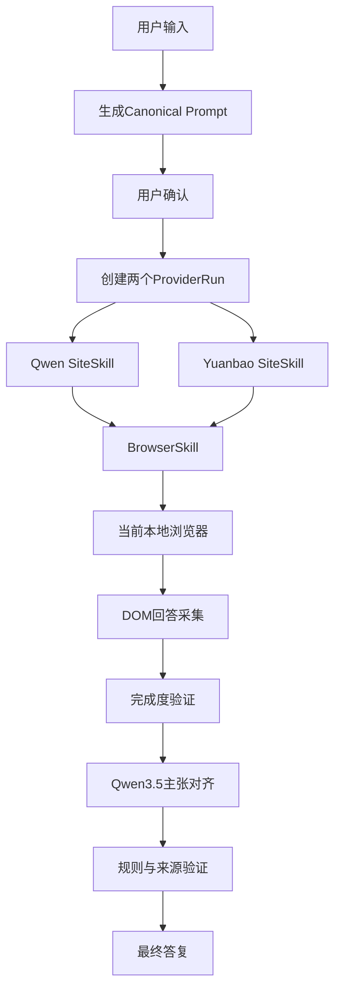

### 10.3 测试路径

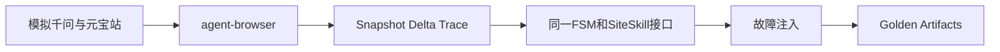

### 10.4 为什么该组合合适

- BrowserSkill 解决最难的当前登录态与用户协作；
- agent-browser 解决隔离回归、trace 和可复现性；
- 确定性 FSM 解决提交防重和崩溃恢复；
- DOM 解决长回答完整性；
- Qwen3.5-9B 在同一模型内覆盖工具调用、文本比较和必要视觉；
- Computer Use 保留为受控 fallback，不污染正常路径；
- 网络流采集按实验逐站启用，不把私有协议风险带进首版。

### 10.5 进程边界

建议五个逻辑进程：

1. UI；
2. Orchestrator；
3. Browser sidecar；
4. Model server；
5. SQLite/Artifact store（可与 Orchestrator 同进程）。

安全边界：

- UI 不直连浏览器调试端口；
- 模型不直接接收 CDP；
- Browser sidecar 只接受 allowlist 领域动作；
- Orchestrator 是唯一写状态和签发提交 token 的组件；
- SiteSkill 只允许千问/元宝 origin。

### 10.6 建议技术选型

| 层 | 首选 | 备选 |
|---|---|---|
| UI | Tauri 2 + React | 本地 Web |
| 编排 | Python + SQLite | TypeScript + SQLite |
| 主浏览器 | BrowserSkill | Playwright CDP |
| 测试浏览器 | agent-browser | Playwright Test |
| 模型服务 | Ollama | llama.cpp |
| 文本/统一模型 | Qwen3.5-9B Q4 | 更高精度量化/更大模型 |
| 视觉回退 | Qwen3.5 视觉或 UI-Mate | Qwen3-VL |
| 主采集 | DOM block extractor | copy 校验 |
| 增强采集 | CDP/SSE 被动观察 | 无 |
| 存储 | SQLite + 本地 artifacts | PostgreSQL 非必要 |

### 10.7 Windows 环境

- Chrome/Edge 使用用户常用稳定版；
- BrowserSkill 扩展/native host 固定兼容版本；
- Ollama 只监听 localhost；
- NVIDIA 驱动使用已验证版本；
- 系统睡眠前暂停任务；
- 浏览器缩放首版固定 100%；
- 禁止同时用 RDP/远控改变 DPI；
- profile 目录不放在实时同步盘；
- 首版只支持一个 Windows 用户会话。

### 10.8 12GB 与 24GB 配置

#### 12GB

- Qwen3.5-9B Q4；
- 8K–16K 上下文；
- 单模型驻留；
- 图片按需送入；
- 两份长回答分块比较；
- 视觉 fallback 时释放多余 KV cache。

#### 24GB

- 9B 更高量化或 14B Q4/Q5（以实际支持为准）；
- 更长上下文；
- 可增加 reranker/embedding；
- 仍不建议两个大模型长期同时驻留。

### 10.9 模型降级

1. 主模型完成比较；
2. OOM 时缩短上下文并按章节比较；
3. 视觉任务转 UI-Mate/Qwen3-VL 分时加载；
4. 仍失败时只展示两份原回答和规则差异；
5. 不因本地模型失败重新访问网页或重发问题。

---

## 11. 实施路线

### 11.1 Phase 0：实验去风险

目标：证明三个未知项，不做产品 UI。

- E1：BrowserSkill 是否可稳定控制当前千问和元宝 tab；
- E2：两个站的 DOM 是否能提取长回答；
- E3：正常/搜索/思考模式的完成信号；
- E4：崩溃点是否能区分已提交和未提交；
- E5：本地 9B 是否可靠输出比较 schema；
- E6：12GB 显存下浏览器和模型是否共存；
- E7：专用 profile 是否触发额外登录验证；
- E8：网络流是否比 DOM 提供实质增益。

退出条件：

- 两站各 20 条代表性回答；
- DOM 完整率达到定义目标；
- 无重复提交；
- 人工 Takeover 可恢复；
- 网络流若未通过，不阻塞进入 PoC。

### 11.2 Phase 1：PoC

范围：

- 本地简单 UI；
- 串行执行千问、元宝；
- BrowserSkill；
- 新对话；
- 普通文本问题；
- DOM 提取；
- 本地比较和最终答复；
- 人工登录；
- 基本日志。

明确不做：

- 附件；
- 多账号；
- 云端；
- 无人值守；
- 私有协议主采集；
- 纯视觉主路径。

### 11.3 Phase 2：MVP

- 持久化状态机；
- provider lease/fencing；
- 双 provider 并行；
- 取消和恢复；
- CAPTCHA/429/未知状态；
- 结构化 AnswerArtifact；
- 来源跳转；
- SiteSkill 版本；
- agent-browser 模拟站回归；
- action/risk budget。

### 11.4 Phase 3：稳定版

- DOM/网络双采集实验；
- 页面指纹 canary；
- 自动熔断；
- 版本兼容矩阵；
- 长回答 block diff；
- 历史任务搜索；
- 导出 comparison artifact；
- 资源自适应；
- SiteSkill 升级回滚。

### 11.5 Phase 4：可选平台化

只有当有第三个以上工作流时考虑：

- OpenClaw/CoWork-OS 宿主；
- 通用 Skill 市场；
- 多模型路由；
- 桌面应用 Computer Use；
- 远程任务。

不要在首版提前承担平台复杂度。

---

## 12. 验证与测试设计

### 12.1 测试金字塔

#### 单元

- 文本规范化；
- canonical HMAC；
- block 转换；
- 流式 delta 拼接；
- 数字/日期/否定规则；
- 状态迁移；
- 冷却与动作预算。

#### 组件

- SiteSkill 对 HTML fixture；
- DOM extractor 对长回答；
- 网络 parser 对脱敏事件流；
- claim/source map；
- provider lease/fencing；
- profile/tab ownership。

#### 模拟站端到端

建立两个本地模拟网页，覆盖：

- 普通流式回答；
- 搜索阶段；
- 思考阶段；
- 代码、表格、公式、引用；
- 虚拟滚动；
- 页面中途刷新；
- 429；
- CAPTCHA；
- 提交后断网；
- 相同问题重复出现；
- DOM/网络不一致。

#### 真实低频 canary

- 每站 1 个短问题；
- 手工观察；
- 不在 CI 自动运行；
- 仅在 SiteSkill/浏览器大版本变更后；
- 失败立即熔断。

### 12.2 故障注入

必须覆盖：

| 故障点 | 预期 |
|---|---|
| fill 前崩溃 | 可安全重启 |
| fill 后 send 前崩溃 | 对账输入框，不自动提交 |
| send 点击瞬间崩溃 | SUBMISSION_UNKNOWN |
| 已生成一半断网 | partial，不重发 |
| 浏览器关闭 | 重绑/人工恢复 |
| tab 被用户导航 | 停止并提示 |
| session TTL 到期 | fencing 后对账 |
| DOM 节点替换 | 重新绑定本轮 assistant |
| 429 | 分提交前后处理 |
| CAPTCHA | Takeover |
| 本地模型 OOM | 分块/规则降级 |
| 两通道正文冲突 | 告警并保留两份 |

### 12.3 Golden Artifacts

每个站点保留脱敏黄金夹具：

- 页面指纹；
- 输入前 snapshot；
- 提交后 snapshot；
- 生成中 snapshot；
- 完成 snapshot；
- AnswerArtifact；
- 可选网络事件流；
- 期望状态序列；
- 期望 blocks；
- SiteSkill/浏览器版本。

动态字段如时间、会话 ID、生成 ID 先规范化再 diff。

### 12.4 质量指标

#### 浏览器

- 提交成功率；
- 重复提交率，目标必须为 0；
- 未知提交率；
- Takeover 率；
- 单次动作数；
- SiteSkill 熔断率。

#### 采集

- 回答完整率；
- block 顺序正确率；
- 代码/表格/引用保持率；
- DOM/网络一致率；
- partial 识别召回。

#### 比较

- common/difference/conflict 分类准确率；
- 来源块存在率；
- 语义支持率；
- 未披露冲突率；
- 最终答案新增无来源事实率。

#### 账号风险

- 429 次数；
- 验证事件；
- 登录失效；
- profile/IP 变化；
- 单日提交量；
- 熔断恢复次数。

### 12.5 验收样本

至少包含：

- 事实问答；
- 开放建议；
- 多步骤技术问题；
- 数字比较；
- 版本/日期敏感问题；
- 包含代码；
- 包含表格；
- 包含来源链接；
- 一方拒答；
- 双方矛盾；
- 双方答案长度极不平衡；
- 长回答；
- 联网搜索；
- 深度思考。

---

## 13. 可观测性与运维

### 13.1 事件日志

记录：

- job/run/attempt；
- 状态迁移和 revision；
- SiteSkill/Transport/浏览器版本；
- 页面 fingerprint；
- 动作类型和 expect 结果；
- completion evidence；
- 风险计数和熔断原因；
- 模型、量化、token/耗时；
- artifact 哈希。

不记录：

- Cookie；
- Authorization；
- 密码；
- MFA；
- 完整敏感请求头；
- 剪贴板全量。

### 13.2 Artifact 保留

建议：

- 最终回答与比较：用户手工删除前保留；
- DOM/snapshot：7 天；
- screenshot：3 天；
- trace：失败任务 7 天，成功任务 1 天；
- 网络事件：只保留脱敏解析结果；
- 登录相关截图：立即或任务结束删除。

这些期限可由用户配置。

### 13.3 版本与回滚

每个任务记录：

- SiteSkill 版本；
- BrowserSkill/agent-browser 版本；
- Chrome/Edge 版本；
- 本地模型和量化；
- prompt/schema 版本；
- extractor/comparator 版本。

升级流程：

1. fixture；
2. 模拟站；
3. 专用 profile；
4. 低频 canary；
5. 主登录通道。

保留最近一个已验证版本，出现未知页面指纹立即回滚或熔断。

---

## 14. 最终决策清单

若现在开始实施，建议直接确定：

- [x] 主通道：BrowserSkill；
- [x] 测试通道：agent-browser；
- [x] 浏览器：Windows Chrome/Edge；
- [x] 模型：Qwen3.5-9B Q4 起步；
- [x] 运行时：Ollama 起步；
- [x] 主采集：本轮 assistant DOM；
- [x] 增强：CDP/SSE 实验通过后启用；
- [x] 控制：确定性持久化 FSM；
- [x] 提交语义：未知效应不重试；
- [x] 比较：主张对齐 + 规则校验 + 来源映射；
- [x] 人工接管：登录/CAPTCHA/MFA/未知页面；
- [x] 风控：单账号单写、低频、动作预算、熔断；
- [x] 禁止：验证码破解、代理轮换、指纹伪造、Cookie 上云；
- [x] 首版范围：纯文本问题，不做附件和多账号。

仍需用实验回答：

- [ ] 千问和元宝当前 DOM 的稳定锚点是什么；
- [ ] 各模式真正可靠的完成信号是什么；
- [ ] DOM 是否能完整水合超长回答；
- [ ] 两站网络流是否稳定且有增益；
- [ ] 12GB 上可接受的上下文和量化；
- [ ] 当前登录浏览器与 BrowserSkill 的兼容边界。

一句话结论：

> 用 BrowserSkill 保留真实登录与人工接管，用确定性 FSM 保护提交，用 DOM 结构化采集回答，用本地 Qwen3.5 做有来源约束的比较与综合；agent-browser 负责隔离测试，Computer Use 只在正常 DOM 路径失效时受限介入。

---

## 15. 资料索引

### 产品与宿主

- [OpenClaw](https://openclaw.ai/)
- [OpenClaw Browser](https://docs.openclaw.ai/tools/browser)
- [OpenClaw Browser Login](https://docs.openclaw.ai/tools/browser-login)
- [WorkBuddy](https://www.workbuddy.ai/)
- [CoWork-OS](https://github.com/CoWork-OS/CoWork-OS)
- [CoWork-OS Architecture](https://github.com/CoWork-OS/CoWork-OS/blob/HEAD/docs/architecture.md)
- [CoWork-OS Browser Workbench](https://github.com/CoWork-OS/CoWork-OS/blob/main/docs/browser-workbench.md)

### 浏览器框架

- [Tencent BrowserSkill](https://github.com/Tencent/BrowserSkill)
- [BrowserSkill Cooperation](https://github.com/Tencent/BrowserSkill/blob/main/packages/dsh-plugin-browserskill/skill/references/cooperation.md)
- [BrowserSkill Profiles](https://github.com/Tencent/BrowserSkill/blob/main/docs/browser-profiles.md)
- [agent-browser](https://github.com/vercel-labs/agent-browser)
- [agent-browser Commands](https://github.com/vercel-labs/agent-browser/blob/main/skill-data/core/references/commands.md)
- [browser-harness](https://github.com/browser-use/browser-harness)
- [browser-harness MCP](https://github.com/browser-use/browser-harness/blob/main/docs/MCP.md)
- [browser-use](https://github.com/browser-use/browser-use)
- [browser-use Real Browser](https://docs.browser-use.com/open-source/customize/browser/real-browser)
- [Playwright Authentication](https://playwright.dev/docs/auth)

### Computer Use 与本地模型

- [Claude Computer Use](https://docs.anthropic.com/en/docs/agents-and-tools/tool-use/computer-use-tool)
- [UI-Mate](https://github.com/Tencent/UI-Mate)
- [Qwen3.5-9B](https://huggingface.co/Qwen/Qwen3.5-9B)
- [Qwen3-VL-8B-Instruct](https://huggingface.co/Qwen/Qwen3-VL-8B-Instruct)
- [ShowUI](https://github.com/showlab/ShowUI)

### 本地运行时

- [Ollama Windows](https://docs.ollama.com/windows)
- [llama.cpp](https://github.com/ggml-org/llama.cpp)
- [vLLM Installation](https://docs.vllm.ai/en/stable/getting_started/installation/gpu/)

### 资料解释

- 项目 README/官方文档用于判断公开能力和接口；
- 产品官网用于判断定位，不将宣传语当作实测性能；
- 模型卡用于判断模型特性，不替代本机基准；
- 账号风险数值是保守工程起点，不是平台公开阈值；
- 千问/元宝 DOM 与网络协议未在本设计阶段实测，因此明确列入 Phase 0。


