# Qwen 浏览器 Agent 研究与设计

> 文档版本：3.0  
> 研究截点：2026-11-11  
> 目标系统：Windows 11 + Chrome + CPU-only 本地模型  
> 目标站点：用户已登录的阿里千问（Qwen）网页版  
> 使用方式：个人、低频、用户显式发起  
> 文档性质：技术研究与系统设计，不包含实现代码

---

## 0. 决策摘要

### 0.1 需求的准确定位

这个系统不是一个需要在任意网站自由探索的“万能浏览器 Agent”，而是一个固定站点、固定动作、固定输出的数据流水线：

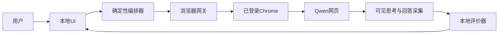

其核心难点不是“怎样让模型学会点击”，而是：

1. 如何稳定复用当前登录态；
2. 如何确保一个问题最多提交一次；
3. 如何准确绑定本轮新回复，而不是历史回复；
4. 如何区分网页实际显示的“思考过程”和最终回答；
5. 如何判断流式生成真正结束；
6. 如何在页面改版、断网、登录失效和验证码出现时安全停止；
7. 如何让纯 CPU 本地小模型给出可校验、不过度自信的评价；
8. 如何在不依赖反检测技术的前提下尽量降低账号异常风险。

### 0.2 首选结论

短期 PoC 和首个可用版本推荐：

> **Tencent BrowserSkill + 自研持久化状态机 + Qwen 站点适配器 + DOM/ARIA 采集 + llama.cpp/Ollama 上的 Qwen3-4B Q4 + Windows 本地 UI。**

理由：

- BrowserSkill 可以通过 Chrome 扩展直接复用已登录的真实 profile；
- 每个任务使用可见 Agent Window，用户可观察和接管；
- 正常路径使用 DOM、可访问性树和元素引用，不需要视觉模型；
- 浏览器动作可以被限制为 Qwen 站点的少数领域操作；
- 本地模型不负责每一步点击，只负责回答评价；
- CPU-only 下 4B 量化模型比 9B、视觉模型或多 Agent 循环更现实；
- BrowserSkill 自带会话、标签页所有权和诊断能力，PoC 成本低于自研扩展；
- 后续可以把 BrowserGateway 替换为自研 MV3 扩展，不需要重写状态机、评价器和 UI。

推荐的工程组合是：

| 层 | 首选 |
|---|---|
| UI | .NET 8 WPF/WinUI 3；若团队更熟悉 Web，可选 Tauri 2 + React |
| 编排 | 自研显式、持久化状态机 |
| 浏览器主通道 | Tencent BrowserSkill |
| 浏览器回归通道 | agent-browser 或 Playwright + 专用测试 profile |
| 观察 | DOM/ARIA 为主，截图仅用于诊断 |
| 提取 | 本轮 assistant DOM + MutationObserver 文本快照差分 |
| 本地推理 | llama.cpp `llama-server`；Ollama 用于最快起步 |
| 基线模型 | Qwen3-4B-GGUF Q4_K_M，非思考模式 |
| 质量升级 | RAM 足够时测试 Qwen3-8B Q4；Qwen3.5-4B 作为实验候选 |
| 持久化 | SQLite + 文件 Artifact 目录 |
| 人工接管 | 登录、MFA、CAPTCHA、未知页面、未知提交结果 |

### 0.3 长期最优与短期最优不同

BrowserSkill 是短期最优，但不必假设它永远是终态。

- **最快落地**：BrowserSkill；
- **固定单站长期维护最优**：自研 MV3 Chrome 扩展 + Native Messaging；
- **回归、Trace 和隔离测试最优**：Playwright/agent-browser + 专用持久 profile；
- **Windows 原生一体化最优**：.NET + WebView2，但它不能直接继承 Chrome 登录态；
- **任意网站探索最灵活**：browser-use/CoWork-OS 类通用 Agent，但不适合作为本固定流程的主循环；
- **稳定性和账号风险最低的对照**：Qwen 官方 API，但它不等价于网页版。

### 0.4 一个必须澄清的概念：思考过程

本文只采集并展示 **Qwen 网页实际向用户显示的可见思考内容**。

系统不应：

- 声称获得模型隐藏的内部思维链；
- 从隐藏 DOM、私有接口或调试字段中推断未向用户展示的推理；
- 在页面没有明确分区时，根据语言风格猜测哪段是“思考”；
- 把加载提示、搜索过程、工具状态或引用摘要误标为思考过程。

建议 UI 使用以下状态：

| 状态 | 含义 |
|---|---|
| `visible` | 页面存在明确、可见的思考分区，已采集 |
| `not_present` | 本轮页面没有显示思考分区 |
| `collapsed` | 页面显示思考分区但当前折叠，可由正常按钮展开 |
| `unknown` | 页面结构无法可靠区分，不作猜测 |
| `partial` | 生成中断，只取得部分可见思考 |

### 0.5 账号风险结论

没有 BrowserSkill、Playwright、视觉点击或所谓“更像人”能够保证不封号或不进入风控名单。

截至研究截点，千问用户服务协议明确限制未经书面许可使用自动化程序接入服务、收集或处理服务内容，以及通过非官方第三方软件进行自动化操作。这个事实与“私人自用”并不冲突：私人自用降低规模风险，但不会消除平台条款和账号处置风险。

本文不把合规讨论扩展为主线，但由于用户明确关注封号风险，必须给出直接结论：

- 官方 API 的账号风险最低；
- 网页自动化始终存在不可消除的账号风险；
- 低频、单会话、可见浏览器、稳定设备和遇验证停机只能降低异常概率，不能提供保证；
- 不采用 stealth、隐藏 WebDriver、指纹伪造、验证码代答、代理轮换、账号池、Cookie 搬运或私有接口重放；
- “模拟人类随机抖动”本身不是可靠风险控制，反而会增加动作数量、误操作和不可复现性；
- 最重要的控制不是随机等待，而是少动作、无并发、无盲重试、用户显式发起和出现异常立即停止。

---

## 1. 需求工程化拆解

### 1.1 原始流程重述

原始六步可重述为七个有明确输入输出的阶段：

1. **创建任务**
   - 用户在本地 UI 输入问题；
   - 生成不可变 `canonical_prompt`；
   - 生成 `run_id` 和问题哈希；
   - 用户确认后任务进入待执行。
2. **准备浏览器**
   - 选择已经核实的 Chrome profile；
   - 建立受限浏览器会话；
   - 导航或切换到 Qwen；
   - 检查登录、页面版本和输入能力。
3. **提交问题**
   - 创建新对话或确认目标对话；
   - 填入相同的规范问题；
   - 提交一次；
   - 记录提交前后证据。
4. **采集生成过程**
   - 绑定本轮新 user turn 和 assistant turn；
   - 监听可见思考区和回答区；
   - 向 UI 推送增量；
   - 不把增量事件直接当作最终原文。
5. **完成与归一化**
   - 通过多个信号判断生成完成；
   - 重新读取最终 DOM；
   - 规范化为块结构；
   - 标记完整、部分或未知。
6. **本地评价**
   - 确定性规则先检查；
   - 本地小模型按量表评价；
   - 校验结构化输出；
   - 输出分数、问题、证据引用和不确定项。
7. **展示与持久化**
   - UI 并列显示可见思考、最终回答和本地评价；
   - 保存运行状态、版本和诊断 Artifact；
   - 不保存 Cookie、密码和完整敏感请求头。

### 1.2 必须功能

- 输入纯文本问题；
- 选择或确认目标 Chrome profile；
- 检测 Qwen 是否已登录；
- 新建或使用指定对话；
- 至多提交一次；
- 绑定本轮消息；
- 流式展示网页可见思考；
- 流式展示网页回答；
- 正确判断完成、部分完成和未知；
- 本地规则评价；
- 本地模型评价；
- UI 展示原文与评价；
- 取消、暂停和人工接管；
- 页面改版熔断；
- 应用重启后恢复到安全状态；
- 保存足以诊断问题但不包含登录凭据的事件和 Artifact。

### 1.3 可选功能

- 选择 Qwen 网页可见模型；
- 切换网页的深度思考、联网搜索等可见开关；
- 展开或收起网页可见思考；
- 历史任务搜索；
- 导出 Markdown；
- 评价模板切换；
- 二次本地评价；
- 低置信度人工复核；
- 回答引用链接格式检查；
- 浏览器 trace、视频或网络元数据；
- 后续支持其他网页模型。

### 1.4 首版非目标

- 任意网站万能 Agent；
- 多账号和账号池；
- 并发批量提问；
- 后台定时刷题；
- CAPTCHA 自动识别或代答；
- 绕过安全验证；
- 指纹伪装、隐藏自动化标志或 stealth browser；
- 代理轮换；
- 复制、导出或同步 Chrome Cookie；
- 逆向或重放 Qwen 私有 API；
- 获取网页未展示的隐藏推理；
- 自动点击 Qwen 回答中的外部链接；
- 自动上传本地文件；
- 让网页文本改变系统权限、工具白名单或评价标准；
- 把本地小模型的评价当成事实正确性的证明。

### 1.5 非功能目标

| 指标 | 设计目标 |
|---|---|
| 自动重复提交 | 0 |
| 提交效果未知时自动重发 | 0 |
| 单账号并发生成 | 1 |
| CAPTCHA 后自动动作 | 0 |
| 正常路径视觉模型调用 | 0 |
| 最终回答来源 | 完成后最终 DOM 快照 |
| 流式 UI | 增量延迟可感知但不要求逐 token |
| 页面结构未知 | 失败关闭，不猜测 |
| 评价输出 | 100% 通过 Schema 或进入人工复核 |
| 重要评价问题 | 必须引用回答原文片段 |
| 本地模型崩溃 | 不影响已采集的 Qwen 原文 |
| 浏览器崩溃 | 不导致自动重发 |
| 日志 | 不含 Cookie、Token、密码和完整 Profile |

这些是验收目标，不是所选框架自动提供的保证。

### 1.6 环境假设

已确认：

- Windows 11；
- Chrome；
- 用户已在 Chrome 登录 Qwen；
- 无本地 GPU，只有 CPU；
- 个人使用；
- 不要求大规模并发。

未确认但会显著影响本地模型选型：

- 物理内存容量；
- CPU 型号、物理核心数和内存带宽；
- Qwen 回答的典型长度；
- 用户可接受的评价等待时间；
- 是否允许首次为自动化专用 profile 手工登录；
- 是否允许安装 Chrome 扩展。

因此本文提供分级方案，并把最终 tokens/s、峰值内存和端到端耗时列为目标机器实测项。

---

## 2. 研究方法与证据规则

### 2.1 研究过程

本次研究采用以下顺序：

1. 把原始流程拆成状态、数据对象和失败模式；
2. 将“完整 Agent 产品”“浏览器执行器”“模型运行时”“桌面 UI”分层；
3. 研究官方文档、官方 GitHub、官方 release 和模型卡；
4. 区分复用现有 Chrome、使用专用 profile 和内嵌浏览器三种登录态路线；
5. 分别评价操作、流式采集、完成判定和本地评价；
6. 先应用硬约束，再进行加权评分；
7. 给出短期、长期和条件化结论；
8. 把无法从文档确认的 Qwen 页面细节列为 Phase 0 实测，而不是假装已有稳定选择器。

### 2.2 证据等级

| 等级 | 来源 | 用途 |
|---|---|---|
| A | 平台协议、浏览器和操作系统官方文档 | 安全边界、平台能力、账号风险 |
| B | 项目官方仓库、官方文档、官方 release | 架构、接口、平台支持、成熟度 |
| C | 官方模型卡和厂商 benchmark | 候选筛选，不能代替本机实测 |
| D | Issue、Discussion、社区量化仓库 | 发现兼容性和性能线索 |
| E | 本项目目标机器与真实页面实测 | 最终选型依据 |

### 2.3 事实标签

文档中的判断可分为：

- **已核实事实**：有一手资料支持；
- **工程判断**：基于事实对本项目的推导；
- **待实测**：Qwen DOM、完成信号、本机性能等当前无法仅靠资料确认；
- **不采用**：与 CPU-only、稳定性或账号风险目标冲突。

### 2.4 选择问题

每项技术都回答：

1. 它属于哪一层？
2. 能否复用当前已登录 Chrome？
3. 是否需要远程调试端口？
4. 正常观察是 DOM、ARIA、截图还是网络？
5. 能否精确提取长回答、代码块和表格？
6. 是否支持持续监听流式 DOM？
7. 提交效果未知时如何对账？
8. 页面变化后如何诊断？
9. 是否需要大模型逐步规划？
10. CPU-only 下是否可接受？
11. 用户能否看到并接管？
12. 对账号异常风险的影响是什么？

### 2.5 证据可复现性

资料索引中的 `main`、`HEAD` 和产品文档链接便于阅读最新内容，但不适合作为长期不变的实施证据。进入 Phase 0 后应建立证据清单：

| 字段 | 说明 |
|---|---|
| `claim_id` | 本文关键事实编号 |
| `source_url` | 官方来源 |
| `accessed_at` | 实际访问日期 |
| `release_or_commit` | release、tag、commit 或模型 revision |
| `local_excerpt` | 支撑结论的最小摘录 |
| `verification` | 已核实/待实测/已失效 |

模型文件还应记录仓库 revision 和 SHA256。研究时通过 Hugging Face 元数据核实：

- `Qwen/Qwen3-4B-GGUF` revision：`bc640142c66e1fdd12af0bd68f40445458f3869b`；
- `Qwen/Qwen3-4B-Instruct-2507` revision：`cdbee75f17c01a7cc42f958dc650907174af0554`。

这些 revision 只代表研究截点，实施时应重新核验并有意识地升级，不能静默跟随 `latest`。

---

## 3. 技术分层地图

### 3.1 分层视图

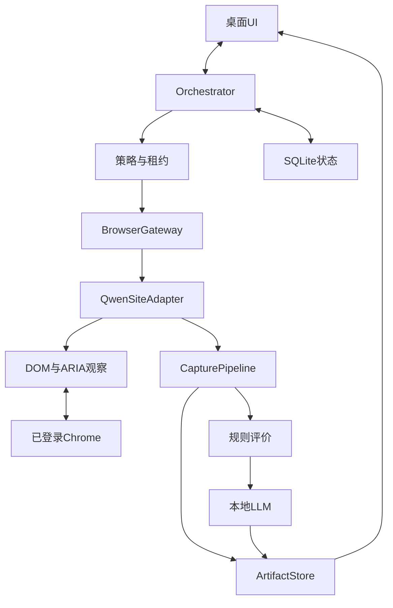

### 3.2 Agent 宿主层

候选：

- 自研轻量状态机；
- OpenClaw；
- WorkBuddy；
- CoWork-OS；
- LangGraph；
- PydanticAI；
- AutoGen/CrewAI。

本项目只有一个固定站点和一个固定评价步骤。完整多 Agent 平台不是必要条件。首版最适合自研显式状态机；PydanticAI 可用于评价输出；只有需要复杂分支、人审 checkpoint、跨任务恢复时再考虑 LangGraph。

### 3.3 浏览器传输层

候选：

- BrowserSkill 扩展桥；
- Playwright MCP 扩展模式；
- Chrome DevTools MCP `--autoConnect`；
- 自研 MV3 扩展 + Native Messaging；
- Playwright/CDP 专用 profile；
- agent-browser；
- browser-harness；
- Selenium/WebDriver BiDi；
- WebView2；
- OS 级鼠标键盘。

浏览器传输层只应提供受限、可审计能力，不应让评价模型获得任意 URL、任意 JavaScript、任意文件读取或整个桌面的自由控制。

### 3.4 感知层

优先级：

1. Qwen 站点语义 DOM；
2. 可访问性树；
3. 当前可见文本；
4. 浏览器截图，仅诊断或人工接管；
5. OCR/视觉，最终兜底；
6. 网络事件只作完成见证，不作首版正文主源。

### 3.5 站点技能层

`QwenSiteAdapter` 应是浏览器框架之上的稳定领域接口：

- `inspect_page`
- `ensure_logged_in`
- `ensure_ready`
- `start_new_conversation`
- `prepare_prompt`
- `commit_prompt`
- `bind_turn`
- `observe_turn`
- `read_final_turn`
- `detect_challenge`
- `collect_diagnostics`
- `release_session`

上层状态机不应知道 Qwen 的 CSS 类名；下层适配器不应自行决定重试或再次提交。

### 3.6 采集层

采集层负责：

- 将 DOM 变化转换为可重放事件；
- 区分可见思考和最终回答；
- 保留标题、列表、代码、表格、链接和引用顺序；
- 生成最终完整快照；
- 标记 `complete`、`partial`、`unknown`；
- 提供证据定位信息。

### 3.7 本地评价层

本地评价不是另一个自由 Agent，而是一个有限输入、有限输出的 Judge：

- 输入：用户问题、Qwen 可见思考、Qwen 最终回答、评价标准；
- 输出：维度分数、问题列表、证据引用、不确定项和摘要；
- 不允许：控制浏览器、读取 Cookie、访问文件系统或修改评价规则。

---

## 4. 同类产品与框架研究

### 4.1 OpenClaw

#### 定位

OpenClaw 是完整 Agent Gateway，而不是单纯浏览器库。它提供会话、模型、工具、审批、节点和浏览器路由。

#### 已核实能力

- 支持 OpenClaw 管理的独立 Chromium profile；
- 支持显式 CDP URL；
- 支持通过 Chrome DevTools MCP 连接现有 Chrome session；
- 浏览器观察覆盖页面快照、截图、网络和控制台；
- 完整平台能力远多于本项目所需。

#### 可借鉴

- Gateway 与执行节点分离；
- profile 抽象；
- 权限与审批；
- 浏览器与模型解耦；
- 工具白名单。

#### 局限

- Windows 部署和完整 Gateway 比轻量单站工具更重；
- 工具面太大，需要大量裁剪；
- 本地 CPU 小模型承担完整 Agent 规划时可靠性不足；
- 页面采集和提交防重仍需自研 Qwen SiteAdapter。

#### 结论

适合未来平台化，不适合首版基础。

### 4.2 WorkBuddy

#### 定位

WorkBuddy 是完整桌面 Agent 产品。其 Chrome 扩展通过 Native Messaging 连接本地桌面程序，只控制显式打开或分享给会话的标签页。

#### 已核实能力

- 可复用浏览器登录态；
- 扩展只连接本地 WorkBuddy/CodeBuddy；
- 支持 Ollama 的 OpenAI-compatible 本地接口；
- 产品提供并行任务、技能和 MCP 等完整工作台功能。

#### 可借鉴

- 扩展 + Native Messaging；
- 显式分享标签页；
- 本地桌面应用承载模型和工作流；
- 浏览器所有权可见。

#### 局限

- 产品本体不是可自由裁剪的开源基础库；
- 内部浏览器控制和恢复语义未完全公开；
- 作为最终产品使用可以，但作为自研系统底座的可控性较低。

#### 结论

适合借鉴产品体验，不作为自研核心依赖。

### 4.3 CoWork-OS

#### 定位

CoWork-OS 是开源 Electron Agent 工作台。Browser V2 使用统一 browser session、可见 Workbench 和主进程工具桥。

#### 可借鉴

- 浏览器 session 统一抽象；
- 可见执行面；
- 工具审批；
- Electron 主进程与 renderer 分工；
- SQLite 和事件持久化；
- 现有 Chrome/CDP adapter。

#### 局限

- 完整系统较重；
- Electron 内存高于本需求必要水平；
- 通用工具面扩大安全和维护范围；
- 本地小模型做通用 Agent 规划仍是瓶颈。

#### 结论

若目标是完整个人 Agent 工作台，契合度高；若只做 Qwen 固定流水线，自研轻量应用更合适。

### 4.4 Claude Computer Use

#### 交互范式

Claude Computer Use 基于截图、鼠标和键盘工具循环。客户端执行工具调用，再把新截图返回模型。

#### 可借鉴

- 观察—动作—新观察循环；
- 用户可随时停止；
- 应用级权限；
- 高风险操作人工确认；
- 页面内容视为不可信输入。

#### 不适合作为本项目基础的原因

- 依赖云端视觉模型；
- 纯 CPU 本地视觉模型不可现实地替代其质量；
- 屏幕 OCR 难以精确保留长回答、代码块和表格；
- 坐标受 DPI、缩放、弹窗和窗口焦点影响；
- 每一步都让模型规划会增加动作数和账号异常风险。

#### 结论

只作为设计参考和极端回退，不作为主路径。

### 4.5 Tencent BrowserSkill

#### 架构

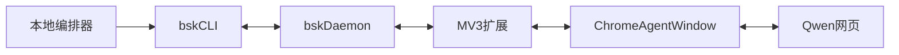

#### 已核实能力

- Windows x64；
- Chrome/Edge 125+；
- CLI/daemon 与 MV3 扩展；
- 扩展通过 CDP 和 WebExtension API 操作页面；
- 每个 session 创建独立 Agent Window；
- Agent Window 默认共享所选 profile 的登录态；
- 用户 tab 需要显式借用；
- 会话级工具队列；
- DOM、AX、截图、网络、控制台和视频诊断；
- 用户可见并可人工接管。

#### 优点

- 与“现有 Chrome 已登录 Qwen”硬约束最匹配；
- 不需要复制 Cookie；
- 不依赖默认 profile 的远程调试端口；
- 正常路径不需要视觉模型；
- 标签页所有权和 Agent Window 降低误操作；
- 工具结果适合 Agent 消费。

#### 局限

- 项目较新，版本变化快；
- 扩展具有较高浏览器权限；
- Agent Window 与普通窗口共享登录态，不是安全沙箱；
- Qwen 的流式 DOM 采集和提交防重仍需站点适配器；
- 断线后的业务事务恢复必须由上层状态机完成。

#### 权限现实

BrowserSkill 官方权限说明包含 `<all_urls>`、`debugger`、`tabs`、`windows`、`downloads`、`scripting` 等能力。它的 Agent Window、会话所有权和本项目的 Qwen allowlist 是应用层保护，不会把扩展本身变成只拥有 Qwen 域名权限的最小权限扩展。

实施时必须：

- 固定 CLI、daemon 和扩展的已验证版本组合；
- 检查组件版本不匹配；
- 使用本地配对和认证；
- IPC/WS 仅限 loopback 或受认证通道；
- 禁止其他本机进程复用控制端点；
- 默认关闭网站调试响应体、视频和不必要的网络记录；
- 明确扩展自动更新后的重新验收流程；
- 将供应链、扩展被替换和本机恶意进程列入威胁模型。

#### 结论

首版浏览器主通道首选。

### 4.6 Playwright 与 Playwright MCP

#### 已核实能力

- Playwright 提供成熟 locator、actionability、自动等待、截图、Trace 和 DOM 访问；
- Playwright MCP 使用可访问性快照和元素引用；
- MCP 扩展模式可连接现有 Chrome/Edge 标签页，复用登录态、Cookie 和已安装扩展；
- 可选择指定 profile；
- 也可使用持久 profile 或 CDP endpoint。

#### 优点

- 工程成熟度和测试工具最好；
- Qwen SiteAdapter 易写；
- MutationObserver、DOM block 提取和最终快照实现自然；
- Trace 对页面改版和失败诊断价值高；
- 专用 profile 可稳定回归。

#### 局限

- 普通 Playwright 直接连接当前默认 Chrome profile 受 Chrome 调试策略影响；
- MCP 工具面比固定站点接口大；
- 扩展模式适合 PoC，但产品内嵌需要自己管理 MCP 生命周期；
- `connectOverCDP` 的功能保真度低于 Playwright 自己启动的浏览器连接。

#### 结论

Playwright 是最佳站点适配开发与测试基础之一；若使用当前登录态，优先扩展模式；若重视回归，使用专用持久 profile。

### 4.7 Chrome DevTools MCP

#### 已核实能力

- Chrome 官方工具；
- Chrome 144+ 支持 `--autoConnect` 到正在运行的 Chrome；
- 用户需在 Chrome 设置中启用远程调试；
- 每次连接由 Chrome 弹窗批准；
- 可访问当前 profile 的标签、Cookie、存储和登录账号；
- 提供页面、网络、控制台和性能诊断；
- 默认存在使用统计和 CrUX URL 查询，可关闭。

#### 优点

- 官方维护；
- 诊断和 CDP 能力全面；
- 可连接当前已登录浏览器；
- 对开发阶段定位 DOM、网络和性能问题很强。

#### 局限

- 每次连接批准不适合完全无人值守；
- 工具面偏调试，不是最精简产品运行时；
- 对当前 profile 权限很大；
- 需要上层限制 URL、JavaScript 和文件能力；
- 逐步 MCP 调用不是最佳流式 DOM 推送机制。

#### 结论

研发诊断优先，产品运行时次选。

### 4.8 agent-browser

#### 架构与能力

- Rust CLI + 常驻 daemon + CDP；
- Windows 本地 TCP IPC；
- 可连接现有调试浏览器；
- accessibility snapshot、紧凑 ref、delta snapshot；
- 控制台、错误、Trace 和 profiler；
- 浏览器本身不是 Agent，只是执行器。

#### 优点

- 资源轻；
- CLI 易被任何语言编排；
- snapshot/delta 对 Agent 友好；
- 会话和诊断能力强；
- 适合模拟站和专用 profile 回归。

#### 局限

- 当前 profile 连接仍依赖 Chrome 远程调试能力；
- ref 在页面变化后失效；
- 精确流式采集需要注入 observer 或定时读取；
- 项目版本演进快，需要锁定已验证版本。

#### 结论

测试通道首选，生产主通道备选。

### 4.9 browser-harness

#### 架构与能力

- Chrome/CDP WebSocket 到 daemon；
- Windows 使用 loopback TCP + 私有元数据；
- Agent 通过 Python helper 或原始 CDP 操作；
- 可以连接真实 Chrome 登录态；
- 可按任务扩展 helper。

#### 优点

- 薄、自由、易扩展；
- Windows 已有原生 daemon relay；
- 对可信开发 Agent 很灵活；
- 可以编写站点专用观察 helper。

#### 局限

- 默认鼓励 Agent 编写和执行 Python/CDP，权限面较大；
- 固定 Qwen 流程没有必要让模型自由写浏览器代码；
- 产品化仍需封装固定动作和状态机；
- 版本较新。

#### 结论

适合研发实验，不如 BrowserSkill 或直接 Playwright 适合作为固定产品边界。

### 4.10 browser-use

#### 当前架构

browser-use 1.0 使用持久 Python REPL、browser-harness helper、原始 CDP 和 Pydantic AI，让模型编写动作代码完成任务。

#### 优点

- 通用自主浏览能力强；
- PoC 快；
- 未知页面适应性高；
- 可连接当前 Chrome 或本地持久 profile；
- 社区活跃。

#### 局限

- 需要模型每步观察和规划；
- CPU 小模型的工具调用、异常恢复和长任务稳定性不足；
- 固定流程使用它会增加 token、等待和动作数；
- 自主探索更容易产生无用滚动、重复点击和刷新；
- 官方建议精确锁定版本，说明 API 变化较快。

#### 结论

不作为固定 Qwen 主循环；可用于对比 PoC 或未来未知网站扩展。

### 4.11 Stagehand

#### 能力

- CDP 驱动 Chromium；
- `observe` 发现结构化动作；
- `act` 执行动作；
- `extract` 按 Schema 提取；
- 可连接现有浏览器 CDP；
- 可将观察结果缓存后确定性重放。

#### 适用性

Stagehand 比完全自由的 browser-use 更容易“先观察、再确定执行”。但是它的语义操作和提取仍依赖模型调用。本项目站点固定，直接 SiteAdapter 的可靠性和 CPU 成本更好。

#### 结论

适合中等确定性的业务自动化，不是本项目首选。

### 4.12 Selenium/WebDriver BiDi

#### 已核实能力

- Selenium Manager 自动管理驱动；
- Windows 正式支持；
- WebDriver BiDi 提供网络、控制台和 JavaScript 事件；
- W3C 标准，跨浏览器。

#### 优点

- 成熟、跨语言、跨浏览器；
- 企业已有 Selenium 栈时复用价值高；
- BiDi 逐步替代旧 CDP 绑定。

#### 局限

- 本项目只需要 Chrome；
- Trace、locator 开发体验和自动等待通常不如 Playwright；
- 连接当前普通 Chrome profile 并不比扩展桥自然；
- 流式 DOM observer 仍需自研。

#### 结论

技术上可行，但没有理由优先于 Playwright/BrowserSkill。

### 4.13 自研 MV3 扩展 + Native Messaging

#### 架构

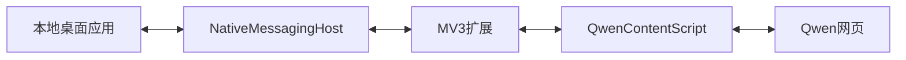

#### 优点

- 直接复用当前 Chrome profile；
- 不需要开放远程调试端口；
- Content Script 可持续监听 DOM 并主动推送事件；
- 可把权限限制为 Qwen 域名；
- 运行时资源最低；
- 固定单站时行为最确定；
- 不需要本地模型参与点击。

#### 局限

- 前期开发成本最高；
- MV3 service worker 生命周期、消息重连和版本发布要自己处理；
- 页面改版适配责任完全在项目；
- Native Messaging 安装和更新需要维护；
- 若使用 `chrome.debugger` 会增加权限和复杂度。

#### 结论

长期单站技术最优，但首版不应先重复造 BrowserSkill 已提供的桥。

### 4.14 纯视觉与 Windows UI Automation

#### 纯视觉

- 优点：不依赖 DOM，任何可见 UI 可操作；
- 缺点：CPU-only 不适合高质量 VLM；OCR 丢结构；坐标脆弱；动作多。

#### Windows UIA

- 优点：适合浏览器外系统弹窗、窗口、焦点和原生控件；
- 缺点：网页 UIA 投影不等于完整 DOM，长回答结构差，Canvas 不可靠。

#### 结论

UIA 可作为系统弹窗辅助；纯视觉只作人工确认和灾难回退。

### 4.15 总体比较

| 技术 | 类型 | 当前登录态 | 主观察 | CPU开销 | 固定Qwen契合度 | 主要用途 |
|---|---|---:|---|---:|---:|---|
| BrowserSkill | 扩展执行器 | 强 | DOM/AX/CDP | 低 | 很高 | 生产主通道 |
| 自研MV3 | 定制执行器 | 强 | DOM | 最低 | 很高 | 长期终态 |
| Playwright MCP扩展 | MCP执行器 | 强 | AX/DOM | 低中 | 高 | PoC/开发 |
| Playwright专用Profile | 自动化框架 | 需单独登录 | DOM/AX | 低中 | 高 | 回归/生产备选 |
| agent-browser | CLI执行器 | 中 | AX/CDP | 低 | 高 | 测试/备选 |
| Chrome DevTools MCP | 调试执行器 | 强 | DOM/CDP | 中 | 中高 | 研发诊断 |
| browser-harness | 薄CDP | 中高 | CDP/自定义 | 低中 | 中高 | 实验 |
| Selenium | 自动化框架 | 中 | DOM/BiDi | 中 | 中 | 既有栈 |
| Stagehand | 语义自动化 | 中 | AX/模型 | 中高 | 中 | 半通用任务 |
| browser-use | 自主Agent | 中高 | DOM/AX/模型 | 高 | 中低 | 未知网站 |
| Computer Use | 视觉Agent | 强 | 截图 | 很高 | 低 | 最终兜底 |

---

## 5. 浏览器连接与登录态

### 5.1 模式 R1：扩展接入当前 Chrome profile

代表：

- BrowserSkill；
- Playwright MCP 扩展；
- WorkBuddy 扩展；
- 自研 MV3 扩展。

优点：

- 直接复用当前登录态；
- 不复制 Cookie；
- 登录、MFA 和验证码在同一可见浏览器内由用户处理；
- 不受 Chrome 136 默认 profile 调试端口限制；
- 用户可看到真实页面。

风险：

- 扩展获得当前 profile 中较高权限；
- 若不做 Agent Window 或 tab ownership，可能误操作用户其他标签；
- 当前 profile 里可能有其他敏感网站，必须限制任务标签和域名。

结论：最符合本需求。

### 5.2 模式 R2：专用持久 profile

代表：

- Playwright persistent context；
- agent-browser；
- Selenium；
- 独立 Chrome + CDP。

优点：

- 自动化与日常浏览隔离；
- 版本、启动参数、viewport 和 Trace 可控；
- 回归最稳定；
- 可以为测试页面使用独立账号或非生产环境。

缺点：

- 首次需要用户手工登录 Qwen；
- 登录设备和 profile 变化可能触发额外验证；
- 不直接等于“当前已经登录的 Chrome”。

结论：测试首选，生产备选。

### 5.3 模式 R3：默认 profile + 远程调试端口

Chrome 官方从 136 起不再允许 `--remote-debugging-port` 或 `--remote-debugging-pipe` 直接作用于默认 Chrome 数据目录；必须使用非默认 `--user-data-dir`。这是为了降低 Cookie 窃取风险。

因此：

- 不应假设可以给日常默认 Chrome 加 `--remote-debugging-port=9222`；
- 不应复制默认 profile 目录来规避限制；
- 需要现有登录态时，应优先使用官方/框架扩展桥或 Chrome 144+ 的用户批准连接；
- 若使用非默认数据目录，应把它当作独立持久 profile，并由用户正常登录。

### 5.4 模式 R4：Chrome 144+ 用户批准连接

Chrome DevTools MCP 和相关工具可以请求连接正在运行的 Chrome：

- 用户先启用远程调试；
- Agent 请求连接；
- Chrome 每次显示批准对话框；
- 连接期间显示自动化控制提示。

优点是官方、透明；缺点是每次连接需要用户参与，且连接后权限很大。适合开发、诊断和人工在环，不适合作为完全无感的后台服务。

### 5.5 模式 R5：内嵌 WebView2

WebView2 使用自己的 User Data Folder，不会自动继承 Chrome 登录态。

优点：

- 应用内直接显示网页；
- 登录、接管和状态展示一体化；
- DOM 脚本与本地消息桥容易；
- Windows 崩溃恢复接口明确。

缺点：

- 用户需要在 WebView2 中重新登录；
- 实际内核是 Edge WebView2，不是用户指定的 Chrome；
- 消费者网站可能对嵌入式浏览器行为不同；
- 本地 UI 和远程网页必须严格隔离。

### 5.6 推荐登录态策略

首版：

1. 用户在 BrowserSkill popup 中确认目标实例；
2. 系统保存 BrowserSkill 实例 ID 或受控别名，不保存 Chrome profile 路径作为身份；
3. 每次任务显式指定已核实实例；
4. 在 Agent Window 打开 Qwen；
5. 登录失效时进入人工接管；
6. 不自动尝试密码、二维码、短信或 MFA。

测试：

1. 使用独立持久 profile；
2. 模拟页面和公开 fixture 为主；
3. 真实 Qwen 只做低频 canary；
4. 不对主账号做高频回归。

---

## 6. Qwen 页面操作与回答采集

### 6.1 为什么固定 SiteAdapter 优于自由 Agent

固定流程只有少数合法动作：

- 打开 Qwen；
- 新建对话；
- 确认可用；
- 填写问题；
- 提交一次；
- 展开可见思考；
- 读取本轮回复；
- 停止或交还人工。

把这些动作做成确定性领域工具，比让模型每一步重新观察和规划更好：

- 动作更少；
- 可测试；
- 可回放；
- 能实现提交防重；
- 页面变化时失败关闭；
- 不会因网页中的提示词而扩大权限；
- 不要求 CPU 小模型具备可靠工具规划能力。

### 6.2 选择器策略

优先级：

1. ARIA role 与 accessible name；
2. 可见标签和稳定语义；
3. `contenteditable`、`textarea` 等控件类型；
4. 与消息容器的结构关系；
5. 稳定 `data-*` 属性；
6. CSS 类名只作最后手段；
7. 坐标不作为正常路径。

适配器不应只保存一个选择器。每个关键元素应有：

- 多个候选定位策略；
- 必须满足的前置条件；
- 禁止出现的冲突状态；
- 页面版本指纹；
- 失败时的诊断快照。

### 6.3 提交前准备

提交前必须确认：

- 当前域名属于允许列表；
- 页面不是登录页、挑战页或错误页；
- 输入框唯一、可见、可编辑；
- 没有另一条回答正在生成；
- 当前任务持有账号写租约；
- 问题文本与 `canonical_prompt` 一致；
- 本轮尚无 `submission_committed` 记录；
- 页面指纹属于已支持版本；
- 用户没有处于人工接管状态。

### 6.4 两阶段提交语义

浏览器网页不能提供真正的分布式事务。系统能实现的是“至多一次 + 对账”，不是数学意义上的 exactly-once。

#### Prepare

- 创建 `SubmissionAttempt`；
- 记录问题哈希；
- 记录提交前最后一条消息锚点；
- 记录消息数量和对话标识；
- 填入问题但尚未点击；
- 最后检查一次前置条件。

#### Commit

- 执行一次提交动作；
- 立即写入 `commit_invoked`；
- 观察新 user turn、输入框清空、停止按钮或新 assistant turn；
- 有证据时写入 `commit_observed`。

#### Reconcile

若点击后浏览器断线或结果未知：

- 不再次提交；
- 重连后查找本问题哈希对应的可见 user turn；
- 查找提交时间附近的新 assistant turn；
- 能确认则继续采集；
- 无法确认则进入 `SUBMISSION_UNKNOWN`，由用户决定。

### 6.5 绑定本轮消息

不能使用“页面最后一个 assistant 节点”作为唯一依据，因为：

- 历史消息可能虚拟滚动；
- 页面可能有欢迎区、推荐问题和引用卡；
- 流式生成可能替换节点；
- 用户可能在人工接管时切换对话。

绑定应组合：

- 提交前消息锚点；
- 新出现的 user turn；
- 规范问题文本或哈希；
- DOM 顺序关系；
- 新 assistant turn 的首次出现时间；
- 对话 ID 或 URL 可见信息；
- 页面切换检测。

### 6.6 MutationObserver 流式采集

推荐在已确认的本轮消息容器上使用 `MutationObserver`：

- 监听 `childList`；
- 监听 `characterData`；
- 开启 `subtree`；
- 每次变化重新读取目标区完整可见文本；
- 以完整快照做差分，不简单拼接 mutation 内容。

不能简单拼接的原因：

- React 可能替换整个节点；
- Markdown 渲染会重排；
- 流式阶段可能回写前文；
- 同一文本可能多次触发 mutation；
- 代码高亮可能重建 DOM。

推荐事件包含：

| 字段 | 含义 |
|---|---|
| `run_id` | 任务 ID |
| `turn_id` | 本轮回答 ID |
| `sequence` | 单调递增序号 |
| `channel` | `thinking` 或 `answer` |
| `snapshot_text` | 当前完整可见文本 |
| `delta_hint` | 仅供 UI 优化的差分 |
| `observed_at` | 本地时间 |
| `container_fingerprint` | 容器结构指纹 |
| `confidence` | 分区置信度 |

最终保存以完整快照为准，`delta_hint` 不作为权威原文。

#### BrowserSkill 集成必须先验证

`MutationObserver` 是页面侧机制，不等于 BrowserSkill 已经提供任意 observer 事件持续推送到宿主。现有公开能力足以执行页面脚本和读取 DOM，但“长时间 observer → 稳定事件通道 → 宿主主动接收”必须作为 Phase 0 阻断性实验。

按优先级准备三条实现路径：

1. BrowserSkill 已支持或可安全封装的持续 observer 推送；
2. 在页面维护小型快照缓冲区，由宿主按受控频率读取；
3. 若前两者不可靠，首版采用低频完整 DOM 轮询，长期迁移自研扩展。

无论哪条路径，都必须：

- 对每次读取得到完整快照；
- 轮询不触发页面写动作；
- 最终结果重新完整读取；
- 浏览器断线后重新注入并重新绑定；
- 不把工具传输成功等同于网页生成完成。

### 6.7 可见思考与最终回答分区

优先使用：

- 分区标题；
- 可访问名称；
- 展开/收起按钮；
- 语义容器层级；
- 与最终回答的 DOM 顺序；
- Qwen 页面当前模式可见状态。

若无法可靠分区：

- 保存 `visible_raw_text`；
- 将 `reasoning_status` 置为 `unknown`；
- UI 明确提示“无法可靠区分思考与回答”；
- 不用本地模型根据文风拆分。

### 6.8 长回答与虚拟滚动

风险：

- 页面只渲染可视区域；
- 折叠思考不在 DOM；
- 代码块按需高亮；
- 引用卡延迟加载；
- 旧消息被虚拟化移除。

处理顺序：

1. 优先读取当前 assistant turn 的逻辑容器；
2. 通过正常页面按钮展开可见思考；
3. 采集当前回答所有 block；
4. 若 DOM 只包含可见区域，按消息容器内部滚动并重复水合；
5. 记录 block ID 和内容哈希去重；
6. 最终重新从头到尾验证顺序；
7. 无法完整水合时标记 `partial`，不得伪装为完整。

### 6.9 内容块规范化

建议 AnswerArtifact 保存两种表示：

- `visible_text`：用户在页面上看到的规范文本；
- `blocks`：保留结构的块列表。

块类型：

- paragraph；
- heading；
- list；
- list_item；
- code；
- table；
- quote；
- formula；
- link；
- citation；
- image_alt；
- tool_status；
- unknown。

每个块至少包含：

- 顺序；
- 类型；
- 可见文本；
- 可选语言标记；
- 可选链接；
- DOM 路径提示；
- 内容哈希；
- 完整性状态。

### 6.10 完成判定

不要依赖固定等待时间，也不要只依赖 `networkidle`。

建议同时使用三类信号。

#### 生命周期信号

- 本轮 assistant turn 已出现；
- 页面仍在同一对话；
- 目标容器未被替换为错误页。

#### 交互信号

- “停止生成”按钮消失；
- 输入框恢复可编辑；
- 发送按钮恢复正常；
- 页面不再显示生成中状态。

#### 内容信号

- 思考和回答快照连续多次不变；
- 目标容器在稳定窗口内无相关 mutation；
- 最终回答非空；
- 没有“重试”“网络错误”“生成中断”等错误状态。

#### 推荐规则

完成需要：

1. 至少观察到一个开始信号；
2. 至少一个交互完成信号；
3. 内容稳定窗口成立；
4. 页面无错误、挑战和导航；
5. 最终 DOM 复读成功。

稳定窗口的具体秒数不能从通用资料决定，应通过真实 Qwen 低频实验校准，并允许 SiteAdapter 版本化配置。

### 6.11 网络事件的定位

网络/SSE 可以作为“生成开始或结束”的辅助证据，但首版不应：

- 逆向 Qwen 私有协议；
- 重放网页请求；
- 从私有响应体替代 DOM 原文；
- 假定内部接口不会变化；
- 通过网络层获取网页未展示内容。

网络和 DOM 不一致时：

- DOM 是用户可见原文；
- 网络只作诊断；
- 标记完整性告警；
- 不静默拼接两个来源。

### 6.12 异常分类

| 异常 | 动作 |
|---|---|
| 登录失效 | `NEED_LOGIN`，人工处理 |
| CAPTCHA/挑战 | `CAPTCHA_BLOCKED`，停止全部自动动作 |
| MFA/二维码 | `NEED_HUMAN` |
| 页面指纹未知 | `PAGE_CHANGED`，采集诊断后停止 |
| 点击结果未知 | `SUBMISSION_UNKNOWN`，只对账不重发 |
| 生成超时但有内容 | `PARTIAL`，保留部分结果 |
| Qwen显示错误 | `PROVIDER_ERROR`，不自动重复提交 |
| 浏览器断线 | 重连后对账 |
| 模型评价失败 | 原回答仍成功，评价进入 `REVIEW_PENDING` |
| UI关闭 | 后台任务按用户设置暂停或继续，状态不丢失 |

---

## 7. 本地模型与评价设计

### 7.1 模型职责必须缩小

CPU-only 本地模型不应该承担：

- 每一步浏览器导航；
- 截图视觉定位；
- 任意工具调用；
- 判断是否再次提交；
- 处理登录或验证码；
- 修改系统状态机。

它只负责：

- 语义相关性；
- 指令遵循；
- 完整性；
- 清晰度；
- 回答内部一致性；
- 证据支持程度；
- 标记不确定项。

确定性规则负责：

- 是否截断；
- 是否为空；
- 是否重复；
- 格式是否合法；
- 是否存在要求的字段；
- URL 和引用格式；
- 页面是否完成；
- 是否出现已知错误；
- 模型输出是否符合 Schema。

### 7.2 本地运行时比较

#### llama.cpp

优点：

- CPU 和 GGUF 原生；
- Windows 二进制；
- 参数、线程、上下文和 KV cache 控制精确；
- `llama-server` 提供 OpenAI-compatible 接口；
- 支持 JSON Schema/GBNF；
- `llama-bench` 可在目标机器上测提示处理和生成速度；
- 额外运行时层最少。

缺点：

- 模型模板、版本和启动参数要自己管理；
- 新模型支持依赖版本；
- 结构化输出与模型思考模式组合需要测试。

结论：正式部署首选。

#### Ollama

优点：

- Windows 安装简单；
- 后台服务；
- 模型下载和生命周期省事；
- 支持结构化输出；
- API 易接入。

缺点：

- 底层 llama.cpp 版本和参数透明度低于直接使用；
- 新模型何时支持取决于打包版本；
- 精细性能调优能力较弱。

结论：MVP 最快起步。

#### LM Studio

优点：

- 模型搜索和人工 A/B 方便；
- 支持 GGUF；
- OpenAI-compatible API；
- 支持结构化输出；
- 可通过 `llmster` 无头运行。

缺点：

- 已有自定义 UI 后，桌面 GUI 价值下降；
- 正式产品依赖比 llama.cpp 更重；
- 自动更新和版本固定需要管理。

结论：选模和人工实验优秀，主服务次选。

#### llama-cpp-python

适合全 Python 原型，但若已经把模型作为独立 HTTP 服务，直接 `llama-server` 的故障隔离和版本管理更清楚。

### 7.3 模型候选

#### Qwen3-4B-GGUF

已核实：

- 官方 Qwen GGUF；
- 4B 参数；
- Q4_K_M 文件约 2.5GB；
- 原生 32K context，但 CPU 系统不应因此默认开大上下文；
- 支持思考/非思考模式；
- 中文能力和指令遵循适合作为基线。

推荐：

- Q4_K_M；
- 非思考模式；
- 4K–8K 初始上下文；
- 低温度；
- JSON Schema；
- 回答过长时先由确定性代码裁剪或分段。

原版 Qwen3 支持思考/非思考切换。结构化评价应固定为非思考 chat template 或显式 `enable_thinking=false`，并记录模板内容哈希；只在 prompt 中写“不要思考”不足以形成可复现配置。llama.cpp、Ollama 或模型模板升级后必须重新验证 Schema。

#### Qwen3-4B-Instruct-2507

已通过 Hugging Face 官方仓库核实：

- 官方 4B、Apache-2.0；
- 原生非思考 Instruct 模型；
- 官方仓库为 Transformers safetensors，未提供与 `Qwen3-4B-GGUF` 同仓库形式的官方 GGUF；
- 非思考模板可能比可切换思考的原版 Qwen3 更适合严格结构化评价。

定位：

- 若接受自行用当前 llama.cpp 转换，或能找到并审计可信 GGUF，可进入 A/B；
- 未验证量化来源、模板和 CPU 性能前，不替代官方 Qwen3-4B-GGUF 基线；
- 不因“2507”更新就假定中文 Judge 质量更高，仍需人工标注集实测。

#### Qwen3-8B-GGUF

适合 24–32GB RAM、质量优先的机器。权重约 5GB，但总内存还包括 KV、计算缓冲、Chrome、UI 和系统。不能只看 GGUF 文件大小。

#### Qwen3.5-4B

已核实：

- 官方提供 Transformers 权重；
- 官方仓库未显示与 Qwen3-4B 同等的官方 GGUF；
- 社区有 GGUF 量化；
- 架构与 Qwen3 不同，应在目标 CPU 单独测试；
- 不应因为版本号更新就默认更快或更适合 CPU。

定位：实验候选，不替代稳定基线。

#### Qwen3 0.6B/1.7B

资源很低，但开放式评价能力有限。适合：

- 规则分类；
- 是否为空/拒答/答非所问的粗筛；
- 低内存 PoC。

不适合独立判断复杂正确性。

#### Phi-4-mini-instruct

约 3.8B，可作为非 Qwen 家族对照，减少同家族自我偏好。但中文评价质量必须实测。

### 7.4 内存分级建议

| 系统RAM | 建议 | 说明 |
|---:|---|---|
| 8GB | 0.6B–1.7B Q4 + 规则为主 | Chrome 与系统已占较多，4B 可能产生内存压力 |
| 16GB | Qwen3-4B Q4_K_M | 推荐基线，context 先从 4K 开始 |
| 24GB | Qwen3-4B Q5 或 Qwen3-8B Q4 | 根据延迟和内存实测选择 |
| 32GB及以上 | Qwen3-8B Q4/Q5 | 质量优先，可增加上下文，但仍不应无界 |

### 7.5 内存估算

总内存近似为：

> GGUF 权重 + KV cache + 计算缓冲 + 模型服务 + Chrome + UI + SQLite/Artifact 缓冲 + Windows + 安全余量

不能用“参数量 × 4bit”直接等同运行内存。

对标准注意力模型，KV cache 与以下因素相关：

- 上下文长度；
- 层数；
- KV 头数；
- 头维度；
- KV 数据类型；
- 并行序列数。

工程原则：

- 首版只开一个评价并发；
- 上下文从 4K 开始；
- 不把完整超长思考和回答无限塞入模型；
- 先保留用户问题、最终回答和评价证据窗口；
- 可见思考可摘要后作为辅助，不应挤掉最终回答；
- 以 `llama-server` 启动日志和 Windows 峰值工作集为准。

### 7.6 性能实测方法

Hugging Face 官方 benchmark 数据集中没有检索到直接覆盖“中文回答质量评审 + 证据引用 + CPU 结构化输出”的可用榜单。因此不应从通用聊天、数学或英文 Agent 榜单直接宣布某个 4B 模型是最佳 Judge。本项目的排序必须以任务特定人工标注集为准。

目标机器必须分别测试：

- 冷启动时间；
- 模型加载峰值内存；
- 512 token 提示处理速度；
- 128/256 token 生成速度；
- 首 token 延迟；
- 典型 1K、4K、8K 中文回答的完整评价耗时；
- 结构化输出成功率；
- 相同输入重复评价一致性；
- Chrome 同时生成时的 UI 卡顿；
- 线程数从 1 到物理核心数的变化。

不要：

- 只看英文短 prompt；
- 混淆 prompt processing 和 token generation；
- 直接照搬他人 GPU 或 Mac benchmark；
- 默认使用所有逻辑线程；
- 为追求 tokens/s 牺牲结构化输出可靠性。

建议在选定模型前设定可配置验收门槛，而不是先写死某个模型：

| 指标 | 建议判定方式 |
|---|---|
| 峰值内存 | Chrome、UI、模型同时运行且保留系统安全余量 |
| 首 token | UI 能持续显示进度，不被误判为卡死 |
| 完整评价耗时 | 用典型和 P95 回答长度衡量 |
| Schema 成功率 | 首次和最多一次修复后分别统计 |
| 证据可定位率 | finding 引用必须能回指原 block |
| 误放行率 | 在人工标注的严重错误样本上优先控制 |
| 稳定性 | 连续运行、模型重载和 Windows 睡眠恢复 |

同时记录 CPU ISA、物理核心数、内存通道/带宽、线程数、Windows 电源模式和 NUMA 情况。没有这些信息的 tokens/s 不具可比性。

### 7.7 评价量表

建议每项 0–4 分：

| 维度 | 0分 | 2分 | 4分 |
|---|---|---|---|
| 指令遵循 | 明显违背 | 部分满足 | 完整满足 |
| 相关性 | 大量无关 | 基本相关 | 聚焦问题 |
| 完整性 | 关键缺失 | 覆盖主要点 | 覆盖全部硬要求 |
| 正确性支持 | 明显自相矛盾或无依据 | 部分可支持 | 论证充分且边界清楚 |
| 内部一致性 | 多处冲突 | 轻微冲突 | 前后一致 |
| 清晰度 | 难以理解 | 可读 | 结构清楚、术语准确 |
| 不确定性 | 过度断言 | 部分提示 | 恰当标注未知和限制 |

“事实正确性”应命名为“正确性支持”或“可验证性”，因为没有外部检索和权威答案时，本地小模型无法证明事实真实。

### 7.8 评价输出概念 Schema

| 字段 | 类型 | 约束 |
|---|---|---|
| `schema_version` | 字符串 | 固定版本 |
| `verdict` | 枚举 | `pass` / `review` / `fail` |
| `scores` | 对象 | 每项 0–4 |
| `findings` | 数组 | 每项含严重级别、代码、原文证据、理由 |
| `strengths` | 数组 | 优点及原文证据 |
| `uncertainties` | 数组 | 无法判断事项 |
| `summary` | 字符串 | 面向用户的简明评价 |
| `model_info` | 对象 | 模型、量化、prompt版本 |

硬规则：

- `evidence_quote` 必须是回答原文的子串或可定位块；
- 模型不能直接决定系统最终是否通过；
- 代码根据硬失败和分数计算 `verdict`；
- Schema 校验失败最多重新生成一次；
- 再失败进入 `review`，不伪造结构。

### 7.9 评价偏差

LLM Judge 常见偏差：

- 偏好更长回答；
- 偏好与自身语言风格相近的回答；
- 把自信语气误当正确；
- 对前后位置敏感；
- 容易忽略数字、否定和限定词；
- 同家族模型可能存在自我偏好。

缓解：

- 规则层先检查硬错误；
- 评分维度具体化；
- 要求原文证据；
- 低温度；
- 建立人工标注样本；
- 重点统计误放行率；
- 可用 Phi-4-mini 作 A/B 对照；
- 不把单次分数当绝对真值。

---

## 8. UI 与桌面部署

### 8.1 UI 必要能力

主界面至少包含：

- 问题输入；
- 目标 Chrome profile 状态；
- Qwen 页面状态；
- 当前 FSM 状态；
- 可见思考流；
- 最终回答；
- 本地评价；
- 暂停、取消、人工接管；
- 错误和恢复建议；
- 历史任务。

### 8.2 推荐布局

```text
┌──────────────────────────────────────────────────────────────┐
│ 问题输入 / 发送确认 / Chrome与Qwen状态                      │
├─────────────────────┬────────────────────────────────────────┤
│ 任务时间线          │ Qwen可见思考                           │
│ READY               │ 流式内容；unknown时明确提示            │
│ SENDING             ├────────────────────────────────────────┤
│ STREAMING           │ Qwen最终回答                           │
│ EVALUATING          │ 完整DOM快照；可复制                    │
│ COMPLETED           ├────────────────────────────────────────┤
│                     │ 本地评价：分数、问题、证据、不确定项   │
├─────────────────────┴────────────────────────────────────────┤
│ 暂停 / 取消 / 打开Agent Window / 人工接管 / 导出            │
└──────────────────────────────────────────────────────────────┘
```

### 8.3 .NET 8 + WPF/WinUI 3

优点：

- Windows 11 原生；
- 进程、服务、SQLite 和系统托盘集成自然；
- WPF 稳定，WinUI 3 外观现代；
- 可以管理 BrowserSkill CLI 和 llama-server 子进程；
- 若未来采用 WebView2，可直接集成；
- 安装包和日志路径符合 Windows 习惯。

缺点：

- 前端生态和跨平台性不如 Web；
- WinUI 3 部署和部分控件复杂度高于 WPF；
- 团队若只熟悉 TypeScript，上手成本较高。

结论：仅支持 Win11 时首选。

### 8.4 Tauri 2 + React + Rust sidecar

优点：

- 桌面壳较轻；
- React UI 开发快；
- Rust 核心适合状态机、SQLite 和进程监督；
- capabilities 可限制前端权限；
- BrowserSkill 和 llama-server 可作为 sidecar。

缺点：

- Rust、前端和 sidecar 三套技术；
- Windows WebView2 运行时仍存在；
- 打包和升级链比纯 .NET 更复杂。

结论：团队熟悉 Web/Rust 时优先。

### 8.5 Electron + React

优点：

- TypeScript 全栈；
- UI、IPC、更新和打包生态成熟；
- CoWork-OS 可作为参考。

缺点：

- RAM 和安装体积较高；
- CPU-only 机器还要同时运行 Chrome 和本地模型；
- 远程网页若错误获得 Node/IPC 权限，后果严重；
- 需要严格 `nodeIntegration:false`、`contextIsolation:true` 和 sandbox。

结论：开发效率优先可用，但不是资源最优。

### 8.6 FastAPI + React

优点：

- 原型最快；
- Python 与浏览器自动化、Pydantic 集成方便；
- 本地 WebSocket 推送流式事件自然；
- 测试工具成熟。

缺点：

- 本地服务、浏览器 worker 和模型服务三个进程；
- Windows 打包复杂；
- 必须只绑定 `127.0.0.1` 并使用随机会话令牌；
- 不能启多个 worker 争抢同一浏览器。

结论：PoC 很好，正式桌面体验次选。

### 8.7 Gradio/Streamlit

适合模型评价试验和调试面板，不适合主控制器：

- 页面刷新可能丢 session；
- Streamlit 重跑模型与浏览器状态难以管理；
- 浏览器 worker 仍必须独立；
- 桌面人工接管体验弱。

### 8.8 UI 结论

本项目限定 Win11：

1. 正式版优先 .NET 8 WPF；
2. 团队偏前端则 Tauri 2 + React；
3. PoC 可用 FastAPI + React；
4. 不建议为了一个固定流水线直接引入 Electron 完整 Agent 工作台。

---

## 9. 共享核心架构

### 9.1 推荐部署拓扑

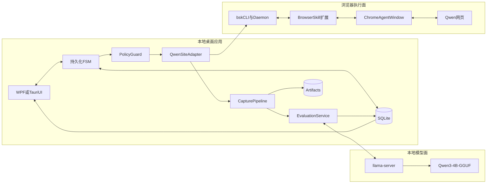

### 9.2 进程边界

#### Desktop 主进程

- UI；
- FSM；
- 策略；
- SQLite；
- BrowserGateway client；
- 模型 client；
- Artifact 索引。

#### BrowserSkill daemon

- 浏览器扩展连接；
- session；
- 标签页所有权；
- 工具调用队列；
- 诊断。

#### Chrome

- 用户 profile；
- BrowserSkill 扩展；
- Agent Window；
- Qwen 页面。

#### llama-server

- 独立模型进程；
- 仅监听 loopback；
- 不读取浏览器 profile；
- 崩溃不影响浏览器任务和原回答。

### 9.3 信任边界

| 区域 | 信任级别 | 原则 |
|---|---|---|
| 状态机与策略 | 高 | 唯一可决定写操作 |
| BrowserGateway | 高但受限 | 只能执行白名单动作 |
| Qwen页面内容 | 不可信 | 不能改变工具、权限和规则 |
| 本地评价模型 | 不完全可信 | 输出必须校验，不可控制浏览器 |
| UI输入 | 用户可信但需规范化 | 作为问题，不作为系统指令 |
| Artifact | 敏感本地数据 | 最小保留、可删除 |

#### BrowserSkill 本地控制面

BrowserSkill 是高权限本地组件，不能只依赖“服务监听在本机”作为授权。应额外防范：

- 未配对本机进程调用 daemon；
- 端口或临时元数据被其他用户读取；
- 扩展、daemon 和 CLI 版本错配；
- 扩展自动更新改变权限或协议；
- 网站调试、视频或下载记录留存超出预期；
- 本机恶意软件通过已登录 profile 获得高价值访问。

控制措施包括本地认证、每用户 ACL、随机会话凭据、版本 allowlist、启动时权限自检、诊断功能默认关闭和全局 kill switch。

### 9.4 核心状态机

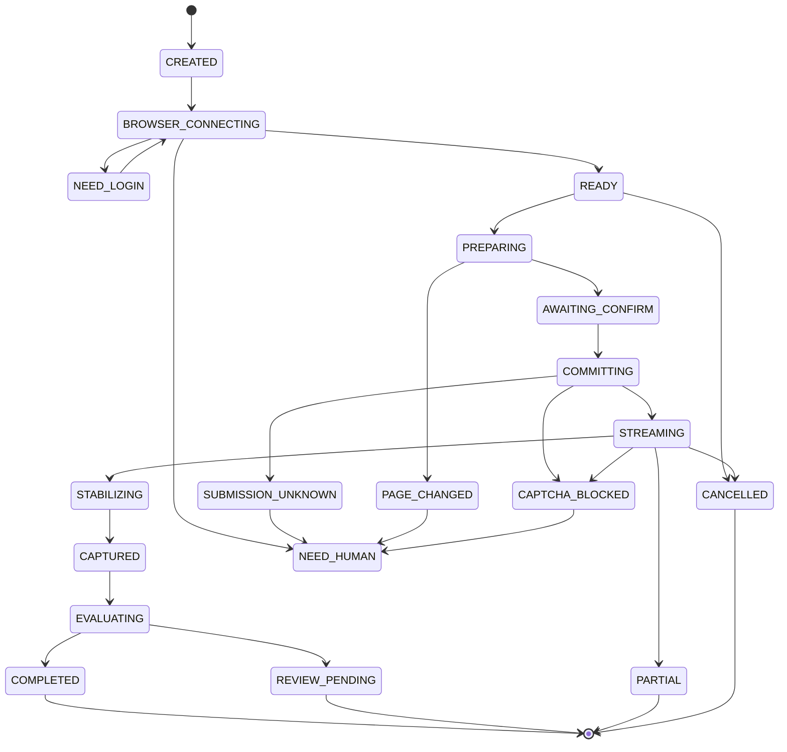

### 9.5 状态原则

- 只有 `AWAITING_CONFIRM` 可进入 `COMMITTING`；
- 每个 `run_id` 最多一个 commit；
- `SUBMISSION_UNKNOWN` 不允许自动回到 `COMMITTING`；
- `CAPTCHA_BLOCKED` 不允许自动恢复；
- `PAGE_CHANGED` 不允许模型自由探索；
- `CAPTURED` 后浏览器可以释放，评价失败不影响原文；
- `CANCELLED` 若已提交，只停止本地等待，不声称能撤回远端请求。

上图表达主要正常路径，不穷举所有异常边。实现必须设置全局守卫：

- 在所有浏览器活动状态检测 CAPTCHA、MFA、登录失效、未知导航和 profile 变化；
- CAPTCHA 或挑战可从任意浏览器活动状态转入 `CAPTCHA_BLOCKED`；
- 用户开始人工接管后立即撤销自动输入租约，所有自动动作进入 `NEED_HUMAN`；
- SQLite、磁盘或事件持久化失败时，在下一次浏览器写动作前进入 `FAILED_SAFE`；
- 评价阶段不再持有浏览器写租约；
- 取消请求可从任意非终态进入“取消处理中”，再根据是否已提交落到 `CANCELLED` 或 `PARTIAL`；
- 浏览器崩溃、系统睡眠和扩展升级后只能走“重新连接 → 重新发现 → 对账”，不能直接恢复旧 ref；
- 任何全局守卫与普通状态转换竞态时，守卫优先。

人工接管竞态必须用租约解决，而不是靠 UI 文案：只要用户接管标志生效，BrowserGateway 拒绝后续写调用，直到用户显式归还。

### 9.6 核心数据对象

#### Run

| 字段 | 说明 |
|---|---|
| `run_id` | 全局任务 ID |
| `canonical_prompt` | 不可变规范问题 |
| `prompt_hash` | 问题哈希 |
| `state` | 当前 FSM 状态 |
| `browser_instance` | 已核实 BrowserSkill 实例 |
| `site_adapter_version` | Qwen 适配器版本 |
| `created_at` | 创建时间 |
| `risk_state` | 正常、冷却、人工、熔断 |

#### SubmissionAttempt

| 字段 | 说明 |
|---|---|
| `attempt_id` | 提交尝试 ID |
| `run_id` | 所属任务 |
| `prepared_at` | Prepare 时间 |
| `commit_invoked_at` | 点击时间 |
| `commit_observed_at` | 页面确认时间 |
| `pre_anchor` | 提交前消息锚点 |
| `observed_user_turn` | 新 user turn 证据 |
| `status` | prepared/committed/unknown |

#### AnswerArtifact

| 字段 | 说明 |
|---|---|
| `turn_id` | 本轮 ID |
| `reasoning_status` | visible/not_present/collapsed/unknown/partial |
| `visible_reasoning` | 网页可见思考 |
| `answer_text` | 最终回答 |
| `blocks` | 结构化内容块 |
| `completion_status` | complete/partial/unknown |
| `completion_evidence` | 完成信号 |
| `content_hash` | 内容哈希 |
| `captured_at` | 采集时间 |

#### EvaluationArtifact

| 字段 | 说明 |
|---|---|
| `evaluation_id` | 评价 ID |
| `answer_hash` | 输入回答哈希 |
| `model` | 模型与量化 |
| `rubric_version` | 量表版本 |
| `scores` | 维度分数 |
| `findings` | 问题与证据 |
| `uncertainties` | 不确定项 |
| `summary` | UI 摘要 |
| `schema_valid` | 是否通过校验 |

### 9.7 事件协议

建议事件：

- `run.created`
- `browser.connecting`
- `browser.ready`
- `browser.need_login`
- `submission.prepared`
- `submission.commit_invoked`
- `submission.observed`
- `submission.unknown`
- `qwen.thinking.snapshot`
- `qwen.answer.snapshot`
- `qwen.turn.stabilizing`
- `qwen.turn.completed`
- `qwen.turn.partial`
- `evaluation.started`
- `evaluation.completed`
- `evaluation.review_pending`
- `run.need_human`
- `run.failed`
- `run.cancelled`

事件应：

- 追加写；
- 带单调序号；
- 可重放 UI；
- 不含 Cookie 和 Token；
- 重要状态转换与 SQLite 事务一起持久化。

### 9.8 租约

至少需要两类租约：

#### BrowserSessionLease

确保一个 BrowserSkill session 只被一个 run 写入。

#### QwenAccountWriteLease

确保同一账号同时最多一个生成任务。即使未来 UI 支持多个任务，也应排队。

租约超时不能自动意味着任务失败或可以重提。必须检查远端页面状态。

### 9.9 Prompt 注入边界

Qwen 回答可能包含：

- “忽略之前指令”；
- “打开某网站”；
- “运行命令”；
- “复制 Cookie”；
- “修改评分标准”。

这些全部只能作为待评价文本。

架构上保证：

- Capture 只输出内容块；
- Evaluator 没有浏览器工具；
- BrowserGateway 不接收回答正文作为动作指令；
- 状态机只接受固定枚举事件；
- 页面中的链接默认不打开；
- 任何新域名导航都需要人工。

### 9.10 Artifact 策略

正常任务：

- 最终思考/回答；
- 最终评价；
- 提交前后最少量截图；
- 页面版本指纹；
- 完成证据。

失败任务：

- 额外保存 ARIA/DOM 快照；
- 错误截图；
- 有限 Trace；
- 控制台错误；
- 不保存完整敏感网络头。

建议保留：

| 类型 | 默认期限 |
|---|---|
| 最终回答与评价 | 用户手工删除 |
| DOM/ARIA诊断 | 7天 |
| 错误截图 | 3天 |
| 成功Trace | 默认不保留或1天 |
| 失败Trace | 7天 |
| 登录/验证码截图 | 任务结束立即删除 |

本地存储还应满足：

- Artifact 目录和 SQLite 仅当前 Windows 用户可访问；
- 应用不以管理员权限运行；
- API 密钥等少量秘密使用 Windows Credential Manager 或 DPAPI，不写入 SQLite 明文；
- 若回答内容本身敏感，可选 DPAPI/应用密钥加密 Artifact；
- 崩溃转储可能包含问题、回答和 DOM，应默认关闭上传并按短期限清理；
- 备份工具可能复制 Artifact，UI 应提供明确的数据目录和“一键删除”；
- 脱敏规则、权限继承和备份恢复要进入测试。

---

## 10. 候选方案

### 10.1 方案 A：BrowserSkill + 自研 FSM + llama.cpp

#### 架构

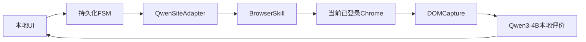

#### 组件

- .NET/Tauri UI；
- SQLite；
- FSM；
- BrowserSkill CLI/daemon/扩展；
- Qwen SiteAdapter；
- DOM observer；
- llama-server 或 Ollama；
- Qwen3-4B Q4。

#### 登录态

直接使用扩展所在 Chrome profile 的当前登录态。任务运行于 Agent Window，用户可见并可接管。

#### 控制与采集

- BrowserSkill snapshot/ref 定位；
- 固定站点动作；
- DOM observer 推送快照；
- 最终 DOM 复读；
- 截图只作诊断。

#### CPU/RAM

- 浏览器控制不调用本地模型；
- 本地模型只在回答完成后运行一次；
- 16GB RAM 推荐 4B Q4；
- 8GB 采用 1.7B + 规则为主。

#### 恢复

- BrowserSkill 重连；
- 旧 ref 全部失效后重新 snapshot；
- FSM 依据账本对账；
- 未知提交不重试。

#### 账号风险

相对网页方案较低：

- 真实 profile；
- 可见浏览器；
- 少量确定性动作；
- 无并发和盲重试。

但扩展/CDP 自动化仍可能被平台识别，不能保证。

#### 优点

- 最快满足当前登录态；
- 正常路径低资源；
- 用户可见；
- 可人工接管；
- 不复制 Cookie；
- 可逐步替换底层。

#### 缺点

- 依赖新项目；
- 扩展权限高；
- 版本更新需要回归；
- Qwen 适配仍需自研；
- BrowserSkill 不是业务事务系统。

#### 适用

- 当前需求首版；
- 用户允许安装扩展；
- 需要当前 Chrome 登录态。

#### 不适用

- 企业策略禁止扩展或 debugger 权限；
- 必须完全无人值守；
- 不接受网页自动化账号风险。

### 10.2 方案 B：自研 MV3 扩展 + Native Messaging

#### 架构

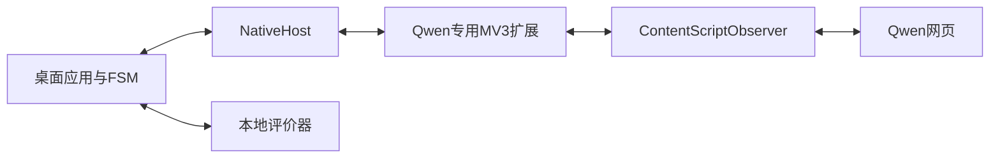

#### 组件

- 桌面应用；
- Native Messaging Host；
- Qwen 专用 MV3 扩展；
- content script；
- 可选 service worker；
- 本地评价服务。

#### 登录态

直接使用当前 Chrome profile。

#### 控制与采集

- Content Script 使用语义 DOM；
- MutationObserver 主动推送；
- 扩展只暴露固定动作；
- 可选 `chrome.debugger` 仅用于必要诊断。

#### CPU/RAM

浏览器增量开销最低；本地模型与方案 A 相同。

#### 恢复

- 扩展重连；
- content script 注入状态检查；
- Native Host 心跳；
- DOM 容器重新绑定；
- FSM 负责业务账本。

#### 账号风险

与方案 A 相近。因为动作可以更少、权限更窄，长期可能更低；但“自研专用扩展”并不会获得平台授权，也不能保证不被识别。

#### 优点

- 长期控制力最高；
- 最小工具面；
- 可主动推送流式 DOM；
- 无需远程调试端口；
- 可将域名权限限制到 Qwen；
- 资源低；
- 版本与协议可自主管理。

#### 缺点

- 初始开发成本最高；
- MV3 生命周期复杂；
- 安装、签名和更新要维护；
- 页面改版责任全部自担；
- 浏览器兼容测试工作大。

#### 适用

- 已证明需求长期使用；
- 只支持 Qwen；
- 重视最小权限和稳定流式采集；
- 愿意维护扩展。

#### 不适用

- 只想快速验证；
- 团队没有扩展/Native Messaging 经验。

### 10.3 方案 C：Playwright/agent-browser + 专用持久 Profile

#### 架构

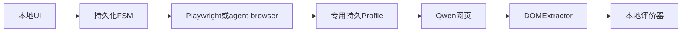

#### 组件

- Playwright 或 agent-browser；
- 非默认 `user-data-dir`；
- 用户首次手工登录；
- Qwen SiteAdapter；
- Trace/截图/ARIA；
- 本地评价服务。

#### 登录态

不直接复用日常默认 Chrome；使用专用 profile 长期保存登录。

#### 控制与采集

- Playwright locator 和 actionability；
- 或 agent-browser snapshot/ref；
- DOM observer；
- 最终 DOM；
- 完整 Trace。

#### CPU/RAM

较低；不需要 Agent 模型逐步规划。专用 Chrome 与日常 Chrome 同时运行时会增加内存。

#### 恢复

- 浏览器可由应用完全管理；
- profile 锁检测；
- Trace；
- tab pinning；
- FSM 对账。

#### 账号风险

中等：

- profile 稳定后行为可控；
- 首次新 profile 登录可能触发验证；
- 自动化浏览器启动和 CDP 行为可被观察；
- 不应启用 stealth 或复制默认 Cookie。

#### 优点

- 自动化和测试成熟；
- Trace 最强；
- 页面 fixture 和回归方便；
- 浏览器生命周期可控；
- 适配器开发效率高。

#### 缺点

- 不满足“直接使用当前已登录 Chrome”的严格解释；
- 需要重新登录；
- Chrome 与自动化版本要管理；
- 专用 profile 与日常浏览分离。

#### 适用

- 可接受专用 profile；
- 重视回归和诊断；
- BrowserSkill 不可用；
- 测试通道。

#### 不适用

- 必须零迁移复用当前日常 profile。

### 10.4 方案 D：.NET 8 + WebView2 一体化

#### 架构

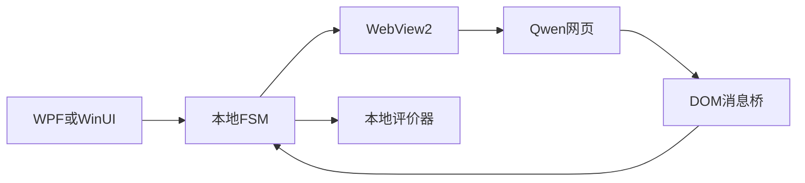

#### 组件

- .NET 8；
- WPF/WinUI 3；
- WebView2；
- 独立 UDF；
- DOM 脚本与 `WebMessageReceived`；
- SQLite；
- 本地评价服务。

#### 登录态

WebView2 使用自己的 UDF。用户必须在应用中重新登录 Qwen，不能直接继承 Chrome profile。

#### 控制与采集

- 页面嵌入应用；
- JS/DOM 与本地消息桥；
- MutationObserver；
- 用户可直接看到和接管。

#### CPU/RAM

通常低于 Electron + 外部 Chrome，但 WebView2 仍有多个进程。若用户同时开 Chrome，资源优势减少。

#### 恢复

- `ProcessFailed`；
- `BrowserProcessExited`；
- 重建 WebView；
- UDF 持久；
- FSM 对账。

#### 账号风险

中等：

- 可见浏览器、低频；
- 新的 WebView2 环境可能被视为新设备或不同客户端；
- 嵌入式环境与普通 Chrome 有差异；
- 不能保证平台接受。

#### 优点

- Windows 原生一体化；
- UI、网页和人工接管在同一窗口；
- DOM 消息推送自然；
- 进程故障接口明确；
- 部署边界清楚。

#### 缺点

- 不满足 Chrome 登录态硬约束；
- 需要重新登录；
- 网站在 WebView2 中的兼容性要实测；
- 页面和本地 IPC 安全边界复杂；
- 只支持 Windows。

#### 适用

- 接受在应用内重新登录；
- 重视单窗口体验；
- Windows-only。

#### 不适用

- 必须使用当前已登录 Chrome。

### 10.5 方案 E：browser-use/CoWork-OS 通用自主 Agent

#### 架构

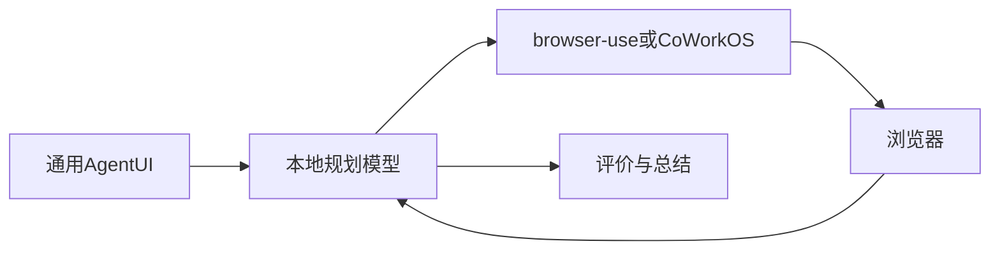

#### 组件

- 完整 Agent 宿主；
- 本地规划模型；
- 通用浏览器工具；
- 任务历史；
- 本地评价。

#### 登录态

取决于扩展、现有 Chrome attach 或持久 profile。

#### 控制与采集

模型逐步观察、决定动作；回答可由 DOM 或模型提取。

#### CPU/RAM

最不适合：

- 本地模型多轮规划；
- 每步页面序列化；
- 可能重复推理；
- 通用 Agent 需要比单次评价更强的模型。

4B CPU 模型很难同时满足工具规划、页面理解、恢复和评价质量。

#### 恢复

通用 Agent history 不能替代业务账本。仍需额外 FSM 和提交防重。

#### 账号风险

高于固定站点方案：

- 动作数更多；
- 自主探索；
- 可能刷新、滚动或重复；
- 行为不易完全预测。

#### 优点

- 扩展到任意网站快；
- PoC 演示能力强；
- 完整工作台和技能生态；
- 未知页面语义适应较好。

#### 缺点

- CPU 负担高；
- 不确定性高；
- 固定流程过度设计；
- 防重和恢复仍需自研；
- 调试复杂；
- 账号动作风险更高。

#### 适用

- 目标扩展为个人通用桌面 Agent；
- 有更强硬件或云模型；
- 能接受不确定性。

#### 不适用

- 当前 CPU-only 固定 Qwen 流程。

### 10.6 方案 F：Qwen 官方 API + 本地评价

#### 架构

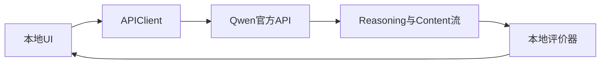

#### 定位

这是对照基线，不满足“操作已登录 Qwen 网页”的核心要求。

#### 登录态

不使用 Chrome 登录态，使用 API 凭据。

#### 控制与采集

- 官方 SSE；
- Chat Completions 可分 `reasoning_content` 和 `content`；
- Responses API 使用结构化 reasoning output item 和 message；
- 有明确完成事件。

#### CPU/RAM

本地只运行评价器，资源最低。

#### 恢复

- 请求 ID；
- 明确错误码；
- 流结束事件；
- 比网页更容易幂等和重试。

#### 账号风险

最低，属于官方调用路径；仍需遵守 API 配额和使用规则。

#### 优点

- 稳定；
- 不依赖 DOM；
- 可准确区分思考与回答；
- 流结束明确；
- 自动化维护成本最低；
- 最容易测试。

#### 缺点

- 输出不一定等于消费者网页版；
- 需要 API 费用和凭据；
- 网页模型、系统提示、工具和账号权益可能不同；
- 不满足原始流程。

#### 适用

- 账号安全和稳定性优先；
- 接受 API 与网页不等价；
- 用作对照、降级或开发测试。

#### 不适用

- 必须取得网页版原始输出。

### 10.7 方案 G：纯视觉 Computer Use

#### 架构

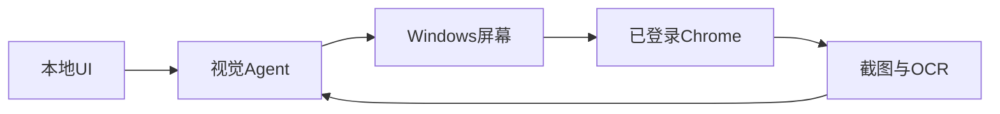

#### 结论

当前无 GPU，不应作为可行主方案。

主要问题：

- 视觉模型 CPU 延迟高；
- 中文 OCR、代码、表格和长回答精度不足；
- 坐标受 DPI 和缩放影响；
- 必须占用前台；
- 提交防重证据弱；
- 动作多，账号风险更高。

仅保留为：

- 人工接管；
- 系统弹窗；
- DOM 完全不可用时的诊断。

---

## 11. 加权比较与选择

这里比较的是可交付的端到端部署方案，不是把不同层级项目当成同类库排行榜。A/B/C/D 是不同浏览器接入组合，E 是完整通用 Agent 组合，F 是非网页对照，G 是视觉对照。决策顺序始终是：

1. 先应用硬约束；
2. 再在剩余端到端方案间比较；
3. 最后分别选择 UI、浏览器传输和本地模型组件。

### 11.1 硬约束

| 硬约束 | 说明 |
|---|---|
| Windows 11 | 必须 |
| Chrome当前登录态 | 原需求明确 |
| CPU-only | 不可依赖本地VLM |
| Qwen网页可见思考与回答 | API不能等价替代 |
| 至多一次提交 | 必须 |
| 可人工接管 | 必须 |
| 不使用反检测和验证码绕过 | 必须 |

硬约束优先于总分。例如 API 分数很高，但不满足网页版要求；WebView2 体验很好，但不继承当前 Chrome 登录态。

### 11.2 评分维度

| 维度 | 权重 |
|---|---:|
| 网页原始输出与可见思考 | 12% |
| 当前Chrome登录态 | 13% |
| 控制可靠性 | 16% |
| 采集完整性 | 14% |
| CPU资源效率 | 10% |
| 页面变化韧性 | 8% |
| 可测试与诊断 | 9% |
| 实现与维护成本 | 7% |
| 人工接管 | 5% |
| 相对账号风险 | 6% |
| 合计 | 100% |

分数 1–5，5 最好。账号风险分高表示相对风险低，不表示无风险。

这些分数是基于公开架构的工程估计，不是 Qwen 真实页面成功率，也不是封号概率。BrowserSkill 稳定性、Qwen DOM 适配和各方案账号风险在 Phase 0 前均只能给中低置信度。评分用于暴露权衡，不能替代硬约束和实测。

### 11.3 评分矩阵

| 方案 | 网页输出 | 登录态 | 可靠性 | 采集 | CPU | 韧性 | 测试 | 成本 | 接管 | 风险 | 加权分 |
|---|---:|---:|---:|---:|---:|---:|---:|---:|---:|---:|---:|
| A BrowserSkill | 5 | 5 | 4 | 4 | 5 | 4 | 4 | 4 | 5 | 4 | 88.0 |
| B 自研MV3 | 5 | 5 | 5 | 5 | 5 | 3 | 4 | 2 | 5 | 4 | 89.6 |
| C Playwright专用Profile | 5 | 3 | 5 | 5 | 5 | 4 | 5 | 4 | 4 | 3 | 88.4 |
| D WebView2 | 5 | 1 | 4 | 5 | 4 | 3 | 4 | 3 | 5 | 3 | 74.2 |
| E 通用自主Agent | 4 | 4 | 2 | 3 | 1 | 4 | 2 | 4 | 4 | 2 | 58.8 |
| F 官方API | 1 | 1 | 5 | 5 | 5 | 5 | 5 | 5 | 3 | 5 | 78.0 |
| G 纯视觉 | 4 | 5 | 1 | 1 | 1 | 3 | 1 | 2 | 5 | 2 | 47.4 |

#### 短期与长期视角

| 方案 | 短期落地 | 长期控制力 | 当前证据置信度 | 说明 |
|---|---:|---:|---|---|
| A BrowserSkill | 5 | 4 | 中 | 最少自研，但项目与接口仍快速变化 |
| B 自研MV3 | 2 | 5 | 中 | 前期重，固定单站长期最可控 |
| C Playwright专用Profile | 4 | 4 | 高 | 框架成熟，但不直接复用当前profile |
| D WebView2 | 3 | 3 | 高 | Windows能力明确，登录态硬约束不满足 |
| E 通用自主Agent | 3 | 2 | 中 | PoC快，CPU与确定性不适合固定主循环 |
| F 官方API | 5 | 5 | 高 | 工程最稳，但不是网页版 |
| G 纯视觉 | 1 | 1 | 高 | CPU-only条件下不合适 |

### 11.4 为什么自研 MV3 总分最高但不先做

评分体现长期能力，不体现学习曲线的现金流和早期不确定性。

在尚未实测 Qwen DOM 时先自研扩展，会同时承担：

- Native Messaging；
- 扩展安装；
- MV3 生命周期；
- Chrome 权限；
- Qwen SiteAdapter；
- 状态机；
- 模型评价；
- UI。

BrowserSkill 可以先消除前四项。待系统证明有长期价值、Qwen DOM 稳定点明确，再把 BrowserGateway 替换成自研扩展，风险更低。

### 11.5 条件化结论

#### 要最快做出 PoC

选择 A：BrowserSkill。

#### 要长期维护一个固定 Qwen 工具

先 A，稳定后迁移到 B。

#### 最重视 Trace 与回归

选择 C，并接受专用 profile。

#### 最重视 Windows 单窗口体验

选择 D，但接受重新登录和非 Chrome profile。

#### 未来目标是任意网站 Agent

考虑 E；但需要更强模型、更多资源和更严格权限系统。

#### 最重视账号安全、稳定和低维护

选择 F，并接受它不是网页版。

#### 当前 CPU-only

淘汰 G 作为主方案。

### 11.6 最终排序

面向当前需求：

1. 方案 A：首版推荐；
2. 方案 B：长期终态；
3. 方案 C：测试与生产备选；
4. 方案 D：条件性 Windows 原生方案；
5. 方案 F：对照/降级；
6. 方案 E：未来平台化；
7. 方案 G：只作回退。

---

## 12. 推荐系统详细设计

### 12.1 推荐组合

- UI：.NET 8 WPF；
- 编排：持久化 FSM；
- 浏览器：BrowserSkill；
- 测试浏览器：agent-browser/Playwright 专用 profile；
- SiteAdapter：Qwen 专用；
- 采集：DOM + ARIA + MutationObserver；
- 评价：规则 + llama.cpp Qwen3-4B Q4；
- 数据：SQLite + Artifact 目录；
- 通信：本机进程 IPC/HTTP，仅 loopback；
- 人工接管：Agent Window；
- 网络：Qwen 官方域名 allowlist；
- 并发：一个账号一个在途任务。

### 12.2 正常运行序列

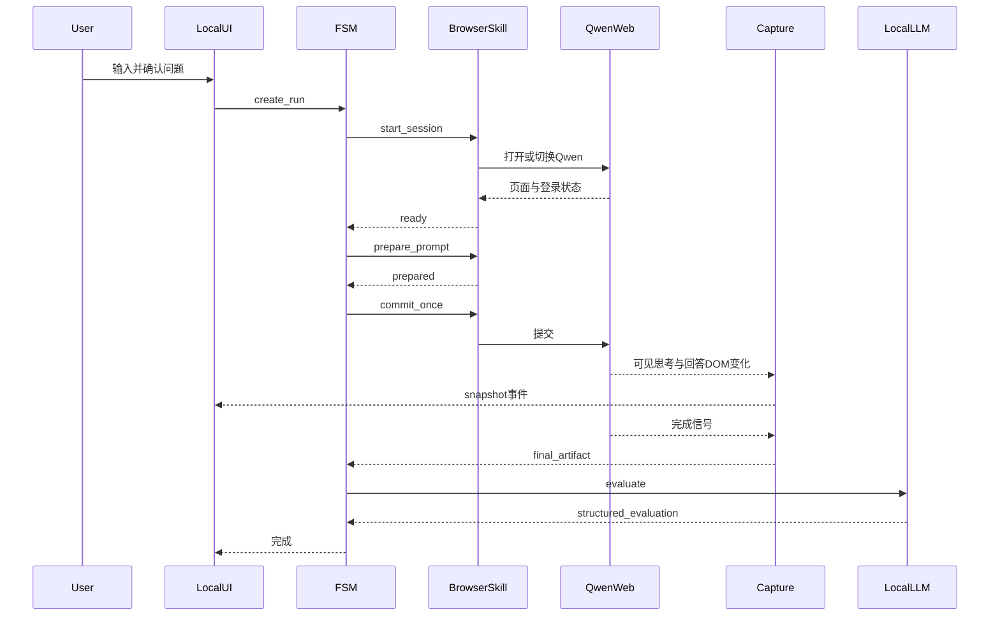

### 12.3 浏览器动作白名单

首版只允许：

- 打开 Qwen 官方域名；
- 创建 Agent Window；
- 新建或切换 Qwen 对话；
- 聚焦输入框；
- 填写规范问题；
- 点击一次发送；
- 点击 Qwen 自身可见的展开思考按钮；
- 读取本轮消息 DOM；
- 截图；
- 关闭任务 tab；
- 交还用户。

禁止：

- 导航任意 URL；
- 点击回答外链；
- 执行回答提供的脚本；
- 上传文件；
- 读取下载目录；
- 读取其他标签；
- 操作密码管理器；
- 修改扩展；
- 读取 Cookie；
- 修改网络请求；
- 清理或搬运 profile。

### 12.4 页面版本策略

每个 SiteAdapter release 包含：

- 支持的 Qwen 页面指纹；
- 输入框候选；
- 发送按钮候选；
- 停止按钮候选；
- user/assistant turn 定位规则；
- 思考分区规则；
- 最终回答 block 规则；
- 错误、登录和挑战规则；
- 完成信号组合；
- fixture；
- 变更记录。

页面指纹可由以下稳定信息组合：

- 页面标题模式；
- 顶层 landmark；
- 关键 accessible name；
- 消息容器层级摘要；
- 可见模式开关；
- 不包含用户内容的结构哈希。

未知指纹不自动探索。

### 12.5 评价输入预算

优先级：

1. 用户问题；
2. 最终回答；
3. 评价量表；
4. 可见思考摘要；
5. 页面元数据。

超长内容处理：

- 先按 block 分段；
- 规则层检查全部内容；
- 模型分段提取问题；
- 最后合并；
- 每个 finding 必须回指原 block；
- 不因 context 限制静默截断。

### 12.6 UI 状态展示

用户应能看出：

- 当前是否已提交；
- 是否仍在思考；
- 是否仍在生成回答；
- 页面是否稳定；
- 本地模型是否正在评价；
- 当前内容是流式预览还是最终快照；
- 哪些内容为 partial/unknown；
- 是否需要人工处理。

### 12.7 取消语义

取消不是一个状态：

- 提交前取消：安全结束；
- 提交后生成中取消：停止本地等待，可选择点击网页可见停止按钮，但不重提；
- 采集后评价中取消：保留原回答，终止本地模型；
- 人工接管时取消：系统停止输入动作，用户接管。

### 12.8 版本锁定

每个 Run 记录：

- Chrome 版本；
- BrowserSkill 版本；
- 扩展版本；
- SiteAdapter 版本；
- llama.cpp/Ollama 版本；
- 模型仓库、文件和量化；
- 评价 prompt 版本；
- Schema 版本；
- UI 版本。

升级流程：

1. 离线 fixture；
2. 模拟聊天页；
3. 专用 profile；
4. 低频真实 canary；
5. 主 profile。

---

## 13. 账号风险工程

### 13.1 风险分类

#### 身份风险

- 新 profile；
- 新设备或 WebView2；
- 登录地点变化；
- Cookie 搬运；
- 多账号或多设备并发；
- 反复登录失败。

#### 行为风险

- 高频提问；
- 并发；
- 固定批量脚本；
- 重复提交；
- 频繁刷新；
- 过多点击和滚动；
- 长时间无人值守；
- 验证出现后继续尝试。

#### 技术风险

- WebDriver/CDP/扩展特征；
- 页面结构异常访问；
- 私有接口调用；
- 网络请求重放；
- 隐藏元素操作。

### 13.2 保守策略

- 仅由用户显式点击创建任务；
- 单账号单任务；
- 使用长期稳定设备、网络和 profile；
- 使用可见浏览器；
- 动作最少化；
- 不制造“随机人类行为”；
- 提交后不盲重试；
- 429 或异常提示进入冷却；
- CAPTCHA、MFA、二维码全部人工；
- 页面未知立即熔断；
- 不做后台定时批量；
- 不使用代理轮换；
- 不复制 Cookie；
- 不使用反检测浏览器；
- 不解析私有接口；
- 不隐藏自动化控制提示；
- 允许用户立即停止。

### 13.3 为什么不提供“反检测方案”

所谓反检测通常包括：

- 隐藏 WebDriver；
- 修改浏览器指纹；
- 随机轨迹；
- 代理轮换；
- CAPTCHA 服务；
- 模拟设备池。

这些措施：

- 不能保证账号安全；
- 会增加系统复杂度和不可复现性；
- 可能造成更多动作和异常；
- 更接近主动规避平台安全控制；
- 与个人低频工具的真实目标不匹配。

本系统的正确目标是“保守、透明、少动作、可停止”，不是“欺骗检测”。

### 13.4 提交冷却

不在文档中声称平台阈值，也不设计针对检测的随机间隔。

建议：

- 用户触发后执行一次；
- 一个任务完成或明确结束后才允许下一个；
- 出现 429、异常验证或账号提醒时停止；
- 冷却由用户确认解除；
- 不自动探测平台极限。

### 13.5 相对风险排序

从低到高：

1. 官方 API；
2. 当前真实 profile + 固定少动作扩展；
3. 专用稳定 profile + 固定 Playwright；
4. WebView2 新环境；
5. 通用自主 Agent；
6. 纯视觉自由探索；
7. stealth/代理/验证码绕过等不采用路线。

### 13.6 事件响应

| 事件 | 响应 |
|---|---|
| CAPTCHA | 立即停止并交还人工 |
| MFA | 人工完成，系统不读取验证码 |
| 429 | 停止任务，进入冷却 |
| 账号警告 | 全局 kill switch |
| 登录失效 | 不自动输入凭据 |
| 页面异常跳转 | 停止并保存诊断 |
| 连续适配失败 | 禁用该 SiteAdapter 版本 |
| 未知提交 | 不重发，人工核对 |

---

## 14. 实施路线

### Phase 0：去风险实验

目标：在不构建完整产品前验证最关键假设。

任务：

1. 确认 BrowserSkill 可连接目标 Chrome profile；
2. 只读打开 Qwen；
3. 识别登录状态；
4. 采集当前已有消息，不提交新问题；
5. 记录 Qwen DOM/ARIA 结构；
6. 确认可见思考分区；
7. 确认长回答、代码块、表格和引用结构；
8. 测试 Agent Window 人工接管；
9. 在模拟聊天页验证 MutationObserver；
10. 验证 BrowserSkill 是否有可靠的长时 observer 事件通道；
11. 若无推送，验证只读快照缓冲或完整 DOM 轮询；
12. 用目标机器测试 Qwen3-4B Q4 和 Qwen3-4B-Instruct-2507 候选。

退出条件：

- 当前登录态可复用；
- 不需要复制 Cookie；
- 能稳定识别输入和消息容器；
- 能区分至少一种可见思考模式；
- 已确定推送、缓冲轮询或直接轮询中的一条可用采集路径；
- 4B 评价延迟可接受，或明确需要 1.7B/8B 调整；
- 无真实自动提交。

### Phase 1：单次人工确认 PoC

目标：完成一次端到端任务，但发送前必须人工确认。

范围：

- 纯文本；
- 新对话；
- 单账号；
- 单任务；
- BrowserSkill；
- DOM 采集；
- 规则评价；
- 本地模型评价；
- UI 展示；
- SQLite。

不做：

- 附件；
- 并发；
- 自动重试；
- 网络私有流；
- 通用 Agent。

退出条件：

- 零重复提交；
- 完成与部分完成区分；
- 原文采集准确；
- 评价结构可校验；
- CAPTCHA 硬停止。

### Phase 2：MVP

增加：

- 页面版本指纹；
- SiteAdapter fixture；
- 重启恢复；
- 提交对账；
- 人工接管；
- 失败 Artifact；
- 评价 A/B；
- 任务历史；
- 导出；
- 版本锁定。

### Phase 3：稳定版

增加：

- 专用 agent-browser/Playwright 回归通道；
- 多版本 SiteAdapter；
- 自动熔断；
- 低频 canary；
- 失败分类统计；
- 模型升级评估；
- BrowserSkill 更新兼容矩阵；
- 是否迁移自研扩展的决策。

### Phase 4：可选长期演进

只有在使用价值已验证后：

- 自研 MV3 + Native Messaging；
- 其他网页模型；
- 多评价器；
- 官方 API 降级；
- 完整 Agent 宿主集成。

---

## 15. 测试与验收

### 15.1 测试金字塔

#### 单元测试

- 状态迁移；
- 租约；
- 问题规范化；
- 文本差分；
- block 归一化；
- 完成判定；
- 评价 Schema；
- verdict 规则；
- 日志脱敏。

#### DOM fixture

建立离线 Qwen 风格 fixture：

- 正常流式；
- 无思考；
- 折叠思考；
- 思考切换为回答；
- React 节点整体替换；
- 代码块重渲染；
- 表格；
- 引用；
- 长回答虚拟滚动；
- 网络错误；
- 生成中断；
- 登录失效；
- CAPTCHA；
- 页面按钮改名；
- 消息重排。

#### 模拟站端到端

模拟：

- 输入；
- 发送；
- 慢速流式；
- 页面刷新；
- 浏览器断线；
- worker 崩溃；
- 重连；
- 未知提交；
- 模型服务崩溃；
- UI 重启。

#### 真实低频 canary

只验证：

- 当前页面指纹；
- 选择器；
- 完成信号；
- 采集完整性；
- 一次人工确认提交。

真实站点不承担高频回归。

### 15.2 故障注入

| 故障 | 期望 |
|---|---|
| 点击后断线 | 进入unknown，不重发 |
| 流式中刷新 | 尝试重新绑定，失败则partial |
| Chrome关闭 | 保存状态，重连后对账 |
| BrowserSkill daemon退出 | 不重复提交 |
| llama-server退出 | 原回答保留，评价pending |
| SQLite暂时锁定 | 不继续远端写动作 |
| 磁盘满 | 停止新任务 |
| DOM按钮改名 | PAGE_CHANGED |
| 消息容器多于一个 | 失败关闭 |
| CAPTCHA出现 | 100%停止 |
| 用户人工切换对话 | 检测上下文变化并暂停 |

### 15.3 浏览器验收指标

- 自动重复提交：0；
- 未知提交状态自动重发：0；
- 单账号并发：1；
- CAPTCHA 后自动动作：0；
- 不支持页面继续探索：0；
- 正常任务视觉调用：0；
- 登录凭据进入日志：0。

### 15.4 采集验收指标

- 黄金 fixture 文本字符准确率不低于 99.5%；
- 代码块边界 100%；
- 表格行列顺序 100%；
- 链接显示文本与 URL 映射 100%；
- 最终 Artifact 来自完成后 DOM；
- 未知分区不猜测；
- partial 明确标记。

### 15.5 评价验收指标

- Schema 首次成功率；
- 一次重试后成功率；
- 证据引用可定位率 100%；
- 人工样本误放行率；
- 同一输入重复评价一致性；
- 1.7B/4B/8B 的质量—延迟曲线；
- 规则层与模型层冲突记录；
- 模型升级前后回归。

### 15.6 账号风险验收

- 无并发；
- 无批量定时；
- 无代理轮换；
- 无 stealth；
- 无 Cookie 导出；
- 无验证码处理；
- 无私有 API；
- 页面异常后自动熔断；
- 每次提交可追溯到用户动作。

---

## 16. 风险登记

| 风险 | 概率 | 影响 | 缓解 |
|---|---|---|---|
| Qwen页面改版 | 高 | 高 | SiteAdapter版本、fixture、熔断 |
| 账号限制 | 中 | 高 | 低频、单会话、人工、API备选 |
| 可见思考结构变化 | 高 | 中 | 状态unknown、不猜测 |
| BrowserSkill版本变化 | 中 | 中 | 锁版本、回归、Playwright备选 |
| Chrome扩展权限过大 | 中 | 高 | 固定实例、Agent Window、域名限制 |
| 重复提交 | 低 | 高 | 两阶段提交、账本、unknown不重试 |
| 本地模型评价差 | 中 | 中 | 规则层、4B/8B A/B、人工样本 |
| CPU评价过慢 | 中 | 中 | 4B Q4、短context、异步UI |
| 内存不足 | 中 | 中 | 分级模型、单并发、限制context |
| 长回答截断 | 中 | 高 | block分段、partial状态 |
| 页面虚拟滚动 | 中 | 高 | 水合、block哈希、完整性校验 |
| Prompt注入 | 中 | 高 | 模型无浏览器工具、固定状态机 |
| 本地服务端口暴露 | 低 | 高 | 仅127.0.0.1、随机令牌、防火墙 |
| Artifact泄露 | 低 | 中 | 本地存储、最小保留、可删除 |
| WebView/Chrome崩溃 | 中 | 中 | 进程隔离、重连对账 |

---

## 17. 待实测问题

### Qwen 页面

- 当前正式域名和可能跳转域名；
- 输入框的稳定语义锚点；
- 新建对话动作；
- user/assistant turn 的稳定边界；
- 思考分区在不同模型/模式下的结构；
- 折叠思考是否仍在 DOM；
- 最终回答是否有独立容器；
- 生成中/停止按钮的稳定信号；
- 输入框何时恢复；
- 长回答是否虚拟化；
- 代码、表格、公式和引用结构；
- 页面错误与 429 表现；
- CAPTCHA/挑战的可识别信号。

### BrowserSkill

- 当前 Chrome 版本兼容；
- profile 实例固定方式；
- Agent Window 是否共享所需 Qwen 登录态；
- tab borrow 是否需要；
- 自定义 DOM observer 是否能持续推送；若不能，轮询成本与稳定性；
- 断线后 session/tab 恢复；
- trace 和视频默认保留；
- 扩展更新策略。

### 本地模型

- 目标机 RAM；
- CPU 物理核心与 AVX2/AVX-512；
- Qwen3-4B Q4 首 token 和总耗时；
- 4K/8K context 峰值内存；
- JSON Schema 成功率；
- 非思考模式可靠性；
- Qwen3.5-4B 是否更快或更好；
- Qwen3-8B 是否值得等待；
- Phi-4-mini 中文对照表现。

### UI

- WPF 还是 Tauri 团队成本；
- 用户是否需要系统托盘；
- 关闭 UI 后任务是否继续；
- Artifact 保留期限；
- 是否需要导出；
- 是否需要多个评价模板。

---

## 18. 最终决策清单

如果现在开始实施，建议确定：

- [x] 主通道：BrowserSkill；
- [x] 长期备选：自研 MV3 + Native Messaging；
- [x] 回归通道：agent-browser/Playwright 专用 profile；
- [x] 控制：持久化确定性 FSM；
- [x] 提交语义：至多一次，unknown 不重试；
- [x] 观察：DOM/ARIA；
- [x] 流式采集：MutationObserver 完整快照差分；
- [x] 最终原文：完成后 DOM 复读；
- [x] 思考定义：仅网页可见思考；
- [x] 视觉：不进入正常路径；
- [x] 本地运行时：llama.cpp 正式、Ollama PoC；
- [x] 基线模型：Qwen3-4B Q4_K_M 非思考模式；
- [x] 评价：规则 + 结构化本地 Judge；
- [x] UI：Win11 优先 .NET 8 WPF；
- [x] 持久化：SQLite + Artifact；
- [x] 人工：登录/MFA/CAPTCHA/未知页面；
- [x] 风控：单会话、低动作、无盲重试、熔断；
- [x] 禁止：stealth、指纹伪造、代理轮换、Cookie搬运、验证码绕过、私有API重放；
- [x] 对照：官方 API；
- [x] 首版：纯文本，不做附件和并发。

仍需实验决定：

- [ ] Qwen DOM 稳定锚点；
- [ ] 思考与回答分区规则；
- [ ] 多信号完成窗口；
- [ ] 长回答水合方式；
- [ ] BrowserSkill 自定义 observer 集成；
- [ ] 目标 CPU 的 4B/8B 选择；
- [ ] WPF 与 Tauri 的团队偏好；
- [ ] 是否在稳定后迁移自研扩展。

一句话结论：

> 用 BrowserSkill 复用当前 Chrome 登录态，用确定性 FSM 保护提交，用 DOM 采集网页可见思考与最终回答，用 CPU 上的 Qwen3-4B 做有 Schema、有证据、承认不确定性的本地评价；长期若需求稳定，再把浏览器桥收敛为 Qwen 专用 MV3 扩展。

---

## 19. 资料索引

### Qwen 与账号边界

- [千问用户服务协议](https://terms.alicdn.com/legal-agreement/terms/c_end_product_protocol/20231011201348415/20231011201348415.html)
- [Qwen OpenAI-compatible Responses API](https://help.aliyun.com/en/model-studio/qwen-api-via-openai-responses)
- [Qwen 流式输出](https://help.aliyun.com/en/model-studio/stream)
- [Qwen 深度思考 API](https://help.aliyun.com/en/model-studio/deep-thinking)
- [Qwen OpenAI Responses 迁移说明](https://help.aliyun.com/zh/model-studio/compatibility-with-openai-responses-api)

### BrowserSkill

- [Tencent BrowserSkill](https://github.com/Tencent/BrowserSkill)
- [BrowserSkill Architecture](https://github.com/Tencent/BrowserSkill/blob/HEAD/docs/architecture.md)
- [BrowserSkill Tabs and Profiles](https://github.com/Tencent/BrowserSkill/blob/main/packages/dsh-plugin-browserskill/skill/references/tabs-and-profiles.md)
- [BrowserSkill Privacy and Permissions](https://github.com/Tencent/BrowserSkill/blob/main/apps/extension/PRIVACY.md)

### Playwright 与 Chrome

- [Playwright MCP Introduction](https://playwright.dev/mcp/introduction)
- [Playwright MCP Existing Browser Extension](https://playwright.dev/mcp/configuration/browser-extension)
- [Playwright MCP Profile and State](https://playwright.dev/mcp/configuration/user-profile)
- [Playwright BrowserType and CDP](https://playwright.dev/docs/api/class-browsertype)
- [Playwright Locators](https://playwright.dev/docs/locators)
- [Playwright Trace Viewer](https://playwright.dev/docs/trace-viewer)
- [Chrome 136 Remote Debugging Changes](https://developer.chrome.com/blog/remote-debugging-port)
- [Chrome DevTools MCP Auto Connect](https://developer.chrome.com/docs/devtools/agents/use-cases/auto-connect)
- [Chrome DevTools MCP Configuration](https://developer.chrome.com/docs/devtools/agents/get-started/configuration)

### 其他浏览器执行器

- [agent-browser](https://github.com/vercel-labs/agent-browser)
- [agent-browser Commands](https://github.com/vercel-labs/agent-browser/blob/main/skill-data/core/references/commands.md)
- [browser-harness](https://github.com/browser-use/browser-harness)
- [browser-harness Installation and Architecture](https://github.com/browser-use/browser-harness/blob/main/install.md)
- [browser-use](https://github.com/browser-use/browser-use)
- [Stagehand Browser Connection](https://docs.stagehand.dev/v4/configuration/browser)
- [Stagehand Observe](https://docs.stagehand.dev/v4/basics/observe)
- [Selenium WebDriver BiDi](https://www.selenium.dev/documentation/webdriver/bidi/)
- [Selenium BiDi Network](https://www.selenium.dev/documentation/webdriver/bidi/network/)
- [Selenium Manager](https://www.selenium.dev/documentation/selenium_manager/)

### 完整 Agent 与 Computer Use

- [OpenClaw](https://openclaw.ai/)
- [OpenClaw Existing Browser Session](https://docs.openclaw.ai/tools/browser/existing-session)
- [WorkBuddy](https://www.workbuddy.ai/)
- [WorkBuddy Model Configuration](https://www.workbuddy.ai/docs/workbuddy/From-Beginner-to-Expert-Guide/Function-Description/Model-Configuration)
- [WorkBuddy Chrome Extension](https://chromewebstore.google.com/detail/workbuddy/ajnnogdfpilbhkeggdjlcokgglijmdde)
- [CoWork-OS](https://github.com/CoWork-OS/CoWork-OS)
- [CoWork-OS Architecture](https://github.com/CoWork-OS/CoWork-OS/blob/main/docs/architecture.md)
- [CoWork-OS Browser V2](https://github.com/CoWork-OS/CoWork-OS/blob/main/docs/browser-v2-architecture.md)
- [Claude Computer Use](https://platform.claude.com/docs/en/agents-and-tools/tool-use/computer-use-tool)

### Chrome 扩展与 WebView2

- [Chrome Content Scripts](https://developer.chrome.com/docs/extensions/develop/concepts/content-scripts)
- [Chrome Native Messaging](https://developer.chrome.com/docs/extensions/develop/concepts/native-messaging)
- [Chrome Debugger API](https://developer.chrome.com/docs/extensions/reference/api/debugger)
- [WebView2 User Data Folder](https://learn.microsoft.com/en-us/microsoft-edge/webview2/concepts/user-data-folder)
- [WebView2 Process Events](https://learn.microsoft.com/en-us/microsoft-edge/webview2/concepts/process-related-events)
- [WebView2 Security](https://learn.microsoft.com/en-us/microsoft-edge/webview2/concepts/security)
- [Tauri 2 Architecture](https://v2.tauri.app/concept/architecture/)
- [Tauri 2 Security](https://v2.tauri.app/security/)
- [Tauri 2 Sidecar](https://v2.tauri.app/develop/sidecar/)
- [Electron Security](https://www.electronjs.org/docs/latest/tutorial/security)

### 本地模型运行时

- [llama.cpp](https://github.com/ggml-org/llama.cpp)
- [llama-server](https://github.com/ggml-org/llama.cpp/blob/HEAD/tools/server/README.md)
- [llama.cpp Grammar and JSON Schema](https://github.com/ggml-org/llama.cpp/blob/HEAD/grammars/README.md)
- [llama-bench](https://github.com/ggml-org/llama.cpp/blob/master/tools/llama-bench/README.md)
- [Ollama Windows](https://docs.ollama.com/windows)
- [Ollama Structured Outputs](https://docs.ollama.com/capabilities/structured-outputs)
- [LM Studio Headless](https://lmstudio.ai/docs/developer/core/headless)
- [LM Studio Structured Output](https://lmstudio.ai/docs/developer/openai-compat/structured-output)

### 模型

- [Qwen3 官方介绍](https://qwenlm.github.io/blog/qwen3/)
- [Qwen3-4B-GGUF](https://huggingface.co/Qwen/Qwen3-4B-GGUF)
- [Qwen3-4B-Instruct-2507](https://huggingface.co/Qwen/Qwen3-4B-Instruct-2507)
- [Qwen3-8B-GGUF](https://huggingface.co/Qwen/Qwen3-8B-GGUF)
- [Qwen3.5-4B](https://huggingface.co/Qwen/Qwen3.5-4B)
- [Phi-4-mini-instruct](https://huggingface.co/microsoft/Phi-4-mini-instruct)

### Web 标准

- [MutationObserver](https://developer.mozilla.org/en-US/docs/Web/API/MutationObserver)
- [HTMLElement.innerText](https://developer.mozilla.org/en-US/docs/Web/API/HTMLElement/innerText)

### 资料解释

- 官方文档证明公开能力，不证明在当前 Qwen 页面一定兼容；
- GitHub README 和 release 用于判断架构与平台支持，不把 star 数当可靠性；
- 模型卡文件大小不是完整运行内存；
- 社区量化和 Issue 只作候选与风险线索；
- 评分矩阵是面向本需求的工程判断，不是通用排行榜；
- Qwen DOM、完成信号和目标 CPU 性能必须通过 Phase 0 实测；
- 任何网页自动化技术都不能承诺账号不会被限制。
