# VirtualBox 浏览器 Agent 研究与设计

> 文档版本：1.0  
> 研究截点：2026-11-05  
> 使用场景：个人私下使用  
> 宿主侧：本地大模型、编排器、持久化状态与最终结果  
> 来宾侧：VirtualBox Windows 11、输入 UI、Chrome/Edge、已登录千问与腾讯元宝  
> 允许组件：Guest Additions、浏览器扩展、轻量 guest agent  
> 本文性质：研究与设计，不包含实现代码

---

## 0. 决策摘要

### 0.1 核心结论

这个需求不是一个普通的“浏览器 Agent”，而是一个跨虚拟机边界的双站采集与本地融合系统：

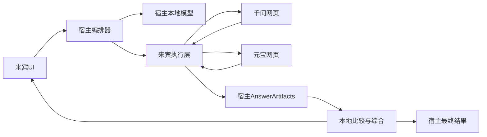

最优基础不是“只通过 VirtualBox 截图看屏幕”，而是分层混合：

1. **正常浏览器主路径：VM 内 BrowserSkill 扩展**
   - 复用 VM 内真实、已登录的 Chrome/Edge profile；
   - 扩展经认证 WSS 与宿主 BrowserSkill daemon 通信；
   - 使用 DOM/ARIA/VOM、元素引用和前置条件执行动作；
   - 回答从本轮消息 DOM 提取为结构化 blocks。
2. **控制与恢复：宿主持久化确定性状态机**
   - 保存 Job、ProviderRun、提交账本和 Artifact；
   - 账号单写租约；
   - 已点击但效果未知时先对账，绝不盲目重发；
   - VM 快照之外保存业务真相。
3. **Windows 原生 UI 补充：来宾 UIA helper**
   - 处理文件选择器、浏览器权限弹窗、系统对话框；
   - 不以 UIA 代替网页 DOM。
4. **VirtualBox 控制面：生命周期与最终兜底**
   - Main API 获取 framebuffer、注入虚拟键鼠；
   - Guest Control 启动和诊断 guest agent；
   - guestproperty 做心跳和小状态；
   - VRDE/VRDP 提供登录、验证码和人工接管。
5. **本地模型：语义融合与有界视觉回退**
   - 正常动作由 SiteSkill/状态机确定，不逐步询问视觉模型；
   - 本地模型负责原子主张抽取、异同、冲突和最终答案；
   - DOM/UIA 均失效时才对局部截图做 Computer Use。

一句话推荐：

> 宿主机运行本地模型、FSM 和 Artifact Store；VM 内 BrowserSkill 复用真实登录态，UIA 处理系统 UI；VirtualBox SDK 负责 VM 生命周期与像素级兜底，VRDE 负责人工接管。

### 0.2 为什么不把纯屏幕路线作为主方案

VirtualBox 可以提供截图和虚拟键鼠，但它不知道：

- 哪个元素是千问输入框；
- 当前 tab 是否属于本任务；
- 用户消息是否已提交；
- 回答是否仍在流式生成；
- 页面上的文本是回答、历史、按钮还是推荐问题；
- 长回答中哪些段落因虚拟滚动没有渲染；
- 鼠标点击失败是坐标、遮挡、焦点还是页面状态导致。

纯视觉还要承担：

- framebuffer 到模型图像的坐标反变换；
- Windows DPI、浏览器缩放和动态分辨率；
- 中文 IME；
- 前台焦点与粘键；
- OCR 的代码、表格和公式损失；
- 每步视觉推理的显存和延迟。

因此纯屏幕路线是必要的兼容性基线和恢复手段，不是固定双站主循环的最佳基础。

### 0.3 VirtualBox 带来的关键变化

相对于浏览器直接运行在宿主机，新增三类状态：

1. **虚拟机状态**
   - powered off、starting、running、paused、saved、stuck。
2. **宿主—来宾通道状态**
   - Guest Additions、host-only 网络、WSS/RPC、guest agent、BrowserSkill。
3. **远端网站业务状态**
   - 未提交、已提交、生成中、完成、限流、验证、未知。

三者不能混为一谈。例如：

- VM snapshot 恢复成功，不代表网站没有收到恢复前的提交；
- WSS 断开，不代表网页点击未生效；
- DOM 提取失败，不代表回答不存在；
- 虚拟机磁盘回滚，不能回滚千问或元宝服务端会话。

### 0.4 封号风险结论

没有 VirtualBox、BrowserSkill、视觉点击或 stealth 能保证不封号。相对安全的工程策略是：

- 长期使用同一 VM、UUID、MAC、虚拟磁盘、Windows 用户和浏览器 profile；
- 来宾通过普通 NAT 使用宿主稳定网络，不轮换代理；
- 同一账号单写；
- 仅由用户显式发起问题；
- 低频、低动作预算；
- CAPTCHA、MFA、异常登录全部人工处理；
- 429 后冷却；
- 提交效果未知时不重试；
- 不把主账号 Cookie 复制到云浏览器；
- 快照恢复后先对账；
- 页面指纹变化立即熔断。

---

## 1. 需求工程化拆解

### 1.1 已确认部署前提

- 本地大模型与编排器运行在宿主机；
- Windows 11 来宾承载问题输入 UI；
- Chrome/Edge 与千问、元宝登录态均在来宾；
- 最终结果既返回来宾 UI，也持久化在宿主；
- 允许 Guest Additions、扩展和 guest agent；
- 必须对比严格的“只看屏幕、只注入键鼠”路线；
- 私人自用，弱化一般合规讨论；
- 重点处理封号、登录态、验证码、误操作和恢复风险。

### 1.2 原始八步的跨 VM 重述

1. 来宾 UI 接受问题；
2. UI 经受认证通道把问题交给宿主；
3. 宿主生成 canonical prompt、任务 ID 和提交账本；
4. 宿主获得千问 provider 租约；
5. 宿主通过来宾执行层操作已登录千问网页；
6. 来宾执行层把千问 AnswerArtifact 回传宿主；
7. 元宝执行同样流程；
8. 宿主本地模型比较两份回答；
9. 宿主规则层验证来源、数字、日期和否定；
10. 最终答案写入宿主 Artifact Store，并推送来宾 UI。

千问和元宝可并行，但首版建议串行：

- 减少一个来宾桌面内多 tab 控制冲突；
- 便于人工观察；
- 降低本地模型和浏览器资源峰值；
- 状态机成熟后再并行。

### 1.3 功能范围

#### 必须

- 任务创建和取消；
- VM 启动、健康检查和恢复；
- 来宾 UI 与宿主双向通信；
- 两站登录状态检测；
- 同一问题的规范化；
- 提交前后对账；
- 流式完成判断；
- 长回答结构化采集；
- 相同点、差异、冲突和各自独有信息；
- 最终综合；
- 人工接管；
- 宿主侧持久化。

#### 可选

- 网络/SSE 回答见证；
- 双站并行；
- 联网搜索/深度思考开关；
- 下载文件回传；
- UIA 系统弹窗；
- 视觉 Computer Use；
- 多版本 SiteSkill；
- OpenClaw/CoWork-OS 宿主集成。

#### 非目标

- 任意网站万能 Agent；
- 无人值守大规模并发；
- 多账号池；
- 验证码破解；
- 代理轮换和指纹伪造；
- 直接伪造千问/元宝私有请求；
- 把 VM snapshot 当作业务事务；
- 让模型获得无限制宿主 Shell；
- 把网页回答中的文字当作工具指令。

### 1.4 质量目标

| 指标 | 设计目标 |
|---|---|
| 自动重复提交 | 0 |
| 未知提交状态下自动重发 | 0 |
| 单 provider 并发写入 | 1 |
| 正常路径视觉模型调用 | 0 |
| 黄金夹具正文准确率 | 不低于 99.5% |
| 代码块/表格顺序 | 100% 保持 |
| CAPTCHA 自动尝试 | 0 |
| VM 快照后无对账继续执行 | 0 |
| 重要比较项来源映射 | 100% |
| 结果宿主持久化 | 100% |

这些是验收目标，不是现有框架自动提供的保证。

### 1.5 这不是严格模型 Benchmark

系统比较的是两个网页产品当时的输出，而非相同推理环境下的底层模型：

- 模型版本可能不同；
- 系统提示不可见；
- 账号等级、地区和灰度实验不同；
- 联网、深度思考和工具配置不同；
- 历史会话影响不同；
- 网站安全策略和引用源不同。

系统应记录可见模型名、开关、提交时间和完成状态，但不能把结果写成严格底层模型排名。

---

## 2. 研究方法与证据规则

### 2.1 证据标签

| 标签 | 含义 |
|---|---|
| 官方事实 | 官方手册、仓库、模型卡或产品文档明确说明 |
| 厂商 benchmark | 厂商自报测试，不等于本场景实测 |
| 架构推断 | 由公开能力推导出的设计判断 |
| 待实测 | 官方没有 SLA，必须在目标机器验证 |

本文不把营销文案当成性能或安全结论。

### 2.2 研究范围

#### VirtualBox

- Main API/SDK；
- `VBoxManage controlvm`；
- Guest Additions；
- Guest Control；
- Guest Properties；
- Shared Folders/Clipboard；
- VRDE/VRDP；
- Web Service；
- NAT/host-only 网络；
- snapshot、saved state 和生命周期。

#### Agent 与浏览器

- OpenClaw；
- WorkBuddy；
- Manus；
- Claude Computer Use/Browser Use；
- Tencent BrowserSkill；
- agent-browser；
- browser-use；
- CoWork-OS；
- Cua；
- Playwright/CDP；
- Windows UI Automation。

#### 模型与测试

- Qwen3.5；
- UI-Mate；
- Qwen3-VL；
- ShowUI；
- OCR；
- OSWorld；
- BrowserGym/WebArena；
- 双站自建模拟站。

### 2.3 选型问题

每项技术都回答：

1. 运行在宿主还是来宾；
2. 操作的是 framebuffer、Windows UI、AX tree、DOM 还是网络；
3. 是否复用真实登录态；
4. 是否要求前台焦点；
5. 回答如何完整回传；
6. 传输断开后如何对账；
7. 能否人工接管；
8. 是否支持确定性动作和前置条件；
9. 资源和时延如何；
10. 对账号身份连续性和动作频率有何影响。

---

## 3. VirtualBox 能力地图

### 3.1 分层定位

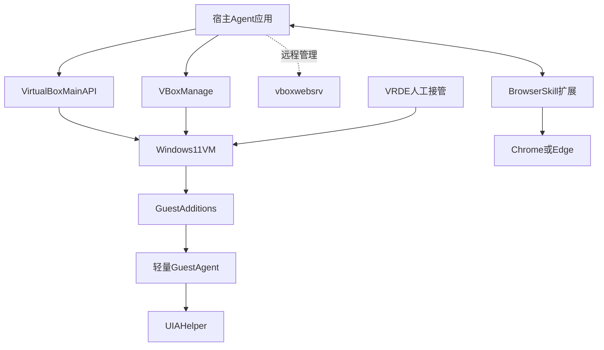

VirtualBox 原生解决：

- VM 生命周期；
- framebuffer；
- 虚拟键盘和鼠标；
- 来宾进程/文件；
- 心跳字符串；
- 共享文件；
- 远程显示。

VirtualBox 不原生解决：

- DOM；
- 浏览器 tab 所有权；
- 网页元素语义；
- 回答消息边界；
- SSE 帧；
- 网站业务状态。

这些必须由 guest agent、浏览器扩展或 CDP 补足。

### 3.2 VirtualBox Main API

#### 官方事实

Main API 是 VirtualBox GUI 和 `VBoxManage` 的底层公共 COM/XPCOM 接口：

- Windows host 使用 COM；
- Linux/macOS 等使用 XPCOM；
- `IVirtualBox` 管机器；
- `ISession`/`IConsole` 管运行会话；
- `IDisplay` 提供显示相关能力；
- `IKeyboard` 和 `IMouse` 提供虚拟输入。

关键接口：

- `IDisplay.takeScreenShotToArray()`：截图直接返回内存数组；
- `IKeyboard.putScancode(s)`：注入扫描码；
- `IKeyboard.putUsageCode()`：注入 HID usage；
- `IKeyboard.releaseKeys()`：异常后释放按键；
- `IMouse.putMouseEvent()`：相对鼠标事件；
- `IMouse.putMouseEventAbsolute()`：绝对坐标事件；
- `IMouse.absoluteSupported`：来宾是否支持绝对定位。

#### 适用

- 持续低延迟截图；
- 纯屏幕控制；
- VM 无窗口/headless 时控制；
- 视觉 fallback；
- 电源、暂停和会话管理。

#### 限制

- 需要正确 machine/session lock；
- 鼠标点击需组合移动、按下、释放，不是一个业务原子动作；
- framebuffer 像素不等于 Windows 逻辑坐标；
- 多显示器需要查询 origin 和尺寸；
- 绝对坐标依赖 Guest Additions/虚拟指针支持；
- 不提供网页元素级结果验证；
- API 对象生命周期和 VirtualBox 版本绑定需要管理。

#### 结论

Main API 是最合适的 VirtualBox 像素/输入底座，但只应是受限执行器，不应直接暴露给本地模型。

资料：

- [VirtualBox Main API](https://www.virtualbox.org/sdkref/)
- [IConsole](https://www.virtualbox.org/sdkref/interface_i_console.html)
- [IDisplay](https://www.virtualbox.org/sdkref/interface_i_display.html)
- [IKeyboard](https://www.virtualbox.org/sdkref/interface_i_keyboard.html)
- [IMouse](https://www.virtualbox.org/sdkref/interface_i_mouse.html)

### 3.3 VBoxManage

#### 官方事实

`controlvm` 支持：

- pause/resume/reset/poweroff/savestate/shutdown；
- `keyboardputscancode`；
- `keyboardputstring`；
- `keyboardputfile`；
- `screenshotpng`；
- 运行时剪贴板和录屏设置。

`screenshotpng` 将单次截图编码并写入文件。`controlvm` 没有与键盘命令对等的鼠标注入子命令。

#### 适用

- 运维脚本；
- 启动、暂停、关闭、保存状态；
- 一次性截图；
- 诊断；
- Main API 故障时的管理备用。

#### 不适用

- 高频 framebuffer 循环；
- 高速视觉闭环；
- 鼠标主控制；
- 结构化网页操作。

每次 CLI 启动、PNG 编码和磁盘写入都会增加延迟，因此持续截图优先 Main API 内存接口。

资料：[VBoxManage 7.2 Command Reference](https://docs.oracle.com/en/virtualization/virtualbox/7.2/user/vboxmanage.html)

### 3.4 Guest Additions

#### 官方事实

Windows Guest Additions 提供：

- 鼠标集成；
- 更好的视频和动态分辨率；
- 共享目录；
- shared clipboard；
- guest properties；
- host 启动 guest 应用；
- 时间同步。

#### 本系统用途

- 绝对指针和显示协调；
- Guest Control；
- guestproperty 心跳；
- 只读/受限共享目录；
- VM 恢复后的时间校正；
- 启动 guest helper。

#### 风险

- host 与 Guest Additions 版本不匹配；
- 自动 resize 改变坐标；
- 双向剪贴板扩大边界；
- 可写共享目录允许 guest 修改 host 文件；
- saved state 恢复后时间跳变影响 TLS、WSS 和网站会话。

建议：

- 固定并验证 host/Guest Additions 版本组合；
- 自动化期间固定来宾分辨率；
- 默认关闭双向 clipboard；
- 共享目录按方向拆分并最小权限；
- 业务协议不依赖剪贴板。

资料：[Guest Additions 7.2](https://docs.oracle.com/en/virtualization/virtualbox/7.2/user/guestadditions.html)

### 3.5 Guest Control

#### 官方事实

`VBoxManage guestcontrol` 可以：

- 以指定 Windows 用户运行程序；
- 等待 stdout/stderr 和退出状态；
- 启动后不等待；
- `copyto`/`copyfrom`；
- 列出和关闭 guest process/session；
- 更新 Guest Additions。

#### 推荐用途

- 首次安装/升级 guest agent；
- 启动、停止、诊断 sidecar；
- 获取版本和健康信息；
- 紧急拉取日志；
- RPC 通道不可用时恢复。

#### 不推荐用途

- 每个浏览器动作创建一个 guest process；
- 长期高频双向消息；
- 保存明文密码在命令行；
- 依赖它穿越 Windows UAC；
- 假定 Session 0 程序可以直接操作交互桌面。

guest helper 必须运行在已登录的交互用户会话。生产主通道应是持久 RPC/WSS，而不是反复执行 `guestcontrol run`。

### 3.6 Guest Properties

#### 官方事实

Guest Properties 是 Guest Additions 与 host 之间的私有字符串通道：

- host 和 guest 均可读写；
- key/value；
- 支持 wait；
- 不需要普通网络。

#### 适用

- heartbeat；
- guest agent 版本；
- 当前 Windows session；
- “需要人工接管”标志；
- 小型启动状态；
- 紧急停止位。

#### 不适用

- 长回答；
- screenshot；
- trace；
- 高频流式 token；
- 大型 JSON。

建议每个值带：

- protocol version；
- monotonic sequence；
- timestamp；
- instance ID；
- HMAC 或由不可信状态处理。

Guest Properties 是状态提示，不是业务数据库。

### 3.7 Shared Folders 与 Clipboard

#### Shared Folders

官方特性：

- 不需要来宾网络；
- 依赖 Guest Additions；
- host 文件夹映射到 guest；
- 可读写或只读；
- Windows 中表现为伪网络重定向器。

适合：

- 大型截图、trace、下载文件；
- 安装包；
- 离线 fixture；
- RPC 故障后的 artifact 备用回传。

不适合：

- 控制消息；
- Exactly-once 提交账本；
- 未采用原子 rename 的实时结果交换。

若使用，建议：

- `host_to_guest` 只读；
- `guest_to_host` 只允许专用 staging 目录；
- 临时文件写完后原子 rename；
- 宿主验证大小、类型和哈希；
- 不执行 guest 回传的任意文件。

#### Shared Clipboard

官方支持文本、图像和 HTML，并可配置 disabled、host-to-guest、guest-to-host、bidirectional；默认禁用。

问题：

- 焦点依赖；
- 格式协商；
- 被其他应用覆盖；
- 无稳定的“直接读取来宾剪贴板”业务 RPC；
- 可能把宿主敏感内容带入 VM。

结论：只用于用户显式复制校验，不作为问题/答案主通道。

### 3.8 NAT、Host-only 与 RPC

推荐双网卡：

1. **Adapter 1：NAT**
   - guest 访问千问、元宝和浏览器更新；
   - 对网站呈现宿主公网出口；
   - 不把 guest 服务暴露给 LAN。
2. **Adapter 2：Host-only**
   - 只承载宿主—guest RPC/WSS；
   - 静态地址或稳定 DHCP reservation；
   - Windows Firewall 只允许宿主地址和固定端口。

RPC 仍需认证，因为 host-only 不是应用层身份：

- mTLS；
- 或首次人工配对产生的短期/轮换 token；
- 每个连接绑定 VM UUID、guest agent ID 和 epoch；
- 消息带 run ID、sequence 和 deadline；
- 写动作需要 fencing token；
- 禁止 guest 任意调用宿主模型/文件工具。

不建议：

- bridge 到办公/家庭 LAN；
- CDP 监听 `0.0.0.0`；
- 无认证 WebSocket；
- 直接把 BrowserSkill/CDP 端口暴露公网。

### 3.9 VRDE/VRDP

#### 官方事实

VirtualBox 通过 VRDE 扩展接口提供远程显示。Oracle VRDP 实现兼容 RDP 客户端：

- VM 可 headless 运行；
- 不依赖 Windows 自身 RDP 服务；
- 能看到 VM console；
- 支持远程键鼠；
- 可配置每 VM 端口和认证。

Oracle 手册指出：

- VRDP 默认禁用；
- `null` 认证很不安全；
- 可使用 host 外部认证或 VBoxAuthSimple；
- 需根据部署配置加密/TLS。

#### 本系统用途

- 用户观察 Agent 操作；
- 首次登录千问/元宝；
- CAPTCHA、MFA、异常登录；
- 未知页面人工处理；
- headless VM 的 Take Over/Hand Back。

#### 不是首选机器视觉通道的原因

- RDP 是增量、压缩和调度后的画面；
- 不保证传每一个 guest frame；
- resize/reconnect 可能改变分辨率；
- 客户端窗口缩放引入第二套坐标；
- GUI RDP 客户端输入受其焦点影响；
- 不提供 DOM 或回答文本 RPC。

自动视觉优先 `IDisplay` 原始 framebuffer；VRDE 优先给人。

资料：[Remote Virtual Machines / VRDP](https://docs.oracle.com/en/virtualization/virtualbox/7.2/user/remotevm.html)

### 3.10 vboxwebsrv

#### 官方事实

VirtualBox Web Service 通过 SOAP/XML 暴露 Main API：

- 默认不启动；
- 使用 managed object references；
- 客户端需释放对象/正确登出；
- 可供远端或不同语言管理。

#### 判断

本机宿主应用不应为了“微服务化”引入 SOAP：

- 高频图像序列化成本高；
- 接口复杂；
- 认证和 TLS 配置增加攻击面；
- 本地 COM/XPCOM 更直接。

只有 VirtualBox host 与 Agent host 不在同一机器时再考虑。

资料：[VirtualBox Programming Interfaces](https://docs.oracle.com/en/virtualization/virtualbox/7.2/user/customizing-vbox.html)

### 3.11 Snapshot、Saved State 与业务状态

#### 官方事实

- pause 暂停 VM 内所有进程；
- saved state 保存 VM 状态，恢复后从原处继续；
- power off 类似拔电，可能造成数据不一致；
- snapshot 可保存设置、磁盘状态；
- 运行中 snapshot 还保存内存状态；
- restore 会回滚虚拟磁盘和内存；
- 在线创建 snapshot 时 VM 会暂停。

#### 最重要的业务结论

VirtualBox snapshot 只回滚本地 VM，不能回滚：

- 千问服务端收到的问题；
- 元宝服务端生成的回答；
- 服务端会话和风控计数；
- 宿主已写入的提交账本。

错误场景：

1. Agent 点击“发送”；
2. 网站已收到；
3. 宿主尚未记录确认；
4. VM 恢复旧 snapshot；
5. 页面看起来像没发过；
6. Agent再次发送；
7. 产生重复提交。

因此：

- 宿主状态是业务真相；
- 每次 snapshot restore 增加 `vm_epoch`；
- restore 后所有 provider 进入 `RECONCILE_REQUIRED`；
- 对账完成前禁止任何发送；
- 不恢复含已登录运行内存的旧 snapshot 作为日常重试；
- 快照主要用于干净环境、测试和灾难恢复。

资料：

- [Working with VMs and Snapshots](https://docs.oracle.com/en/virtualization/virtualbox/7.2/user/working-with-vms.html)
- [VirtualBox Security Guide](https://docs.oracle.com/en/virtualization/virtualbox/7.2/user/Security.html)

### 3.12 VirtualBox 能力对比

| 能力 | 层级 | 适合主路径 | 关键限制 |
|---|---|---:|---|
| Main API screenshot/input | framebuffer | 否 | 无网页语义 |
| VBoxManage | 运维 CLI | 否 | 高频成本、无鼠标 CLI |
| Guest Control | 进程/文件 | bootstrap | 凭据、交互 session |
| Guest Properties | 小字符串 | 心跳 | 容量与协议弱 |
| Shared Folders | 文件 | artifact 备用 | 权限与原子性 |
| Shared Clipboard | GUI 数据 | 否 | 焦点、覆盖、边界 |
| VRDE/VRDP | 远程显示 | 人工接管 | 压缩、坐标、无 DOM |
| Web Service | 远程管理 | 否 | SOAP 与攻击面 |
| Snapshot | VM 回滚 | 测试/灾备 | 不回滚网站状态 |
| BrowserSkill/CDP | 浏览器语义 | 是 | 需 guest 组件 |

### 3.13 必须实测

VirtualBox 官方不承诺本应用需要的延迟或 FPS。目标机必须测：

- Main API screenshot p50/p95/p99；
- 输入到画面变化的端到端延迟；
- 陈旧帧率；
- headless、锁屏、最小化、3D 加速下画面；
- 100%/125%/150% DPI；
- dynamic resize；
- 单/多显示器；
- 中文输入、组合键和粘键；
- guestcontrol 启动交互 helper；
- Guest Additions 版本不匹配；
- VRDE reconnect 后分辨率；
- snapshot restore 后时间、WSS、登录态；
- 网络短断、host-only 重连；
- 浏览器/Windows 更新后的坐标与 UIA。

---

## 4. 同类产品与框架研究

### 4.1 OpenClaw

#### 官方事实

OpenClaw 是自托管 Agent 宿主，Gateway 作为控制面，连接模型、消息渠道、技能、工具和执行节点。浏览器可采用：

- managed profile；
- 现有已登录 Chrome session；
- remote CDP/Node；
- sandbox browser。

其重启恢复的关键思想不是“从失败工具调用原地续跑”，而是保留 transcript，恢复后重新观察当前状态再继续。

#### 对本项目可借鉴

- 宿主控制面与 VM 执行面分离；
- Tool/Skill/Plugin 分层；
- 浏览器执行器可远端；
- artifact staging 与受限读取；
- 恢复后先重新观察；
- 来自网页的内容属于不可信数据。

#### 不直接采用

- 消息渠道、多节点、记忆和通用插件远超当前需求；
- 默认工具面过大；
- 固定双站流程仍需领域 FSM；
- sandbox browser 不等于复用 VirtualBox 内既有 profile。

#### 判断

借架构，不把完整 OpenClaw 作为首版依赖。

资料：

- [OpenClaw](https://openclaw.ai/)
- [OpenClaw Browser](https://docs.openclaw.ai/tools/browser)
- [Existing Browser Session](https://docs.openclaw.ai/tools/browser/existing-session)
- [Remote Browser](https://docs.openclaw.ai/tools/browser/remote)
- [Sandboxing](https://docs.openclaw.ai/gateway/sandboxing)
- [Restart Recovery](https://docs.openclaw.ai/gateway/restart-recovery)

### 4.2 WorkBuddy

#### 官方事实

WorkBuddy 的公开定位是桌面办公 Agent 工作区：

- 每个会话是独立任务；
- 有 workspace/context；
- 提供 Computer Use 和 Agent Browser；
- 有权限模式；
- Artifact、Files、Changes 分栏；
- 支持跨设备查看、停止、继续或远程控制任务。

#### 可借鉴

- 任务状态透明；
- UI 显示正在控制哪个环境；
- 结果、文件和变更分层；
- 明确暂停、继续与接管；
- 本地模型配置入口；
- 交付物优先于长对话日志。

#### 不直接采用

- 浏览器底层协议和登录态边界未完全公开；
- 产品与账号/云服务耦合；
- 公开能力不能当作可嵌入 SDK；
- 崩溃后的写操作恢复语义不明确。

#### 判断

作为 UI 和任务体验参考，不作为技术底座。

资料：

- [WorkBuddy Overview](https://www.workbuddy.ai/docs/workbuddy/Overview)
- [WorkBuddy Conversation](https://www.workbuddy.ai/docs/workbuddy/Conversation)
- [WorkBuddy Results](https://www.workbuddy.ai/docs/workbuddy/Results)
- [Cross-device Tasks](https://www.workbuddy.ai/document/cross-device-tasks)

### 4.3 Manus

#### 官方事实

Manus 的公开设计以每任务云 sandbox/虚拟计算机为核心：

- sandbox 有网络、文件系统和浏览器；
- Cloud Browser 支持实时观看；
- CAPTCHA/MFA 可 Take Over/Hand Back；
- sandbox 休眠/唤醒保留一定状态；
- 正式 artifact 与中间临时文件生命周期不同；
- Branch 可以从历史点复制对话和文件；
- Studio 提供本地文件、终端、Computer Use 和权限模式。

#### 可借鉴

- 任务对应明确执行环境；
- Take Over/Return 是状态机，不是临时异常；
- 正式 Artifact 与临时工作文件分层；
- 远程观察不等于远程自动化协议；
- sandbox 恢复不能假定中间状态完整；
- 分支任务应生成新 job，而不是修改旧提交历史。

#### 不直接采用

- Manus 的云 sandbox 不是本地 VirtualBox；
- 不复用本机 VM 内当前登录态；
- 公开产品不是本项目可控的底层 SDK；
- 厂商关于隔离、安全和生产级交付的陈述需与实测区分。

#### 判断

借鉴 VM 生命周期、接管和 Artifact UX，不以 Manus 云环境替代本地 VM。

资料：

- [Manus Sandbox](https://www.manus.im/blog/manus-sandbox)
- [Manus Cloud Browser](https://www.manus.im/docs/features/cloud-browser)
- [Manus Branch](https://manus.im/docs/features/branch)
- [Manus Studio](https://www.manus.im/docs/features/desktop)

### 4.4 Claude Computer Use 与 Browser Use

#### 官方事实

Anthropic 的 Computer/Browser Use 是客户端工具协议：

- Computer Use 面向完整桌面截图、点击、拖动、滚动和键盘；
- Browser Use 面向 viewport、accessibility、元素、表单和 tab；
- 模型返回 `tool_use`；
- 接入应用负责实际环境和动作执行；
- 它本身不会自动提供一台 VirtualBox VM。

Claude Managed Agents 的 sandbox/session/checkpoint 属于另一产品层，不能把其恢复能力归到基础 Computer Use 工具协议。

#### 对本项目的价值

- 通用视觉规划能力上限；
- 可定义 VirtualBox framebuffer 工具；
- 处理 DOM/UIA 不可见的画布或未知弹窗；
- 借鉴坐标、截图和动作协议。

#### 限制

- 云模型，不符合“本地大模型主 Agent”的强定义；
- 每步上传截图有时延和费用；
- 长回答截图提取损失大；
- 坐标仍受缩放和焦点影响；
- 强模型也不能提供网站提交幂等性。

#### 判断

作为能力对照或可选云 fallback；主路径仍用本地确定性语义工具。

资料：

- [Claude Computer Use](https://docs.anthropic.com/en/docs/agents-and-tools/tool-use/computer-use-tool)
- [Claude API Release Notes](https://docs.anthropic.com/en/release-notes/api)
- [Managed Agents Sessions](https://docs.anthropic.com/en/docs/managed-agents/sessions)

### 4.5 Tencent BrowserSkill

#### 官方架构

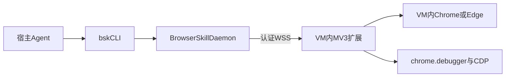

BrowserSkill 不是 VirtualBox 组件，也不是 native messaging。其公开架构是：

> CLI → daemon → WebSocket → MV3 扩展 → CDP/WebExtension。

#### 核心能力

- 扩展所在 profile 的真实登录态；
- 独立可见 Agent Window；
- 显式借用/归还现有 tab；
- snapshot/ref；
- DOM、ARIA、VOM、截图；
- `expect` 前置检查；
- 导航或人工操作后撤销旧控制上下文；
- 远端 daemon 与浏览器扩展配对；
- 适合“宿主 Agent、来宾浏览器”的拓扑。

#### VirtualBox 场景优势

- 无需把 CDP 端口直接暴露 host-only 网络；
- 来宾浏览器主动建立认证 WSS；
- 不复制 Cookie；
- 操作可见；
- 用户可经 VRDE 接管；
- 结果可通过协议直接回宿主。

#### 限制

- CLI、daemon、扩展协议版本需一致；
- 扩展/CDP 权限较高；
- 断线不提供业务事务恢复；
- 远端模式对 upload/download 有限制；
- VOM 是语义推断，不等于原始 `textContent`；
- `expect` 不与网站服务器构成原子事务；
- 项目较年轻，需要锁定版本和回归。

#### 判断

它是本场景最贴合的浏览器主通道，但状态机、防重和 Artifact 仍由宿主实现。

资料：

- [Tencent BrowserSkill](https://github.com/Tencent/BrowserSkill)
- [BrowserSkill Architecture](https://github.com/Tencent/BrowserSkill/blob/HEAD/docs/architecture.md)
- [BrowserSkill Cooperation](https://github.com/Tencent/BrowserSkill/blob/main/packages/dsh-plugin-browserskill/skill/references/cooperation.md)
- [Browser Profiles](https://github.com/Tencent/BrowserSkill/blob/main/docs/browser-profiles.md)

### 4.6 agent-browser

#### 定位

agent-browser 是面向 Agent 的确定性浏览器 CLI/MCP 工具，提供：

- compact accessibility snapshot；
- 元素 ref；
- delta；
- session/profile；
- CDP attach；
- tab pinning；
- screenshot/diff；
- trace、HAR、console、error 和调试工具。

#### VirtualBox 部署

两种方式：

1. agent-browser daemon/CLI 在 guest；
2. 宿主通过 guest RPC 发领域动作。

不建议把裸 CDP 暴露到不可信网络。

#### 优点

- 比自由 Agent loop 更可预测；
- 专用 profile 和 session 清晰；
- 回归诊断强；
- 可用于本地模拟千问/元宝站；
- 适合作为 BrowserSkill 的测试对照。

#### 限制

- 默认隔离 profile 不等于来宾当前登录 profile；
- attach 当前浏览器需要调试配置；
- 直接打开个人默认 profile 有锁和安全限制；
- 功能面大，主账号不应暴露全部工具。

#### 判断

首选测试/回归和专用 profile 备选，不优先替代 BrowserSkill 的真实登录通道。

资料：

- [agent-browser](https://github.com/vercel-labs/agent-browser)
- [Sessions](https://agent-browser.dev/sessions)
- [CDP Mode](https://agent-browser.dev/cdp-mode)
- [Streaming](https://agent-browser.dev/streaming)

### 4.7 browser-use

#### 定位

browser-use 是完整浏览器 Agent Runtime：

- 模型循环观察 DOM/AX/截图；
- 规划动作；
- 连接现有 CDP、真实 Chrome 或持久 profile；
- 支持自定义 tools；
- 适合未知网页。

#### VirtualBox 部署

guest 内运行 worker，宿主发送任务；或者把模型调用代理到宿主。

#### 优点

- PoC 快；
- 对页面小变化有语义适应；
- Python 生态；
- 容易增加第三个站点；
- 视觉与 DOM 可组合。

#### 缺点

- 每步模型循环重；
- guest/host 多一层模型 RPC；
- 小型本地模型 action schema 需实测；
- 自由探索增加点击和刷新；
- 提交防重仍需外部 FSM；
- Cloud 产品能力不等于开源库本身。

#### 判断

快速原型或未知站点有价值；固定双站主账号路径不使用自由 loop。

资料：

- [browser-use](https://github.com/browser-use/browser-use)
- [Real Browser](https://docs.browser-use.com/open-source/customize/browser/real-browser)
- [Human in the Loop](https://docs.browser-use.com/cloud/agent/human-in-the-loop)

### 4.8 Playwright/CDP

#### 能力

- DOM locator；
- actionability 检查；
- accessibility/页面结构；
- 网络监听；
- persistent context；
- trace/video/screenshot；
- 浏览器自动等待；
- `connectOverCDP`。

#### VirtualBox 方式

- guest 内 Playwright sidecar 是最稳妥方式；
- 宿主只调用领域 RPC；
- CDP 只绑定 guest loopback；
- sidecar 在 guest 内连接 CDP；
- 不将 DevTools endpoint 暴露到 LAN。

#### 关键限制

- Chromium 远程调试策略持续收紧；
- 使用默认个人 profile 的调试受到限制；
- `connectOverCDP` 能力低于 Playwright 自己启动的完整协议连接；
- 专用 profile 需用户重新登录；
- 自研 SiteSkill 和协议均由项目维护。

#### 判断

它是自研确定性基线。若 BrowserSkill 不可用，guest Playwright sidecar 是最强备选。

资料：

- [Playwright BrowserType](https://playwright.dev/docs/api/class-browsertype)
- [Playwright Actionability](https://playwright.dev/docs/actionability)
- [Chrome Remote Debugging Changes](https://developer.chrome.com/blog/remote-debugging-port)

### 4.9 Windows UI Automation

#### 能力

Windows UIA 提供桌面应用的：

- AutomationElement tree；
- control type/name/property；
- invoke/value/selection 等 pattern；
- window/focus/bounding rectangle；
- 原生对话框和浏览器 chrome 控件。

实现候选：

- .NET FlaUI；
- Python pywinauto；
- 原生 UIAutomation COM；
- WinAppDriver 只作为历史/兼容参考。

#### 适用

- 文件选择器；
- 下载保存窗口；
- 浏览器权限弹窗；
- Windows 安全提示；
- 来宾 UI；
- BrowserSkill 扩展页面；
- CDP 不覆盖的系统 UI。

#### 限制

- 必须运行在交互用户 session；
- Windows 服务 Session 0 不能直接操作用户桌面；
- AX/UIA 是投影，不是完整 DOM；
- Canvas/WebGL 和无障碍差的页面缺失；
- bounding rectangle 仍受 DPI；
- 浏览器内部网页信息通常不如 DOM 完整。

#### 判断

作为系统 UI 补充，不作为网页正文提取主通道。

资料：

- [UI Automation Tree Overview](https://learn.microsoft.com/en-us/windows/win32/winauto/uiauto-treeoverview)
- [Interactive Services and Session 0](https://learn.microsoft.com/en-us/windows/win32/services/interactive-services)
- [Chrome Windows UIA Support](https://developer.chrome.com/blog/windows-uia-support-update)
- [FlaUI](https://github.com/FlaUI/FlaUI)
- [pywinauto](https://github.com/pywinauto/pywinauto)

### 4.10 CoWork-OS

#### 定位

CoWork-OS 是 GUI-first 本地桌面 Agent：

- Electron 主进程和 React UI；
- Browser Workbench；
- accessibility snapshot/ref；
- workspace/browser partition；
- Take Over/Resume；
- checkpoint；
- artifact preview。

#### 可借鉴

- 可见浏览器工作台；
- 接管状态；
- 冲突写串行；
- Access Profile；
- task/checkpoint/artifact 分层；
- browser 与 workspace 绑定。

#### 不直接采用

- 完整桌面 Agent 远超双站需求；
- 默认 workspace browser 不天然等于 VM 当前 profile；
- 仍需实现 VirtualBox bridge；
- Electron 和插件升级面大。

资料：

- [CoWork-OS](https://github.com/CoWork-OS/CoWork-OS)
- [Browser Workbench](https://github.com/CoWork-OS/CoWork-OS/blob/main/docs/browser-workbench.md)
- [Browser V2 Architecture](https://github.com/CoWork-OS/CoWork-OS/blob/main/docs/browser-v2-architecture.md)

### 4.11 Cua 与 VNC 类框架

Cua 提供跨 OS desktop driver、sandbox、stream 和人工接管思想；VNC 类 Agent 可以把任意远程桌面当作视觉环境。

可借鉴：

- desktop driver 抽象；
- observe/action 协议；
- live stream；
- takeover；
- sandbox 生命周期。

局限：

- 并非为 VirtualBox 与当前登录 profile 专门设计；
- VNC/画面仍没有 DOM；
- 视觉长回答提取弱；
- 小型项目的稳定性和版本支持需实测。

资料：

- [Cua](https://github.com/trycua/cua)
- [vnc-use](https://github.com/mayflower/vnc-use)

### 4.12 生态定位矩阵

| 技术 | 本质 | 运行位置 | 观察层 | 真实登录态 | 本项目角色 |
|---|---|---|---|---:|---|
| VirtualBox Main API | VM 控制面 | host | framebuffer | 5 | 生命周期/视觉兜底 |
| VRDE | 远程显示 | host/客户端 | 像素 | 5 | 人工接管 |
| BrowserSkill | 浏览器 transport | host+guest | DOM/ARIA/VOM | 5 | 主路径 |
| Playwright sidecar | 浏览器驱动 | guest | DOM/CDP | 4 | 确定性备选 |
| agent-browser | Agent 浏览器工具 | guest | AX/DOM/CDP | 4 | 回归/备选 |
| browser-use | Agent Runtime | guest+host | DOM/视觉 | 4 | 快速 PoC |
| UIA helper | Windows 自动化 | guest | UIA | 5 | 系统 UI |
| Claude CU/BU | 云模型工具协议 | cloud+local | 像素/语义 | 依执行器 | 能力对照 |
| OpenClaw | Agent 宿主 | host | 依工具 | 依工具 | 平台化参考 |
| CoWork-OS | 桌面 Agent OS | host/guest | AX/CDP/视觉 | 依 profile | UI/宿主参考 |
| Manus | 云 sandbox 产品 | cloud | 浏览器/桌面 | 低 | 生命周期 UX |
| WorkBuddy | 办公 Agent 产品 | desktop/cloud | 未完全公开 | 未知 | UI/任务 UX |

---

## 5. 本地模型、视觉与测试生态

### 5.1 模型职责分离

不要让同一个本地模型承担所有低级控制：

| 职责 | 首选 | 原因 |
|---|---|---|
| 任务 FSM | 确定性代码 | 可恢复、可测试 |
| 网页定位 | SiteSkill + DOM/ARIA | 快、准、低 token |
| Windows 弹窗 | UIA | 结构化 |
| 视觉定位 | UI-Mate/Qwen视觉 | 仅异常 |
| 回答比较 | Qwen3.5 文本/统一模型 | 中文与结构化输出 |
| 数字日期校验 | 规则代码 | 避免模型漏冲突 |
| 最终综合 | Qwen3.5 | 语义整合 |

### 5.2 Qwen3.5

适合作为宿主统一模型候选：

- 中文；
- 工具调用；
- 文本综合；
- 多模态能力；
- 可本地量化。

推荐从 9B Q4 起步：

- 正常流程只喂结构化观察；
- 两份长回答按主题/主张分块；
- 不把完整页面截图、HTML 和 AX 同时塞入；
- 模型输出严格 schema；
- 最终答案再转自然语言。

模型卡 benchmark 属于厂商自报，不能证明千问/元宝页面操作成功率。

资料：[Qwen3.5-9B](https://huggingface.co/Qwen/Qwen3.5-9B)

### 5.3 UI-Mate

UI-Mate 是腾讯开放的 GUI Agent 候选，适合：

- VirtualBox framebuffer；
- Windows 原生弹窗；
- DOM/UIA 不可用的未知界面；
- 局部截图定位。

注意：

- 官方 benchmark 不等于本 VM 成功率；
- 视觉模型输出坐标仍需变换和动作验证；
- 9B 视觉模型在 12GB 显存需量化和实测；
- 不应每步调用；
- 发送按钮等高风险动作必须由 FSM 批准。

资料：[UI-Mate](https://github.com/Tencent/UI-Mate)

### 5.4 Qwen3-VL 与 ShowUI

Qwen3-VL：

- OCR；
- 文档理解；
- 空间理解；
- 局部截图诊断。

ShowUI：

- 小模型 GUI grounding；
- 适合“文本规划器 + 视觉定位器”；
- 不独立承担长程状态和恢复。

资料：

- [Qwen3-VL-8B-Instruct](https://huggingface.co/Qwen/Qwen3-VL-8B-Instruct)
- [ShowUI](https://github.com/showlab/ShowUI)

### 5.5 OCR

OCR 可用于：

- 检测 CAPTCHA/登录提示；
- 视觉 fallback 的短文本；
- 页面标题/错误提示；
- 回归截图差异。

不适合作为长回答主采集：

- 代码缩进丢失；
- 表格结构丢失；
- 公式和链接不可恢复；
- 滚动拼接易重叠/遗漏；
- 中文标点和小字号误识别；
- 页面控件文字混入正文。

### 5.6 本地推理运行时

#### Ollama

- Windows/Linux 部署简单；
- NVIDIA 支持；
- OpenAI 风格本地服务；
- 适合个人应用；
- 服务仅绑定宿主 loopback；
- 来宾不能直接任意调用模型。

资料：[Ollama Windows](https://docs.ollama.com/windows)

#### llama.cpp

- GGUF 量化丰富；
- CPU/GPU 混合卸载；
- 运行时可控；
- 多模态 projector/template 需精确匹配。

资料：[llama.cpp](https://github.com/ggml-org/llama.cpp)

#### vLLM

- 高吞吐；
- 适合多请求；
- 单用户 VirtualBox 场景通常过重；
- Windows host 需要 WSL2/其他部署。

资料：[vLLM Installation](https://docs.vllm.ai/en/stable/getting_started/installation/gpu/)

### 5.7 显存与资源

| 宿主显存 | 建议 |
|---|---|
| 12GB | Qwen3.5-9B Q4 单模型，8K–16K 起测；视觉按需；VM 不直通 GPU |
| 16GB | 9B 更高量化或视觉模型分时；长回答分块 |
| 24GB | 9B 高精度/较大文本模型；UI-Mate/Qwen3-VL 分时加载 |

VirtualBox Windows 来宾通常使用虚拟显卡，不需要把宿主 CUDA GPU 交给 guest。模型留在宿主可避免：

- GPU passthrough 复杂度；
- guest 显存竞争；
- 驱动双重维护；
- 模型随 VM snapshot 回滚；
- 大权重在 VM 内占盘。

宿主仍需预留：

- 浏览器/VM framebuffer；
- VirtualBox 3D；
- KV cache；
- screenshot tensor；
- OCR/VLM workspace；
- UI。

### 5.8 OSWorld

OSWorld 评估完整桌面、多应用和执行结果，适合：

- 验证视觉 Agent 协议；
- UIA/截图混合；
- 恢复和窗口操作；
- 泛化能力参考。

不适合直接证明：

- 千问/元宝登录态稳定；
- 回答完整提取；
- 网页提交 exactly-once；
- 封号风险。

其历史 VirtualBox provider 状态也不能替代本项目实测。

资料：[OSWorld](https://github.com/xlang-ai/OSWorld)

### 5.9 BrowserGym/WebArena

BrowserGym 提供统一浏览器研究环境，可接 WebArena、VisualWebArena、WorkArena。可借鉴：

- 任务 reset；
- observation/action；
- evaluator；
- 可复现网站；
- 执行结果而非文本相似度评估。

本项目应自建双站模拟 fixture，不能在 CI 自动操作真实账号。

资料：

- [BrowserGym](https://github.com/ServiceNow/BrowserGym)
- [WebArena](https://github.com/web-arena-x/webarena)

### 5.10 自建 benchmark

模拟千问与元宝页面，覆盖：

- 普通流式回答；
- 深度思考；
- 联网搜索；
- 代码；
- 表格；
- 公式；
- 引用；
- 虚拟滚动；
- 页面 skeleton；
- DOM 节点替换；
- SSE 断开；
- WSS 断开；
- VM pause/resume；
- VM snapshot restore；
- BrowserSkill reconnect；
- 429；
- CAPTCHA；
- 用户接管；
- 同一问题在历史中重复出现；
- DOM 与网络流不一致。

关键指标：

- 重复提交率；
- 未知提交率；
- AnswerArtifact 完整度；
- takeover 恢复率；
- vm_epoch 对账覆盖；
- 动作数；
- p50/p95 延迟；
- 本地模型 OOM；
- 错误来源映射率。

---

## 6. 共享核心架构

所有候选方案都应复用本章的控制面、数据模型和恢复语义。区别只在 Browser Transport 与感知层。

### 6.1 推荐部署拓扑

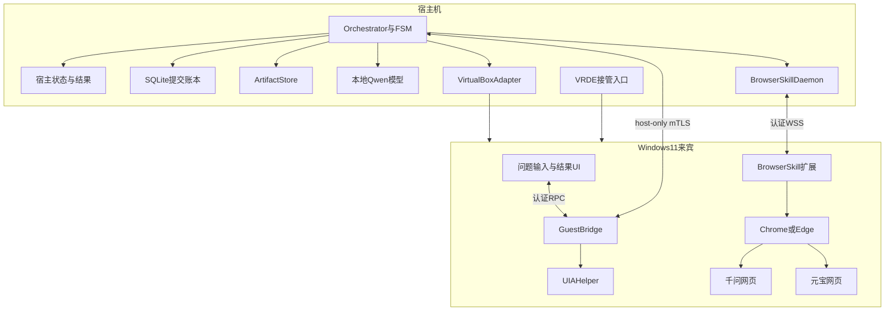

### 6.2 信任边界

#### 宿主可信控制面

包含：

- canonical prompt；
- Job/ProviderRun；
- 提交账本；
- provider lease；
- vm_epoch；
- AnswerArtifact；
- 比较与最终结果；
- 本地模型；
- 风险策略。

宿主账本不能放进会被 VM snapshot 回滚的路径。

#### 来宾受限执行面

包含：

- 输入 UI；
- GuestBridge；
- UIA helper；
- BrowserSkill 扩展；
- 浏览器和 profile；
- 临时 screenshot/trace。

来宾可能：

- 崩溃；
- 回滚；
- 被网页内容影响；
- 断网；
- 被用户手工操作；
- 返回过期消息。

因此宿主必须验证 run ID、epoch、sequence 和状态。

#### 不可信外部内容

- 千问回答；
- 元宝回答；
- 网页 DOM；
- 外部链接；
- 下载文件；
- 页面显示的“系统指令”；
- OCR/VLM 读到的文字。

这些只能作为数据，不能直接扩大工具权限。

### 6.3 宿主组件

#### Orchestrator

- 接收来宾 UI 请求；
- 生成 canonical prompt；
- 驱动持久化 FSM；
- 获取 VM/provider lease；
- 调用 Browser Transport；
- 管理超时、取消、冷却和接管；
- 触发提取、比较与综合；
- 将结果推送到来宾 UI。

#### VM Manager

- 启动/停止/查询 VM；
- 获取 vm_epoch；
- 检查 Guest Additions；
- 获取 framebuffer；
- 注入受限虚拟输入；
- 管理 snapshot 事件；
- 打开 VRDE 接管入口。

#### Browser Gateway

- BrowserSkill daemon 或其他 Transport；
- 只暴露领域工具；
- 固定 origin allowlist；
- 管理 tab/session/context；
- 记录 SiteSkill 和浏览器版本。

#### Model Router

- 文本比较模型；
- 可选视觉模型；
- 上下文预算；
- schema 验证；
- OOM 降级；
- 不保存浏览器凭据。

#### Artifact Store

- 内容寻址；
- 哈希；
- metadata；
- 保留期；
- partial/complete；
- 来源映射。

### 6.4 来宾组件

#### Guest UI

- 用户输入问题；
- 显示 canonical prompt；
- 展示千问/元宝状态；
- 显示是否由 Agent 控制；
- 提供暂停、取消、Take Over、Hand Back；
- 展示双方原回答、异同和最终答案；
- 将问题发送给 GuestBridge，不直接调用 BrowserSkill。

#### GuestBridge

- 与宿主配对；
- 报告 guest/Windows/user session/version；
- 转发 UI 任务和状态；
- 启动/监督 UIA helper；
- 生成 guest heartbeat；
- 不拥有提交决策权。

#### UIA Helper

- 运行在交互用户 session；
- 只接受 allowlist 窗口/控件动作；
- 返回 control type、name、bounds 和 pattern；
- 不执行任意 PowerShell/程序；
- Agent 接管时暂停。

#### BrowserSkill Extension

- 在已登录 profile 中工作；
- 只操作独立 Agent Window 或显式借用 tab；
- 通过 daemon 协议返回 DOM/ARIA/VOM/截图；
- 断线后旧 context 失效；
- 不保存宿主业务状态。

### 6.5 宿主—来宾通信

#### 主通道

host-only 网络上的 mTLS RPC/WebSocket：

- guest 主动连宿主；
- 首次通过 VRDE 显示配对码；
- 宿主保存 VM identity 与 guest public key；
- 证书可轮换；
- 每消息有 sequence/deadline；
- 断线重连后进行状态同步。

#### 消息 envelope

概念字段：

- protocol version；
- message ID；
- correlation ID；
- VM UUID；
- vm_epoch；
- guest instance ID；
- user session ID；
- job ID；
- provider run ID；
- fencing token；
- sequence；
- deadline；
- payload type；
- payload hash。

#### 通道分工

| 通道 | 作用 | 不承担 |
|---|---|---|
| mTLS RPC/WSS | 控制、状态、文本 Artifact | 大型 trace |
| guestproperty | 心跳、版本、紧急停止 | 回答正文 |
| Shared Folder | 大文件 staging | 控制与账本 |
| Guest Control | bootstrap/诊断 | 每步动作 |
| VRDE | 人工观察与输入 | 机器结构化提取 |
| Main API | framebuffer/虚拟输入 | DOM |

### 6.6 双层租约

#### VM Input Lease

保护来宾桌面输入权：

- owner：agent 或 human；
- vm_epoch；
- fencing token；
- user session；
- heartbeat；
- TTL；
- lease state；
- last safe checkpoint。

规则：

- Agent 与用户不能同时自动输入；
- Take Over 前停止动作队列；
- 释放所有虚拟键；
- 使旧坐标和 UIA element 失效；
- Hand Back 后重新观察；
- TTL 到期不自动恢复写操作。

#### Provider Lease

每个站点账号一个写租约：

- provider；
- profile；
- conversation；
- owner run；
- epoch/fencing token；
- heartbeat；
- last submission attempt。

千问与元宝可各有一个租约，但共享同一 VM input lease 时仍需序列化前台视觉/UIA动作。BrowserSkill 的后台语义动作能否安全并行需实测。

### 6.7 核心数据模型

#### Job

- job ID；
- canonical prompt 引用；
- prompt HMAC；
- 创建来源；
- guest UI session；
- provider 列表；
- 总状态；
- policy version；
- 创建/完成时间。

#### VMRun

- VM UUID；
- vm_epoch；
- VirtualBox/Guest Additions 版本；
- power state；
- guest instance ID；
- Windows user/session；
- 分辨率/DPI；
- BrowserSkill/GuestBridge/UIA 版本；
- network endpoints；
- snapshot lineage；
- input lease。

#### ProviderRun

- provider；
- SiteSkill version；
- browser/profile/tab/session；
- conversation URL/ID；
- visible model/options；
- state/revision；
- submission attempt；
- pre/post evidence；
- completion evidence；
- failure phase/code；
- cooldown；
- provider lease。

#### SubmissionAttempt

- attempt ID；
- canonical prompt HMAC；
- provider；
- conversation baseline；
- pre-submit message hashes；
- input value hash；
- action request sequence；
- click/press timestamp；
- transport acknowledgement；
- observed user message；
- reconcile result；
- final effect status。

#### AnswerArtifact

- provider；
- run/attempt；
- raw text；
- normalized Markdown；
- ordered blocks；
- citations/links；
- DOM/AX/network/OCR source；
- first/last block evidence；
- completion evidence；
- integrity state；
- partial/uncertain；
- extractor version；
- content hash。

#### ComparisonArtifact

- atomic claims；
- alignments；
- common points；
- differences；
- conflicts；
- provider-only claims；
- local additions；
- final answer；
- source map；
- verifier result；
- model/prompt/schema version。

### 6.8 Canonical Prompt

同一问题定义：

1. 用户在来宾 UI 最终确认的文本；
2. Unicode NFC；
3. 统一换行；
4. UTF-8；
5. 附件另算 hash；
6. 不为某一站添加隐藏前缀；
7. 两个 ProviderRun 引用同一宿主对象。

显示与传输：

- 来宾 UI 显示规范化后的版本；
- 宿主保存加密正文或用户允许的本地明文；
- HMAC 用于本地对象一致性；
- 页面回读按明确空白规则比较。

无法证明远端服务端收到每个字节完全相同，只能证明系统提交了相同规范对象并观察到对应可见消息。

### 6.9 总状态机

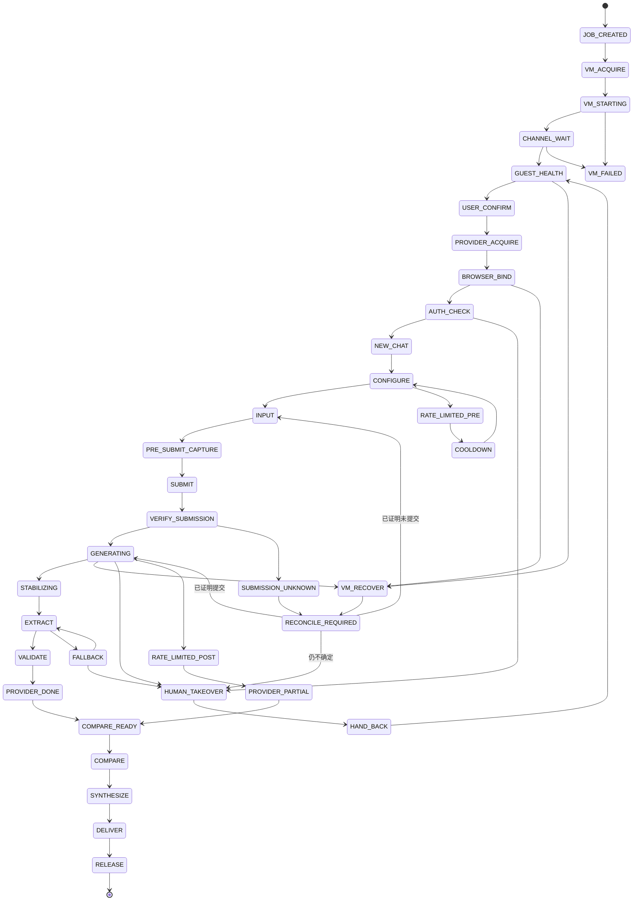

### 6.10 VM 恢复状态

任何以下事件都增加或重新确认 `vm_epoch`：

- snapshot restore；
- VM reboot；
- saved state restore；
- guest instance ID 变化；
- Windows user session 变化；
- profile 从备份替换；
- GuestBridge 重新安装/重置 identity。

恢复步骤：

1. 冻结所有 provider 写入；
2. 失效旧 VM input lease；
3. 检查 VM/Guest Additions/GuestBridge；
4. 获取当前 Windows session；
5. 重新绑定 BrowserSkill；
6. 枚举目标 tab；
7. 读取对话状态；
8. 对所有非终态 submission attempt 对账；
9. 更新 VMRun；
10. 只有证明安全后恢复。

### 6.11 提交防重

#### Prepare

提交前记录：

- vm_epoch；
- browser/session/tab；
- conversation URL/ID；
- 消息数量；
- 最后用户/assistant message hash；
- 输入框值；
- canonical prompt HMAC；
- SiteSkill/page fingerprint；
- provider/model/options；
- attempt ID；
- fencing token。

#### Commit

写动作要求：

- VM input lease 有效；
- provider lease 有效；
- 页面 origin 正确；
- input 与 canonical prompt 匹配；
- send 控件唯一且可用；
- 没有 CAPTCHA/登录/429；
- attempt 处于唯一允许状态。

#### Reconcile

提交后观察：

- 新用户消息；
- 可见文本匹配；
- 新 assistant 节点；
- busy/stop 状态；
- conversation URL/ID；
- 可选网络 request/stream；
- 错误/验证码覆盖。

结果只有：

- `PROVED_SUBMITTED`；
- `PROVED_NOT_SUBMITTED`；
- `UNKNOWN_EFFECT`。

`UNKNOWN_EFFECT` 不允许再点击发送。

### 6.12 流式完成检测

不能只依赖固定 sleep 或 `networkidle`。

#### 生命周期信号

- stop 控件出现后消失；
- busy → idle；
- assistant 节点结束标记；
- 网络 stream finish；
- 工具/搜索阶段完成。

#### 交互信号

- input 恢复；
- send 可用；
- copy/retry toolbar 出现；
- 页面没有继续滚动生成。

#### 内容信号

- 文本 hash 连续稳定；
- block 数稳定；
- MutationObserver 静默；
- 最后一块完整；
- DOM 与可选网络流均不再增长。

#### 规则

- 至少一个生命周期信号；
- 至少一个独立交互/结果信号；
- 内容非空；
- 经过站点模式校准的稳定窗；
- 搜索/思考用更长窗口；
- 超时输出 partial，不无限等待；
- VM pause 时间不计入生成超时。

### 6.13 回答采集优先级

1. 本轮 assistant DOM blocks；
2. BrowserSkill 结构化提取；
3. accessibility/ARIA；
4. 经验证的 CDP/SSE 被动观察；
5. 页面复制按钮显式校验；
6. UIA；
7. 滚动 screenshot + OCR/VLM。

#### DOM block extractor

保留：

- 标题；
- 段落；
- 有序/无序列表；
- 引用；
- 代码和语言；
- 表格；
- 公式；
- 链接和引用；
- 展开内容；
- DOM 顺序。

删除：

- 工具栏；
- copy/retry 按钮；
- skeleton；
- 推荐问题；
- 侧栏历史；
- 隐藏无关节点。

虚拟滚动：

- 受控滚动；
- 每屏记录 block/content hash；
- 首尾重叠去重；
- 检查首块、末块和连续性；
- 恢复原滚动位置；
- 不能证明完整则标记 partial。

### 6.14 网络流见证

阶段化启用：

1. 发现当前页面自己的 fetch/SSE/WebSocket；
2. 关联 submission attempt；
3. 解析 delta/citation/finish；
4. 与 DOM 规范文本比较；
5. 通过版本化 fixture 后才启用；
6. 页面/协议 fingerprint 变化立即关闭。

明确禁止：

- 从宿主伪造私有 API；
- 导出 Cookie 调接口；
- 重放签名请求；
- 以网络流成功替代可见页面提交；
- 静默选择与 DOM 冲突的网络正文。

完整性状态：

- `MATCH`；
- `FORMAT_ONLY_DIFF`；
- `CONTENT_DIFF`；
- `DOM_PARTIAL`；
- `NETWORK_PARTIAL`；
- `UNVERIFIED`。

### 6.15 UIA 与视觉 fallback

#### UIA 路径

1. BrowserSkill 报告浏览器外阻塞；
2. FSM 请求 UIA snapshot；
3. helper 只返回 allowlist 进程/窗口；
4. SiteSkill 识别对话框；
5. 低风险动作可自动；
6. 登录、授权、文件覆盖等进入人工接管；
7. UIA 完成后重新绑定浏览器；
8. 旧 DOM ref 失效。

#### 视觉路径

1. Main API 取原始 framebuffer；
2. 记录 display origin/size；
3. 按模型要求缩放；
4. 模型输出目标与置信度；
5. 坐标映射回原 framebuffer；
6. 执行前截取局部图复核；
7. FSM 批准动作；
8. Main API 注入输入；
9. 新截图验证效果；
10. 高风险发送动作仍需 DOM/状态证据。

### 6.16 坐标与 DPI

坐标链：

```text
模型图像坐标
→ 反缩放到 framebuffer 坐标
→ 加 display origin
→ VirtualBox 绝对坐标
→ Windows 虚拟桌面
→ 应用 client area
```

必须记录：

- guest resolution；
- display index/origin；
- screenshot width/height；
- 模型输入 width/height；
- Windows scale；
- browser zoom；
- window bounds；
- UIA DPI awareness；
- VRDE client scaling（只用于人工）。

规则：

- 首版单显示器；
- Windows 100% scale；
- browser 100% zoom；
- 禁止自动 resize；
- 每次视觉点击前新截图；
- 分别计算 X/Y scale；
- 不把 VRDE 客户端窗口坐标直接注入 VM；
- 点击后验证焦点和页面结果；
- 异常时调用 `releaseKeys()`。

### 6.17 中文输入

优先级：

1. BrowserSkill/DOM `fill`；
2. UIA ValuePattern；
3. guest agent 受限文本注入；
4. host-to-guest clipboard + 显式粘贴（仅备用）；
5. 扫描码逐键输入（仅 ASCII）。

原因：

- `keyboardputstring` 与中文 IME、布局、组合字符的可靠性需实测；
- 剪贴板可能被覆盖；
- 扫描码不适合中文；
- DOM fill 最容易回读验证。

任何输入后都要读回输入框并与 canonical prompt 对比。

### 6.18 人工接管

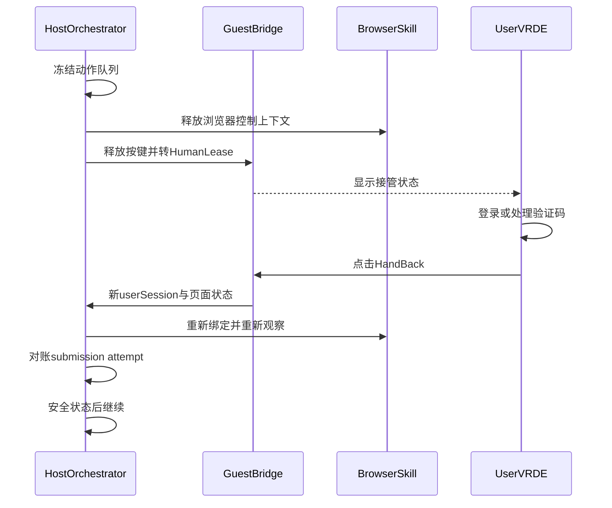

接管触发：

- 登录失效；
- CAPTCHA/MFA；
- 页面 fingerprint 未知；
- 系统弹窗；
- 提交效果未知；
- 账号限制；
- 用户主动点击；
- Agent 动作预算耗尽。

接管期间：

- Agent 不注入输入；
- lease 不因 TTL 被另一个 Agent 获得；
- 不自动关闭用户打开的页面；
- 所有旧 ref/坐标作废；
- Hand Back 不是“继续下一步”，而是“重新观察并调度”。

### 6.19 Artifact 生命周期

#### 类型

- `PromptArtifact`；
- `AnswerArtifact`；
- `DOMBlocksArtifact`；
- `NetworkWitnessArtifact`；
- `ScreenshotArtifact`；
- `TraceArtifact`；
- `DownloadArtifact`；
- `ComparisonArtifact`；
- `FinalAnswerArtifact`。

#### 回传

小文本：

- mTLS RPC；
- payload hash；
- sequence；
- 宿主 ack。

大文件：

- guest staging；
- 临时名；
- 写完后 rename；
- manifest；
- 宿主复制；
- hash/size/type 验证；
- 宿主 ack 后删除 guest 临时文件。

#### 状态

- `STAGING`；
- `SEALED`；
- `TRANSFERRED`；
- `VERIFIED`；
- `REJECTED`；
- `EXPIRED`。

VM snapshot restore 后，宿主已验证 Artifact 不回滚；guest staging 只作缓存。

### 6.20 比较与综合

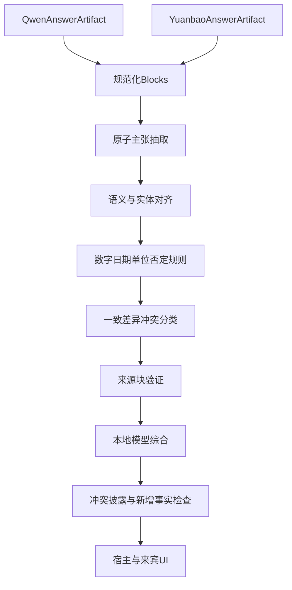

#### 原子主张

- claim ID；
- text；
- fact/opinion/recommendation/assumption；
- entity；
- number/unit/date；
- negation；
- source provider/block；
- extraction confidence。

#### 分类

- `equivalent`；
- `compatible_detail`；
- `scope_difference`；
- `assumption_difference`；
- `factual_conflict`；
- `recommendation_conflict`；
- `evidence_difference`；
- `provider_only`；
- `uncertain`。

#### 最终规则

1. 直接回答用户问题；
2. 双方一致结论优先；
3. 独有信息注明来源；
4. 冲突不取平均；
5. 数字、日期、版本和否定单独校验；
6. 必要时建议核验；
7. 本地模型新增知识标为本地补充；
8. 每个关键结论映射来源 block；
9. 一方 partial 时降低结论强度；
10. 两方均失败时展示失败原因，不编造综合。

### 6.21 领域工具面

本地模型只获得：

| 工具 | 作用 | 写效果 |
|---|---|---:|
| `inspect_vm` | VM/guest 健康 | 否 |
| `prepare_provider` | 页面/登录检查 | 否 |
| `start_new_chat` | 新建对话 | 是 |
| `submit_question` | 唯一提交动作 | 是，高风险 |
| `observe_generation` | 读取生成 | 否 |
| `extract_answer` | 生成 Artifact | 否 |
| `request_takeover` | 人工接管 | 状态变化 |
| `compare_answers` | 比较 | 否 |
| `synthesize_final` | 综合 | 否 |

模型不获得：

- 任意 Main API；
- 任意 `VBoxManage`；
- 任意 Guest Control；
- 任意宿主/来宾 Shell；
- 任意 URL；
- 任意 JavaScript；
- 任意文件系统；
- Cookie；
- 裸 CDP；
- snapshot restore；
- poweroff。

这些能力只能由 FSM 基于 policy 调用。

### 6.22 UI 与结果交付

来宾 UI：

- 问题输入；
- 当前 VM/浏览器/账号状态；
- 双站进度；
- Take Over/Hand Back；
- 原回答；
- 相同点；
- 不同点；
- 冲突；
- 最终答案；
- partial/uncertain；
- 来源跳转。

宿主 UI/结果：

- 任务列表；
- VM 和通道健康；
- 风险/冷却；
- Artifact；
- trace；
- 版本；
- 手工导出；
- 熔断恢复。

来宾 UI 关闭不取消任务。宿主任务完成后结果可在来宾 UI 重连时重放。

---

## 7. 候选方案

### 7.1 方案 A：VirtualBox Main API 纯黑盒

#### 架构

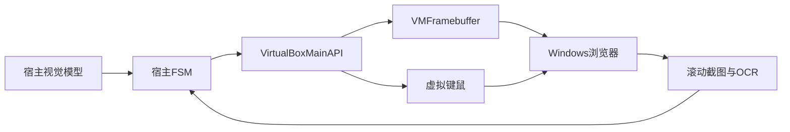

#### 控制与读取

- `IDisplay` 持续截图；
- `IKeyboard/IMouse` 注入；
- VLM/GUI grounding 定位；
- OCR/截图拼接读取回答；
- 不安装业务扩展或 guest agent。

#### 登录态

直接操作 VM 内普通浏览器，登录态连续性高。首次登录、验证码由用户经 VM 窗口或 VRDE 完成。

#### 恢复

- 重新截图；
- 视觉识别当前页面；
- 从历史消息对账；
- screenshot hash 不能证明提交状态；
- 任何提交未知优先人工确认。

#### 资源

- 每步截图编码和视觉推理；
- 12GB 需小模型/量化；
- 长回答 OCR 慢；
- VM 与视觉模型并行占内存。

#### 封号风险

浏览器身份自然，但视觉探索会产生更多鼠标、滚动、误点和重试。服务端仍可观察自动化节奏，“像人点击”不等于低风险。

#### 优点

- 最少 guest 业务组件；
- 任意可见 UI 通用；
- 不依赖 DOM/CDP；
- 可处理浏览器外界面；
- VirtualBox 隔离边界直观。

#### 缺点

- 长回答完整度最低；
- 坐标/DPI/焦点脆弱；
- 中文输入困难；
- 提交防重证据弱；
- 调试和测试困难；
- 每步模型成本高。

#### 适用

- 不允许安装扩展/agent；
- 验证可行性；
- 安装、登录和灾难恢复。

#### 不适用

- 作为长期双站主路径；
- 要求代码/表格/引用完整。

### 7.2 方案 B：VRDE/RDP/VNC + Computer Use

#### 架构

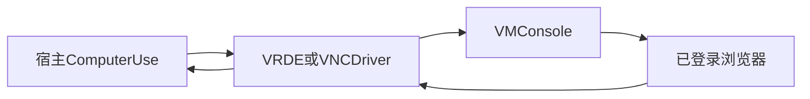

#### 控制与读取

- 远程桌面协议获取连续画面；
- 协议或客户端注入键鼠；
- 云 Claude 或本地 GUI 模型规划；
- OCR/视觉采集回答。

#### 登录态

操作 console 中真实浏览器，登录态连续。VRDE 不创建 Windows RDP 的另一个用户 session，这一点优于直接启用 Windows RDP 服务。

#### 恢复

- 重连 VRDE；
- 固定 remote resolution；
- 重新截图；
- 清除旧坐标；
- 提交状态仍需网页视觉对账。

#### 资源

- 画面压缩/解压；
- 网络/协议延迟；
- Computer Use 模型调用；
- 本地方案显存高，云方案有费用。

#### 封号风险

与方案 A 类似；自动化动作可能更受协议时延影响，造成重复或错误输入。

#### 优点

- headless host 也可工作；
- live view 和人工接管成熟；
- 可接现有 RDP/VNC Agent；
- 不要求 DOM；
- 人与 Agent 看到同一 console。

#### 缺点

- 压缩/增量帧不适合作为精确感知；
- reconnect/resize 改坐标；
- 无结构化回答；
- VRDE 认证/TLS 要单独配置；
- GUI 客户端焦点问题；
- 仍需 VirtualBox/业务状态机。

#### 适用

- 远程人工接管；
- headless VM；
- 纯视觉实验。

#### 不适用

- 回答正文主采集；
- 要求低时延、确定性提交。

### 7.3 方案 C：Guest UIA Sidecar

#### 架构

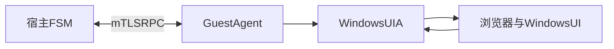

#### 控制与读取

- UIA tree、properties、patterns；
- ValuePattern 写输入；
- InvokePattern 点击；
- TextPattern/Name 读取；
- bounding rectangle + screenshot 补充。

#### 登录态

直接操作现有 Windows session 和浏览器，登录态高。

#### 恢复

- UIA element 不跨页面/窗口长期保存；
- 每步按稳定属性重找；
- session 变化后重启 helper；
- 浏览器内页面对账能力取决于 AX/UIA 暴露。

#### 资源

低于视觉模型；helper 常驻开销小；大量 UIA tree 需局部过滤。

#### 封号风险

动作少于纯视觉，浏览器身份自然；但网页控件语义和 DOM 不完整会导致误操作。

#### 优点

- 浏览器外系统 UI 强；
- 不要求 DevTools；
- 可精确读窗口、焦点和控件；
- 低模型依赖；
- 与普通 Windows 应用通用。

#### 缺点

- 网页 AX 投影不等于 DOM；
- 长回答结构不完整；
- Canvas/自绘控件不可见；
- 需交互 user session；
- Windows/Chrome UIA 版本变化；
- DPI 仍影响坐标 fallback。

#### 适用

- 文件选择器和系统弹窗；
- 来宾输入 UI；
- BrowserSkill/CDP 的补充。

#### 不适用

- 单独承担网页长回答采集。

### 7.4 方案 D：Guest Playwright/CDP Sidecar

#### 架构

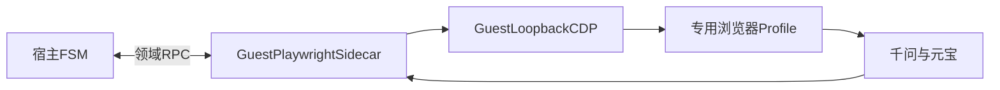

#### 控制与读取

- locator 和 actionability；
- DOM/ARIA；
- network/SSE 监听；
- trace、video、screenshot；
- SiteSkill 自研。

#### 登录态

推荐长期专用 profile，由用户经 VRDE 首次手工登录。直接连接默认个人 profile 受浏览器调试策略、锁和安全限制影响。

#### 恢复

- sidecar/session 重连；
- persistent profile；
- tab/conversation 对账；
- trace 支持回放；
- VM restore 后必须依宿主账本恢复。

#### 资源

低模型调用；浏览器和 sidecar 常驻；trace/视频占盘。

#### 封号风险

专用 profile 长期稳定时中低；新 profile 初次登录可能触发验证。CDP 自动化仍可被网站行为层观察。

#### 优点

- DOM 完整；
- 长回答提取强；
- 网络见证容易；
- 自动等待；
- 测试、trace 和 fixture 成熟；
- 控制面完全可定制。

#### 缺点

- 需重新登录专用 profile；
- 自研 sidecar、协议和 SiteSkill；
- 浏览器版本/CDP 耦合；
- 裸 CDP 暴露风险；
- attach 现有 profile 不如 BrowserSkill 自然。

#### 适用

- 愿意专用 profile；
- 重视稳定回归；
- BrowserSkill 不可用。

#### 不适用

- 硬性要求直接复用当前普通浏览器 profile 且不重启。

### 7.5 方案 E：BrowserSkill 远端扩展

#### 架构

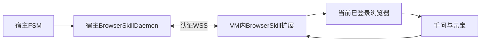

#### 控制与读取

- snapshot/ref；
- DOM/ARIA/VOM；
- `expect`；
- screenshot；
- 结构化提取；
- 独立 Agent Window；
- SiteSkill。

#### 登录态

直接复用扩展所在 VM profile，是当前需求最强匹配。

#### 恢复

- WSS 重连；
- session/context 重新建立；
- tab 重新绑定；
- 对话/提交对账；
- 旧 ref 全失效；
- 不假定 transport ack 等于网站提交成功。

#### 资源

浏览器扩展和 daemon 开销低；正常流程不需视觉模型；回答可直接文本回宿主。

#### 封号风险

相对最低之一：真实 profile、正常网页和可见浏览器、动作数少。但扩展/CDP 自动化和行为节奏仍可能被识别，不能保证账号安全。

#### 优点

- 真实登录态；
- 天然适配 host/guest 远端；
- 不开放裸 CDP；
- DOM 精度；
- 用户可见/可接管；
- Agent Window 所有权；
- 工具输出紧凑。

#### 缺点

- 较年轻；
- 扩展权限高；
- 版本联动；
- 远端 upload/download 限制；
- 断线无业务事务恢复；
- 千问/元宝页面适配仍需维护。

#### 适用

当前需求的最佳单一主方案。

#### 不适用

- 禁止安装浏览器扩展；
- 浏览器策略禁止 debugger 权限。

### 7.6 方案 F：Guest agent-browser

#### 架构

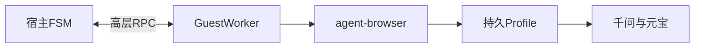

#### 控制与读取

- compact AX snapshot；
- ref/delta；
- CDP；
- screenshot/diff；
- trace/HAR；
- 确定性命令。

#### 登录态

长期专用 profile 最稳；attach 当前浏览器需调试配置。用户可通过 VRDE 登录。

#### 恢复

- session/profile/tab pinning；
- trace；
- guest worker 重启；
- 宿主 FSM 仍负责提交账本。

#### 资源

比自由 browser-use 低；比直接 Playwright 多一层 CLI/daemon；诊断 Artifact 较多。

#### 封号风险

与 Playwright 专用 profile 类似；应禁用不必要的“人类化/stealth”伪装，重点控制动作和频率。

#### 优点

- Agent 友好；
- 确定性；
- 诊断工具完整；
- session/tab 隔离；
- 测试性最高之一；
- 比自研 Playwright sidecar 上手快。

#### 缺点

- 不天然是当前 profile；
- guest 进程和 RPC 层；
- 大工具面需裁剪；
- 项目版本迭代快；
- 主账号策略需额外限制。

#### 适用

- 专用 profile；
- 模拟站；
- 回归和 trace；
- BrowserSkill 备选。

#### 不适用

- 零迁移复用普通 profile 的硬约束。

### 7.7 方案 G：Guest browser-use 自主 Agent

#### 架构

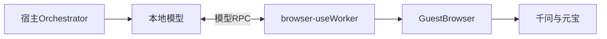

#### 控制与读取

- DOM/AX/截图 observation；
- 模型每步规划；
- browser-use tools；
- structured result；
- 可加入 custom action。

#### 登录态

可用真实/持久 profile，但需验证 VM 内连接方式与浏览器策略。

#### 恢复

- Agent history 只能辅助；
- 宿主必须持久化 FSM；
- 写操作封装为外部确定性工具；
- VM 恢复后不能让模型从自然语言猜测状态。

#### 资源

- 多轮 host↔guest↔model；
- token 和时延高；
- 本地小模型可靠性需实测；
- screenshot 增加显存。

#### 封号风险

中等：自主探索容易增加滚动、重载、点击和重试。必须限制步骤、域名、工具和提交次数。

#### 优点

- PoC 快；
- 未知页面适应；
- Python 生态；
- 新站点扩展快；
- 可组合视觉。

#### 缺点

- 固定流程过重；
- 行为不确定；
- 防重/恢复不内建；
- 跨 VM 模型循环延迟；
- 错误较难复现。

#### 适用

- 价值验证；
- 未知第三方网站；
- 页面变化频繁的低风险任务。

#### 不适用

- 主账号固定双站生产循环。

### 7.8 方案 H：完整 Agent 宿主

#### 架构

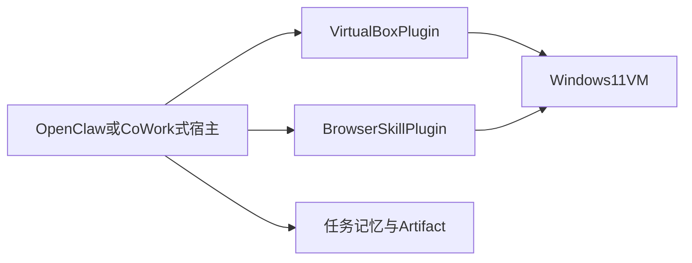

#### 技术栈

- OpenClaw/CoWork-OS/Cua 式 runtime；
- VM plugin；
- BrowserSkill/Playwright skill；
- 本地模型；
- 宿主任务、记忆、权限和 Artifact UI。

#### 登录态

取决于 browser skill；使用 BrowserSkill 时可复用，使用 managed browser 时需专用 profile。

#### 控制与读取

双站流程仍必须做成固定 workflow/skill，不能让通用 Agent 自由调用所有宿主和 VM 能力。

#### 恢复

宿主可复用 task/checkpoint，但 submission attempt、vm_epoch 和 provider lease 仍需领域实现。

#### 资源

宿主平台、插件、VM、浏览器和模型同时运行，内存/磁盘/升级成本最大。

#### 封号风险

由底层浏览器路径决定；完整宿主不会自动降低风险。工具面过大反而增加误操作面。

#### 优点

- 完整任务 UI；
- 记忆、权限、技能、Artifact；
- 易扩展更多工作流；
- 多设备/消息入口潜力；
- 产品形态成熟。

#### 缺点

- 首版过重；
- 升级和供应链面大；
- VirtualBox bridge 仍需自研；
- 领域 FSM 仍不可省；
- 通用抽象可能掩盖提交细节。

#### 适用

目标是长期个人 Agent 平台。

#### 不适用

只解决当前双站问题。

### 7.9 方案 I：推荐混合方案

#### 架构

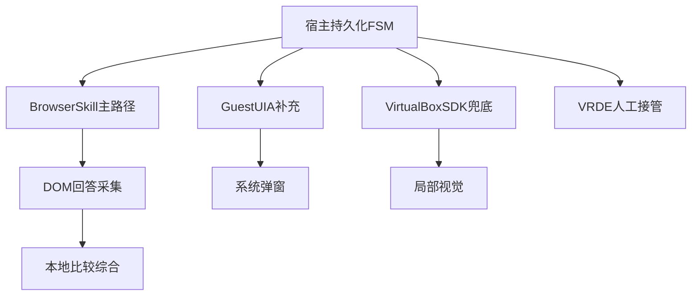

#### 控制与读取

- 网页：BrowserSkill；
- 系统 UI：UIA；
- 像素异常：Main API + 本地视觉；
- 用户操作：VRDE；
- 回答：DOM，网络流可选见证；
- 状态：宿主 SQLite FSM。

#### 登录态

复用 VM 内当前 profile，不复制 Cookie；VRDE 完成人工登录。

#### 恢复

- vm_epoch；
- 双层租约；
- transport 重绑；
- submission reconcile；
- DOM/UIA/视觉逐级降级；
- 人工接管；
- 宿主 Artifact 不随快照回滚。

#### 资源

正常路径开销低；UIA/VLM 按需。组件较多，但各自职责窄。

#### 封号风险

相对最低：动作尽量少、真实网页/profile、验证人工处理、未知提交不重试。仍无封号保证。

#### 优点

- 登录态、完整度、接管和恢复最均衡；
- 结构化主路径；
- 系统 UI 和未知页面有 fallback；
- 宿主业务状态独立于 VM；
- 可分阶段建设；
- 测试通道可替换。

#### 缺点

- 组件和协议最多；
- 版本兼容矩阵；
- UIA/视觉路径需独立测试；
- 初始设计工作高于单框架 PoC；
- BrowserSkill 仍是年轻依赖。

#### 适用

长期私人稳定使用，是最终推荐。

#### 不适用

只想用一天做一次演示；此时方案 G 更快。

---

## 8. 加权比较

### 8.1 硬约束

先检查不可被分数补偿的约束：

- H1：宿主运行本地模型和业务状态；
- H2：Windows 11 VM 承载 UI/浏览器；
- H3：使用已登录千问和元宝网页；
- H4：最终结果回宿主；
- H5：未知提交不重试；
- H6：验证码/MFA 人工处理；
- H7：不把 Cookie 同步到云浏览器。

所有方案理论上可满足 H1–H7，但 A/B/C 的回答完整性和提交证据需要接受显著降级。

### 8.2 指标和权重

| 指标 | 权重 | 高分含义 |
|---|---:|---|
| 登录态连续性 | 15% | 复用稳定 VM/profile |
| 封号相对风险 | 14% | 低动作、低误操作、身份稳定 |
| 跨 VM 可靠性 | 14% | 断线、重启、回滚可恢复 |
| 回答完整度 | 14% | 代码/表格/引用/长回答 |
| 提交安全/恢复 | 12% | 防重、对账、fencing |
| 人工接管 | 10% | 可见、可暂停、可归还 |
| 可测试性 | 8% | fixture、trace、故障注入 |
| 资源/延迟 | 7% | 正常路径开销低 |
| 实现速度 | 6% | 个人可快速落地 |

评分 1–5，属于架构先验，不是目标机器实测。

### 8.3 评分矩阵

| 方案 | 登录 | 风险 | 跨VM | 完整 | 提交 | 接管 | 测试 | 资源 | 速度 | 加权分 |
|---|---:|---:|---:|---:|---:|---:|---:|---:|---:|---:|
| A Main API纯黑盒 | 5.0 | 3.8 | 3.0 | 2.2 | 2.5 | 4.5 | 2.8 | 2.5 | 3.0 | **3.34** |
| B VRDE+Computer Use | 5.0 | 3.6 | 3.2 | 2.0 | 2.5 | 5.0 | 2.5 | 2.3 | 3.5 | **3.35** |
| C UIA Sidecar | 5.0 | 4.0 | 3.8 | 3.0 | 3.3 | 4.5 | 3.5 | 3.6 | 3.3 | **3.84** |
| D Playwright Sidecar | 4.0 | 4.2 | 4.5 | 4.8 | 4.6 | 3.8 | 5.0 | 4.4 | 3.8 | **4.36** |
| E BrowserSkill | 5.0 | 4.5 | 4.4 | 4.7 | 4.5 | 4.8 | 4.2 | 4.4 | 4.3 | **4.58** |
| F agent-browser | 4.1 | 4.1 | 4.3 | 4.6 | 4.5 | 4.0 | 5.0 | 4.1 | 4.1 | **4.31** |
| G browser-use | 4.0 | 3.5 | 3.5 | 4.0 | 3.0 | 4.0 | 3.4 | 2.8 | 4.7 | **3.65** |
| H 完整Agent宿主 | 4.0 | 3.8 | 3.6 | 4.0 | 3.8 | 4.5 | 3.8 | 2.5 | 2.5 | **3.73** |
| I 推荐混合 | 5.0 | 4.6 | 4.7 | 4.9 | 4.8 | 5.0 | 4.8 | 4.2 | 3.2 | **4.68** |

### 8.4 条件化选择

- **最终长期使用**：I；
- **最少组件且复用当前 profile**：E；
- **允许专用 profile、重视测试**：D 或 F；
- **最快验证通用 Agent 价值**：G；
- **禁止扩展/CDP，但允许 helper**：C；
- **guest 内什么都不能安装**：A；
- **远程观察与人工接管优先**：B；
- **目标是个人 Agent 平台**：H。

### 8.5 推荐次序

1. E 做 PoC；
2. 为 E 加宿主 FSM/账本；
3. 加 VRDE 接管；
4. 加 UIA；
5. 加 Main API 视觉 fallback；
6. 用 F/D 构建模拟站回归；
7. 最终形成 I。

### 8.6 淘汰理由

- A 不做主线：正文提取和防重证据不足；
- B 不做主线：远程显示不是结构化自动化协议；
- C 不做主线：UIA 无法完整替代 DOM；
- D 不首选当前 profile：专用 profile 更安全可靠，但需要重新登录；
- F 不首选当前 profile：最强项是测试和专用 session；
- G 不做生产主线：模型循环引入不确定动作；
- H 不做首版：平台复杂度超过问题；
- E 单独不是最终方案：缺 VM/系统 UI/灾难 fallback；
- I 得分最高但不宜一次性全做，应按阶段演进。

---

## 9. VM 身份连续性与封号风险

本文只讨论直接影响账号连续性和系统可用性的风险。任何方案都不能保证不封号。

### 9.1 风险模型

#### 身份变化

- VM UUID 改变；
- 虚拟网卡 MAC 改变；
- VM clone 产生新硬件组合；
- Windows machine ID/用户变化；
- 浏览器 profile 被复制；
- Cookie 在多 VM 同时使用；
- 时区、语言、分辨率突变；
- 公网 IP/地区快速变化；
- snapshot 回到很久以前的登录状态。

#### 行为异常

- 高频提问；
- 极短固定间隔；
- 多 tab/多 VM 并发写同一账号；
- 超时后重复发送；
- 重复 reload/new chat；
- 视觉 Agent 试探式点击；
- 验证页面继续自动操作；
- 私有接口重放；
- 长时间无人值守。

#### 恢复错误

- transport 断开被误判为未提交；
- VM restore 后再次提交；
- 宿主与来宾状态分叉；
- 人工接管后 Agent 使用旧坐标；
- 两个 Orchestrator 持有过期 lease；
- guest 重放旧 RPC。

### 9.2 稳定 VM 身份

生产 VM 建议：

- 固定 VM UUID；
- 固定虚拟网卡 MAC；
- 固定虚拟磁盘；
- 固定 Windows 安装和用户；
- 固定浏览器家族；
- 正常、稳定的浏览器更新节奏；
- 固定语言、时区和区域；
- 单显示器；
- 固定分辨率和 DPI；
- 不频繁 clone/import/export；
- 不把同一 profile 复制到多个 VM。

#### clone 与模板

干净模板用于测试，不用于复制主账号登录态：

- 模板中不登录千问/元宝；
- clone 后生成独立 VM/Windows/browser identity；
- 测试账号与主账号分离；
- 主 VM 不从公共模板反复重建；
- 不在两个 clone 中并发使用同一 Cookie。

### 9.3 网络身份

推荐：

- guest 互联网走 NAT；
- 公网出口与宿主日常网络一致；
- host-only 只做控制；
- 不使用代理池；
- 不频繁切换 VPN/地区；
- DNS、时区和地区尽量一致；
- guest 不桥接到不可信 LAN；
- BrowserSkill WSS 只在 host-only。

VirtualBox NAT 不自动让行为“更像人”；它只是让 guest 共享宿主出口。平台仍可看到账号、IP、浏览器、Cookie 和行为。

### 9.4 浏览器 profile

- 当前登录 profile 只由一个浏览器进程使用；
- BrowserSkill 使用独立 Agent Window；
- 不把 profile 放共享目录；
- 不把 Cookie 导出到宿主模型；
- 不同步到 cloud browser；
- 不让 Playwright 和普通浏览器同时写同一目录；
- profile 备份不作为并行副本；
- 登录失效由用户恢复；
- 扩展列表保持稳定；
- BrowserSkill 更新先在测试 profile 验证。

### 9.5 单账号单写

三个维度同时锁：

1. VM input lease；
2. provider/account lease；
3. submission attempt 状态。

规则：

- 同一账号只有一个 active write；
- 同一 VM 只有一个自动输入 owner；
- 人工接管时禁止 Agent 写；
- lease TTL 到期不等于可重发；
- 两个站可并行读取；
- 前台视觉/UIA动作仍需序列化；
- 另一个宿主实例必须使用更高 fencing token；
- 旧实例迟到命令被 guest 拒绝。

### 9.6 频率与动作预算

以下是保守工程起点，不是平台公开阈值：

| 项目 | 初始建议 |
|---|---:|
| 单 provider 并发提交 | 1 |
| 两个新问题最小间隔 | 30 秒 |
| 单 run 浏览器写动作 | 30 |
| reload 预算 | 1 |
| new chat 预算 | 1 |
| 安全自动重试 | 明确未提交时最多 1 次 |
| 普通回答软超时 | 3 分钟 |
| 搜索/深度思考软超时 | 10 分钟 |
| 初期每日自动任务 | 20 次以内校准 |
| 连续验证/429 | 2 次即长冷却 |

动作风险成本：

| 动作 | 成本 |
|---|---:|
| snapshot/DOM read | 0 |
| 小范围 scroll | 1 |
| fill | 1 |
| 普通 click | 1 |
| new chat | 3 |
| send | 5 |
| reload | 5 |
| snapshot restore | 进入人工恢复 |
| 登录/CAPTCHA/MFA | 禁止自动 |

不靠大幅随机延迟伪装人类。低频、用户发起、动作最少比“人类化轨迹”更重要。

### 9.7 CAPTCHA、MFA 与异常登录

检测来源：

- DOM 文本和 URL；
- iframe/overlay；
- UIA window；
- OCR；
- 网络 401/403；
- 页面 fingerprint 变化；
- BrowserSkill 错误。

处理：

1. 停止所有自动输入；
2. 释放虚拟键；
3. 保留 provider lease；
4. 标记 `HUMAN_TAKEOVER`；
5. 打开/提示 VRDE；
6. 用户手工完成；
7. 用户 Hand Back；
8. 重新检查 user session、tab、URL、登录状态；
9. 对账 submission；
10. 安全后继续。

不实现：

- OCR 解验证码；
- 滑块轨迹；
- 第三方打码；
- 自动短信/邮箱验证码；
- 自动 passkey；
- 反复刷新验证页。

### 9.8 429、额度和服务繁忙

分阶段处理：

#### 提交前

- 尊重 Retry-After；
- 没有 Retry-After 时从 15 分钟冷却；
- 冷却结束重新检查页面；
- 不提前排队自动补发。

#### 提交后

- 不重发；
- 尝试读取已有 partial；
- 保存错误和 completion evidence；
- 必要时人工确认。

#### 熔断

- 同 provider 连续 2 次 429：至少 1 小时；
- 一天 3 次 429/验证：到次日；
- 明确账号受限：`MANUAL_ONLY`；
- 数值由实测调整，不能当作允许阈值。

### 9.9 Snapshot 风险

#### 禁止的恢复思路

“失败就恢复快照再跑一次”会产生：

- 服务端已提交但本地回滚；
- Cookie 回到旧轮换状态；
- 浏览器 session 与服务端不一致；
- guest 时间跳变；
- WSS certificate/sequence 回滚；
- guest 重放旧消息；
- 同一 VM identity 出现时间倒退。

#### 安全规则

- snapshot 前先让任务到 terminal/safe checkpoint；
- 运行中含主账号登录态的快照不作自动重试点；
- restore 必须由宿主提高 vm_epoch；
- guest sequence 重新协商；
- 所有非 terminal ProviderRun 进入 reconcile；
- 宿主账本和 Artifact 不回滚；
- restore 后先检查时钟；
- 低频 canary 后才恢复正常；
- 不用快照制造主账号并行分身。

### 9.10 指纹与所谓 stealth

不推荐：

- 随机 UA；
- 随机分辨率；
- Canvas/WebGL 欺骗；
- 字体伪造；
- navigator 属性补丁堆；
- 代理轮换；
- 鼠标轨迹随机化作为核心安全措施；
- 每次新 profile。

原因：

- 身份内部不一致；
- 更新后易失效；
- 产生非正常组合；
- 掩盖真正问题；
- 无法证明降低封号概率；
- 增加动作和维护。

稳定、可见、低频的普通环境优于复杂 stealth。

### 9.11 风险分级

| 等级 | 示例 | 自动化策略 |
|---|---|---|
| R0 | DOM read、answer extract | 自动 |
| R1 | scroll、切 tab、普通开关 | 自动，预算内 |
| R2 | new chat、输入问题 | FSM 审批 |
| R3 | send、reload、取消生成 | 强前置条件与对账 |
| R4 | 登录、授权、文件覆盖 | 人工接管 |
| R5 | CAPTCHA/MFA、账号受限 | 仅人工 |

### 9.12 熔断器

每 provider 独立：

- `CLOSED`：正常；
- `OPEN`：禁止自动写；
- `HALF_OPEN`：一次人工确认 canary；
- `MANUAL_ONLY`：Agent 只读。

触发：

- 未知页面 fingerprint；
- 选择器连续失败；
- CAPTCHA/MFA；
- 429/账号限制；
- 疑似重复提交；
- DOM/网络正文冲突；
- VM/session/profile identity 改变；
- input lease 冲突；
- BrowserSkill 协议不兼容；
- UIA/视觉误点；
- snapshot restore。

恢复：

1. 离线诊断；
2. 更新 SiteSkill；
3. fixture 回归；
4. 模拟站；
5. 测试 profile；
6. 低频 canary；
7. 用户确认；
8. 关闭熔断。

### 9.13 账号事件响应

出现封禁/风控迹象：

1. 停止该 provider 所有自动写；
2. 不清 Cookie；
3. 不换 IP；
4. 不连续登录；
5. 保存脱敏时间线；
6. 用户经普通浏览器/VRDE确认账号状态；
7. 等待平台提示时间；
8. 排查重复提交、频率和 VM identity；
9. 只读/手工 canary；
10. 必要时长期 `MANUAL_ONLY`。

---

## 10. 故障恢复设计

### 10.1 故障分层

| 层 | 故障 | 第一动作 |
|---|---|---|
| UI | 来宾 UI 关闭 | 任务继续，重连重放 |
| RPC | host-only 断开 | 冻结写，等待/重连 |
| GuestBridge | 进程崩溃 | Guest Control 重启 |
| BrowserSkill | WSS/daemon 断开 | 重绑并对账 |
| Browser | tab/进程崩溃 | 重启 profile，查历史 |
| Windows | user session 变化 | 新 vm_epoch/接管 |
| VM | pause/save/reboot | 恢复后对账 |
| Snapshot | restore | 全部 run reconcile |
| Website | 429/验证/改版 | 冷却/接管/熔断 |
| Model | OOM/schema 错 | 分块/规则降级 |

### 10.2 恢复阶梯

由轻到重：

1. 重新观察页面；
2. 重新绑定 tab；
3. 重连 BrowserSkill；
4. 重启 guest helper；
5. 重启浏览器；
6. 重新登录；
7. 重启 VM；
8. 恢复快照；
9. 人工恢复。

每一级都先：

- 冻结写；
- 读取宿主账本；
- 检查 attempt effect；
- 重新获取 lease；
- 对账。

不能“恢复越重，就越应该从头重做”。

### 10.3 未知提交处理

必须覆盖：

- 点击瞬间 WSS 断开；
- send 后 VM pause；
- 浏览器崩溃；
- 页面导航；
- 用户接管；
- 429 overlay；
- 网站收到但 DOM 未渲染。

对账证据优先级：

1. 当前对话中的新用户消息；
2. canonical prompt 可见文本；
3. assistant 节点/生成状态；
4. conversation ID/URL；
5. 网络 witness；
6. 历史列表时间/摘要；
7. 用户人工判断。

只有正面证明未提交才允许回到 INPUT。

### 10.4 本地模型失败

- 比较模型 OOM：按主题/blocks 分块；
- schema 错：一次无工具的格式修复；
- 视觉模型失败：UIA/人工接管；
- 模型服务不可用：保留两份原回答；
- 最终综合失败：规则输出共同点/差异骨架；
- 不因模型失败重新发网页问题。

### 10.5 结果降级

| 情况 | 输出 |
|---|---|
| 两站 complete | 完整比较与综合 |
| 一站 complete、一站 partial | 标明不对称证据 |
| 一站失败 | 展示另一站，不假装比较 |
| 两站 partial | 保存原文，谨慎摘要 |
| 两站失败 | 返回故障报告 |
| DOM/network 冲突 | 显示完整性告警 |
| 模型失败 | 原回答 + 规则差异 |

---

## 11. 推荐实现蓝图

### 11.1 最终组合

> BrowserSkill 主路径 + 宿主持久化 FSM + guest UIA + VirtualBox Main API + VRDE + 本地 Qwen3.5。

### 11.2 正常流程

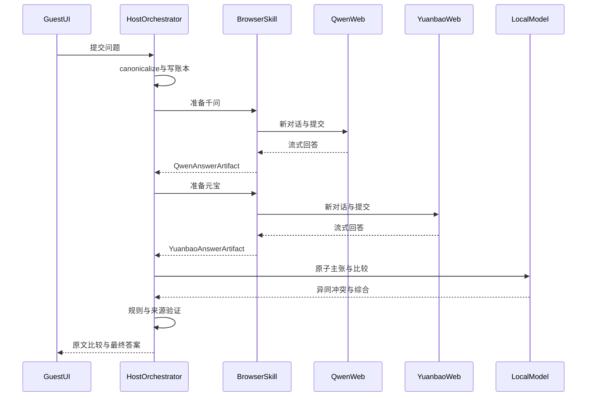

### 11.3 模块边界

建议逻辑目录：

| 模块 | 职责 |
|---|---|
| `host/ui` | 宿主任务、健康和 Artifact |
| `host/orchestrator` | FSM、调度、取消和恢复 |
| `host/ledger` | Job、Run、Attempt、Lease |
| `host/vbox` | Main API、Guest Control、epoch |
| `host/browser_gateway` | BrowserSkill/备选 transport |
| `host/site_skills` | 千问/元宝适配 |
| `host/capture` | DOM/network/Artifact |
| `host/compare` | claims、rules、synthesis |
| `host/model_router` | Ollama/llama.cpp、预算、降级 |
| `guest/ui` | 输入、状态、结果、接管 |
| `guest/bridge` | RPC、心跳、版本、staging |
| `guest/uia_helper` | 受限 Windows UIA |
| `fixtures` | 双站模拟网页 |
| `goldens` | 脱敏 snapshot/Artifact |

这是模块边界，不是要求一次性生成全部项目。

### 11.4 端口和网络原则

- guest Internet：NAT；
- control：host-only；
- BrowserSkill：认证 WSS；
- GuestBridge：mTLS；
- CDP：guest loopback；
- model server：host loopback；
- VRDE：host loopback 或受限管理网；
- Windows Firewall：只允许宿主 host-only 地址；
- 不使用 bridge 作为默认；
- 不开放公网端口。

### 11.5 版本兼容矩阵

至少记录：

- VirtualBox；
- Extension Pack；
- Guest Additions；
- Windows build；
- Chrome/Edge；
- BrowserSkill CLI/daemon/extension；
- GuestBridge/UIA；
- SiteSkill；
- Qwen 模型/量化；
- prompt/schema；
- extractor/comparator。

任何一项大版本变化：

1. fixture；
2. 模拟站；
3. 测试 profile；
4. canary；
5. 主 profile。

---

## 12. 实施路线

### 12.1 Phase 0：实验去风险

目标是回答未知事实，不做完整 UI。

#### E1 VirtualBox framebuffer

- Main API screenshot FPS；
- p50/p95；
- headless/3D/锁屏；
- stale frame。

#### E2 输入

- 绝对鼠标；
- 键盘扫描码；
- 中文；
- focus；
- releaseKeys；
- DPI。

#### E3 宿主—来宾网络

- NAT + host-only；
- WSS/mTLS；
- 网络重连；
- VM pause/resume；
- guestproperty heartbeat。

#### E4 BrowserSkill 远端

- 扩展到宿主 daemon；
- Agent Window；
- tab 借用/归还；
- WSS 断开；
- 版本不匹配。

#### E5 千问/元宝 DOM

- 输入框；
- send；
- 本轮用户消息；
- assistant root；
- 代码/表格/引用；
- 虚拟滚动。

#### E6 完成判断

- 普通回答；
- 搜索；
- 深度思考；
- stop/busy/toolbars；
- 稳定窗。

#### E7 提交故障

- send 前后断 WSS；
- pause VM；
- kill browser；
- snapshot restore；
- reload；
- 429。

#### E8 本地比较

- 9B Q4；
- schema；
- 长回答分块；
- 数字/日期/否定；
- 来源支持。

#### E9 UIA

- 文件选择器；
- 权限弹窗；
- Windows session；
- DPI；
- Browser window identity。

#### E10 账号连续性

- 专用 Agent Window；
- 低频 canary；
- snapshot 后登录态；
- 浏览器更新；
- Guest Additions 更新。

### 12.2 Phase 1：PoC

范围：

- 宿主简单 UI/CLI；
- 来宾简单输入 UI；
- BrowserSkill 远端；
- 串行千问、元宝；
- 普通文本问题；
- DOM 回答；
- 本地比较；
- VRDE 人工登录；
- SQLite 最小账本。

不做：

- UIA；
- 视觉自动动作；
- network canonical；
- 附件；
- 并行；
- snapshot 自动恢复。

退出条件：

- 两站各 20 个代表问题；
- 0 重复提交；
- 回答 block 达目标；
- WSS 断开后安全停止；
- 结果回宿主和来宾 UI。

### 12.3 Phase 2：MVP

- 持久化完整 FSM；
- VM/provider lease；
- vm_epoch；
- unknown-effect reconcile；
- CAPTCHA/429；
- Take Over/Hand Back；
- AnswerArtifact/ComparisonArtifact；
- 宿主 Artifact Store；
- UIA helper；
- 模拟站；
- 故障注入；
- 风险预算。

### 12.4 Phase 3：稳定版

- agent-browser/Playwright 回归通道；
- DOM/network 双采集实验；
- 页面 fingerprint；
- 自动熔断；
- 版本兼容矩阵；
- 完整 trace；
- 资源自适应；
- 双站安全并行；
- SiteSkill 回滚。

### 12.5 Phase 4：平台化

只有出现多个新工作流时：

- OpenClaw/CoWork-OS 集成；
- 多 VM；
- 多 provider；
- 桌面应用；
- 移动端接管；
- 通用 Skill。

---

## 13. 测试与验收

### 13.1 测试金字塔

#### 单元

- canonicalization；
- prompt HMAC；
- RPC sequence；
- fencing；
- state transition；
- cooldown；
- coordinate transform；
- block normalize；
- claim rules；
- Artifact hash。

#### 组件

- VirtualBox Adapter 对 fake API；
- GuestBridge 协议；
- UIA fixture；
- BrowserSkill Transport；
- SiteSkill 对 HTML；
- SSE parser；
- lease takeover；
- snapshot epoch。

#### 模拟站

- 可控流式速度；
- DOM 重建；
- 虚拟滚动；
- 代码/表格/公式；
- 搜索/思考阶段；
- 429；
- CAPTCHA；
- 登录过期；
- submit ack 丢失；
- 相同问题历史；
- DOM/network 冲突。

#### 真实 canary

- 不进 CI；
- 每站一个短问题；
- 用户在场；
- 低频；
- 更新后执行；
- 失败熔断。

### 13.2 故障注入矩阵

| 故障点 | 预期结果 |
|---|---|
| fill 前 GuestBridge 崩溃 | 可安全重启 |
| fill 后 send 前断开 | 回读输入，不自动发送 |
| send 瞬间 WSS 断开 | SUBMISSION_UNKNOWN |
| 生成中 pause VM | 超时暂停计时 |
| 生成中 restore snapshot | vm_epoch 增加并对账 |
| BrowserSkill daemon 重启 | 旧 context 失效 |
| browser kill | profile 重开，查历史 |
| tab 被用户导航 | 停止并重新绑定 |
| VRDE reconnect/resize | 旧坐标作废 |
| Windows user session 切换 | 人工恢复 |
| 429 | 分提交前/后 |
| CAPTCHA | Take Over |
| DOM extractor 失败 | AX/network/人工 |
| 本地模型 OOM | 分块或规则降级 |
| DOM/network 冲突 | Integrity Warning |
| 宿主双实例 | fencing 阻止旧 owner |

### 13.3 Golden Artifacts

每个站点/页面模式保留脱敏：

- 页面 fingerprint；
- pre-submit snapshot；
- post-submit snapshot；
- generating snapshot；
- complete snapshot；
- DOM blocks；
- 可选网络事件；
- AnswerArtifact；
- 状态序列；
- SiteSkill/browser 版本；
- comparison expected labels。

动态 ID、时间和生成 token 先规范化再 diff。

### 13.4 验收问题集

- 短事实；
- 开放建议；
- 多步骤技术；
- 数字和单位；
- 日期/版本；
- 代码；
- 表格；
- 公式；
- 引用链接；
- 长回答；
- 搜索；
- 深度思考；
- 一方拒答；
- 一方 partial；
- 双方矛盾；
- 双方长度极不平衡；
- 包含疑似提示注入的回答。

### 13.5 指标

#### VM/通道

- boot-to-ready；
- heartbeat loss；
- WSS reconnect；
- screenshot latency；
- input-to-frame latency；
- vm_epoch recovery；
- takeover time。

#### 浏览器

- 提交成功率；
- 重复提交率，目标 0；
- unknown effect；
- 平均动作数；
- SiteSkill 熔断；
- tab 误绑定。

#### 回答

- 正文准确率；
- block 顺序；
- 代码/表格/引用；
- complete/partial 分类；
- DOM/network 一致率。

#### 比较

- claim alignment；
- conflict recall；
- source existence；
- semantic support；
- 未披露冲突；
- 新增无来源事实。

#### 风险

- 429；
- CAPTCHA；
- 登录失效；
- VM identity 变化；
- 日提交量；
- 人工接管；
- 熔断。

---

## 14. 可观测性与数据保留

### 14.1 事件

记录：

- job/run/attempt；
- vm_uuid/vm_epoch；
- guest instance/user session；
- lease/fencing；
- 状态迁移；
- transport/SiteSkill/browser 版本；
- page fingerprint；
- 动作类型；
- expect/result；
- completion evidence；
- Artifact hash；
- 模型/量化/耗时；
- 风险/冷却。

不记录：

- Cookie；
- Authorization；
- 密码；
- MFA；
- 完整敏感 header；
- Guest Control 明文密码；
- 全局剪贴板。

### 14.2 建议保留

| 数据 | 默认 |
|---|---|
| 最终回答/比较 | 用户删除前 |
| DOM/AX snapshot | 7 天 |
| screenshot | 3 天 |
| 成功 trace | 1 天 |
| 失败 trace | 7 天 |
| 网络 witness | 脱敏后 7 天 |
| 登录/验证码截图 | 任务结束删除 |
| guest staging | 宿主确认后删除 |

### 14.3 资源预算

#### 宿主

- Orchestrator/SQLite：低；
- BrowserSkill daemon：低；
- Qwen3.5-9B Q4：主要 GPU；
- 视觉模型：按需分时；
- Artifact：按 trace/screenshot 控制；
- VirtualBox：CPU/RAM/虚拟显存。

#### Windows 11 VM 起点

- 4–8 vCPU；
- 8–16GB RAM；
- 128MB 以上虚拟显存，按官方支持；
- 单显示器 1920×1080；
- 100% DPI；
- NAT + host-only；
- Guest Additions；
- 不在 guest 运行大模型。

精确配置由 E1–E10 基准确定。

---

## 15. 术语表

| 术语 | 含义 |
|---|---|
| host | 运行本地模型、编排器和 VirtualBox 的宿主机 |
| guest | VirtualBox 内 Windows 11 |
| framebuffer | VirtualBox 暴露的 VM 显示像素 |
| Main API | VirtualBox COM/XPCOM 公共控制接口 |
| Guest Additions | 来宾驱动与 host/guest 集成功能 |
| Guest Control | host 启动/管理 guest 程序和文件 |
| guestproperty | host/guest 字符串属性通道 |
| VRDE/VRDP | VirtualBox 远程显示扩展/Oracle RDP 实现 |
| Browser Transport | BrowserSkill、Playwright 等浏览器控制层 |
| SiteSkill | 千问/元宝页面专用适配 |
| VM input lease | Agent 与人之间的 VM 输入所有权 |
| provider lease | 单站账号写入所有权 |
| vm_epoch | VM 恢复/身份变化后的单调代次 |
| fencing token | 阻止旧 owner 迟到写入的单调 token |
| canonical prompt | 两站共用的规范问题对象 |
| unknown effect | 无法证明提交生效或未生效 |
| AnswerArtifact | 一站回答及完整性/来源证据 |
| ComparisonArtifact | 异同、冲突、来源与最终综合 |
| Take Over | 用户从 Agent 取得输入权 |
| Hand Back | 用户归还后触发重新观察，不直接续步 |
| canary | 低频、人工观察的真实站点验证 |

---

## 16. 最终决策清单

建议直接确定：

- [x] 模型/FSM/账本在宿主；
- [x] UI/浏览器/登录态在 Windows 11 guest；
- [x] 主浏览器通道 BrowserSkill 远端 WSS；
- [x] 网页采集 DOM/ARIA；
- [x] 系统 UI 用 UIA；
- [x] 像素 fallback 用 VirtualBox Main API；
- [x] 人工接管用 VRDE；
- [x] NAT + host-only 双网卡；
- [x] 宿主 mTLS RPC；
- [x] Guest Control 只做 bootstrap/诊断；
- [x] guestproperty 只做心跳；
- [x] 共享目录只做受限大文件 staging；
- [x] snapshot 外保存业务真相；
- [x] snapshot restore 后强制 reconcile；
- [x] 未知提交不重试；
- [x] CAPTCHA/MFA 人工；
- [x] 单账号单写；
- [x] 本地 Qwen3.5-9B Q4 起步；
- [x] agent-browser/Playwright 做模拟站和回归。

必须用实验确认：

- [ ] BrowserSkill 远端 WSS 在目标 VirtualBox 网络的稳定性；
- [ ] 千问/元宝 DOM anchors；
- [ ] 长回答虚拟滚动完整性；
- [ ] 搜索/思考完成信号；
- [ ] framebuffer/input 延迟；
- [ ] DPI/中文输入；
- [ ] UIA session 行为；
- [ ] VM restore 后登录态和网站对账；
- [ ] 本地 9B 比较准确率；
- [ ] 真实低频使用的 429/验证基线。

最终建议：

> 不要把 VirtualBox 当成网页自动化框架；把它当作隔离、生命周期、像素兜底和人工接管层。网页主路径应由 VM 内 BrowserSkill 提供语义控制，宿主的持久化 FSM 才是业务可靠性的核心。

---

## 17. 官方资料索引

### VirtualBox

- [VirtualBox 7.2 User Manual](https://docs.oracle.com/en/virtualization/virtualbox/7.2/user/)
- [VBoxManage Command Reference](https://docs.oracle.com/en/virtualization/virtualbox/7.2/user/vboxmanage.html)
- [Guest Additions](https://docs.oracle.com/en/virtualization/virtualbox/7.2/user/guestadditions.html)
- [Remote Virtual Machines / VRDP](https://docs.oracle.com/en/virtualization/virtualbox/7.2/user/remotevm.html)
- [Working with VMs / Snapshots](https://docs.oracle.com/en/virtualization/virtualbox/7.2/user/working-with-vms.html)
- [VirtualBox Security Guide](https://docs.oracle.com/en/virtualization/virtualbox/7.2/user/Security.html)
- [Programming Interfaces](https://docs.oracle.com/en/virtualization/virtualbox/7.2/user/customizing-vbox.html)
- [VirtualBox Main API](https://www.virtualbox.org/sdkref/)
- [IDisplay](https://www.virtualbox.org/sdkref/interface_i_display.html)
- [IKeyboard](https://www.virtualbox.org/sdkref/interface_i_keyboard.html)
- [IMouse](https://www.virtualbox.org/sdkref/interface_i_mouse.html)

### 产品与宿主

- [OpenClaw](https://openclaw.ai/)
- [OpenClaw Browser](https://docs.openclaw.ai/tools/browser)
- [OpenClaw Recovery](https://docs.openclaw.ai/gateway/restart-recovery)
- [WorkBuddy](https://www.workbuddy.ai/)
- [Manus Sandbox](https://www.manus.im/blog/manus-sandbox)
- [Manus Cloud Browser](https://www.manus.im/docs/features/cloud-browser)
- [CoWork-OS](https://github.com/CoWork-OS/CoWork-OS)
- [Cua](https://github.com/trycua/cua)

### 浏览器与桌面自动化

- [Tencent BrowserSkill](https://github.com/Tencent/BrowserSkill)
- [BrowserSkill Architecture](https://github.com/Tencent/BrowserSkill/blob/HEAD/docs/architecture.md)
- [agent-browser](https://github.com/vercel-labs/agent-browser)
- [browser-use](https://github.com/browser-use/browser-use)
- [Playwright](https://playwright.dev/)
- [Playwright Actionability](https://playwright.dev/docs/actionability)
- [Chrome Remote Debugging Changes](https://developer.chrome.com/blog/remote-debugging-port)
- [Windows UI Automation](https://learn.microsoft.com/en-us/windows/win32/winauto/entry-uiauto-win32)
- [FlaUI](https://github.com/FlaUI/FlaUI)
- [pywinauto](https://github.com/pywinauto/pywinauto)

### Computer Use 与模型

- [Claude Computer Use](https://docs.anthropic.com/en/docs/agents-and-tools/tool-use/computer-use-tool)
- [UI-Mate](https://github.com/Tencent/UI-Mate)
- [Qwen3.5-9B](https://huggingface.co/Qwen/Qwen3.5-9B)
- [Qwen3-VL-8B-Instruct](https://huggingface.co/Qwen/Qwen3-VL-8B-Instruct)
- [ShowUI](https://github.com/showlab/ShowUI)
- [Ollama](https://docs.ollama.com/windows)
- [llama.cpp](https://github.com/ggml-org/llama.cpp)

### Benchmark

- [OSWorld](https://github.com/xlang-ai/OSWorld)
- [BrowserGym](https://github.com/ServiceNow/BrowserGym)
- [WebArena](https://github.com/web-arena-x/webarena)

### 证据说明

- VirtualBox 接口能力来自 Oracle 手册/Main API；
- 产品定位来自官方产品页或官方仓库；
- 模型能力与 benchmark 若来自模型卡，视为厂商自报；
- 加权分数是针对本需求的架构判断；
- 延迟、FPS、千问/元宝 DOM、封号风险和本地模型成功率均列为待实测；
- 私有网页协议未在本文阶段实测，不写成既定事实。


